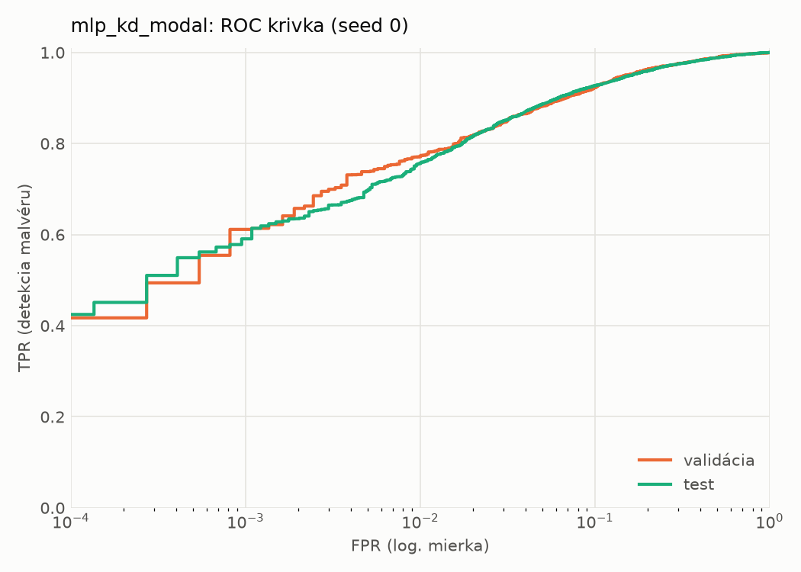
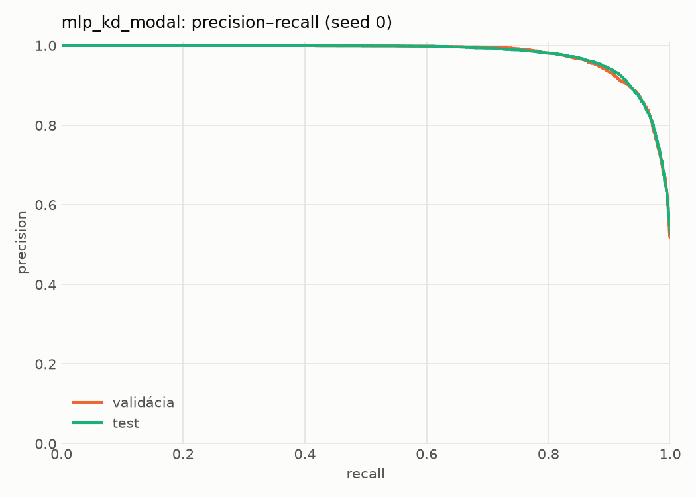
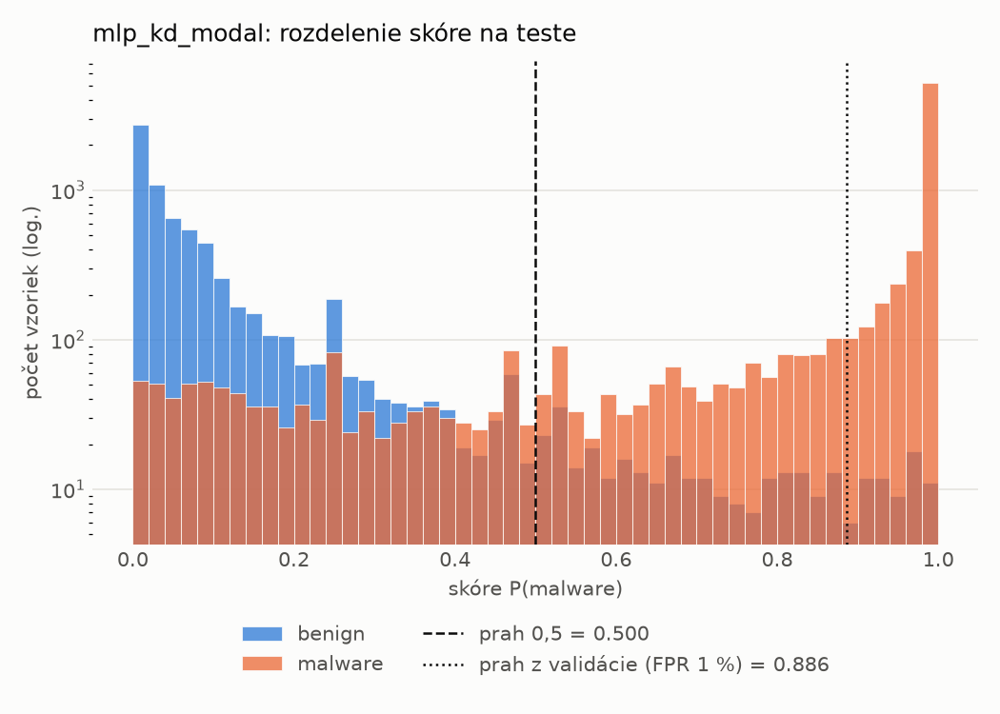
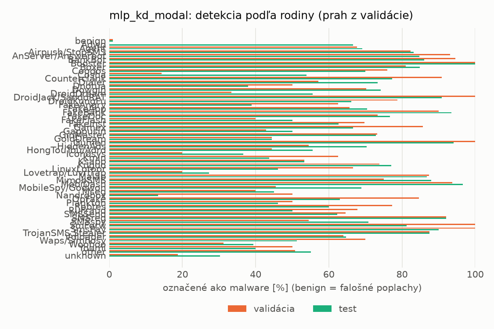
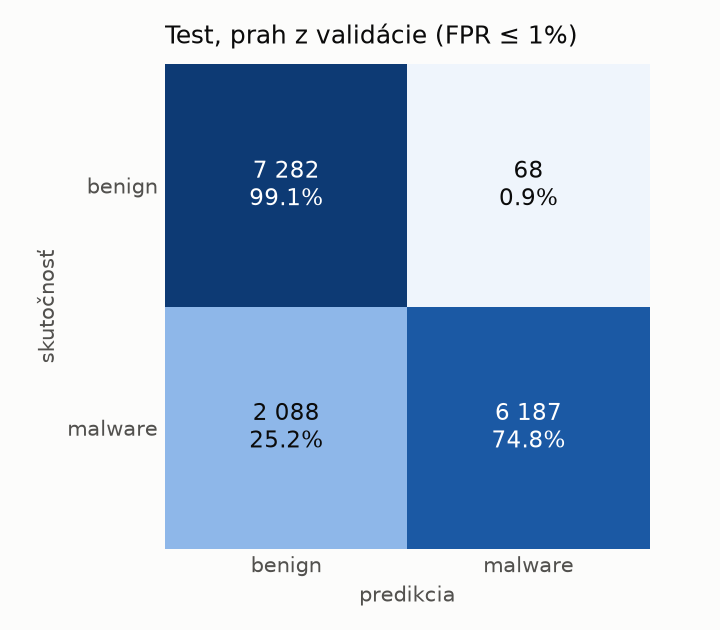
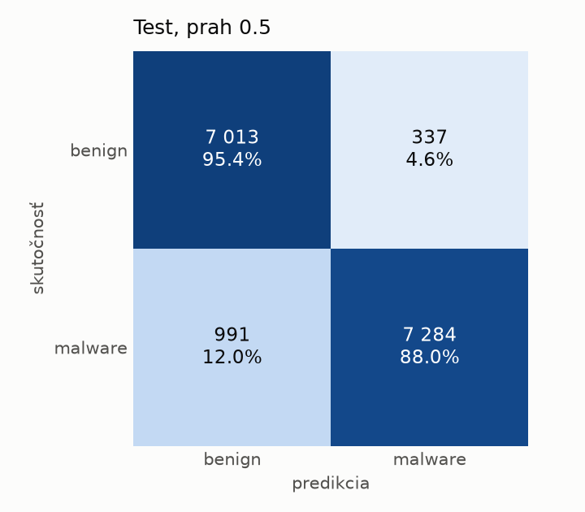
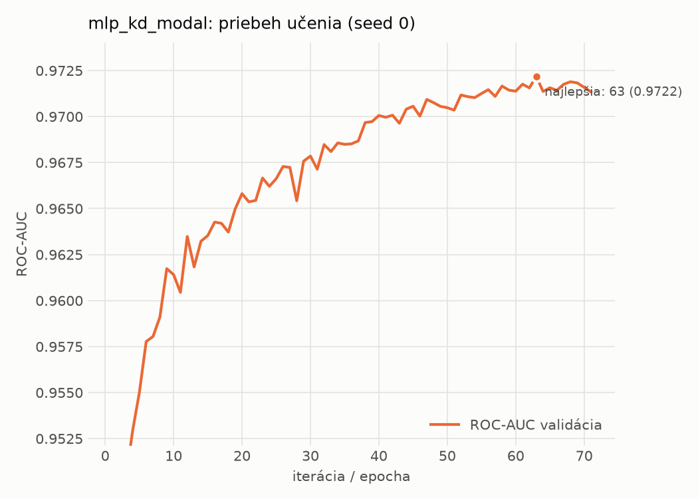

# dynamic/mlp_kd_modal – beh `20261122-224523`

> Automaticky generované (`src/training/run_tabular.py`). Konfigurácia: `config.yaml`, protokol: `protocol.yaml`.

- **Model:** `mlp` – študent – malé MLP učené destiláciou z učiteľa rovnakej modality (variant A)
- **Ladenie:** bez ladenia – hyperparametre prevzaté z `runs_v4/real_full/full/students_dynamic/mlp_kd_modal/20261122-210858`
- **Finálne modely:** seedy [0, 1, 2]; hodnoty sú priemer ± smerodajná odchýlka cez seedy
- **Najlepšie hyperparametre:** `{"hidden_layers": 1, "max_epochs": 100, "patience": 8, "hidden_width": 64, "dropout": 0.014842517384265013, "lr": 0.0018389280483922955, "weight_decay": 7.464279126466132e-05, "batch_size": 512, "kd_alpha": 0.45301900884301544, "kd_temperature": 1.2914074151312493}`

## Detekčná kvalita (bez prahu)
| metrika | train (podvzorka) | validácia | test |
|---|---|---|---|
| ROC-AUC | 0.9761 ± 0.0002 | 0.9720 ± 0.0005 | 0.9717 ± 0.0003 |
| PR-AUC | 0.9808 ± 0.0005 | 0.9781 ± 0.0003 | 0.9785 ± 0.0003 |
| TPR pri FPR 1 % | 0.8073 ± 0.0041 | 0.7740 ± 0.0038 | 0.7608 ± 0.0042 |
| TPR pri FPR 0,1 % | 0.6321 ± 0.0194 | 0.5986 ± 0.0112 | 0.6027 ± 0.0105 |
| log loss | 0.1912 ± 0.0019 | 0.2112 ± 0.0014 | 0.2142 ± 0.0016 |
| Brier skóre | 0.0560 ± 0.0004 | 0.0623 ± 0.0005 | 0.0636 ± 0.0007 |

Rozdiel ROC-AUC train − validácia: **0.0041** (veľký rozdiel = preučenie).

## Pri prahu z validácie (FPR ≤ 1% na validácii)
| metrika | train (podvzorka) | validácia | test |
|---|---|---|---|
| accuracy | 0.8800 ± 0.0023 | 0.8782 ± 0.0020 | 0.8634 ± 0.0018 |
| balanced accuracy | 0.8828 ± 0.0022 | 0.8822 ± 0.0020 | 0.8706 ± 0.0017 |
| precision | 0.9923 ± 0.0006 | 0.9885 ± 0.0002 | 0.9901 ± 0.0008 |
| recall (TPR) | 0.7718 ± 0.0048 | 0.7740 ± 0.0038 | 0.7496 ± 0.0031 |
| FPR | 0.0063 ± 0.0005 | 0.0097 ± 0.0002 | 0.0085 ± 0.0007 |
| F1 | 0.8683 ± 0.0029 | 0.8682 ± 0.0025 | 0.8532 ± 0.0022 |
| MCC | 0.7815 ± 0.0037 | 0.7777 ± 0.0034 | 0.7548 ± 0.0031 |

## Pri pevnom prahu 0.5
| metrika | train (podvzorka) | validácia | test |
|---|---|---|---|
| accuracy | 0.9255 ± 0.0016 | 0.9150 ± 0.0011 | 0.9151 ± 0.0014 |
| balanced accuracy | 0.9263 ± 0.0015 | 0.9158 ± 0.0011 | 0.9171 ± 0.0013 |
| precision | 0.9557 ± 0.0024 | 0.9397 ± 0.0033 | 0.9535 ± 0.0020 |
| recall (TPR) | 0.8962 ± 0.0054 | 0.8933 ± 0.0036 | 0.8826 ± 0.0039 |
| FPR | 0.0437 ± 0.0027 | 0.0617 ± 0.0038 | 0.0484 ± 0.0024 |
| F1 | 0.9250 ± 0.0019 | 0.9159 ± 0.0011 | 0.9167 ± 0.0016 |
| MCC | 0.8530 ± 0.0028 | 0.8312 ± 0.0022 | 0.8329 ± 0.0025 |

## Výpočtové nároky (seed 0, testovacia množina)
| meranie | hodnota |
|---|---|
| tréning finálneho modelu | 14.7 s (priemer cez seedy) |
| ladenie spolu | 0 s |
| počet parametrov / uzlov | 8 641 |
| veľkosť modelu na disku | 0.04 MB |
| transformácia vstupu – latencia (1 vlákno) | 0.015 ms |
| transformácia vstupu – priepustnosť | 741 868 vzoriek/s |
| CPU latencia modelu (batch 1, 1 vlákno) | 0.157 ms (p95 0.167) |
| CPU priepustnosť (24 vlákien) | 9 091 174 vzoriek/s |
| GPU latencia (batch 1) | 0.280 ms (p95 0.316) |
| GPU priepustnosť | 2 895 181 vzoriek/s |
| GPU špičková pamäť | 62 MB |

## Grafy
| | |
|---|---|
|  |  |
|  |  |
|  |  |
|  |  |

## Súbory
`metrics.json` (všetky metriky po seedoch vrátane rodín), `timing.json`, `hpo_trials.csv`,
`predictions/<časť>_seed<N>.parquet` (sha256, family, label, score), `model/seed_<N>/`, `log.txt`.
