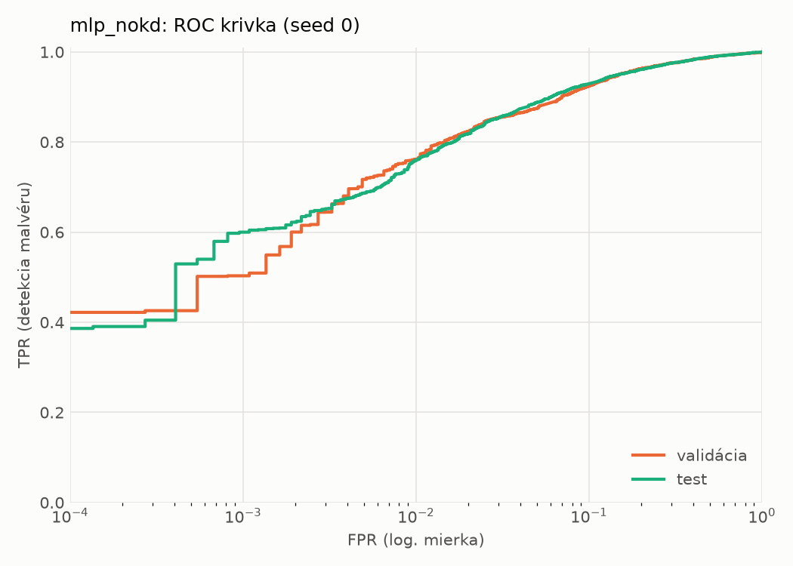
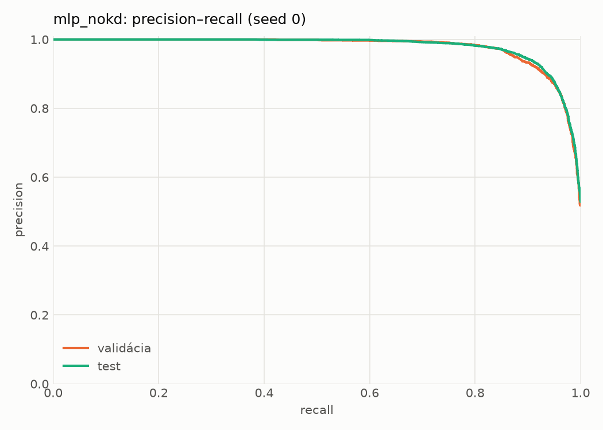
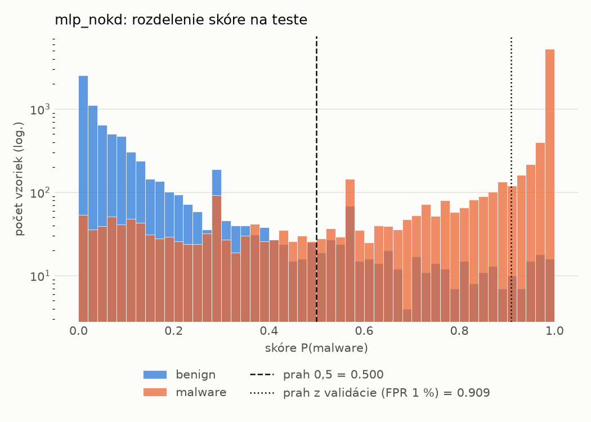
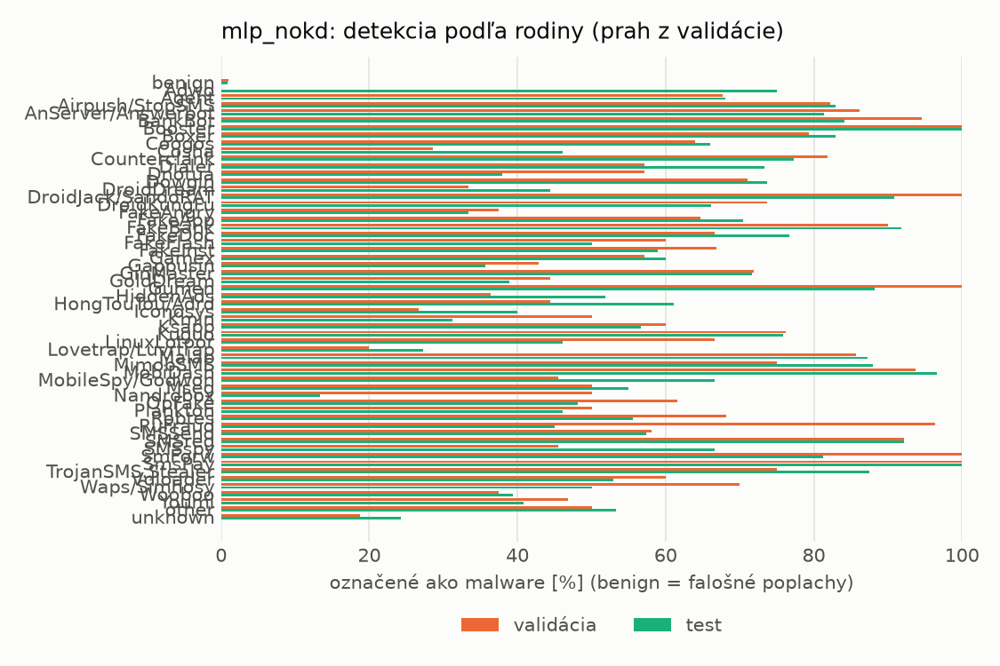
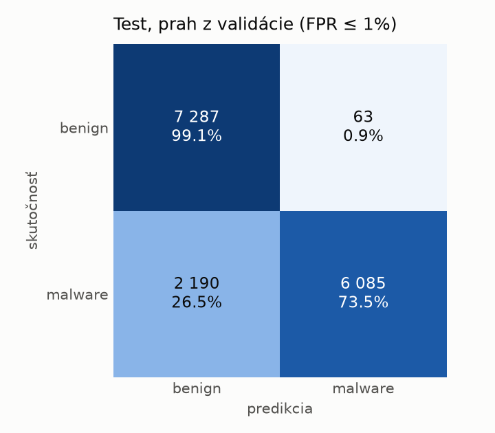
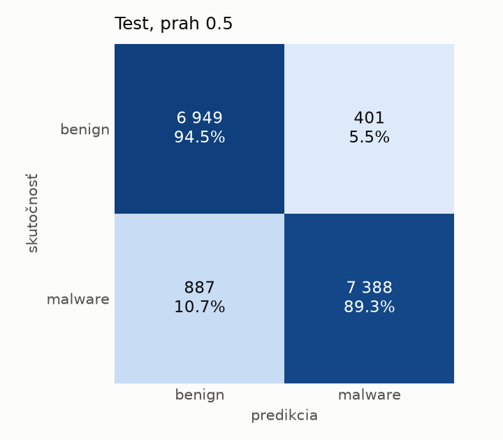
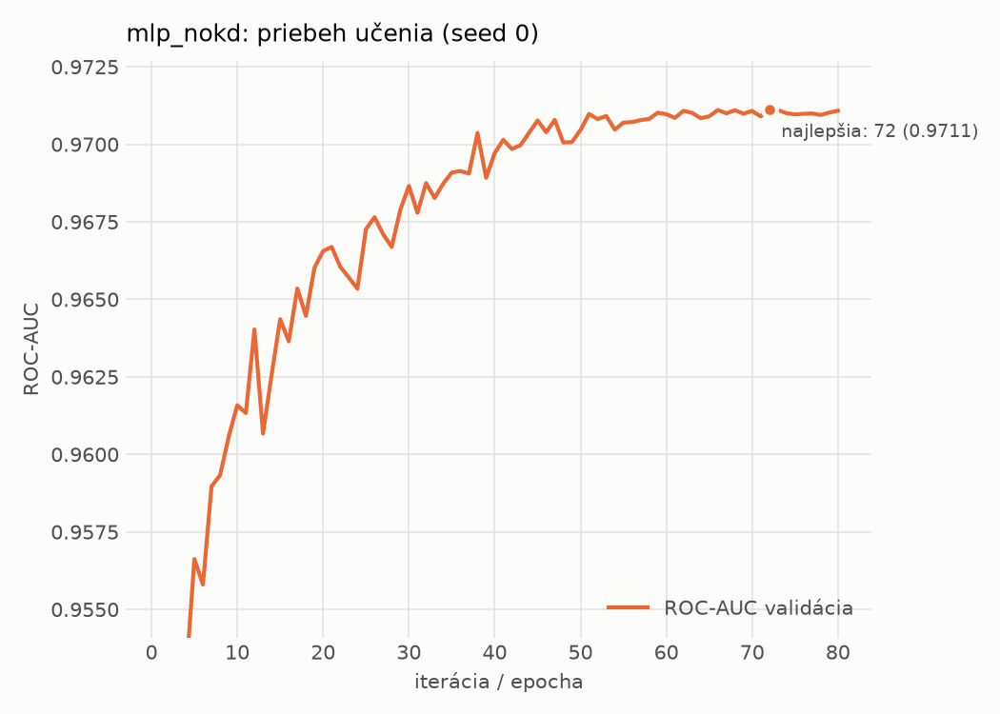

# dynamic/mlp_nokd – beh `20261122-224422`

> Automaticky generované (`src/training/run_tabular.py`). Konfigurácia: `config.yaml`, protokol: `protocol.yaml`.

- **Model:** `mlp` – kontrola – rovnaké malé MLP bez destilácie (iba skutočné označenia)
- **Ladenie:** bez ladenia – hyperparametre prevzaté z `runs_v4/real_full/full/students_dynamic/mlp_nokd/20261122-205917`
- **Finálne modely:** seedy [0, 1, 2]; hodnoty sú priemer ± smerodajná odchýlka cez seedy
- **Najlepšie hyperparametre:** `{"hidden_layers": 1, "max_epochs": 100, "patience": 8, "hidden_width": 64, "dropout": 0.014622282919838341, "lr": 0.0013105433289036465, "weight_decay": 1.7870054646247664e-05, "batch_size": 256}`

## Detekčná kvalita (bez prahu)
| metrika | train (podvzorka) | validácia | test |
|---|---|---|---|
| ROC-AUC | 0.9782 ± 0.0008 | 0.9711 ± 0.0001 | 0.9713 ± 0.0005 |
| PR-AUC | 0.9827 ± 0.0006 | 0.9775 ± 0.0001 | 0.9784 ± 0.0004 |
| TPR pri FPR 1 % | 0.8237 ± 0.0038 | 0.7653 ± 0.0044 | 0.7579 ± 0.0070 |
| TPR pri FPR 0,1 % | 0.6397 ± 0.0135 | 0.5062 ± 0.0229 | 0.5952 ± 0.0189 |
| log loss | 0.1814 ± 0.0036 | 0.2143 ± 0.0013 | 0.2138 ± 0.0013 |
| Brier skóre | 0.0529 ± 0.0013 | 0.0622 ± 0.0002 | 0.0622 ± 0.0006 |

Rozdiel ROC-AUC train − validácia: **0.0070** (veľký rozdiel = preučenie).

## Pri prahu z validácie (FPR ≤ 1% na validácii)
| metrika | train (podvzorka) | validácia | test |
|---|---|---|---|
| accuracy | 0.8786 ± 0.0018 | 0.8736 ± 0.0023 | 0.8584 ± 0.0029 |
| balanced accuracy | 0.8815 ± 0.0017 | 0.8777 ± 0.0022 | 0.8658 ± 0.0027 |
| precision | 0.9941 ± 0.0004 | 0.9882 ± 0.0001 | 0.9900 ± 0.0009 |
| recall (TPR) | 0.7677 ± 0.0033 | 0.7653 ± 0.0044 | 0.7401 ± 0.0049 |
| FPR | 0.0048 ± 0.0003 | 0.0098 ± 0.0000 | 0.0084 ± 0.0008 |
| F1 | 0.8663 ± 0.0022 | 0.8626 ± 0.0028 | 0.8470 ± 0.0035 |
| MCC | 0.7798 ± 0.0030 | 0.7701 ± 0.0037 | 0.7467 ± 0.0048 |

## Pri pevnom prahu 0.5
| metrika | train (podvzorka) | validácia | test |
|---|---|---|---|
| accuracy | 0.9298 ± 0.0013 | 0.9142 ± 0.0016 | 0.9178 ± 0.0010 |
| balanced accuracy | 0.9303 ± 0.0013 | 0.9147 ± 0.0016 | 0.9194 ± 0.0009 |
| precision | 0.9525 ± 0.0020 | 0.9328 ± 0.0027 | 0.9497 ± 0.0016 |
| recall (TPR) | 0.9082 ± 0.0033 | 0.8992 ± 0.0019 | 0.8920 ± 0.0033 |
| FPR | 0.0476 ± 0.0022 | 0.0698 ± 0.0030 | 0.0532 ± 0.0020 |
| F1 | 0.9298 ± 0.0014 | 0.9157 ± 0.0015 | 0.9199 ± 0.0011 |
| MCC | 0.8606 ± 0.0026 | 0.8289 ± 0.0032 | 0.8374 ± 0.0017 |

## Výpočtové nároky (seed 0, testovacia množina)
| meranie | hodnota |
|---|---|
| tréning finálneho modelu | 19.8 s (priemer cez seedy) |
| ladenie spolu | 0 s |
| počet parametrov / uzlov | 8 641 |
| veľkosť modelu na disku | 0.04 MB |
| transformácia vstupu – latencia (1 vlákno) | 0.015 ms |
| transformácia vstupu – priepustnosť | 735 384 vzoriek/s |
| CPU latencia modelu (batch 1, 1 vlákno) | 0.156 ms (p95 0.166) |
| CPU priepustnosť (24 vlákien) | 8 995 912 vzoriek/s |
| GPU latencia (batch 1) | 0.281 ms (p95 0.331) |
| GPU priepustnosť | 2 902 117 vzoriek/s |
| GPU špičková pamäť | 94 MB |

## Grafy
| | |
|---|---|
|  |  |
|  |  |
|  |  |
|  |  |

## Súbory
`metrics.json` (všetky metriky po seedoch vrátane rodín), `timing.json`, `hpo_trials.csv`,
`predictions/<časť>_seed<N>.parquet` (sha256, family, label, score), `model/seed_<N>/`, `log.txt`.
