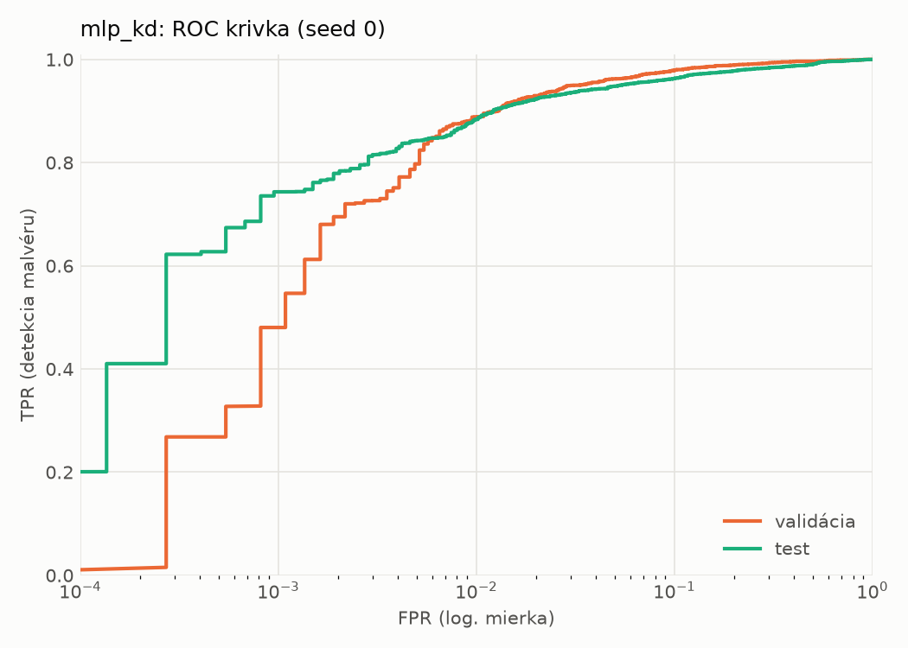
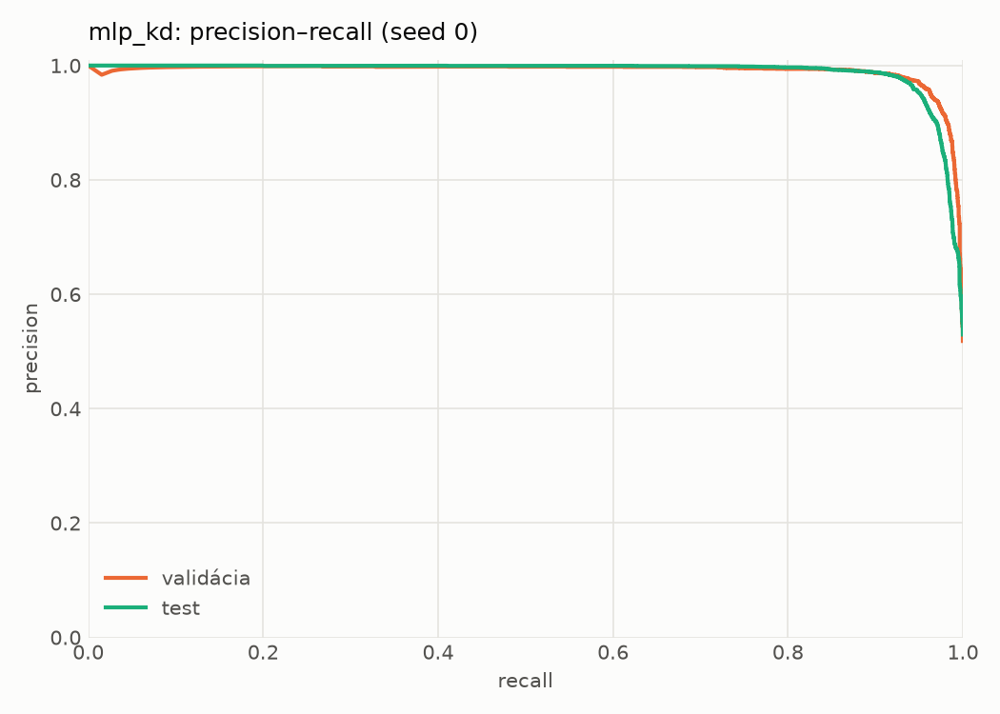
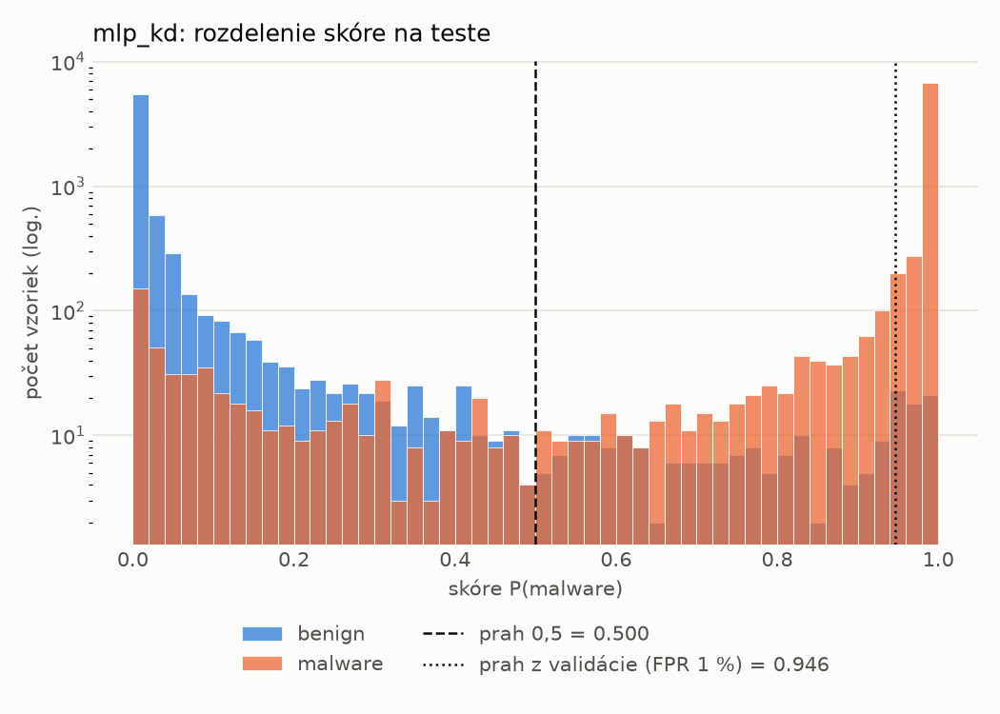
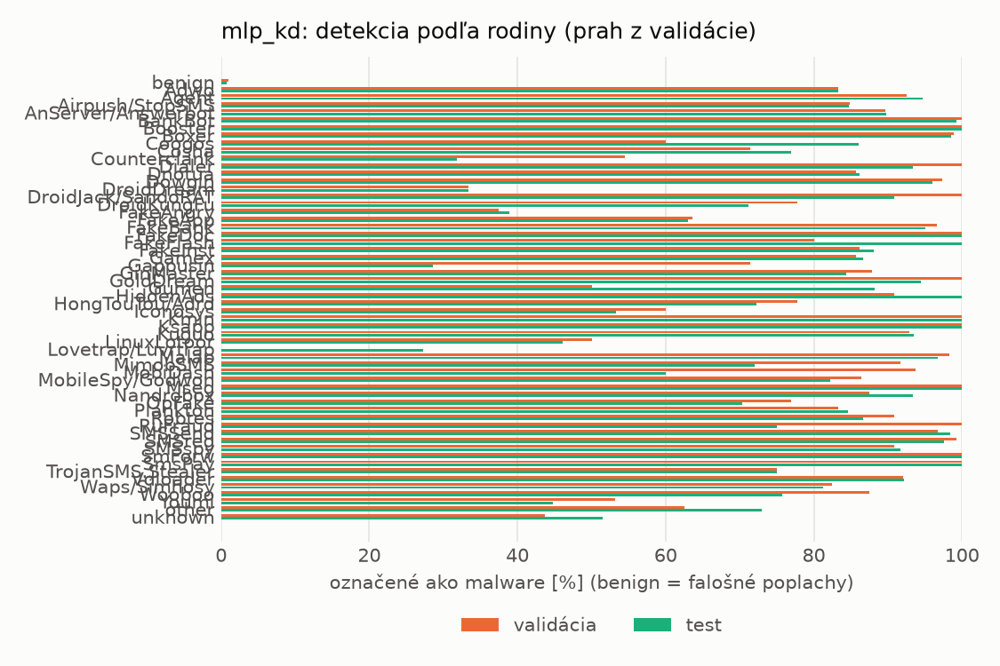
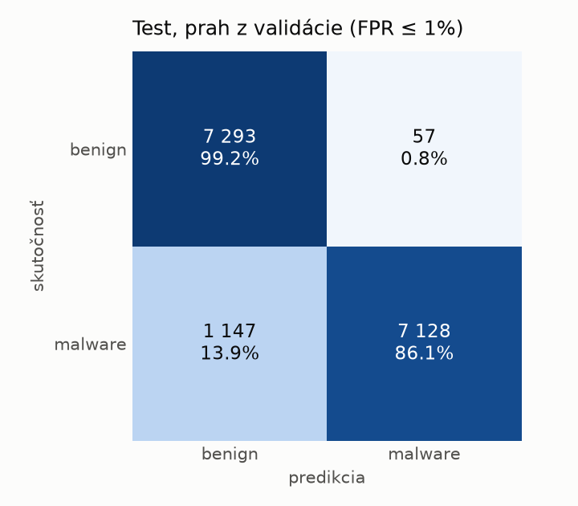
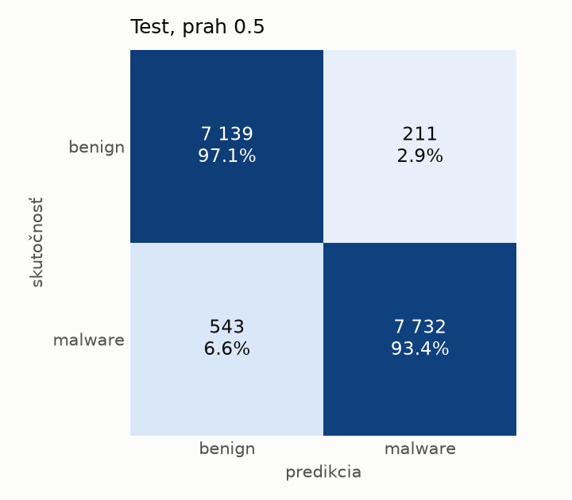
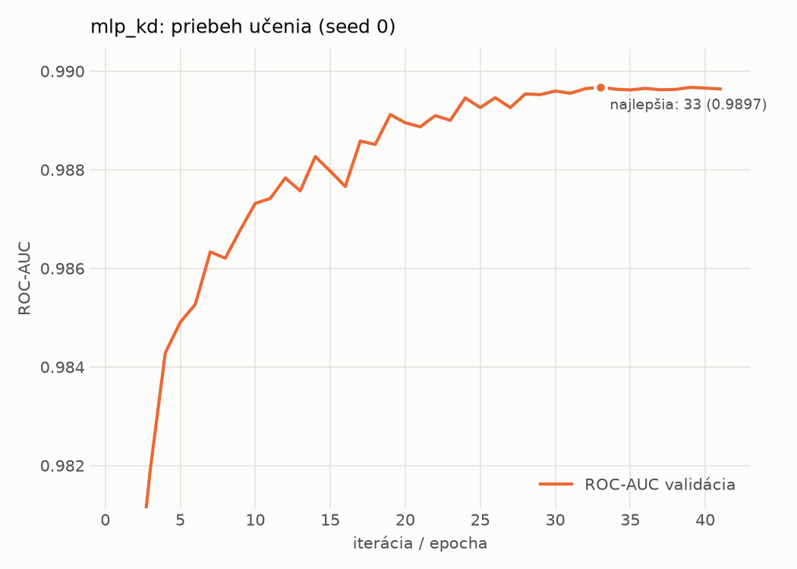

# static/mlp_kd – beh `20261122-224208`

> Automaticky generované (`src/training/run_tabular.py`). Konfigurácia: `config.yaml`, protokol: `protocol.yaml`.

- **Model:** `mlp` – študent – malé MLP učené destiláciou z hybridného učiteľa
- **Ladenie:** bez ladenia – hyperparametre prevzaté z `runs_v4/real_full/full/students_static/mlp_kd/20261122-203423`
- **Finálne modely:** seedy [0, 1, 2]; hodnoty sú priemer ± smerodajná odchýlka cez seedy
- **Najlepšie hyperparametre:** `{"hidden_layers": 1, "max_epochs": 100, "patience": 8, "hidden_width": 64, "dropout": 0.018096880153353218, "lr": 0.002445898909575082, "weight_decay": 6.315937377471515e-05, "batch_size": 1024, "kd_alpha": 0.6461462865023861, "kd_temperature": 1.5048732616232385}`

## Detekčná kvalita (bez prahu)
| metrika | train (podvzorka) | validácia | test |
|---|---|---|---|
| ROC-AUC | 0.9937 ± 0.0004 | 0.9895 ± 0.0002 | 0.9834 ± 0.0017 |
| PR-AUC | 0.9951 ± 0.0003 | 0.9901 ± 0.0004 | 0.9884 ± 0.0009 |
| TPR pri FPR 1 % | 0.9426 ± 0.0027 | 0.8877 ± 0.0035 | 0.8825 ± 0.0032 |
| TPR pri FPR 0,1 % | 0.7516 ± 0.0398 | 0.5047 ± 0.1386 | 0.6943 ± 0.0430 |
| log loss | 0.0886 ± 0.0030 | 0.1298 ± 0.0017 | 0.1654 ± 0.0115 |
| Brier skóre | 0.0230 ± 0.0006 | 0.0331 ± 0.0004 | 0.0399 ± 0.0007 |

Rozdiel ROC-AUC train − validácia: **0.0043** (veľký rozdiel = preučenie).

## Pri prahu z validácie (FPR ≤ 1% na validácii)
| metrika | train (podvzorka) | validácia | test |
|---|---|---|---|
| accuracy | 0.9391 ± 0.0021 | 0.9371 ± 0.0018 | 0.9233 ± 0.0017 |
| balanced accuracy | 0.9405 ± 0.0020 | 0.9390 ± 0.0017 | 0.9272 ± 0.0016 |
| precision | 0.9961 ± 0.0003 | 0.9899 ± 0.0000 | 0.9923 ± 0.0003 |
| recall (TPR) | 0.8845 ± 0.0042 | 0.8877 ± 0.0035 | 0.8618 ± 0.0030 |
| FPR | 0.0036 ± 0.0003 | 0.0098 ± 0.0000 | 0.0075 ± 0.0003 |
| F1 | 0.9370 ± 0.0023 | 0.9360 ± 0.0020 | 0.9225 ± 0.0018 |
| MCC | 0.8842 ± 0.0036 | 0.8795 ± 0.0033 | 0.8556 ± 0.0030 |

## Pri pevnom prahu 0.5
| metrika | train (podvzorka) | validácia | test |
|---|---|---|---|
| accuracy | 0.9707 ± 0.0007 | 0.9578 ± 0.0009 | 0.9513 ± 0.0004 |
| balanced accuracy | 0.9709 ± 0.0006 | 0.9579 ± 0.0009 | 0.9524 ± 0.0004 |
| precision | 0.9794 ± 0.0000 | 0.9642 ± 0.0017 | 0.9725 ± 0.0008 |
| recall (TPR) | 0.9630 ± 0.0013 | 0.9540 ± 0.0029 | 0.9345 ± 0.0006 |
| FPR | 0.0213 ± 0.0000 | 0.0381 ± 0.0020 | 0.0297 ± 0.0009 |
| F1 | 0.9711 ± 0.0007 | 0.9591 ± 0.0009 | 0.9531 ± 0.0004 |
| MCC | 0.9415 ± 0.0013 | 0.9156 ± 0.0018 | 0.9034 ± 0.0009 |

## Výpočtové nároky (seed 0, testovacia množina)
| meranie | hodnota |
|---|---|
| tréning finálneho modelu | 4.3 s (priemer cez seedy) |
| ladenie spolu | 0 s |
| počet parametrov / uzlov | 10 753 |
| veľkosť modelu na disku | 0.05 MB |
| transformácia vstupu – latencia (1 vlákno) | 0.014 ms |
| transformácia vstupu – priepustnosť | 615 153 vzoriek/s |
| CPU latencia modelu (batch 1, 1 vlákno) | 0.155 ms (p95 0.165) |
| CPU priepustnosť (24 vlákien) | 2 914 459 vzoriek/s |
| GPU latencia (batch 1) | 0.472 ms (p95 0.486) |
| GPU priepustnosť | 2 620 677 vzoriek/s |
| GPU špičková pamäť | 72 MB |

## Grafy
| | |
|---|---|
|  |  |
|  |  |
|  |  |
|  |  |

## Súbory
`metrics.json` (všetky metriky po seedoch vrátane rodín), `timing.json`, `hpo_trials.csv`,
`predictions/<časť>_seed<N>.parquet` (sha256, family, label, score), `model/seed_<N>/`, `log.txt`.
