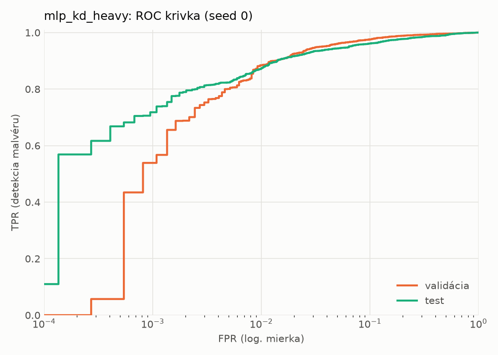
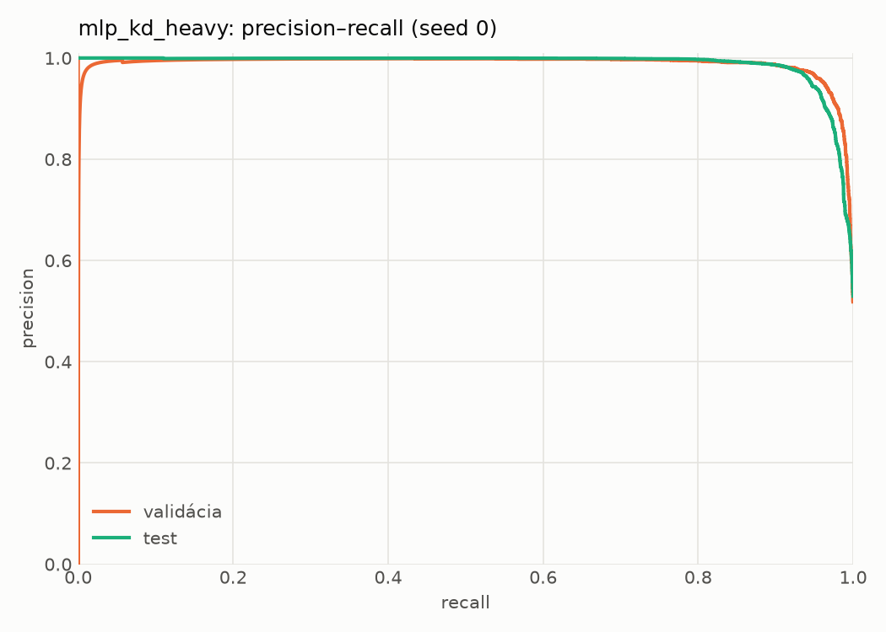
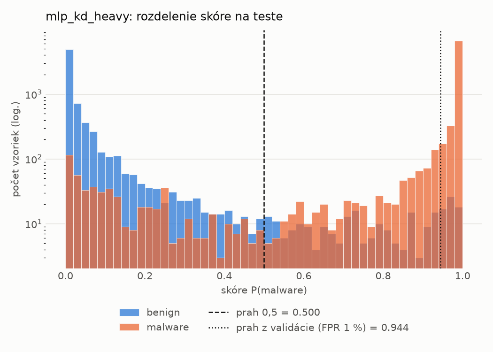
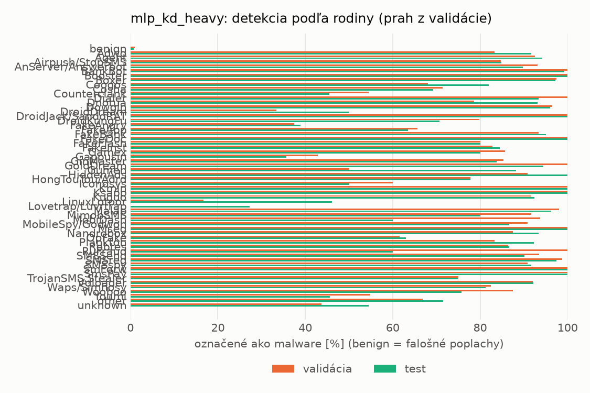
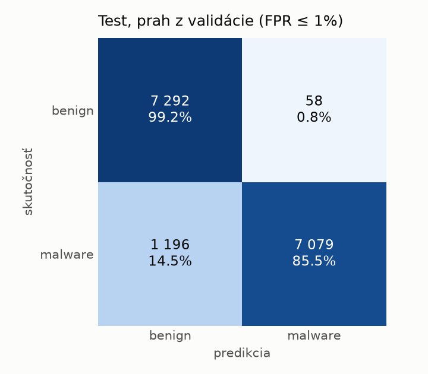
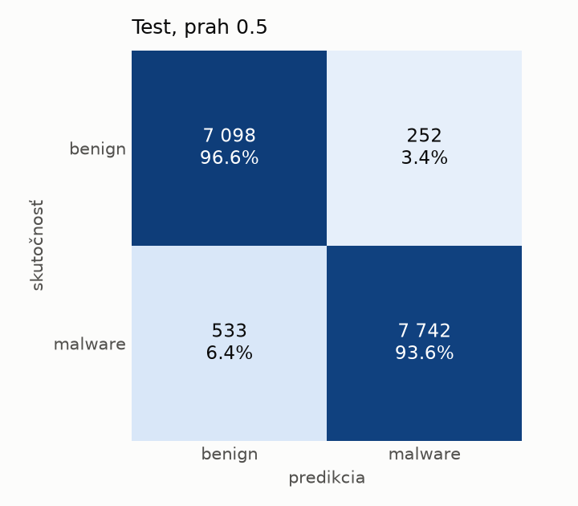
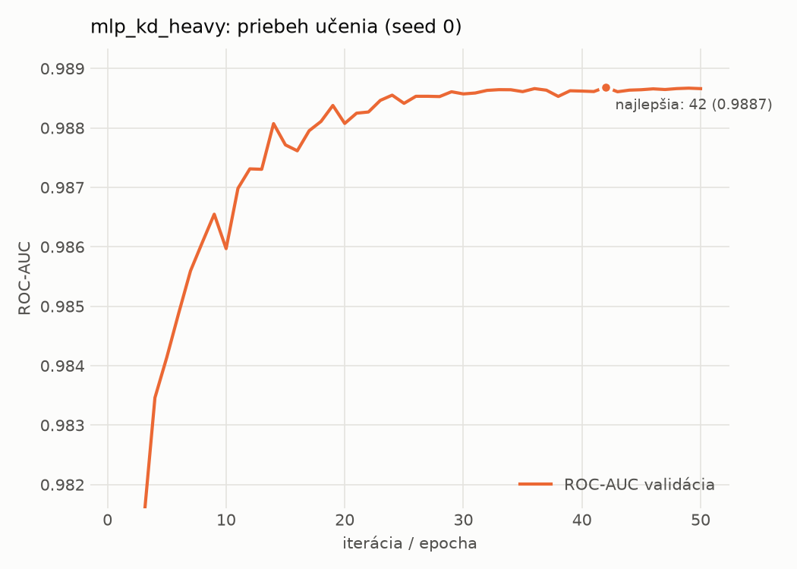

# static/mlp_kd_heavy – beh `20261122-224318`

> Automaticky generované (`src/training/run_tabular.py`). Konfigurácia: `config.yaml`, protokol: `protocol.yaml`.

- **Model:** `mlp` – študent – malé MLP učené destiláciou z mlp_large hybridu (V4)
- **Ladenie:** bez ladenia – hyperparametre prevzaté z `runs_v4/real_full/full/students_static/mlp_kd_heavy/20261122-204855`
- **Finálne modely:** seedy [0, 1, 2]; hodnoty sú priemer ± smerodajná odchýlka cez seedy
- **Najlepšie hyperparametre:** `{"hidden_layers": 1, "max_epochs": 100, "patience": 8, "hidden_width": 64, "dropout": 0.04239795529418809, "lr": 0.0021920597062990285, "weight_decay": 0.0001469802566586536, "batch_size": 1024, "kd_alpha": 0.8931311185241001, "kd_temperature": 5.447798930063548}`

## Detekčná kvalita (bez prahu)
| metrika | train (podvzorka) | validácia | test |
|---|---|---|---|
| ROC-AUC | 0.9934 ± 0.0002 | 0.9885 ± 0.0002 | 0.9845 ± 0.0003 |
| PR-AUC | 0.9948 ± 0.0001 | 0.9890 ± 0.0005 | 0.9888 ± 0.0003 |
| TPR pri FPR 1 % | 0.9314 ± 0.0048 | 0.8746 ± 0.0145 | 0.8749 ± 0.0045 |
| TPR pri FPR 0,1 % | 0.7709 ± 0.0214 | 0.4595 ± 0.0766 | 0.7041 ± 0.0186 |
| log loss | 0.0931 ± 0.0018 | 0.1319 ± 0.0010 | 0.1516 ± 0.0035 |
| Brier skóre | 0.0250 ± 0.0005 | 0.0347 ± 0.0002 | 0.0404 ± 0.0006 |

Rozdiel ROC-AUC train − validácia: **0.0050** (veľký rozdiel = preučenie).

## Pri prahu z validácie (FPR ≤ 1% na validácii)
| metrika | train (podvzorka) | validácia | test |
|---|---|---|---|
| accuracy | 0.9316 ± 0.0058 | 0.9303 ± 0.0075 | 0.9153 ± 0.0048 |
| balanced accuracy | 0.9331 ± 0.0057 | 0.9324 ± 0.0073 | 0.9197 ± 0.0044 |
| precision | 0.9958 ± 0.0008 | 0.9897 ± 0.0002 | 0.9925 ± 0.0012 |
| recall (TPR) | 0.8702 ± 0.0120 | 0.8746 ± 0.0145 | 0.8465 ± 0.0100 |
| FPR | 0.0039 ± 0.0007 | 0.0098 ± 0.0000 | 0.0072 ± 0.0013 |
| F1 | 0.9287 ± 0.0066 | 0.9285 ± 0.0083 | 0.9137 ± 0.0054 |
| MCC | 0.8708 ± 0.0102 | 0.8673 ± 0.0134 | 0.8419 ± 0.0079 |

## Pri pevnom prahu 0.5
| metrika | train (podvzorka) | validácia | test |
|---|---|---|---|
| accuracy | 0.9684 ± 0.0001 | 0.9557 ± 0.0004 | 0.9497 ± 0.0010 |
| balanced accuracy | 0.9685 ± 0.0001 | 0.9557 ± 0.0003 | 0.9505 ± 0.0009 |
| precision | 0.9754 ± 0.0013 | 0.9590 ± 0.0018 | 0.9678 ± 0.0011 |
| recall (TPR) | 0.9626 ± 0.0013 | 0.9553 ± 0.0026 | 0.9362 ± 0.0029 |
| FPR | 0.0255 ± 0.0014 | 0.0440 ± 0.0021 | 0.0351 ± 0.0013 |
| F1 | 0.9690 ± 0.0001 | 0.9571 ± 0.0005 | 0.9517 ± 0.0011 |
| MCC | 0.9369 ± 0.0002 | 0.9112 ± 0.0008 | 0.8997 ± 0.0019 |

## Výpočtové nároky (seed 0, testovacia množina)
| meranie | hodnota |
|---|---|
| tréning finálneho modelu | 3.6 s (priemer cez seedy) |
| ladenie spolu | 0 s |
| počet parametrov / uzlov | 10 753 |
| veľkosť modelu na disku | 0.05 MB |
| transformácia vstupu – latencia (1 vlákno) | 0.014 ms |
| transformácia vstupu – priepustnosť | 625 874 vzoriek/s |
| CPU latencia modelu (batch 1, 1 vlákno) | 0.156 ms (p95 0.166) |
| CPU priepustnosť (24 vlákien) | 2 546 323 vzoriek/s |
| GPU latencia (batch 1) | 0.289 ms (p95 0.310) |
| GPU priepustnosť | 1 911 596 vzoriek/s |
| GPU špičková pamäť | 113 MB |

## Grafy
| | |
|---|---|
|  |  |
|  |  |
|  |  |
|  |  |

## Súbory
`metrics.json` (všetky metriky po seedoch vrátane rodín), `timing.json`, `hpo_trials.csv`,
`predictions/<časť>_seed<N>.parquet` (sha256, family, label, score), `model/seed_<N>/`, `log.txt`.
