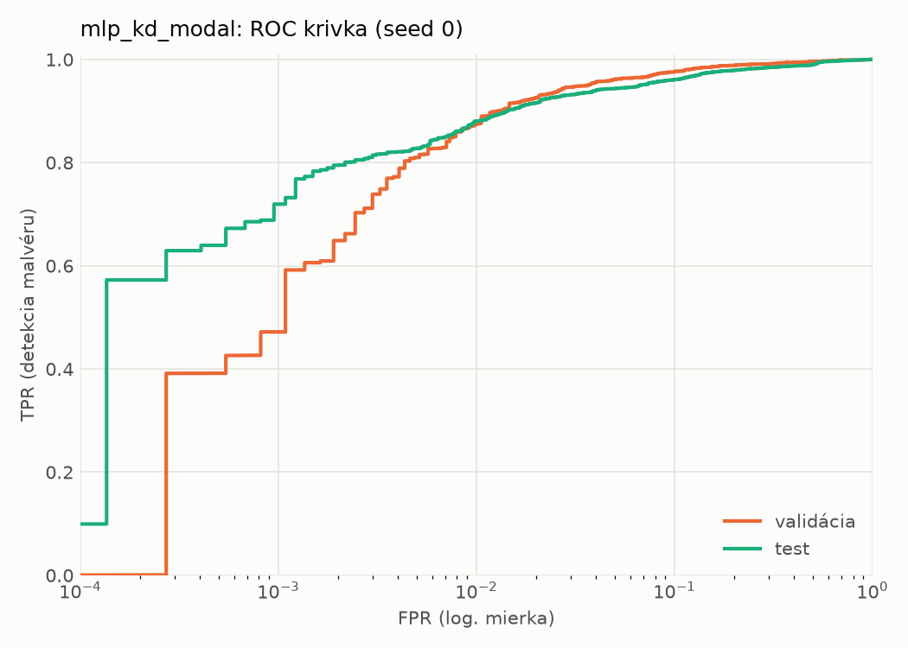
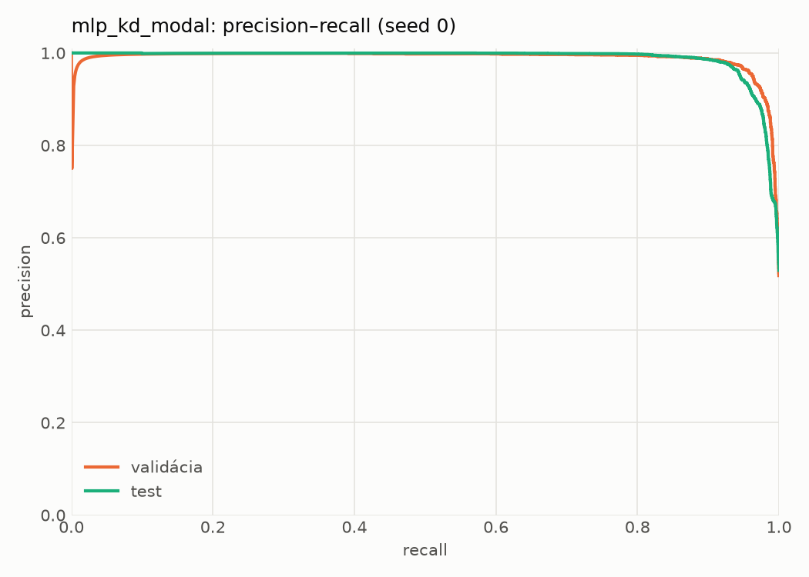
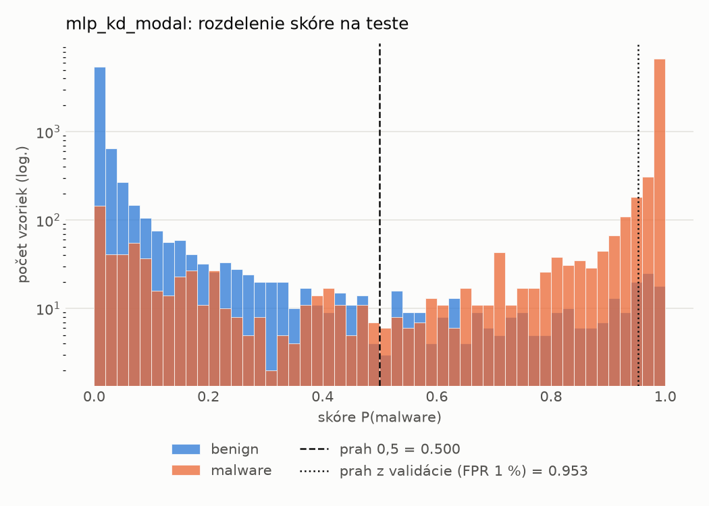
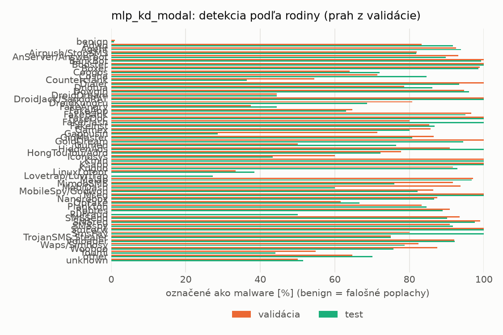
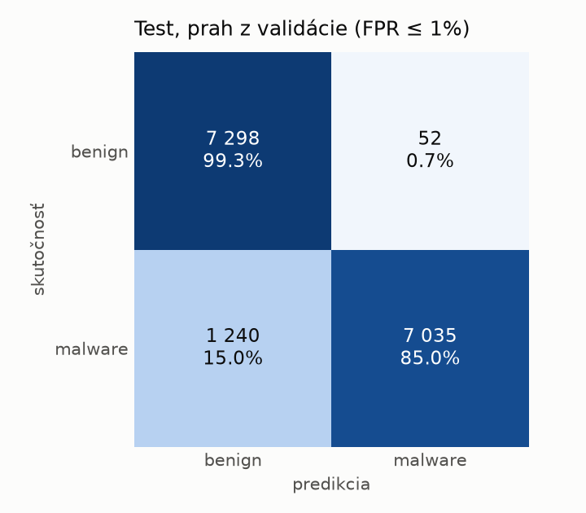
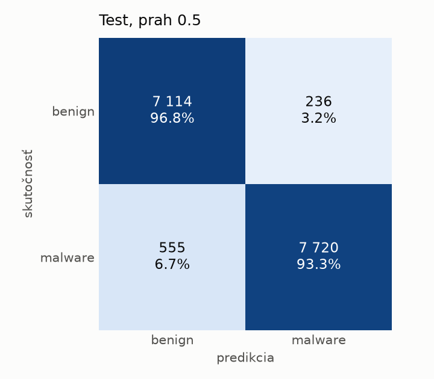
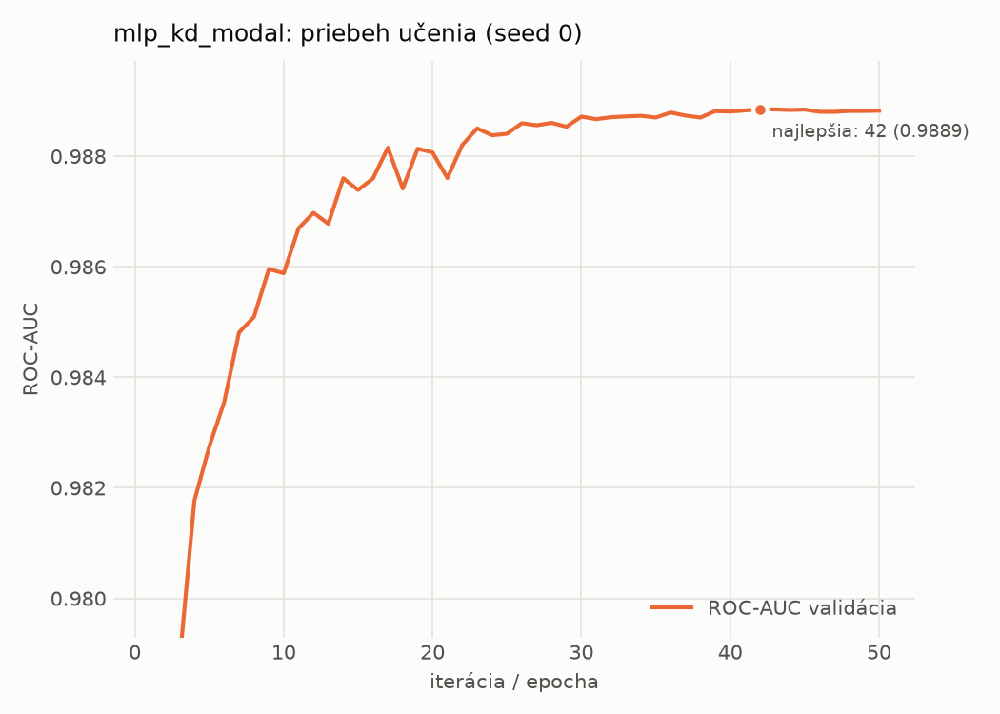

# static/mlp_kd_modal – beh `20261122-224301`

> Automaticky generované (`src/training/run_tabular.py`). Konfigurácia: `config.yaml`, protokol: `protocol.yaml`.

- **Model:** `mlp` – študent – malé MLP učené destiláciou z učiteľa rovnakej modality (variant A)
- **Ladenie:** bez ladenia – hyperparametre prevzaté z `runs_v4/real_full/full/students_static/mlp_kd_modal/20261122-204432`
- **Finálne modely:** seedy [0, 1, 2]; hodnoty sú priemer ± smerodajná odchýlka cez seedy
- **Najlepšie hyperparametre:** `{"hidden_layers": 1, "max_epochs": 100, "patience": 8, "hidden_width": 64, "dropout": 0.005196375734621726, "lr": 0.0014172842807441423, "weight_decay": 1.1835949733056038e-05, "batch_size": 1024, "kd_alpha": 0.5211229932470658, "kd_temperature": 1.6263320735090332}`

## Detekčná kvalita (bez prahu)
| metrika | train (podvzorka) | validácia | test |
|---|---|---|---|
| ROC-AUC | 0.9933 ± 0.0003 | 0.9893 ± 0.0005 | 0.9842 ± 0.0004 |
| PR-AUC | 0.9947 ± 0.0002 | 0.9904 ± 0.0010 | 0.9887 ± 0.0001 |
| TPR pri FPR 1 % | 0.9368 ± 0.0017 | 0.8802 ± 0.0100 | 0.8834 ± 0.0026 |
| TPR pri FPR 0,1 % | 0.7697 ± 0.0306 | 0.5530 ± 0.0705 | 0.7091 ± 0.0221 |
| log loss | 0.0938 ± 0.0020 | 0.1305 ± 0.0025 | 0.1624 ± 0.0020 |
| Brier skóre | 0.0248 ± 0.0006 | 0.0337 ± 0.0004 | 0.0411 ± 0.0002 |

Rozdiel ROC-AUC train − validácia: **0.0040** (veľký rozdiel = preučenie).

## Pri prahu z validácie (FPR ≤ 1% na validácii)
| metrika | train (podvzorka) | validácia | test |
|---|---|---|---|
| accuracy | 0.9343 ± 0.0051 | 0.9332 ± 0.0052 | 0.9200 ± 0.0041 |
| balanced accuracy | 0.9358 ± 0.0050 | 0.9352 ± 0.0050 | 0.9241 ± 0.0038 |
| precision | 0.9959 ± 0.0002 | 0.9898 ± 0.0001 | 0.9927 ± 0.0003 |
| recall (TPR) | 0.8754 ± 0.0101 | 0.8802 ± 0.0100 | 0.8553 ± 0.0079 |
| FPR | 0.0038 ± 0.0002 | 0.0098 ± 0.0000 | 0.0071 ± 0.0003 |
| F1 | 0.9318 ± 0.0057 | 0.9318 ± 0.0056 | 0.9188 ± 0.0045 |
| MCC | 0.8757 ± 0.0091 | 0.8725 ± 0.0093 | 0.8499 ± 0.0070 |

## Pri pevnom prahu 0.5
| metrika | train (podvzorka) | validácia | test |
|---|---|---|---|
| accuracy | 0.9682 ± 0.0015 | 0.9579 ± 0.0007 | 0.9504 ± 0.0012 |
| balanced accuracy | 0.9684 ± 0.0015 | 0.9580 ± 0.0006 | 0.9514 ± 0.0011 |
| precision | 0.9753 ± 0.0016 | 0.9627 ± 0.0016 | 0.9708 ± 0.0006 |
| recall (TPR) | 0.9623 ± 0.0020 | 0.9558 ± 0.0028 | 0.9345 ± 0.0025 |
| FPR | 0.0256 ± 0.0017 | 0.0398 ± 0.0019 | 0.0317 ± 0.0007 |
| F1 | 0.9688 ± 0.0015 | 0.9592 ± 0.0007 | 0.9523 ± 0.0012 |
| MCC | 0.9365 ± 0.0029 | 0.9157 ± 0.0013 | 0.9014 ± 0.0023 |

## Výpočtové nároky (seed 0, testovacia množina)
| meranie | hodnota |
|---|---|
| tréning finálneho modelu | 5.0 s (priemer cez seedy) |
| ladenie spolu | 0 s |
| počet parametrov / uzlov | 10 753 |
| veľkosť modelu na disku | 0.05 MB |
| transformácia vstupu – latencia (1 vlákno) | 0.014 ms |
| transformácia vstupu – priepustnosť | 627 054 vzoriek/s |
| CPU latencia modelu (batch 1, 1 vlákno) | 0.158 ms (p95 0.168) |
| CPU priepustnosť (24 vlákien) | 2 578 043 vzoriek/s |
| GPU latencia (batch 1) | 0.287 ms (p95 0.313) |
| GPU priepustnosť | 1 897 942 vzoriek/s |
| GPU špičková pamäť | 72 MB |

## Grafy
| | |
|---|---|
|  |  |
|  |  |
|  |  |
|  |  |

## Súbory
`metrics.json` (všetky metriky po seedoch vrátane rodín), `timing.json`, `hpo_trials.csv`,
`predictions/<časť>_seed<N>.parquet` (sha256, family, label, score), `model/seed_<N>/`, `log.txt`.
