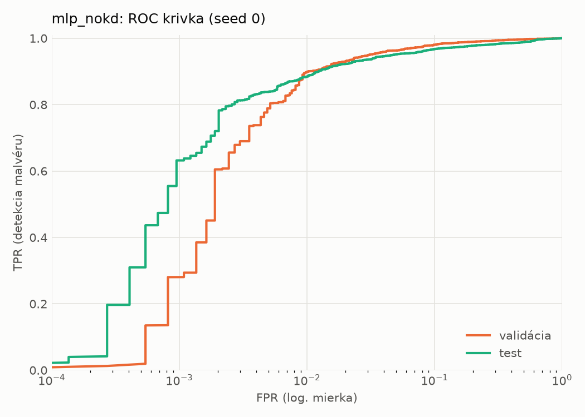
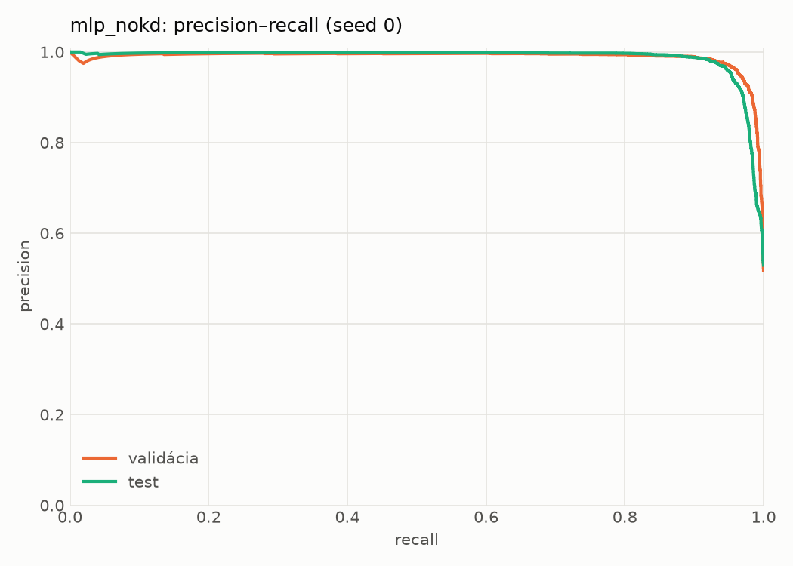
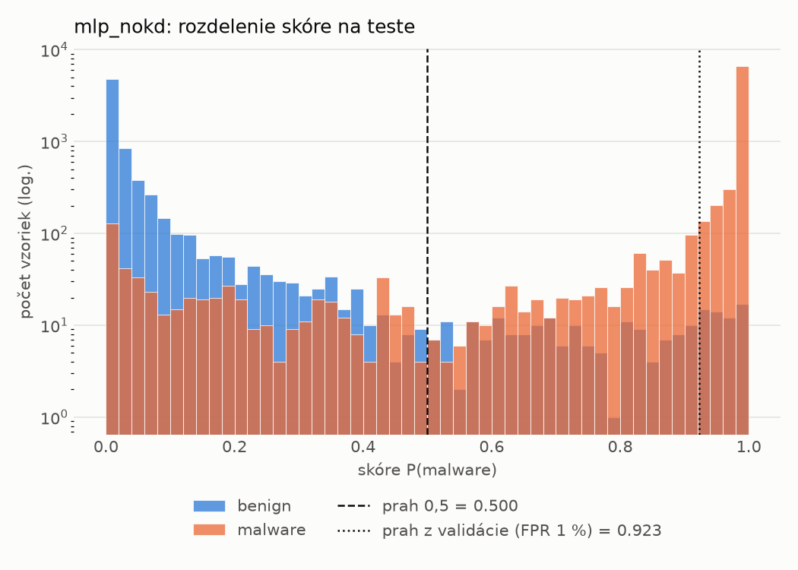
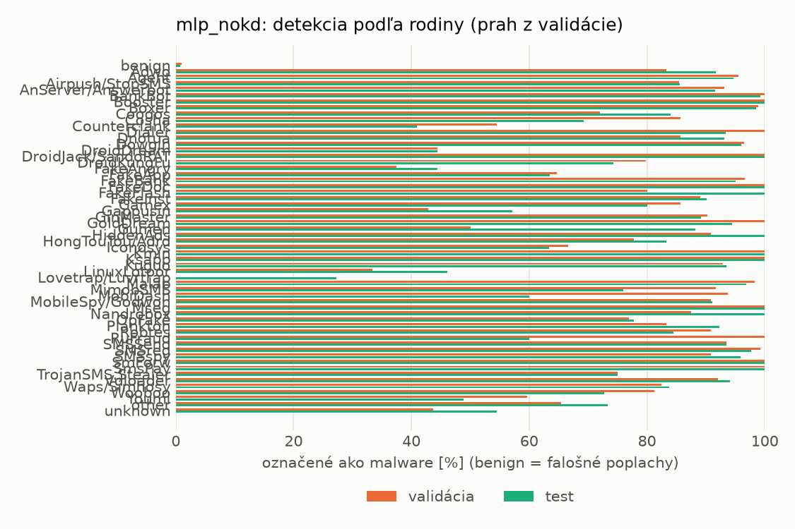
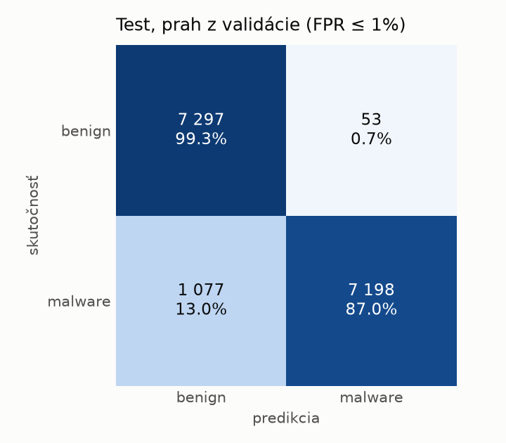
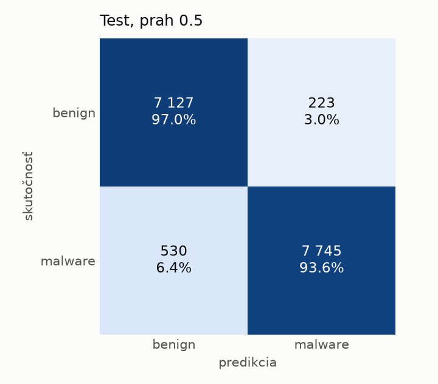
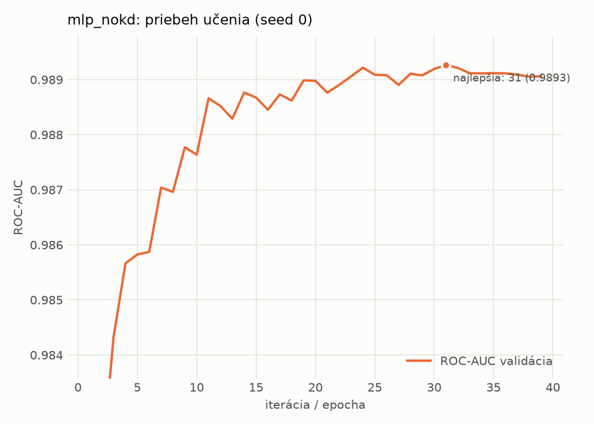

# static/mlp_nokd – beh `20261122-224223`

> Automaticky generované (`src/training/run_tabular.py`). Konfigurácia: `config.yaml`, protokol: `protocol.yaml`.

- **Model:** `mlp` – kontrola – rovnaké malé MLP bez destilácie (iba skutočné označenia)
- **Ladenie:** bez ladenia – hyperparametre prevzaté z `runs_v4/real_full/full/students_static/mlp_nokd/20261122-203844`
- **Finálne modely:** seedy [0, 1, 2]; hodnoty sú priemer ± smerodajná odchýlka cez seedy
- **Najlepšie hyperparametre:** `{"hidden_layers": 1, "max_epochs": 100, "patience": 8, "hidden_width": 64, "dropout": 0.011630579234704915, "lr": 0.0010706598847019353, "weight_decay": 3.845140400781195e-05, "batch_size": 256}`

## Detekčná kvalita (bez prahu)
| metrika | train (podvzorka) | validácia | test |
|---|---|---|---|
| ROC-AUC | 0.9949 ± 0.0005 | 0.9894 ± 0.0004 | 0.9831 ± 0.0004 |
| PR-AUC | 0.9960 ± 0.0003 | 0.9893 ± 0.0007 | 0.9878 ± 0.0003 |
| TPR pri FPR 1 % | 0.9526 ± 0.0027 | 0.8861 ± 0.0101 | 0.8877 ± 0.0027 |
| TPR pri FPR 0,1 % | 0.8164 ± 0.0110 | 0.3077 ± 0.0407 | 0.6100 ± 0.0691 |
| log loss | 0.0801 ± 0.0032 | 0.1244 ± 0.0020 | 0.1532 ± 0.0022 |
| Brier skóre | 0.0212 ± 0.0007 | 0.0320 ± 0.0005 | 0.0383 ± 0.0005 |

Rozdiel ROC-AUC train − validácia: **0.0055** (veľký rozdiel = preučenie).

## Pri prahu z validácie (FPR ≤ 1% na validácii)
| metrika | train (podvzorka) | validácia | test |
|---|---|---|---|
| accuracy | 0.9422 ± 0.0043 | 0.9362 ± 0.0052 | 0.9252 ± 0.0027 |
| balanced accuracy | 0.9435 ± 0.0041 | 0.9381 ± 0.0050 | 0.9290 ± 0.0026 |
| precision | 0.9971 ± 0.0006 | 0.9898 ± 0.0001 | 0.9929 ± 0.0004 |
| recall (TPR) | 0.8898 ± 0.0086 | 0.8861 ± 0.0101 | 0.8649 ± 0.0056 |
| FPR | 0.0027 ± 0.0006 | 0.0098 ± 0.0000 | 0.0069 ± 0.0005 |
| F1 | 0.9404 ± 0.0047 | 0.9351 ± 0.0057 | 0.9245 ± 0.0030 |
| MCC | 0.8901 ± 0.0077 | 0.8780 ± 0.0095 | 0.8590 ± 0.0047 |

## Pri pevnom prahu 0.5
| metrika | train (podvzorka) | validácia | test |
|---|---|---|---|
| accuracy | 0.9736 ± 0.0008 | 0.9595 ± 0.0009 | 0.9531 ± 0.0022 |
| balanced accuracy | 0.9738 ± 0.0008 | 0.9595 ± 0.0008 | 0.9541 ± 0.0022 |
| precision | 0.9823 ± 0.0012 | 0.9644 ± 0.0003 | 0.9733 ± 0.0012 |
| recall (TPR) | 0.9659 ± 0.0012 | 0.9571 ± 0.0017 | 0.9371 ± 0.0034 |
| FPR | 0.0183 ± 0.0013 | 0.0380 ± 0.0003 | 0.0290 ± 0.0013 |
| F1 | 0.9740 ± 0.0008 | 0.9607 ± 0.0009 | 0.9548 ± 0.0022 |
| MCC | 0.9473 ± 0.0016 | 0.9189 ± 0.0017 | 0.9067 ± 0.0044 |

## Výpočtové nároky (seed 0, testovacia množina)
| meranie | hodnota |
|---|---|
| tréning finálneho modelu | 11.9 s (priemer cez seedy) |
| ladenie spolu | 0 s |
| počet parametrov / uzlov | 10 753 |
| veľkosť modelu na disku | 0.05 MB |
| transformácia vstupu – latencia (1 vlákno) | 0.008 ms |
| transformácia vstupu – priepustnosť | 808 128 vzoriek/s |
| CPU latencia modelu (batch 1, 1 vlákno) | 0.085 ms (p95 0.091) |
| CPU priepustnosť (24 vlákien) | 3 289 543 vzoriek/s |
| GPU latencia (batch 1) | 0.279 ms (p95 0.334) |
| GPU priepustnosť | 1 420 132 vzoriek/s |
| GPU špičková pamäť | 113 MB |

## Grafy
| | |
|---|---|
|  |  |
|  |  |
|  |  |
|  |  |

## Súbory
`metrics.json` (všetky metriky po seedoch vrátane rodín), `timing.json`, `hpo_trials.csv`,
`predictions/<časť>_seed<N>.parquet` (sha256, family, label, score), `model/seed_<N>/`, `log.txt`.
