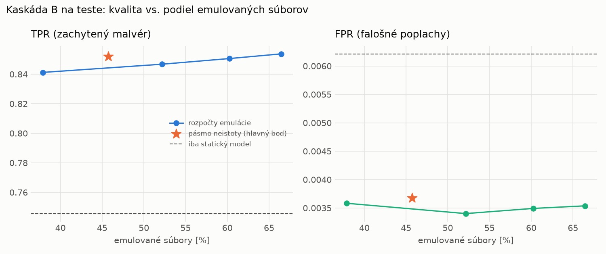

# Kaskáda B `b_baselines` – beh `20261123-224732`

> Generované `src/cascade/evaluate_b.py` (2026-11-23T22:47:32+01:00). Seedy: [0, 1, 2]; hodnoty = priemer ± sm. odchýlka.
> Všetky prahy a pásmo neistoty sú z validácie; test sa na nič nenastavuje. Postup: `docs/09_plan_v2.md`.

| rola | beh |
|---|---|
| static | `runs_v4/real_full/time/static/lightgbm/20261123-223043` |
| dynamic | `runs_v4/real_full/time/dynamic/lightgbm/20261123-223305` |
| hybrid | `runs_v4/real_full/time/hybrid/lightgbm/20261123-223543` |

Druhý stupeň: **dynamic**. Pásmo neistoty statického modelu: FPR ≤ 0.1% nad `hi`,
najviac 1% malvéru validácie pod `lo` (seed 0: lo = 0.0298, hi = 0.9946, seed 1: lo = 0.0253, hi = 0.9951, seed 2: lo = 0.0190, hi = 0.9943).

## Test
| prístup | accuracy | balanced_accuracy | precision | recall_tpr | fpr | f1 | mcc |
|---|---|---|---|---|---|---|---|
| kaskáda B | 0.9030 ± 0.0007 | 0.9242 ± 0.0004 | 0.9977 ± 0.0003 | 0.8520 ± 0.0012 | 0.0037 ± 0.0005 | 0.9191 ± 0.0006 | 0.8154 ± 0.0010 |
| statický | 0.8332 ± 0.0371 | 0.8697 ± 0.0285 | 0.9955 ± 0.0001 | 0.7456 ± 0.0576 | 0.0062 ± 0.0006 | 0.8518 ± 0.0370 | 0.7084 ± 0.0541 |
| dynamický | 0.7628 ± 0.0061 | 0.8146 ± 0.0045 | 0.9923 ± 0.0006 | 0.6383 ± 0.0098 | 0.0091 ± 0.0008 | 0.7768 ± 0.0071 | 0.6100 ± 0.0073 |
| hybrid (každá vzorka) | 0.9231 ± 0.0013 | 0.9389 ± 0.0010 | 0.9954 ± 0.0002 | 0.8853 ± 0.0018 | 0.0075 ± 0.0003 | 0.9371 ± 0.0011 | 0.8487 ± 0.0023 |

- **emulované súbory: 45.74%** (ostatné rozhodne iba statický model); na hybrid ide 18.62% súborov
- chyby pri istom rozhodnutí statického modelu (seed 0): 818
- validácia: emulované 16.96%, na hybrid 3.90%

## Validácia
| prístup | accuracy | balanced_accuracy | precision | recall_tpr | fpr | f1 | mcc |
|---|---|---|---|---|---|---|---|
| kaskáda B | 0.9816 ± 0.0004 | 0.9811 ± 0.0004 | 0.9945 ± 0.0002 | 0.9672 ± 0.0007 | 0.0050 ± 0.0002 | 0.9807 ± 0.0004 | 0.9634 ± 0.0007 |
| statický | 0.9661 ± 0.0007 | 0.9652 ± 0.0008 | 0.9890 ± 0.0002 | 0.9400 ± 0.0016 | 0.0097 ± 0.0002 | 0.9639 ± 0.0008 | 0.9330 ± 0.0014 |
| dynamický | 0.9339 ± 0.0013 | 0.9318 ± 0.0013 | 0.9883 ± 0.0002 | 0.8732 ± 0.0026 | 0.0096 ± 0.0002 | 0.9272 ± 0.0015 | 0.8727 ± 0.0023 |
| hybrid (každá vzorka) | 0.9820 ± 0.0002 | 0.9817 ± 0.0003 | 0.9893 ± 0.0000 | 0.9731 ± 0.0005 | 0.0098 ± 0.0000 | 0.9812 ± 0.0003 | 0.9640 ± 0.0005 |

## Krivka rozpočtu emulácie (test, priemer cez seedy)
| budget_val | emulation_rate | hybrid_rate | recall_tpr | fpr | f1 |
|---|---|---|---|---|---|
| 0.1000 | 0.3788 | 0.1672 | 0.8412 | 0.0036 | 0.9128 |
| 0.2000 | 0.5215 | 0.2147 | 0.8468 | 0.0034 | 0.9161 |
| 0.3000 | 0.6023 | 0.2407 | 0.8506 | 0.0035 | 0.9183 |
| 0.4000 | 0.6644 | 0.2538 | 0.8538 | 0.0035 | 0.9202 |

## Výpočtové nároky
Čas dynamickej analýzy (beh v emulátore alebo na zariadení) dataset neuvádza, preto sa neodhaduje. Úspora kaskády B = podiel súborov s dynamickou analýzou: **45.74%** (ostatné prístupy 100 %).

_Chýba benchmark niektorého komponentu (v zero-day behoch sa nemeria)._

