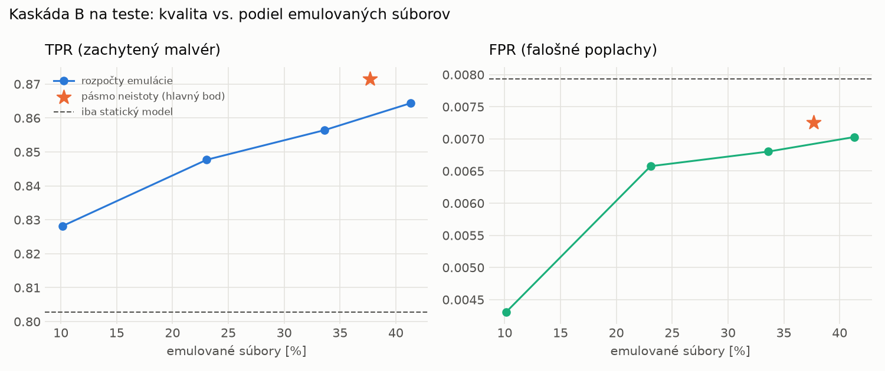

# Kaskáda B `b_direct` – beh `20261123-224728`

> Generované `src/cascade/evaluate_b.py` (2026-11-23T22:47:29+01:00). Seedy: [0, 1, 2]; hodnoty = priemer ± sm. odchýlka.
> Všetky prahy a pásmo neistoty sú z validácie; test sa na nič nenastavuje. Postup: `docs/09_plan_v2.md`.

| rola | beh |
|---|---|
| static | `runs_v4/real_full/time/students_static/mlp_kd/20261123-224256` |
| hybrid | `runs_v4/real_full/time/hybrid/lightgbm/20261123-223543` |

Druhý stupeň: **hybrid**. Pásmo neistoty statického modelu: FPR ≤ 0.1% nad `hi`,
najviac 1% malvéru validácie pod `lo` (seed 0: lo = 0.0203, hi = 0.9993, seed 1: lo = 0.0196, hi = 0.9994, seed 2: lo = 0.0190, hi = 0.9996).

## Test
| prístup | accuracy | balanced_accuracy | precision | recall_tpr | fpr | f1 | mcc |
|---|---|---|---|---|---|---|---|
| kaskáda B | 0.9143 ± 0.0012 | 0.9322 ± 0.0009 | 0.9955 ± 0.0001 | 0.8716 ± 0.0018 | 0.0073 ± 0.0001 | 0.9294 ± 0.0011 | 0.8335 ± 0.0021 |
| statický | 0.8696 ± 0.0150 | 0.8974 ± 0.0112 | 0.9947 ± 0.0011 | 0.8028 ± 0.0242 | 0.0079 ± 0.0019 | 0.8884 ± 0.0143 | 0.7608 ± 0.0226 |
| hybrid (každá vzorka) | 0.9231 ± 0.0013 | 0.9389 ± 0.0010 | 0.9954 ± 0.0002 | 0.8853 ± 0.0018 | 0.0075 ± 0.0003 | 0.9371 ± 0.0011 | 0.8487 ± 0.0023 |

- **emulované súbory: 37.67%** (ostatné rozhodne iba statický model); na hybrid ide 37.67% súborov
- chyby pri istom rozhodnutí statického modelu (seed 0): 497
- validácia: emulované 33.30%, na hybrid 33.30%

## Validácia
| prístup | accuracy | balanced_accuracy | precision | recall_tpr | fpr | f1 | mcc |
|---|---|---|---|---|---|---|---|
| kaskáda B | 0.9813 ± 0.0004 | 0.9810 ± 0.0004 | 0.9893 ± 0.0003 | 0.9718 ± 0.0007 | 0.0098 ± 0.0003 | 0.9805 ± 0.0005 | 0.9627 ± 0.0009 |
| statický | 0.9356 ± 0.0086 | 0.9336 ± 0.0089 | 0.9881 ± 0.0002 | 0.8769 ± 0.0178 | 0.0098 ± 0.0000 | 0.9292 ± 0.0101 | 0.8758 ± 0.0158 |
| hybrid (každá vzorka) | 0.9820 ± 0.0002 | 0.9817 ± 0.0003 | 0.9893 ± 0.0000 | 0.9731 ± 0.0005 | 0.0098 ± 0.0000 | 0.9812 ± 0.0003 | 0.9640 ± 0.0005 |

## Krivka rozpočtu emulácie (test, priemer cez seedy)
| budget_val | emulation_rate | hybrid_rate | recall_tpr | fpr | f1 |
|---|---|---|---|---|---|
| 0.1000 | 0.1014 | 0.1014 | 0.8281 | 0.0043 | 0.9048 |
| 0.2000 | 0.2307 | 0.2307 | 0.8477 | 0.0066 | 0.9158 |
| 0.3000 | 0.3360 | 0.3360 | 0.8564 | 0.0068 | 0.9208 |
| 0.4000 | 0.4131 | 0.4131 | 0.8644 | 0.0070 | 0.9253 |

## Výpočtové nároky
Čas dynamickej analýzy (beh v emulátore alebo na zariadení) dataset neuvádza, preto sa neodhaduje. Úspora kaskády B = podiel súborov s dynamickou analýzou: **37.67%** (ostatné prístupy 100 %).

_Chýba benchmark niektorého komponentu (v zero-day behoch sa nemeria)._

