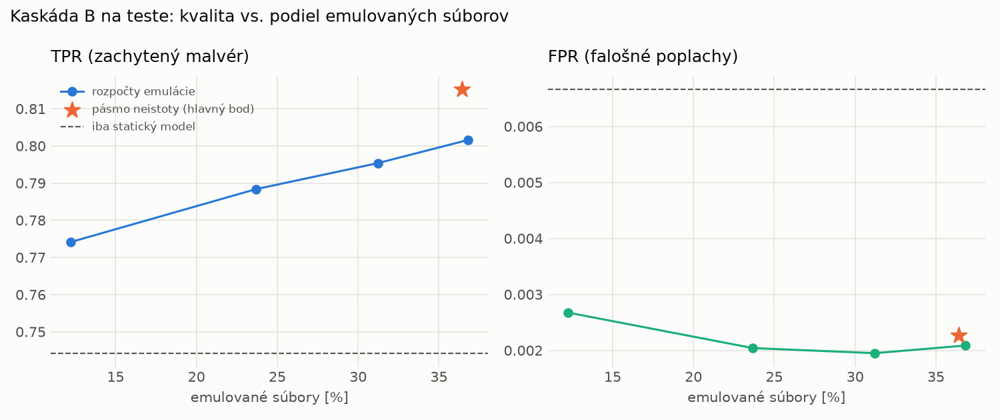

# Kaskáda B `b_heavyteacher` – beh `20261123-224736`

> Generované `src/cascade/evaluate_b.py` (2026-11-23T22:47:36+01:00). Seedy: [0, 1, 2]; hodnoty = priemer ± sm. odchýlka.
> Všetky prahy a pásmo neistoty sú z validácie; test sa na nič nenastavuje. Postup: `docs/09_plan_v2.md`.

| rola | beh |
|---|---|
| static | `runs_v4/real_full/time/students_static/mlp_kd_heavy/20261123-224355` |
| dynamic | `runs_v4/real_full/time/students_dynamic/mlp_kd_heavy/20261123-224558` |
| hybrid | `runs_v4/real_full/time/hybrid/lightgbm/20261123-223543` |

Druhý stupeň: **dynamic**. Pásmo neistoty statického modelu: FPR ≤ 0.1% nad `hi`,
najviac 1% malvéru validácie pod `lo` (seed 0: lo = 0.0296, hi = 0.9984, seed 1: lo = 0.0349, hi = 0.9990, seed 2: lo = 0.0233, hi = 0.9986).

## Test
| prístup | accuracy | balanced_accuracy | precision | recall_tpr | fpr | f1 | mcc |
|---|---|---|---|---|---|---|---|
| kaskáda B | 0.8797 ± 0.0092 | 0.9065 ± 0.0070 | 0.9985 ± 0.0002 | 0.8153 ± 0.0144 | 0.0023 ± 0.0004 | 0.8976 ± 0.0086 | 0.7784 ± 0.0143 |
| statický | 0.8322 ± 0.0228 | 0.8688 ± 0.0173 | 0.9952 ± 0.0006 | 0.7442 ± 0.0358 | 0.0067 ± 0.0012 | 0.8513 ± 0.0230 | 0.7059 ± 0.0325 |
| dynamický | 0.7604 ± 0.0255 | 0.8131 ± 0.0193 | 0.9933 ± 0.0011 | 0.6340 ± 0.0404 | 0.0079 ± 0.0018 | 0.7735 ± 0.0300 | 0.6081 ± 0.0314 |
| hybrid (každá vzorka) | 0.9231 ± 0.0013 | 0.9389 ± 0.0010 | 0.9954 ± 0.0002 | 0.8853 ± 0.0018 | 0.0075 ± 0.0003 | 0.9371 ± 0.0011 | 0.8487 ± 0.0023 |

- **emulované súbory: 36.42%** (ostatné rozhodne iba statický model); na hybrid ide 12.84% súborov
- chyby pri istom rozhodnutí statického modelu (seed 0): 547
- validácia: emulované 31.84%, na hybrid 8.02%

## Validácia
| prístup | accuracy | balanced_accuracy | precision | recall_tpr | fpr | f1 | mcc |
|---|---|---|---|---|---|---|---|
| kaskáda B | 0.9647 ± 0.0028 | 0.9636 ± 0.0029 | 0.9945 ± 0.0007 | 0.9320 ± 0.0053 | 0.0048 ± 0.0006 | 0.9622 ± 0.0031 | 0.9309 ± 0.0053 |
| statický | 0.9283 ± 0.0063 | 0.9260 ± 0.0065 | 0.9881 ± 0.0004 | 0.8617 ± 0.0129 | 0.0097 ± 0.0002 | 0.9205 ± 0.0075 | 0.8624 ± 0.0115 |
| dynamický | 0.8801 ± 0.0070 | 0.8760 ± 0.0073 | 0.9864 ± 0.0003 | 0.7619 ± 0.0145 | 0.0098 ± 0.0000 | 0.8597 ± 0.0094 | 0.7773 ± 0.0120 |
| hybrid (každá vzorka) | 0.9820 ± 0.0002 | 0.9817 ± 0.0003 | 0.9893 ± 0.0000 | 0.9731 ± 0.0005 | 0.0098 ± 0.0000 | 0.9812 ± 0.0003 | 0.9640 ± 0.0005 |

## Krivka rozpočtu emulácie (test, priemer cez seedy)
| budget_val | emulation_rate | hybrid_rate | recall_tpr | fpr | f1 |
|---|---|---|---|---|---|
| 0.1000 | 0.1222 | 0.0577 | 0.7741 | 0.0027 | 0.8718 |
| 0.2000 | 0.2368 | 0.1020 | 0.7884 | 0.0020 | 0.8810 |
| 0.3000 | 0.3122 | 0.1323 | 0.7954 | 0.0020 | 0.8854 |
| 0.4000 | 0.3680 | 0.1540 | 0.8016 | 0.0021 | 0.8892 |

## Výpočtové nároky
Čas dynamickej analýzy (beh v emulátore alebo na zariadení) dataset neuvádza, preto sa neodhaduje. Úspora kaskády B = podiel súborov s dynamickou analýzou: **36.42%** (ostatné prístupy 100 %).

_Chýba benchmark niektorého komponentu (v zero-day behoch sa nemeria)._

