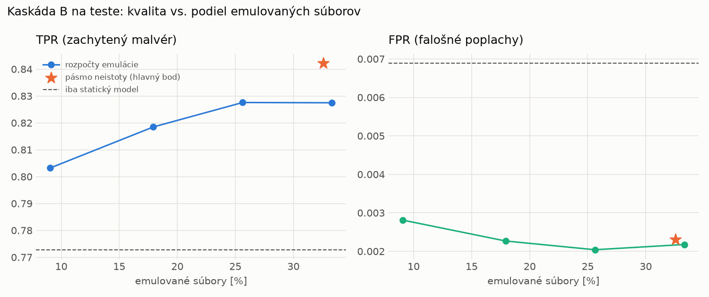

# Kaskáda B `b_nokd` – beh `20261123-224734`

> Generované `src/cascade/evaluate_b.py` (2026-11-23T22:47:34+01:00). Seedy: [0, 1, 2]; hodnoty = priemer ± sm. odchýlka.
> Všetky prahy a pásmo neistoty sú z validácie; test sa na nič nenastavuje. Postup: `docs/09_plan_v2.md`.

| rola | beh |
|---|---|
| static | `runs_v4/real_full/time/students_static/mlp_nokd/20261123-224313` |
| dynamic | `runs_v4/real_full/time/students_dynamic/mlp_nokd/20261123-224443` |
| hybrid | `runs_v4/real_full/time/hybrid/lightgbm/20261123-223543` |

Druhý stupeň: **dynamic**. Pásmo neistoty statického modelu: FPR ≤ 0.1% nad `hi`,
najviac 1% malvéru validácie pod `lo` (seed 0: lo = 0.0461, hi = 0.9988, seed 1: lo = 0.0461, hi = 0.9995, seed 2: lo = 0.0439, hi = 0.9977).

## Test
| prístup | accuracy | balanced_accuracy | precision | recall_tpr | fpr | f1 | mcc |
|---|---|---|---|---|---|---|---|
| kaskáda B | 0.8971 ± 0.0025 | 0.9200 ± 0.0020 | 0.9985 ± 0.0002 | 0.8423 ± 0.0038 | 0.0023 ± 0.0003 | 0.9138 ± 0.0023 | 0.8062 ± 0.0042 |
| statický | 0.8506 ± 0.0081 | 0.8830 ± 0.0066 | 0.9951 ± 0.0012 | 0.7728 ± 0.0116 | 0.0069 ± 0.0016 | 0.8700 ± 0.0078 | 0.7321 ± 0.0127 |
| dynamický | 0.7686 ± 0.0078 | 0.8194 ± 0.0055 | 0.9937 ± 0.0017 | 0.6464 ± 0.0132 | 0.0075 ± 0.0022 | 0.7832 ± 0.0091 | 0.6185 ± 0.0089 |
| hybrid (každá vzorka) | 0.9231 ± 0.0013 | 0.9389 ± 0.0010 | 0.9954 ± 0.0002 | 0.8853 ± 0.0018 | 0.0075 ± 0.0003 | 0.9371 ± 0.0011 | 0.8487 ± 0.0023 |

- **emulované súbory: 32.56%** (ostatné rozhodne iba statický model); na hybrid ide 10.70% súborov
- chyby pri istom rozhodnutí statického modelu (seed 0): 727
- validácia: emulované 35.80%, na hybrid 8.77%

## Validácia
| prístup | accuracy | balanced_accuracy | precision | recall_tpr | fpr | f1 | mcc |
|---|---|---|---|---|---|---|---|
| kaskáda B | 0.9659 ± 0.0008 | 0.9648 ± 0.0009 | 0.9945 ± 0.0002 | 0.9344 ± 0.0019 | 0.0048 ± 0.0002 | 0.9635 ± 0.0009 | 0.9331 ± 0.0016 |
| statický | 0.9295 ± 0.0034 | 0.9273 ± 0.0036 | 0.9881 ± 0.0002 | 0.8643 ± 0.0071 | 0.0097 ± 0.0002 | 0.9220 ± 0.0041 | 0.8647 ± 0.0063 |
| dynamický | 0.8756 ± 0.0062 | 0.8714 ± 0.0065 | 0.9862 ± 0.0002 | 0.7526 ± 0.0129 | 0.0098 ± 0.0000 | 0.8537 ± 0.0084 | 0.7697 ± 0.0107 |
| hybrid (každá vzorka) | 0.9820 ± 0.0002 | 0.9817 ± 0.0003 | 0.9893 ± 0.0000 | 0.9731 ± 0.0005 | 0.0098 ± 0.0000 | 0.9812 ± 0.0003 | 0.9640 ± 0.0005 |

## Krivka rozpočtu emulácie (test, priemer cez seedy)
| budget_val | emulation_rate | hybrid_rate | recall_tpr | fpr | f1 |
|---|---|---|---|---|---|
| 0.1000 | 0.0905 | 0.0404 | 0.8032 | 0.0028 | 0.8901 |
| 0.2000 | 0.1793 | 0.0778 | 0.8185 | 0.0023 | 0.8996 |
| 0.3000 | 0.2563 | 0.0999 | 0.8276 | 0.0020 | 0.9051 |
| 0.4000 | 0.3332 | 0.1222 | 0.8275 | 0.0022 | 0.9050 |

## Výpočtové nároky
Čas dynamickej analýzy (beh v emulátore alebo na zariadení) dataset neuvádza, preto sa neodhaduje. Úspora kaskády B = podiel súborov s dynamickou analýzou: **32.56%** (ostatné prístupy 100 %).

_Chýba benchmark niektorého komponentu (v zero-day behoch sa nemeria)._

