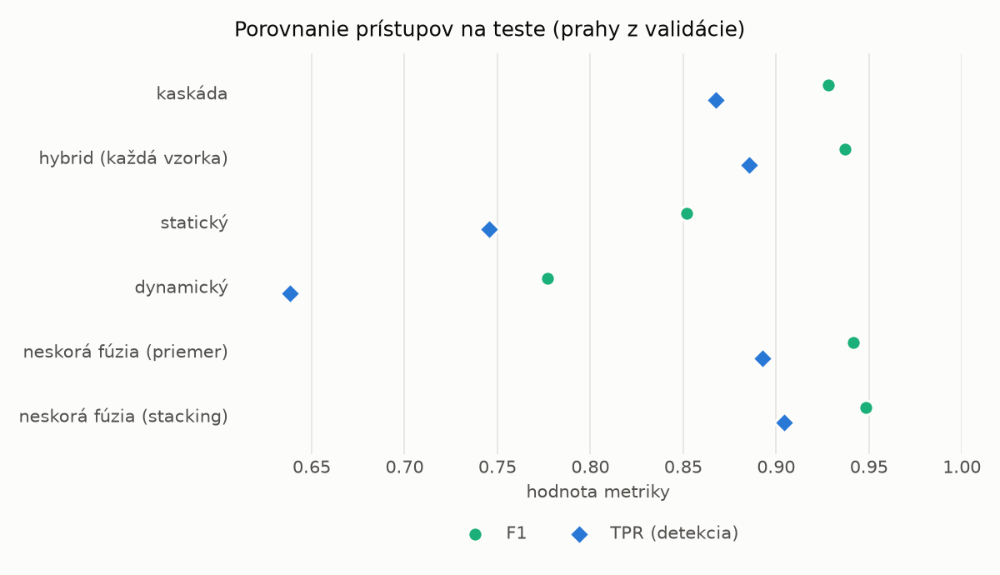
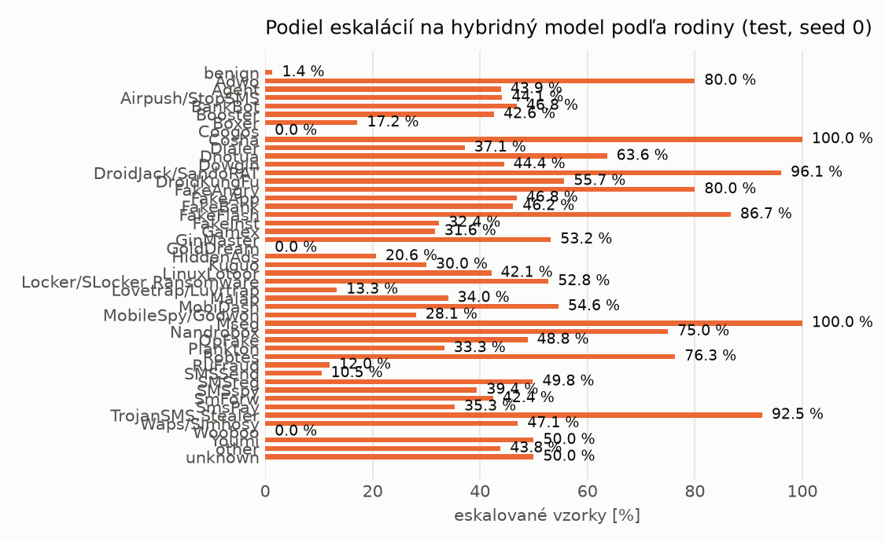

# Kaskáda `baselines` – beh `20261123-224722`

> Generované `src/cascade/evaluate.py` (2026-11-23T22:47:23+01:00). Seedy: [0, 1, 2]; hodnoty = priemer ± sm. odchýlka.
> Všetky prahy sú určené na validácii (FPR ≤ 1 %); test sa na nič nenastavuje.

| rola | beh |
|---|---|
| static | `runs_v4/real_full/time/static/lightgbm/20261123-223043` |
| dynamic | `runs_v4/real_full/time/dynamic/lightgbm/20261123-223305` |
| hybrid | `runs_v4/real_full/time/hybrid/lightgbm/20261123-223543` |

## Test
| prístup | accuracy | balanced_accuracy | precision | recall_tpr | fpr | f1 | mcc |
|---|---|---|---|---|---|---|---|
| kaskáda | 0.9131 ± 0.0003 | 0.9320 ± 0.0002 | 0.9977 ± 0.0003 | 0.8677 ± 0.0006 | 0.0037 ± 0.0005 | 0.9282 ± 0.0003 | 0.8324 ± 0.0005 |
| hybrid (každá vzorka) | 0.9231 ± 0.0013 | 0.9389 ± 0.0010 | 0.9954 ± 0.0002 | 0.8853 ± 0.0018 | 0.0075 ± 0.0003 | 0.9371 ± 0.0011 | 0.8487 ± 0.0023 |
| statický | 0.8332 ± 0.0371 | 0.8697 ± 0.0285 | 0.9955 ± 0.0001 | 0.7456 ± 0.0576 | 0.0062 ± 0.0006 | 0.8518 ± 0.0370 | 0.7084 ± 0.0541 |
| dynamický | 0.7628 ± 0.0061 | 0.8146 ± 0.0045 | 0.9923 ± 0.0006 | 0.6383 ± 0.0098 | 0.0091 ± 0.0008 | 0.7768 ± 0.0071 | 0.6100 ± 0.0073 |
| neskorá fúzia (priemer) | 0.9285 ± 0.0013 | 0.9433 ± 0.0010 | 0.9963 ± 0.0001 | 0.8927 ± 0.0021 | 0.0061 ± 0.0002 | 0.9417 ± 0.0011 | 0.8585 ± 0.0023 |
| neskorá fúzia (stacking) | 0.9363 ± 0.0014 | 0.9495 ± 0.0010 | 0.9967 ± 0.0001 | 0.9044 ± 0.0022 | 0.0054 ± 0.0002 | 0.9483 ± 0.0012 | 0.8726 ± 0.0024 |

## Validácia
| prístup | accuracy | balanced_accuracy | precision | recall_tpr | fpr | f1 | mcc |
|---|---|---|---|---|---|---|---|
| kaskáda | 0.9821 ± 0.0005 | 0.9816 ± 0.0005 | 0.9945 ± 0.0002 | 0.9683 ± 0.0009 | 0.0050 ± 0.0002 | 0.9812 ± 0.0005 | 0.9645 ± 0.0010 |
| hybrid (každá vzorka) | 0.9820 ± 0.0002 | 0.9817 ± 0.0003 | 0.9893 ± 0.0000 | 0.9731 ± 0.0005 | 0.0098 ± 0.0000 | 0.9812 ± 0.0003 | 0.9640 ± 0.0005 |
| statický | 0.9661 ± 0.0007 | 0.9652 ± 0.0008 | 0.9890 ± 0.0002 | 0.9400 ± 0.0016 | 0.0097 ± 0.0002 | 0.9639 ± 0.0008 | 0.9330 ± 0.0014 |
| dynamický | 0.9339 ± 0.0013 | 0.9318 ± 0.0013 | 0.9883 ± 0.0002 | 0.8732 ± 0.0026 | 0.0096 ± 0.0002 | 0.9272 ± 0.0015 | 0.8727 ± 0.0023 |
| neskorá fúzia (priemer) | 0.9821 ± 0.0007 | 0.9818 ± 0.0007 | 0.9893 ± 0.0000 | 0.9733 ± 0.0015 | 0.0098 ± 0.0000 | 0.9813 ± 0.0008 | 0.9642 ± 0.0014 |
| neskorá fúzia (stacking) | 0.9842 ± 0.0003 | 0.9839 ± 0.0003 | 0.9896 ± 0.0002 | 0.9775 ± 0.0008 | 0.0096 ± 0.0002 | 0.9835 ± 0.0003 | 0.9684 ± 0.0006 |

## Správanie kaskády (test, seed 0)
- podiel eskalácií na hybrid: **29.76%** (6197 vzoriek)
- chyby pri zhode študentov (kaskáda ich nemôže opraviť): **1361**
  (9.307% zo zhôd; FP 3, FN 1358)
- úspešnosť na eskalovaných vzorkách: hybrid 0.9273842181700823, statický 0.5883492012263999,
  dynamický 0.4116507987736001  → prínos hybridu pri nezhode

## Výpočtové nároky (odhad z benchmarkov komponentov)
_Chýba benchmark niektorého komponentu (`python -m src.evaluation.benchmark`)._

