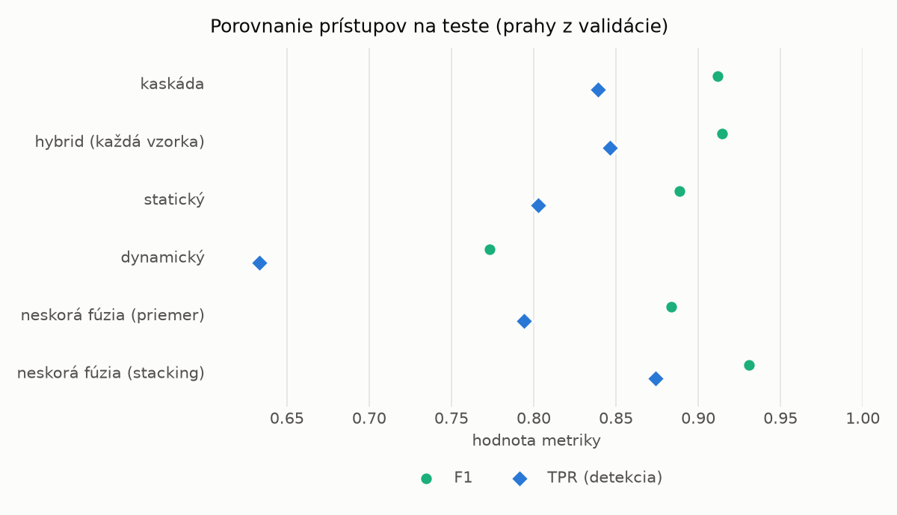
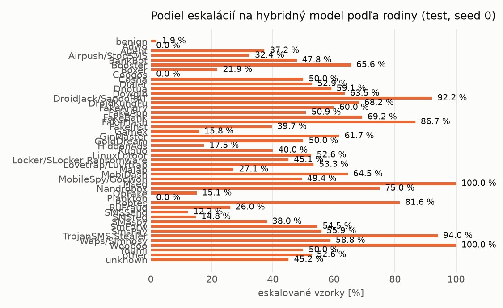

# Kaskáda `heavy` – beh `20261123-224720`

> Generované `src/cascade/evaluate.py` (2026-11-23T22:47:21+01:00). Seedy: [0, 1, 2]; hodnoty = priemer ± sm. odchýlka.
> Všetky prahy sú určené na validácii (FPR ≤ 1 %); test sa na nič nenastavuje.

| rola | beh |
|---|---|
| static | `runs_v4/real_full/time/students_static/mlp_kd/20261123-224256` |
| dynamic | `runs_v4/real_full/time/students_dynamic/mlp_kd/20261123-224410` |
| hybrid | `runs_v4/real_full/time/hybrid/mlp_large/20261123-223715` |

## Test
| prístup | accuracy | balanced_accuracy | precision | recall_tpr | fpr | f1 | mcc |
|---|---|---|---|---|---|---|---|
| kaskáda | 0.8951 ± 0.0037 | 0.9183 ± 0.0028 | 0.9984 ± 0.0003 | 0.8392 ± 0.0058 | 0.0025 ± 0.0004 | 0.9119 ± 0.0034 | 0.8028 ± 0.0060 |
| hybrid (každá vzorka) | 0.8977 ± 0.0023 | 0.9192 ± 0.0019 | 0.9950 ± 0.0002 | 0.8462 ± 0.0035 | 0.0078 ± 0.0002 | 0.9146 ± 0.0021 | 0.8054 ± 0.0039 |
| statický | 0.8696 ± 0.0150 | 0.8974 ± 0.0112 | 0.9947 ± 0.0011 | 0.8028 ± 0.0242 | 0.0079 ± 0.0019 | 0.8884 ± 0.0143 | 0.7608 ± 0.0226 |
| dynamický | 0.7598 ± 0.0079 | 0.8125 ± 0.0060 | 0.9929 ± 0.0009 | 0.6333 ± 0.0125 | 0.0083 ± 0.0011 | 0.7733 ± 0.0093 | 0.6067 ± 0.0098 |
| neskorá fúzia (priemer) | 0.8647 ± 0.0068 | 0.8940 ± 0.0053 | 0.9957 ± 0.0003 | 0.7942 ± 0.0104 | 0.0062 ± 0.0004 | 0.8836 ± 0.0065 | 0.7536 ± 0.0105 |
| neskorá fúzia (stacking) | 0.9162 ± 0.0048 | 0.9337 ± 0.0035 | 0.9958 ± 0.0007 | 0.8742 ± 0.0081 | 0.0068 ± 0.0012 | 0.9310 ± 0.0043 | 0.8369 ± 0.0081 |

## Validácia
| prístup | accuracy | balanced_accuracy | precision | recall_tpr | fpr | f1 | mcc |
|---|---|---|---|---|---|---|---|
| kaskáda | 0.9641 ± 0.0038 | 0.9629 ± 0.0039 | 0.9943 ± 0.0009 | 0.9309 ± 0.0083 | 0.0050 ± 0.0008 | 0.9615 ± 0.0042 | 0.9297 ± 0.0072 |
| hybrid (každá vzorka) | 0.9747 ± 0.0011 | 0.9742 ± 0.0011 | 0.9893 ± 0.0003 | 0.9579 ± 0.0022 | 0.0096 ± 0.0003 | 0.9734 ± 0.0011 | 0.9498 ± 0.0021 |
| statický | 0.9356 ± 0.0086 | 0.9336 ± 0.0089 | 0.9881 ± 0.0002 | 0.8769 ± 0.0178 | 0.0098 ± 0.0000 | 0.9292 ± 0.0101 | 0.8758 ± 0.0158 |
| dynamický | 0.8734 ± 0.0061 | 0.8691 ± 0.0063 | 0.9863 ± 0.0004 | 0.7479 ± 0.0126 | 0.0097 ± 0.0002 | 0.8506 ± 0.0083 | 0.7658 ± 0.0105 |
| neskorá fúzia (priemer) | 0.9509 ± 0.0022 | 0.9494 ± 0.0023 | 0.9886 ± 0.0001 | 0.9087 ± 0.0045 | 0.0098 ± 0.0000 | 0.9469 ± 0.0025 | 0.9042 ± 0.0041 |
| neskorá fúzia (stacking) | 0.9695 ± 0.0020 | 0.9688 ± 0.0021 | 0.9891 ± 0.0002 | 0.9472 ± 0.0040 | 0.0097 ± 0.0002 | 0.9677 ± 0.0022 | 0.9397 ± 0.0039 |

## Správanie kaskády (test, seed 0)
- podiel eskalácií na hybrid: **21.30%** (4434 vzoriek)
- chyby pri zhode študentov (kaskáda ich nemôže opraviť): **1464**
  (8.934% zo zhôd; FP 3, FN 1461)
- úspešnosť na eskalovaných vzorkách: hybrid 0.8486693730266125, statický 0.7918358141632837,
  dynamický 0.20816418583671628  → prínos hybridu pri nezhode

## Výpočtové nároky (odhad z benchmarkov komponentov)
_Chýba benchmark niektorého komponentu (`python -m src.evaluation.benchmark`)._

