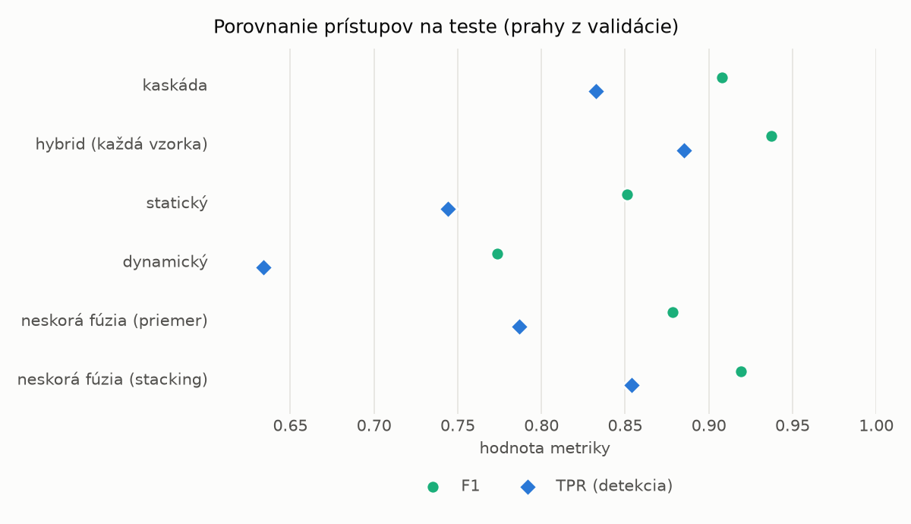
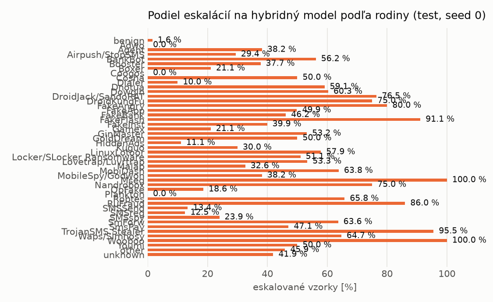

# Kaskáda `heavyteacher` – beh `20261123-224725`

> Generované `src/cascade/evaluate.py` (2026-11-23T22:47:25+01:00). Seedy: [0, 1, 2]; hodnoty = priemer ± sm. odchýlka.
> Všetky prahy sú určené na validácii (FPR ≤ 1 %); test sa na nič nenastavuje.

| rola | beh |
|---|---|
| static | `runs_v4/real_full/time/students_static/mlp_kd_heavy/20261123-224355` |
| dynamic | `runs_v4/real_full/time/students_dynamic/mlp_kd_heavy/20261123-224558` |
| hybrid | `runs_v4/real_full/time/hybrid/lightgbm/20261123-223543` |

## Test
| prístup | accuracy | balanced_accuracy | precision | recall_tpr | fpr | f1 | mcc |
|---|---|---|---|---|---|---|---|
| kaskáda | 0.8908 ± 0.0070 | 0.9151 ± 0.0054 | 0.9985 ± 0.0001 | 0.8325 ± 0.0110 | 0.0022 ± 0.0002 | 0.9080 ± 0.0065 | 0.7961 ± 0.0113 |
| hybrid (každá vzorka) | 0.9231 ± 0.0013 | 0.9389 ± 0.0010 | 0.9954 ± 0.0002 | 0.8853 ± 0.0018 | 0.0075 ± 0.0003 | 0.9371 ± 0.0011 | 0.8487 ± 0.0023 |
| statický | 0.8322 ± 0.0228 | 0.8688 ± 0.0173 | 0.9952 ± 0.0006 | 0.7442 ± 0.0358 | 0.0067 ± 0.0012 | 0.8513 ± 0.0230 | 0.7059 ± 0.0325 |
| dynamický | 0.7604 ± 0.0255 | 0.8131 ± 0.0193 | 0.9933 ± 0.0011 | 0.6340 ± 0.0404 | 0.0079 ± 0.0018 | 0.7735 ± 0.0300 | 0.6081 ± 0.0314 |
| neskorá fúzia (priemer) | 0.8595 ± 0.0167 | 0.8898 ± 0.0128 | 0.9952 ± 0.0004 | 0.7866 ± 0.0261 | 0.0070 ± 0.0007 | 0.8785 ± 0.0161 | 0.7457 ± 0.0252 |
| neskorá fúzia (stacking) | 0.9032 ± 0.0113 | 0.9238 ± 0.0085 | 0.9960 ± 0.0005 | 0.8538 ± 0.0179 | 0.0063 ± 0.0009 | 0.9194 ± 0.0101 | 0.8152 ± 0.0186 |

## Validácia
| prístup | accuracy | balanced_accuracy | precision | recall_tpr | fpr | f1 | mcc |
|---|---|---|---|---|---|---|---|
| kaskáda | 0.9654 ± 0.0030 | 0.9643 ± 0.0031 | 0.9948 ± 0.0007 | 0.9332 ± 0.0057 | 0.0045 ± 0.0006 | 0.9630 ± 0.0033 | 0.9323 ± 0.0057 |
| hybrid (každá vzorka) | 0.9820 ± 0.0002 | 0.9817 ± 0.0003 | 0.9893 ± 0.0000 | 0.9731 ± 0.0005 | 0.0098 ± 0.0000 | 0.9812 ± 0.0003 | 0.9640 ± 0.0005 |
| statický | 0.9283 ± 0.0063 | 0.9260 ± 0.0065 | 0.9881 ± 0.0004 | 0.8617 ± 0.0129 | 0.0097 ± 0.0002 | 0.9205 ± 0.0075 | 0.8624 ± 0.0115 |
| dynamický | 0.8801 ± 0.0070 | 0.8760 ± 0.0073 | 0.9864 ± 0.0003 | 0.7619 ± 0.0145 | 0.0098 ± 0.0000 | 0.8597 ± 0.0094 | 0.7773 ± 0.0120 |
| neskorá fúzia (priemer) | 0.9571 ± 0.0033 | 0.9559 ± 0.0035 | 0.9889 ± 0.0004 | 0.9214 ± 0.0066 | 0.0096 ± 0.0003 | 0.9540 ± 0.0037 | 0.9160 ± 0.0064 |
| neskorá fúzia (stacking) | 0.9697 ± 0.0021 | 0.9690 ± 0.0022 | 0.9890 ± 0.0001 | 0.9477 ± 0.0044 | 0.0098 ± 0.0000 | 0.9679 ± 0.0023 | 0.9400 ± 0.0041 |

## Správanie kaskády (test, seed 0)
- podiel eskalácií na hybrid: **21.59%** (4495 vzoriek)
- chyby pri zhode študentov (kaskáda ich nemôže opraviť): **1659**
  (10.162% zo zhôd; FP 1, FN 1658)
- úspešnosť na eskalovaných vzorkách: hybrid 0.8985539488320355, statický 0.7123470522803115,
  dynamický 0.2876529477196885  → prínos hybridu pri nezhode

## Výpočtové nároky (odhad z benchmarkov komponentov)
_Chýba benchmark niektorého komponentu (`python -m src.evaluation.benchmark`)._

