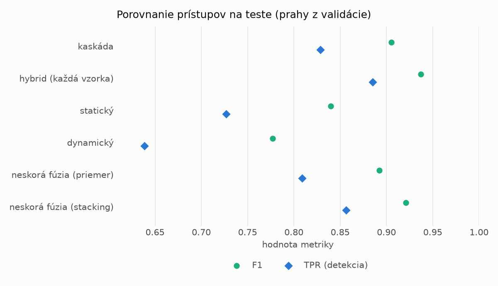
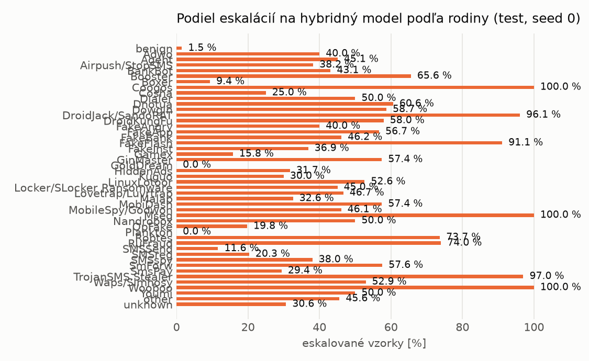

# Kaskáda `modal` – beh `20261123-224718`

> Generované `src/cascade/evaluate.py` (2026-11-23T22:47:18+01:00). Seedy: [0, 1, 2]; hodnoty = priemer ± sm. odchýlka.
> Všetky prahy sú určené na validácii (FPR ≤ 1 %); test sa na nič nenastavuje.

| rola | beh |
|---|---|
| static | `runs_v4/real_full/time/students_static/mlp_kd_modal/20261123-224339` |
| dynamic | `runs_v4/real_full/time/students_dynamic/mlp_kd_modal/20261123-224525` |
| hybrid | `runs_v4/real_full/time/hybrid/lightgbm/20261123-223543` |

## Test
| prístup | accuracy | balanced_accuracy | precision | recall_tpr | fpr | f1 | mcc |
|---|---|---|---|---|---|---|---|
| kaskáda | 0.8881 ± 0.0100 | 0.9130 ± 0.0078 | 0.9984 ± 0.0003 | 0.8284 ± 0.0152 | 0.0024 ± 0.0004 | 0.9055 ± 0.0092 | 0.7918 ± 0.0161 |
| hybrid (každá vzorka) | 0.9231 ± 0.0013 | 0.9389 ± 0.0010 | 0.9954 ± 0.0002 | 0.8853 ± 0.0018 | 0.0075 ± 0.0003 | 0.9371 ± 0.0011 | 0.8487 ± 0.0023 |
| statický | 0.8208 ± 0.0170 | 0.8600 ± 0.0133 | 0.9949 ± 0.0008 | 0.7267 ± 0.0260 | 0.0068 ± 0.0008 | 0.8398 ± 0.0177 | 0.6894 ± 0.0241 |
| dynamický | 0.7632 ± 0.0047 | 0.8151 ± 0.0034 | 0.9929 ± 0.0007 | 0.6385 ± 0.0077 | 0.0084 ± 0.0009 | 0.7772 ± 0.0055 | 0.6110 ± 0.0055 |
| neskorá fúzia (priemer) | 0.8739 ± 0.0132 | 0.9009 ± 0.0100 | 0.9951 ± 0.0004 | 0.8091 ± 0.0208 | 0.0073 ± 0.0008 | 0.8924 ± 0.0125 | 0.7677 ± 0.0204 |
| neskorá fúzia (stacking) | 0.9053 ± 0.0129 | 0.9255 ± 0.0098 | 0.9965 ± 0.0010 | 0.8566 ± 0.0205 | 0.0055 ± 0.0016 | 0.9212 ± 0.0116 | 0.8189 ± 0.0215 |

## Validácia
| prístup | accuracy | balanced_accuracy | precision | recall_tpr | fpr | f1 | mcc |
|---|---|---|---|---|---|---|---|
| kaskáda | 0.9672 ± 0.0016 | 0.9662 ± 0.0017 | 0.9951 ± 0.0007 | 0.9366 ± 0.0036 | 0.0043 ± 0.0006 | 0.9650 ± 0.0018 | 0.9358 ± 0.0031 |
| hybrid (každá vzorka) | 0.9820 ± 0.0002 | 0.9817 ± 0.0003 | 0.9893 ± 0.0000 | 0.9731 ± 0.0005 | 0.0098 ± 0.0000 | 0.9812 ± 0.0003 | 0.9640 ± 0.0005 |
| statický | 0.9321 ± 0.0029 | 0.9300 ± 0.0030 | 0.9882 ± 0.0003 | 0.8696 ± 0.0058 | 0.0097 ± 0.0002 | 0.9251 ± 0.0034 | 0.8694 ± 0.0053 |
| dynamický | 0.8791 ± 0.0041 | 0.8750 ± 0.0042 | 0.9864 ± 0.0002 | 0.7598 ± 0.0085 | 0.0098 ± 0.0000 | 0.8584 ± 0.0055 | 0.7756 ± 0.0070 |
| neskorá fúzia (priemer) | 0.9578 ± 0.0037 | 0.9566 ± 0.0039 | 0.9890 ± 0.0005 | 0.9227 ± 0.0082 | 0.0095 ± 0.0005 | 0.9547 ± 0.0042 | 0.9172 ± 0.0070 |
| neskorá fúzia (stacking) | 0.9693 ± 0.0028 | 0.9686 ± 0.0029 | 0.9891 ± 0.0001 | 0.9468 ± 0.0060 | 0.0097 ± 0.0002 | 0.9675 ± 0.0031 | 0.9393 ± 0.0055 |

## Správanie kaskády (test, seed 0)
- podiel eskalácií na hybrid: **23.14%** (4819 vzoriek)
- chyby pri zhode študentov (kaskáda ich nemôže opraviť): **1751**
  (10.942% zo zhôd; FP 1, FN 1750)
- úspešnosť na eskalovaných vzorkách: hybrid 0.9234280971155842, statický 0.6503423946876945,
  dynamický 0.34965760531230544  → prínos hybridu pri nezhode

## Výpočtové nároky (odhad z benchmarkov komponentov)
_Chýba benchmark niektorého komponentu (`python -m src.evaluation.benchmark`)._

