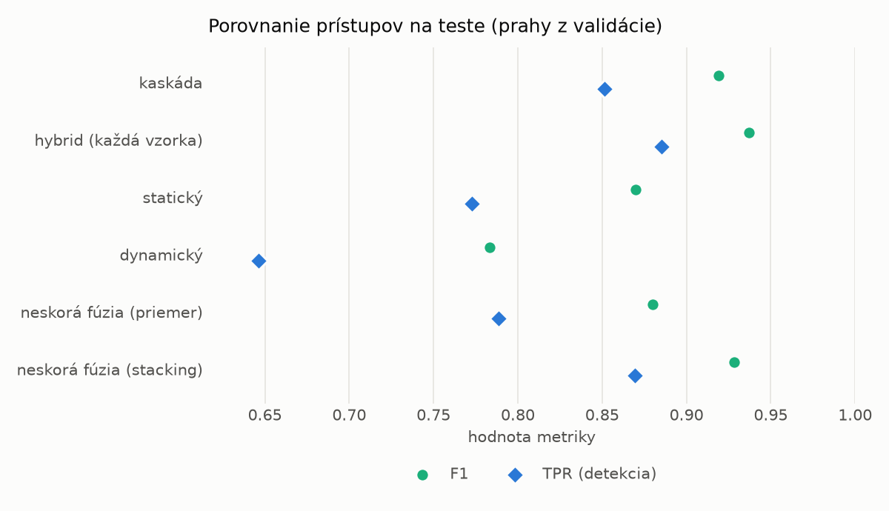
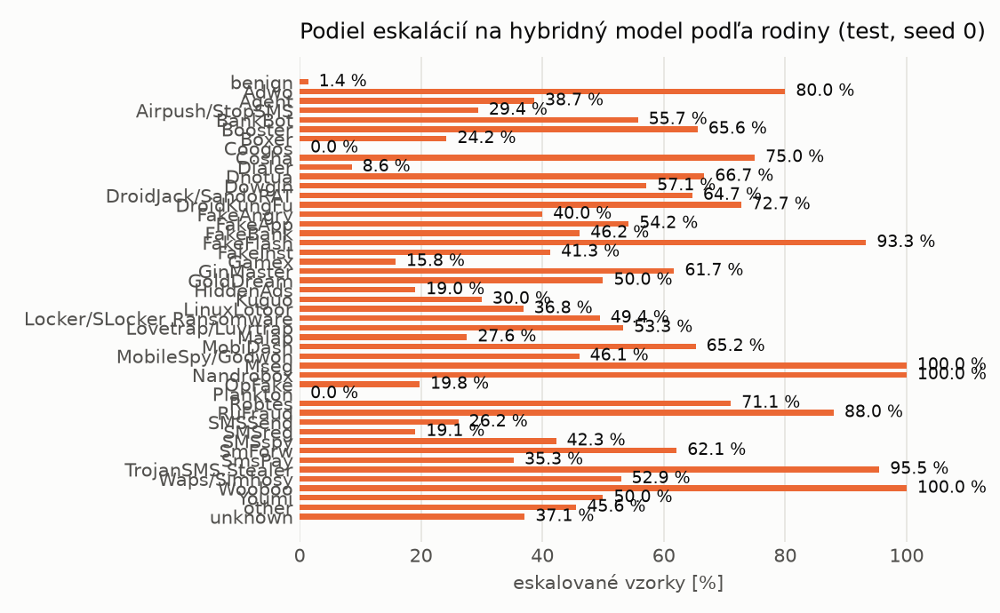

# Kaskáda `nokd` – beh `20261123-224716`

> Generované `src/cascade/evaluate.py` (2026-11-23T22:47:16+01:00). Seedy: [0, 1, 2]; hodnoty = priemer ± sm. odchýlka.
> Všetky prahy sú určené na validácii (FPR ≤ 1 %); test sa na nič nenastavuje.

| rola | beh |
|---|---|
| static | `runs_v4/real_full/time/students_static/mlp_nokd/20261123-224313` |
| dynamic | `runs_v4/real_full/time/students_dynamic/mlp_nokd/20261123-224443` |
| hybrid | `runs_v4/real_full/time/hybrid/lightgbm/20261123-223543` |

## Test
| prístup | accuracy | balanced_accuracy | precision | recall_tpr | fpr | f1 | mcc |
|---|---|---|---|---|---|---|---|
| kaskáda | 0.9031 ± 0.0054 | 0.9246 ± 0.0042 | 0.9986 ± 0.0001 | 0.8515 ± 0.0083 | 0.0022 ± 0.0002 | 0.9192 ± 0.0049 | 0.8162 ± 0.0090 |
| hybrid (každá vzorka) | 0.9231 ± 0.0013 | 0.9389 ± 0.0010 | 0.9954 ± 0.0002 | 0.8853 ± 0.0018 | 0.0075 ± 0.0003 | 0.9371 ± 0.0011 | 0.8487 ± 0.0023 |
| statický | 0.8506 ± 0.0081 | 0.8830 ± 0.0066 | 0.9951 ± 0.0012 | 0.7728 ± 0.0116 | 0.0069 ± 0.0016 | 0.8700 ± 0.0078 | 0.7321 ± 0.0127 |
| dynamický | 0.7686 ± 0.0078 | 0.8194 ± 0.0055 | 0.9937 ± 0.0017 | 0.6464 ± 0.0132 | 0.0075 ± 0.0022 | 0.7832 ± 0.0091 | 0.6185 ± 0.0089 |
| neskorá fúzia (priemer) | 0.8610 ± 0.0032 | 0.8912 ± 0.0024 | 0.9959 ± 0.0004 | 0.7884 ± 0.0051 | 0.0060 ± 0.0005 | 0.8800 ± 0.0031 | 0.7480 ± 0.0047 |
| neskorá fúzia (stacking) | 0.9132 ± 0.0079 | 0.9315 ± 0.0060 | 0.9961 ± 0.0005 | 0.8692 ± 0.0125 | 0.0062 ± 0.0009 | 0.9283 ± 0.0070 | 0.8320 ± 0.0134 |

## Validácia
| prístup | accuracy | balanced_accuracy | precision | recall_tpr | fpr | f1 | mcc |
|---|---|---|---|---|---|---|---|
| kaskáda | 0.9670 ± 0.0008 | 0.9659 ± 0.0008 | 0.9949 ± 0.0002 | 0.9363 ± 0.0016 | 0.0044 ± 0.0002 | 0.9647 ± 0.0009 | 0.9353 ± 0.0015 |
| hybrid (každá vzorka) | 0.9820 ± 0.0002 | 0.9817 ± 0.0003 | 0.9893 ± 0.0000 | 0.9731 ± 0.0005 | 0.0098 ± 0.0000 | 0.9812 ± 0.0003 | 0.9640 ± 0.0005 |
| statický | 0.9295 ± 0.0034 | 0.9273 ± 0.0036 | 0.9881 ± 0.0002 | 0.8643 ± 0.0071 | 0.0097 ± 0.0002 | 0.9220 ± 0.0041 | 0.8647 ± 0.0063 |
| dynamický | 0.8756 ± 0.0062 | 0.8714 ± 0.0065 | 0.9862 ± 0.0002 | 0.7526 ± 0.0129 | 0.0098 ± 0.0000 | 0.8537 ± 0.0084 | 0.7697 ± 0.0107 |
| neskorá fúzia (priemer) | 0.9546 ± 0.0032 | 0.9533 ± 0.0034 | 0.9888 ± 0.0003 | 0.9164 ± 0.0066 | 0.0097 ± 0.0002 | 0.9512 ± 0.0036 | 0.9112 ± 0.0061 |
| neskorá fúzia (stacking) | 0.9699 ± 0.0019 | 0.9692 ± 0.0020 | 0.9890 ± 0.0000 | 0.9482 ± 0.0040 | 0.0098 ± 0.0000 | 0.9682 ± 0.0021 | 0.9405 ± 0.0037 |

## Správanie kaskády (test, seed 0)
- podiel eskalácií na hybrid: **22.98%** (4784 vzoriek)
- chyby pri zhode študentov (kaskáda ich nemôže opraviť): **1644**
  (10.251% zo zhôd; FP 0, FN 1644)
- úspešnosť na eskalovaných vzorkách: hybrid 0.9069816053511706, statický 0.6749581939799331,
  dynamický 0.3250418060200669  → prínos hybridu pri nezhode

## Výpočtové nároky (odhad z benchmarkov komponentov)
_Chýba benchmark niektorého komponentu (`python -m src.evaluation.benchmark`)._

