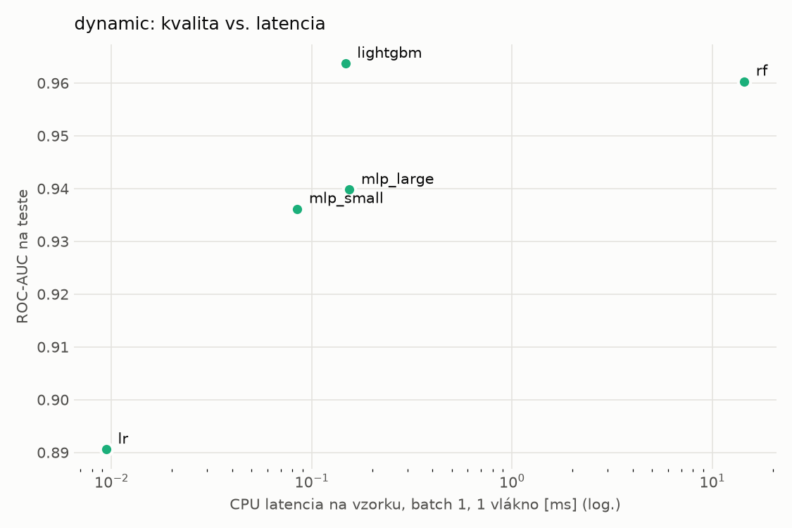
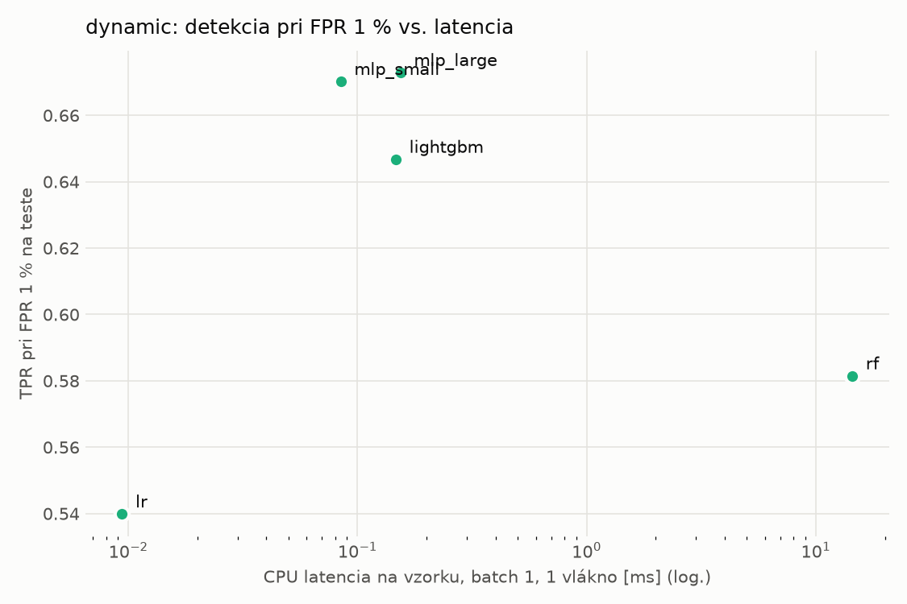
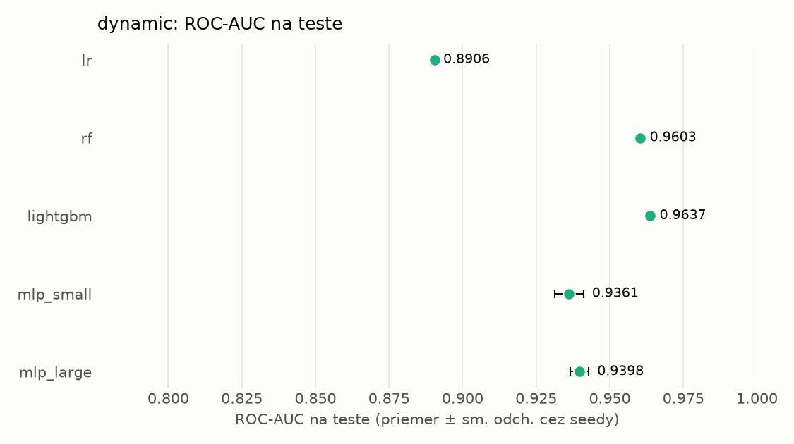
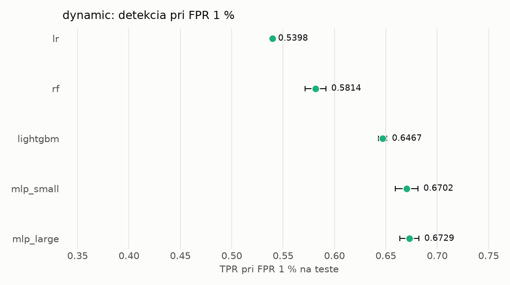

# Porovnanie modelov – dynamic

> Generované `src/evaluation/compare.py` (2026-11-23T22:35:29+01:00); použitý je posledný beh každého modelu.
> Metriky sú priemer cez seedy. \* = pri prahu určenom na validácii (FPR ≤ 1 %).
> CPU ms/vz. = medián latencie jednej vzorky na 1 vlákne vrátane transformácie vstupu (meranie hneď po tréningu,
> orientačné). Oficiálne merania spotreby sú v časti „Spotreba zdrojov pri inferencii“.

## Detekčná kvalita a orientačné časy
| model | ROC-AUC val | ROC-AUC test | TPR@FPR 1 % test | TPR@FPR 0,1 % test | F1 test* | FPR test* | gap train−val | CPU ms/vz. | CPU vz./s | GPU ms/vz. | parametre | MB | tréning s | ladenie min |
|---|---|---|---|---|---|---|---|---|---|---|---|---|---|---|
| [lr](../../dynamic/lr/20261123-223244/README.md) | 0.9225 | 0.8906 ± 0.0000 | 0.5398 | 0.4516 | 0.6946 | 0.0094 | -0.0007 | 0.009 | 5 047 515 | – | 130 | 0.01 | 0.3 | 0.0 |
| [rf](../../dynamic/rf/20261123-223247/README.md) | 0.9805 | 0.9603 ± 0.0004 | 0.5814 | 0.3994 | 0.7203 | 0.0092 | 0.0186 | 14.427 | 122 557 | – | 4 386 172 | 351.29 | 2.9 | 0.0 |
| [lightgbm](../../dynamic/lightgbm/20261123-223305/README.md) | 0.9841 | 0.9637 ± 0.0004 | 0.6467 | 0.4850 | 0.7768 | 0.0091 | 0.0151 | 0.147 | 85 340 | – | 420 339 | 23.08 | 15.2 | 0.0 |
| [mlp_small](../../dynamic/mlp_small/20261123-223405/README.md) | 0.9771 | 0.9361 ± 0.0049 | 0.6702 | 0.5389 | 0.7912 | 0.0085 | 0.0123 | 0.085 | 2 168 131 | 0.579 | 67 073 | 0.28 | 22.9 | 0.0 |
| [mlp_large](../../dynamic/mlp_large/20261123-223515/README.md) | 0.9764 | 0.9398 ± 0.0031 | 0.6729 | 0.5205 | 0.7915 | 0.0079 | 0.0127 | 0.154 | 524 583 | 0.448 | 595 457 | 2.41 | 3.9 | 0.0 |

## Nízka prevalencia malvéru (test, prah z validácie)
| model | TPR | FPR | precision @ 1 % | falošné na 1 skutočný poplach @ 1 % | precision @ 0.1 % | falošné na 1 skutočný poplach @ 0.1 % |
|---|---|---|---|---|---|---|
| lr | 0.5349 | 0.0094 | 0.365 | 1.74 | 0.054 | 17.53 |
| rf | 0.5657 | 0.0092 | 0.384 | 1.60 | 0.058 | 16.18 |
| lightgbm | 0.6383 | 0.0091 | 0.414 | 1.41 | 0.065 | 14.27 |
| mlp_small | 0.6576 | 0.0085 | 0.439 | 1.28 | 0.072 | 12.88 |
| mlp_large | 0.6578 | 0.0079 | 0.456 | 1.19 | 0.077 | 12.05 |

Prepočet: TPR a FPR nezávisia od podielu malvéru, preto sa dajú preniesť na nízku prevalenciu (v reálnej prevádzke je malvéru ~1 % alebo menej; v teste 54 %). „Falošné na 1 skutočný poplach“ = koľko neškodných súborov je označených na každý zachytený malvér.

## Spotreba zdrojov pri inferencii (benchmark, testovacia množina)
_Benchmark zatiaľ nebol spustený (`python -m src.evaluation.benchmark --approach dynamic`)._

## Grafy

