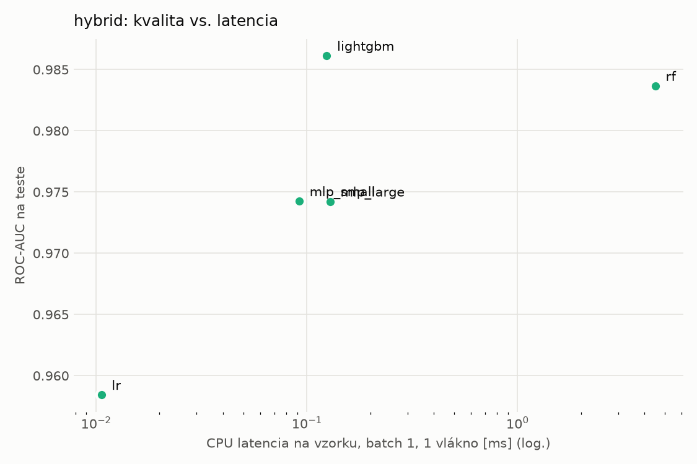
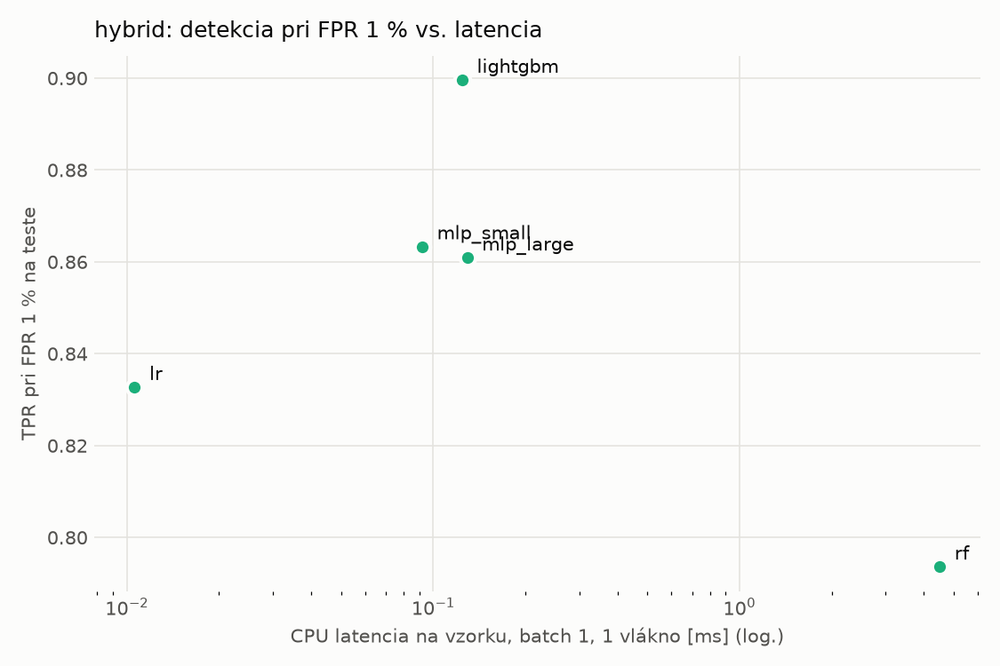
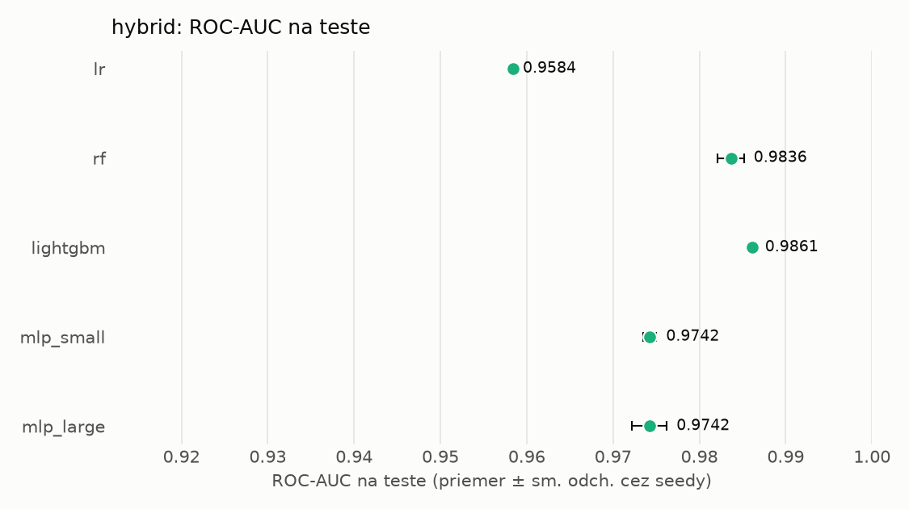
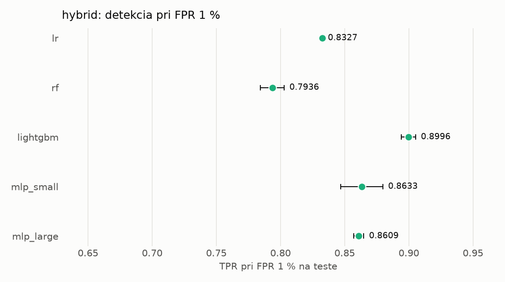

# Porovnanie modelov – hybrid

> Generované `src/evaluation/compare.py` (2026-11-23T22:37:54+01:00); použitý je posledný beh každého modelu.
> Metriky sú priemer cez seedy. \* = pri prahu určenom na validácii (FPR ≤ 1 %).
> CPU ms/vz. = medián latencie jednej vzorky na 1 vlákne vrátane transformácie vstupu (meranie hneď po tréningu,
> orientačné). Oficiálne merania spotreby sú v časti „Spotreba zdrojov pri inferencii“.

## Detekčná kvalita a orientačné časy
| model | ROC-AUC val | ROC-AUC test | TPR@FPR 1 % test | TPR@FPR 0,1 % test | F1 test* | FPR test* | gap train−val | CPU ms/vz. | CPU vz./s | GPU ms/vz. | parametre | MB | tréning s | ladenie min |
|---|---|---|---|---|---|---|---|---|---|---|---|---|---|---|
| [lr](../../hybrid/lr/20261123-223532/README.md) | 0.9896 | 0.9584 ± 0.0000 | 0.8327 | 0.7177 | 0.8945 | 0.0071 | 0.0004 | 0.011 | 2 188 551 | – | 293 | 0.01 | 0.3 | 0.0 |
| [rf](../../hybrid/rf/20261123-223535/README.md) | 0.9962 | 0.9836 ± 0.0015 | 0.7936 | 0.5659 | 0.8627 | 0.0061 | 0.0038 | 4.506 | 223 198 | – | 756 140 | 60.75 | 1.2 | 0.0 |
| [lightgbm](../../hybrid/lightgbm/20261123-223543/README.md) | 0.9977 | 0.9861 ± 0.0004 | 0.8996 | 0.7451 | 0.9371 | 0.0075 | 0.0023 | 0.124 | 112 518 | – | 368 745 | 20.54 | 19.3 | 0.0 |
| [mlp_small](../../hybrid/mlp_small/20261123-223653/README.md) | 0.9957 | 0.9742 ± 0.0008 | 0.8633 | 0.7339 | 0.9173 | 0.0078 | 0.0032 | 0.092 | 1 204 062 | 0.373 | 108 801 | 0.45 | 6.6 | 0.0 |
| [mlp_large](../../hybrid/mlp_large/20261123-223715/README.md) | 0.9960 | 0.9742 ± 0.0020 | 0.8609 | 0.7255 | 0.9146 | 0.0078 | 0.0034 | 0.129 | 739 661 | 0.428 | 316 161 | 1.29 | 11.8 | 0.0 |

## Nízka prevalencia malvéru (test, prah z validácie)
| model | TPR | FPR | precision @ 1 % | falošné na 1 skutočný poplach @ 1 % | precision @ 0.1 % | falošné na 1 skutočný poplach @ 0.1 % |
|---|---|---|---|---|---|---|
| lr | 0.8122 | 0.0071 | 0.537 | 0.86 | 0.103 | 8.70 |
| rf | 0.7611 | 0.0061 | 0.559 | 0.79 | 0.111 | 7.98 |
| lightgbm | 0.8853 | 0.0075 | 0.543 | 0.84 | 0.105 | 8.50 |
| mlp_small | 0.8508 | 0.0078 | 0.526 | 0.90 | 0.099 | 9.11 |
| mlp_large | 0.8462 | 0.0078 | 0.521 | 0.92 | 0.097 | 9.26 |

Prepočet: TPR a FPR nezávisia od podielu malvéru, preto sa dajú preniesť na nízku prevalenciu (v reálnej prevádzke je malvéru ~1 % alebo menej; v teste 54 %). „Falošné na 1 skutočný poplach“ = koľko neškodných súborov je označených na každý zachytený malvér.

## Spotreba zdrojov pri inferencii (benchmark, testovacia množina)
_Benchmark zatiaľ nebol spustený (`python -m src.evaluation.benchmark --approach hybrid`)._

## Grafy

