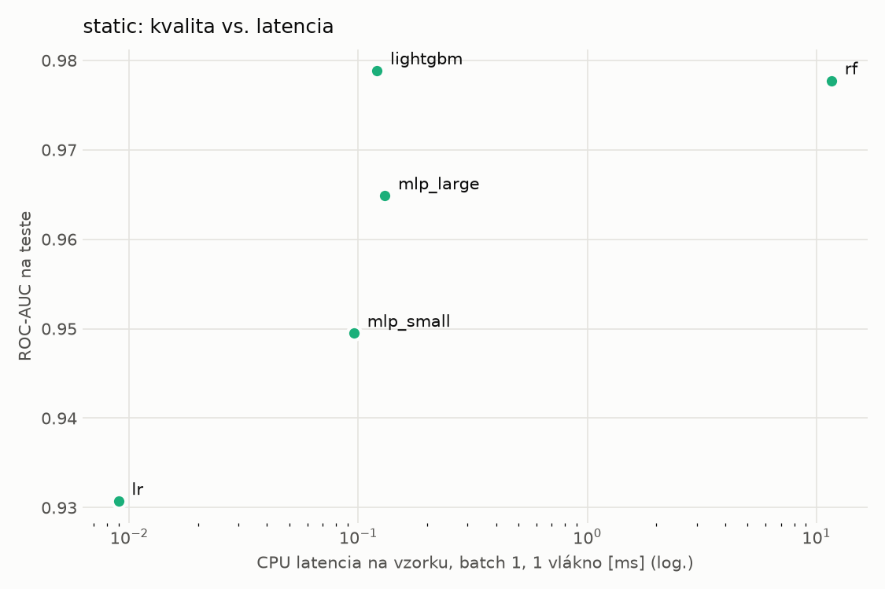
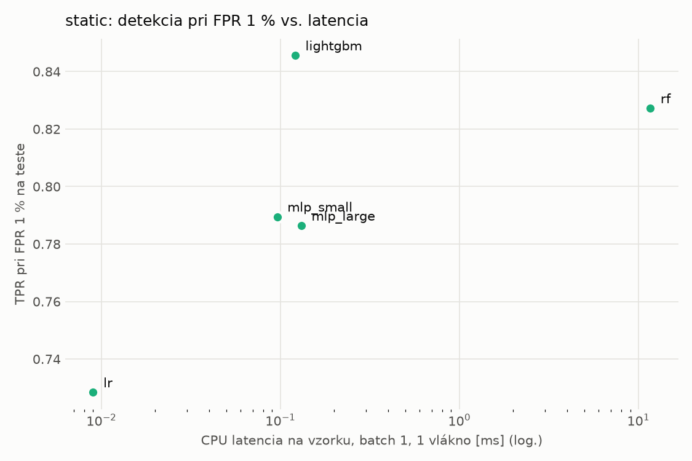
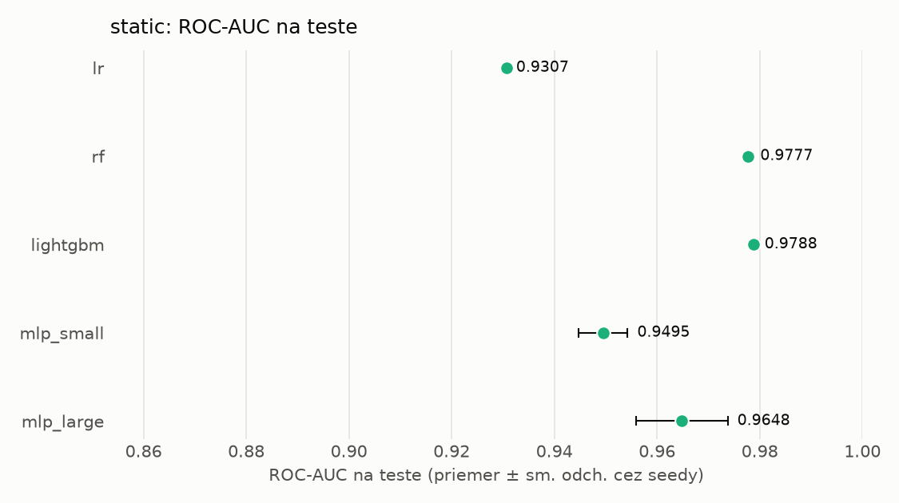
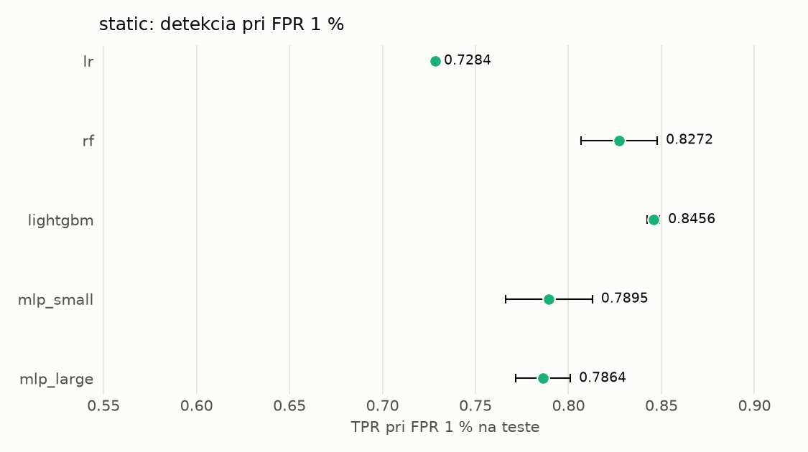

# Porovnanie modelov – static

> Generované `src/evaluation/compare.py` (2026-11-23T22:32:41+01:00); použitý je posledný beh každého modelu.
> Metriky sú priemer cez seedy. \* = pri prahu určenom na validácii (FPR ≤ 1 %).
> CPU ms/vz. = medián latencie jednej vzorky na 1 vlákne vrátane transformácie vstupu (meranie hneď po tréningu,
> orientačné). Oficiálne merania spotreby sú v časti „Spotreba zdrojov pri inferencii“.

## Detekčná kvalita a orientačné časy
| model | ROC-AUC val | ROC-AUC test | TPR@FPR 1 % test | TPR@FPR 0,1 % test | F1 test* | FPR test* | gap train−val | CPU ms/vz. | CPU vz./s | GPU ms/vz. | parametre | MB | tréning s | ladenie min |
|---|---|---|---|---|---|---|---|---|---|---|---|---|---|---|
| [lr](../../static/lr/20261123-223027/README.md) | 0.9726 | 0.9307 ± 0.0000 | 0.7284 | 0.5124 | 0.8219 | 0.0079 | 0.0008 | 0.009 | 3 942 251 | – | 164 | 0.01 | 0.2 | 0.0 |
| [rf](../../static/rf/20261123-223029/README.md) | 0.9942 | 0.9777 ± 0.0005 | 0.8272 | 0.2111 | 0.7964 | 0.0063 | 0.0058 | 11.656 | 178 550 | – | 2 557 584 | 204.97 | 1.8 | 0.0 |
| [lightgbm](../../static/lightgbm/20261123-223043/README.md) | 0.9945 | 0.9788 ± 0.0002 | 0.8456 | 0.4331 | 0.8518 | 0.0062 | 0.0055 | 0.121 | 129 030 | – | 479 978 | 26.57 | 10.7 | 0.0 |
| [mlp_small](../../static/mlp_small/20261123-223131/README.md) | 0.9908 | 0.9495 ± 0.0048 | 0.7895 | 0.5861 | 0.8619 | 0.0060 | 0.0061 | 0.096 | 1 296 362 | 0.640 | 75 777 | 0.32 | 9.4 | 0.0 |
| [mlp_large](../../static/mlp_large/20261123-223201/README.md) | 0.9914 | 0.9648 ± 0.0089 | 0.7864 | 0.5949 | 0.8562 | 0.0061 | 0.0064 | 0.131 | 936 723 | 0.421 | 250 113 | 1.02 | 12.7 | 0.0 |

## Nízka prevalencia malvéru (test, prah z validácie)
| model | TPR | FPR | precision @ 1 % | falošné na 1 skutočný poplach @ 1 % | precision @ 0.1 % | falošné na 1 skutočný poplach @ 0.1 % |
|---|---|---|---|---|---|---|
| lr | 0.7006 | 0.0079 | 0.473 | 1.12 | 0.082 | 11.25 |
| rf | 0.6707 | 0.0063 | 0.518 | 0.93 | 0.096 | 9.39 |
| lightgbm | 0.7456 | 0.0062 | 0.548 | 0.82 | 0.107 | 8.32 |
| mlp_small | 0.7600 | 0.0060 | 0.560 | 0.79 | 0.112 | 7.93 |
| mlp_large | 0.7512 | 0.0061 | 0.555 | 0.80 | 0.110 | 8.08 |

Prepočet: TPR a FPR nezávisia od podielu malvéru, preto sa dajú preniesť na nízku prevalenciu (v reálnej prevádzke je malvéru ~1 % alebo menej; v teste 54 %). „Falošné na 1 skutočný poplach“ = koľko neškodných súborov je označených na každý zachytený malvér.

## Spotreba zdrojov pri inferencii (benchmark, testovacia množina)
_Benchmark zatiaľ nebol spustený (`python -m src.evaluation.benchmark --approach static`)._

## Grafy

