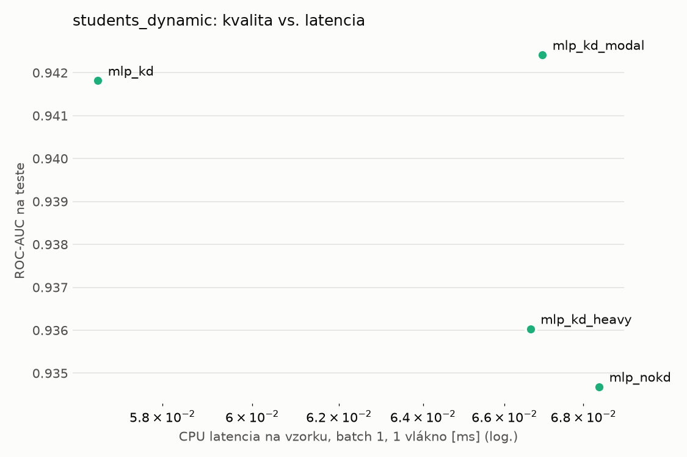
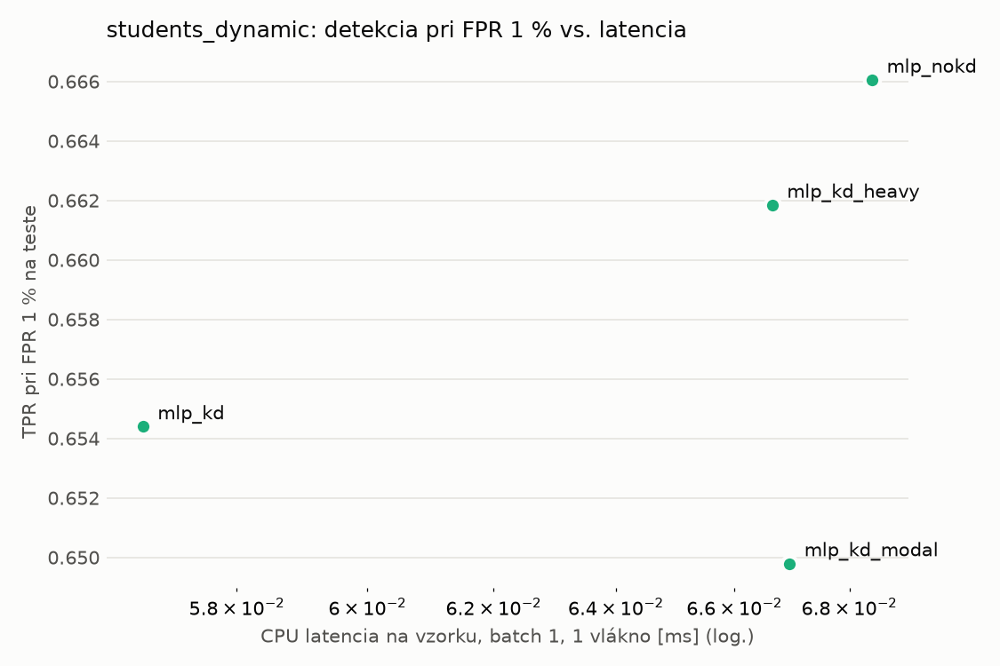
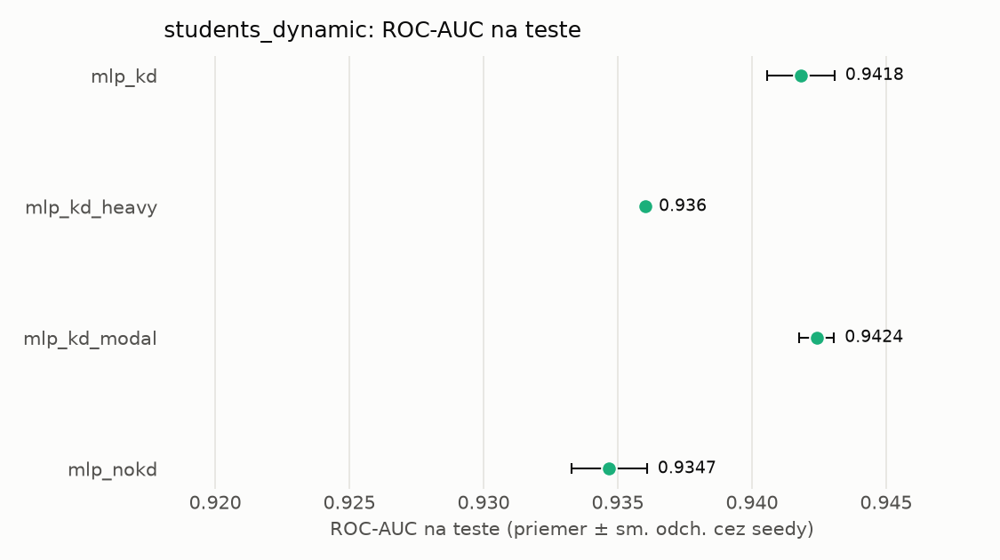
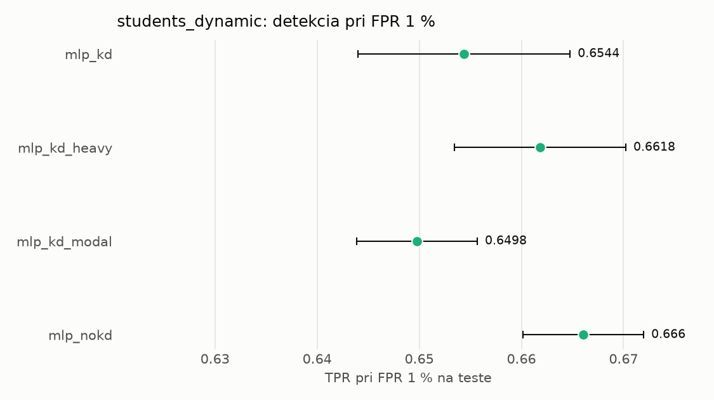

# Porovnanie modelov – students_dynamic

> Generované `src/evaluation/compare.py` (2026-11-23T22:47:11+01:00); použitý je posledný beh každého modelu.
> Metriky sú priemer cez seedy. \* = pri prahu určenom na validácii (FPR ≤ 1 %).
> CPU ms/vz. = medián latencie jednej vzorky na 1 vlákne vrátane transformácie vstupu (meranie hneď po tréningu,
> orientačné). Oficiálne merania spotreby sú v časti „Spotreba zdrojov pri inferencii“.

## Detekčná kvalita a orientačné časy
| model | ROC-AUC val | ROC-AUC test | TPR@FPR 1 % test | TPR@FPR 0,1 % test | F1 test* | FPR test* | gap train−val | CPU ms/vz. | CPU vz./s | GPU ms/vz. | parametre | MB | tréning s | ladenie min |
|---|---|---|---|---|---|---|---|---|---|---|---|---|---|---|
| [mlp_kd](../../students_dynamic/mlp_kd/20261123-224410/README.md) | 0.9692 | 0.9418 ± 0.0013 | 0.6544 | 0.4284 | 0.7733 | 0.0083 | 0.0048 | 0.057 | 3 754 508 | 0.266 | 8 513 | 0.04 | 10.3 | 0.0 |
| [mlp_kd_heavy](../../students_dynamic/mlp_kd_heavy/20261123-224558/README.md) | 0.9701 | 0.9360 ± 0.0001 | 0.6618 | 0.3994 | 0.7735 | 0.0079 | 0.0078 | 0.067 | 4 975 387 | 0.448 | 8 513 | 0.04 | 23.8 | 0.0 |
| [mlp_kd_modal](../../students_dynamic/mlp_kd_modal/20261123-224525/README.md) | 0.9704 | 0.9424 ± 0.0006 | 0.6498 | 0.4364 | 0.7772 | 0.0084 | 0.0044 | 0.067 | 4 197 021 | 0.443 | 8 513 | 0.04 | 10.2 | 0.0 |
| [mlp_nokd](../../students_dynamic/mlp_nokd/20261123-224443/README.md) | 0.9698 | 0.9347 ± 0.0014 | 0.6660 | 0.4526 | 0.7832 | 0.0075 | 0.0072 | 0.068 | 4 529 751 | 0.441 | 8 513 | 0.04 | 13.5 | 0.0 |

## Nízka prevalencia malvéru (test, prah z validácie)
| model | TPR | FPR | precision @ 1 % | falošné na 1 skutočný poplach @ 1 % | precision @ 0.1 % | falošné na 1 skutočný poplach @ 0.1 % |
|---|---|---|---|---|---|---|
| mlp_kd | 0.6333 | 0.0083 | 0.434 | 1.30 | 0.071 | 13.16 |
| mlp_kd_heavy | 0.6340 | 0.0079 | 0.448 | 1.23 | 0.074 | 12.43 |
| mlp_kd_modal | 0.6385 | 0.0084 | 0.435 | 1.30 | 0.071 | 13.13 |
| mlp_nokd | 0.6464 | 0.0075 | 0.466 | 1.15 | 0.080 | 11.57 |

Prepočet: TPR a FPR nezávisia od podielu malvéru, preto sa dajú preniesť na nízku prevalenciu (v reálnej prevádzke je malvéru ~1 % alebo menej; v teste 54 %). „Falošné na 1 skutočný poplach“ = koľko neškodných súborov je označených na každý zachytený malvér.

## Spotreba zdrojov pri inferencii (benchmark, testovacia množina)
_Benchmark zatiaľ nebol spustený (`python -m src.evaluation.benchmark --approach students_dynamic`)._

## Grafy

