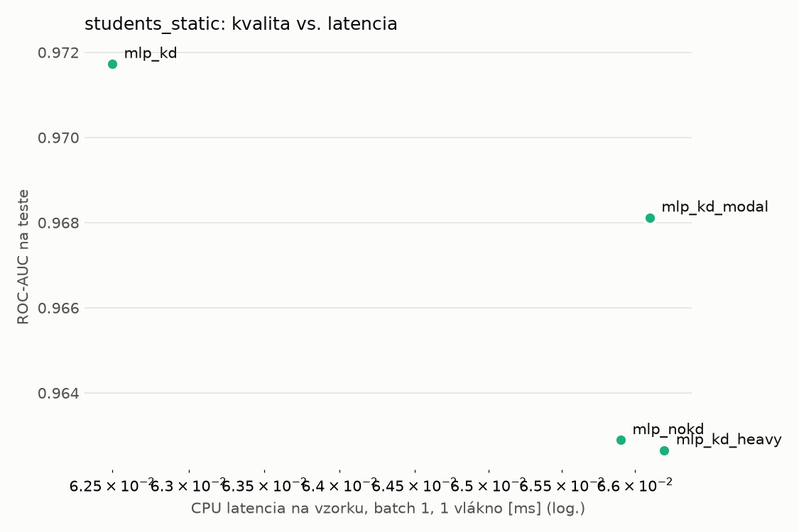
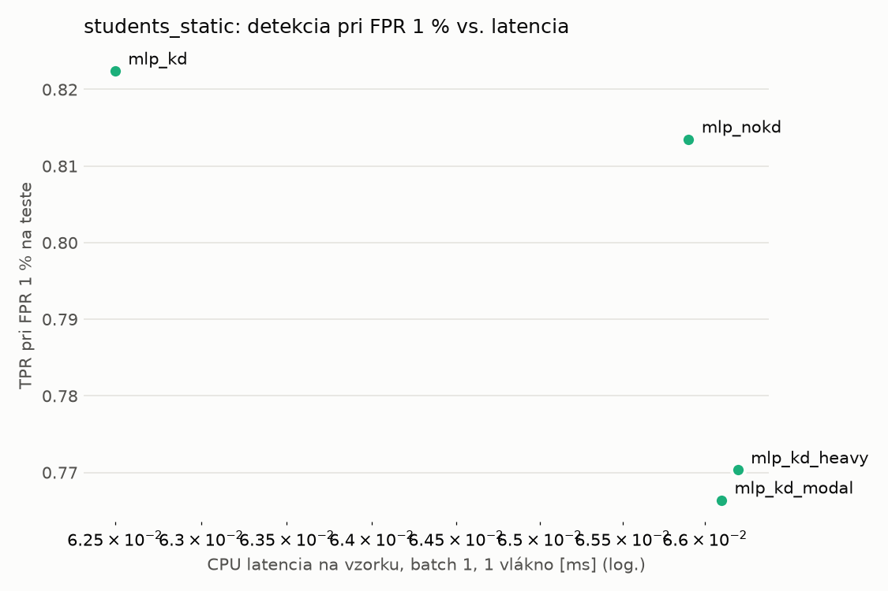
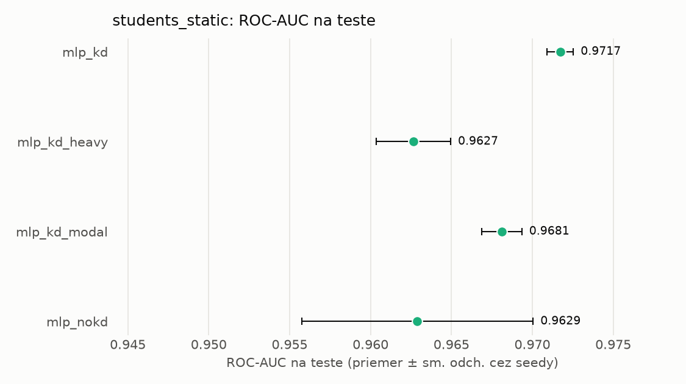
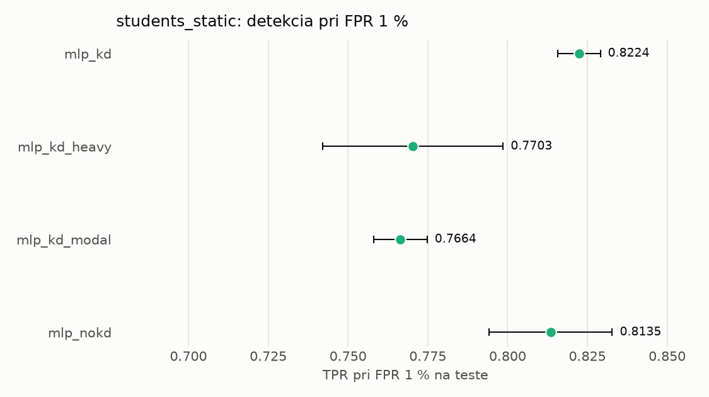

# Porovnanie modelov – students_static

> Generované `src/evaluation/compare.py` (2026-11-23T22:44:08+01:00); použitý je posledný beh každého modelu.
> Metriky sú priemer cez seedy. \* = pri prahu určenom na validácii (FPR ≤ 1 %).
> CPU ms/vz. = medián latencie jednej vzorky na 1 vlákne vrátane transformácie vstupu (meranie hneď po tréningu,
> orientačné). Oficiálne merania spotreby sú v časti „Spotreba zdrojov pri inferencii“.

## Detekčná kvalita a orientačné časy
| model | ROC-AUC val | ROC-AUC test | TPR@FPR 1 % test | TPR@FPR 0,1 % test | F1 test* | FPR test* | gap train−val | CPU ms/vz. | CPU vz./s | GPU ms/vz. | parametre | MB | tréning s | ladenie min |
|---|---|---|---|---|---|---|---|---|---|---|---|---|---|---|
| [mlp_kd](../../students_static/mlp_kd/20261123-224256/README.md) | 0.9889 | 0.9717 ± 0.0008 | 0.8224 | 0.6251 | 0.8884 | 0.0079 | 0.0047 | 0.063 | 3 370 566 | 0.444 | 10 689 | 0.05 | 4.9 | 0.0 |
| [mlp_kd_heavy](../../students_static/mlp_kd_heavy/20261123-224355/README.md) | 0.9887 | 0.9627 ± 0.0023 | 0.7703 | 0.5781 | 0.8513 | 0.0067 | 0.0044 | 0.066 | 2 686 407 | 0.464 | 10 689 | 0.05 | 3.6 | 0.0 |
| [mlp_kd_modal](../../students_static/mlp_kd_modal/20261123-224339/README.md) | 0.9887 | 0.9681 ± 0.0012 | 0.7664 | 0.5051 | 0.8398 | 0.0068 | 0.0040 | 0.066 | 3 395 134 | 0.448 | 10 689 | 0.05 | 4.5 | 0.0 |
| [mlp_nokd](../../students_static/mlp_nokd/20261123-224313/README.md) | 0.9883 | 0.9629 ± 0.0072 | 0.8135 | 0.6409 | 0.8700 | 0.0069 | 0.0058 | 0.066 | 2 842 108 | 0.440 | 10 689 | 0.05 | 8.3 | 0.0 |

## Nízka prevalencia malvéru (test, prah z validácie)
| model | TPR | FPR | precision @ 1 % | falošné na 1 skutočný poplach @ 1 % | precision @ 0.1 % | falošné na 1 skutočný poplach @ 0.1 % |
|---|---|---|---|---|---|---|
| mlp_kd | 0.8028 | 0.0079 | 0.505 | 0.98 | 0.092 | 9.88 |
| mlp_kd_heavy | 0.7442 | 0.0067 | 0.530 | 0.89 | 0.101 | 8.95 |
| mlp_kd_modal | 0.7267 | 0.0068 | 0.521 | 0.92 | 0.097 | 9.29 |
| mlp_nokd | 0.7728 | 0.0069 | 0.531 | 0.88 | 0.101 | 8.91 |

Prepočet: TPR a FPR nezávisia od podielu malvéru, preto sa dajú preniesť na nízku prevalenciu (v reálnej prevádzke je malvéru ~1 % alebo menej; v teste 54 %). „Falošné na 1 skutočný poplach“ = koľko neškodných súborov je označených na každý zachytený malvér.

## Spotreba zdrojov pri inferencii (benchmark, testovacia množina)
_Benchmark zatiaľ nebol spustený (`python -m src.evaluation.benchmark --approach students_static`)._

## Grafy

