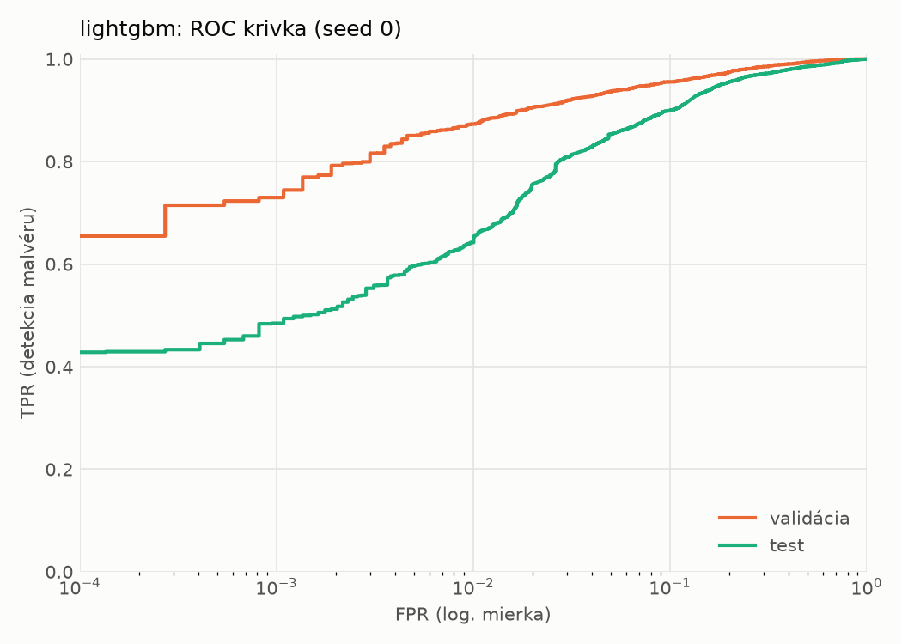
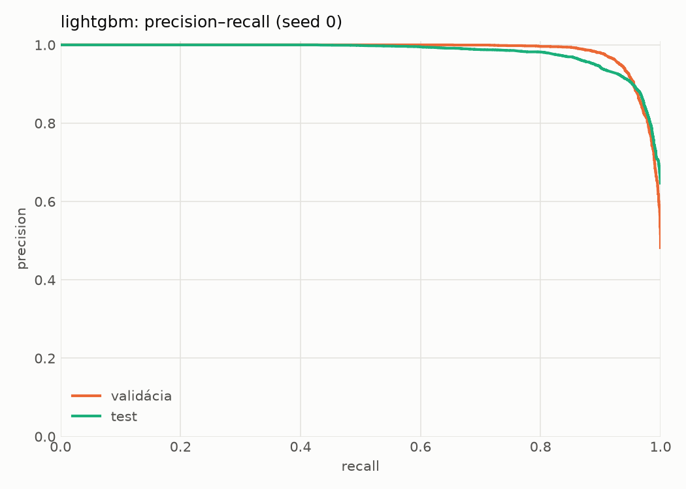
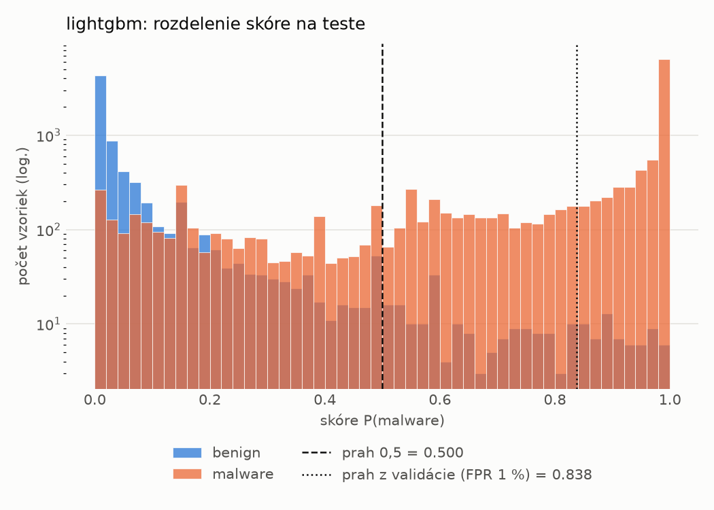
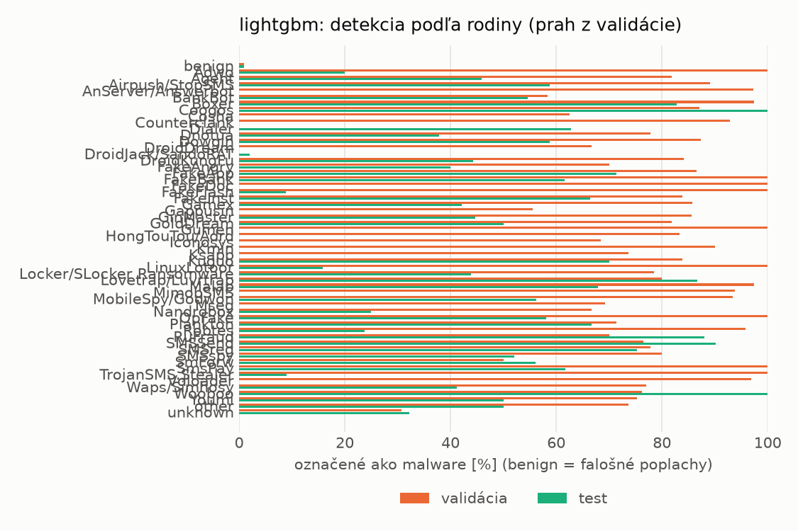
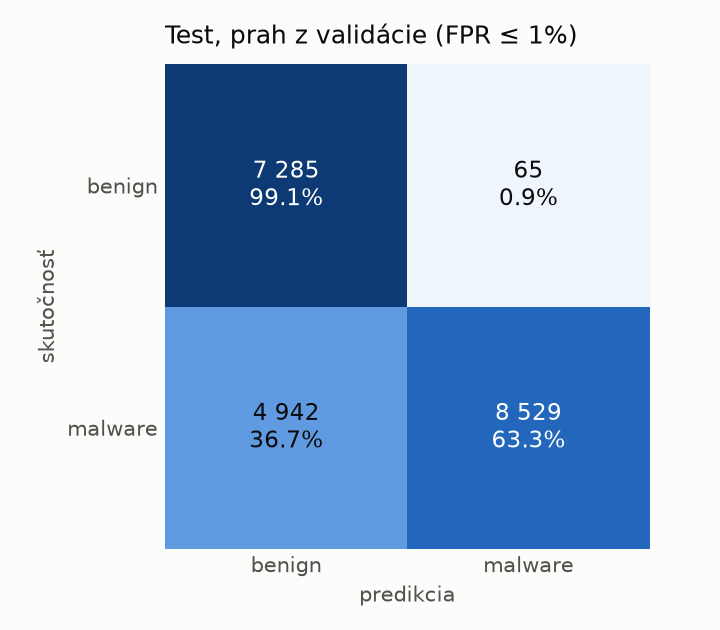
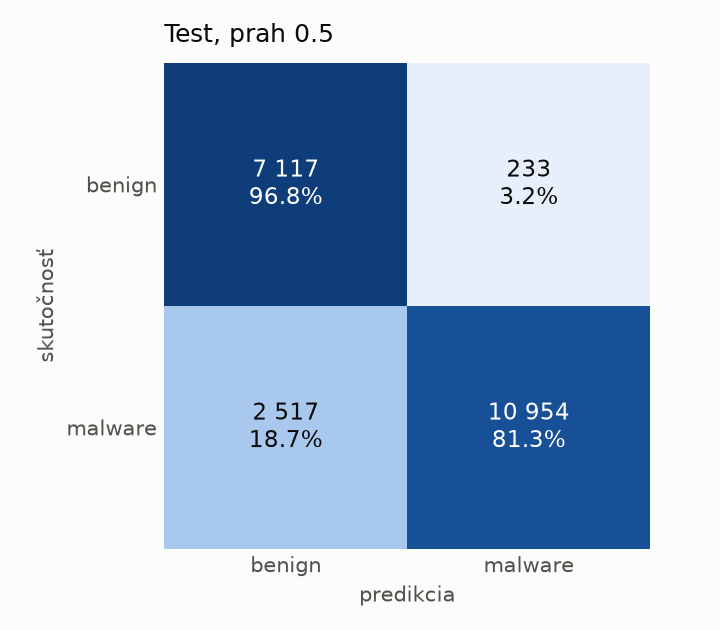
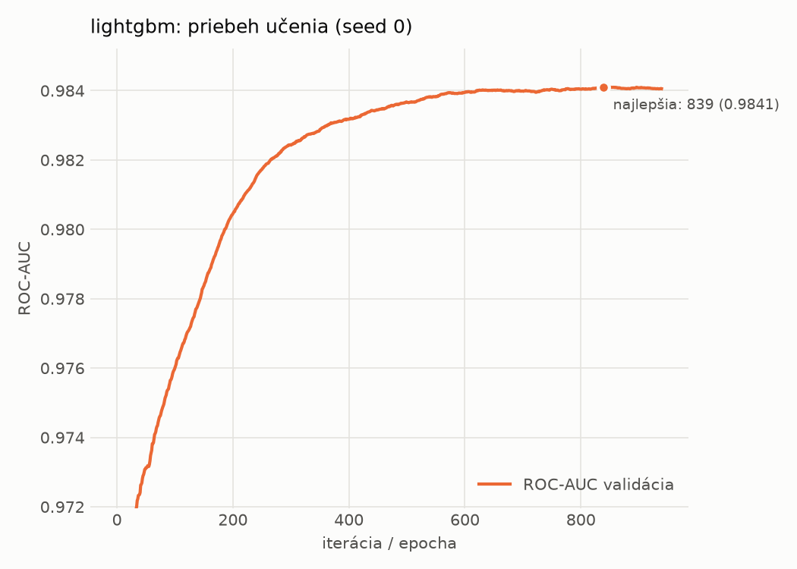

# dynamic/lightgbm – beh `20261123-223305`

> Automaticky generované (`src/training/run_tabular.py`). Konfigurácia: `config.yaml`, protokol: `protocol.yaml`.

- **Model:** `lightgbm` – LightGBM, gradient boosting stromov s early stopping na validácii (pôvodné hodnoty príznakov)
- **Ladenie:** bez ladenia – hyperparametre prevzaté z `runs_v4/real_full/full/dynamic/lightgbm/20261122-191914`
- **Finálne modely:** seedy [0, 1, 2]; hodnoty sú priemer ± smerodajná odchýlka cez seedy
- **Najlepšie hyperparametre:** `{"num_boost_round": 5000, "early_stopping_rounds": 100, "learning_rate": 0.017901592505193763, "num_leaves": 251, "min_child_samples": 52, "feature_fraction": 0.9358255991772038, "bagging_fraction": 0.8815171244905227, "lambda_l1": 0.02987319702672823, "lambda_l2": 0.017348460156736675}`

## Detekčná kvalita (bez prahu)
| metrika | train (podvzorka) | validácia | test |
|---|---|---|---|
| ROC-AUC | 0.9992 ± 0.0001 | 0.9841 ± 0.0001 | 0.9637 ± 0.0004 |
| PR-AUC | 0.9992 ± 0.0001 | 0.9863 ± 0.0000 | 0.9812 ± 0.0002 |
| TPR pri FPR 1 % | 0.9826 ± 0.0045 | 0.8732 ± 0.0026 | 0.6467 ± 0.0039 |
| TPR pri FPR 0,1 % | 0.9687 ± 0.0016 | 0.7327 ± 0.0027 | 0.4850 ± 0.0079 |
| log loss | 0.0452 ± 0.0038 | 0.1494 ± 0.0006 | 0.3392 ± 0.0029 |
| Brier skóre | 0.0102 ± 0.0008 | 0.0424 ± 0.0000 | 0.1014 ± 0.0009 |

Rozdiel ROC-AUC train − validácia: **0.0151** (veľký rozdiel = preučenie).

## Pri prahu z validácie (FPR ≤ 1% na validácii)
| metrika | train (podvzorka) | validácia | test |
|---|---|---|---|
| accuracy | 0.9758 ± 0.0003 | 0.9339 ± 0.0013 | 0.7628 ± 0.0061 |
| balanced accuracy | 0.9747 ± 0.0003 | 0.9318 ± 0.0013 | 0.8146 ± 0.0045 |
| precision | 1.0000 ± 0.0000 | 0.9883 ± 0.0002 | 0.9923 ± 0.0006 |
| recall (TPR) | 0.9493 ± 0.0007 | 0.8732 ± 0.0026 | 0.6383 ± 0.0098 |
| FPR | 0.0000 ± 0.0000 | 0.0096 ± 0.0002 | 0.0091 ± 0.0008 |
| F1 | 0.9740 ± 0.0004 | 0.9272 ± 0.0015 | 0.7768 ± 0.0071 |
| MCC | 0.9526 ± 0.0006 | 0.8727 ± 0.0023 | 0.6100 ± 0.0073 |

## Pri pevnom prahu 0.5
| metrika | train (podvzorka) | validácia | test |
|---|---|---|---|
| accuracy | 0.9869 ± 0.0009 | 0.9459 ± 0.0003 | 0.8686 ± 0.0019 |
| balanced accuracy | 0.9865 ± 0.0009 | 0.9451 ± 0.0003 | 0.8916 ± 0.0014 |
| precision | 0.9942 ± 0.0003 | 0.9630 ± 0.0006 | 0.9802 ± 0.0010 |
| recall (TPR) | 0.9782 ± 0.0015 | 0.9232 ± 0.0009 | 0.8133 ± 0.0033 |
| FPR | 0.0052 ± 0.0003 | 0.0330 ± 0.0006 | 0.0301 ± 0.0016 |
| F1 | 0.9861 ± 0.0009 | 0.9427 ± 0.0003 | 0.8890 ± 0.0018 |
| MCC | 0.9738 ± 0.0017 | 0.8921 ± 0.0006 | 0.7506 ± 0.0030 |

## Výpočtové nároky (seed 0, testovacia množina)
| meranie | hodnota |
|---|---|
| tréning finálneho modelu | 15.2 s (priemer cez seedy) |
| ladenie spolu | 0 s |
| počet parametrov / uzlov | 420 339 |
| veľkosť modelu na disku | 23.08 MB |
| CPU latencia modelu (batch 1, 1 vlákno) | 0.147 ms (p95 0.182) |
| CPU priepustnosť (24 vlákien) | 85 340 vzoriek/s |

## Grafy
| | |
|---|---|
|  |  |
|  |  |
|  |  |
|  |  |

## Súbory
`metrics.json` (všetky metriky po seedoch vrátane rodín), `timing.json`, `hpo_trials.csv`,
`predictions/<časť>_seed<N>.parquet` (sha256, family, label, score), `model/seed_<N>/`, `log.txt`.
