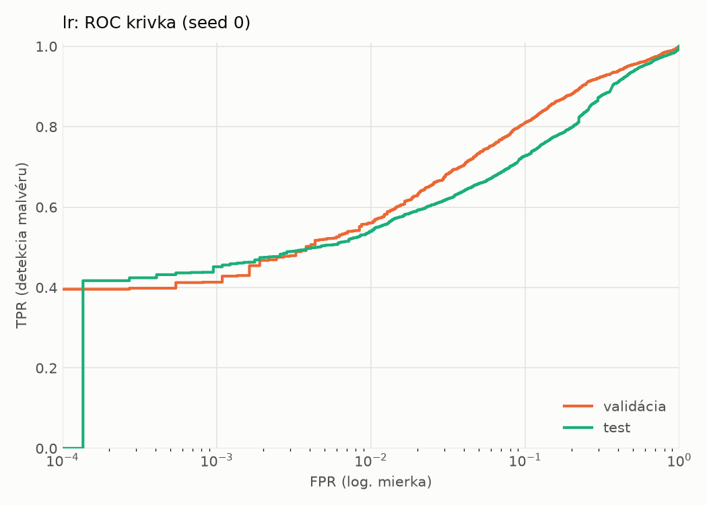
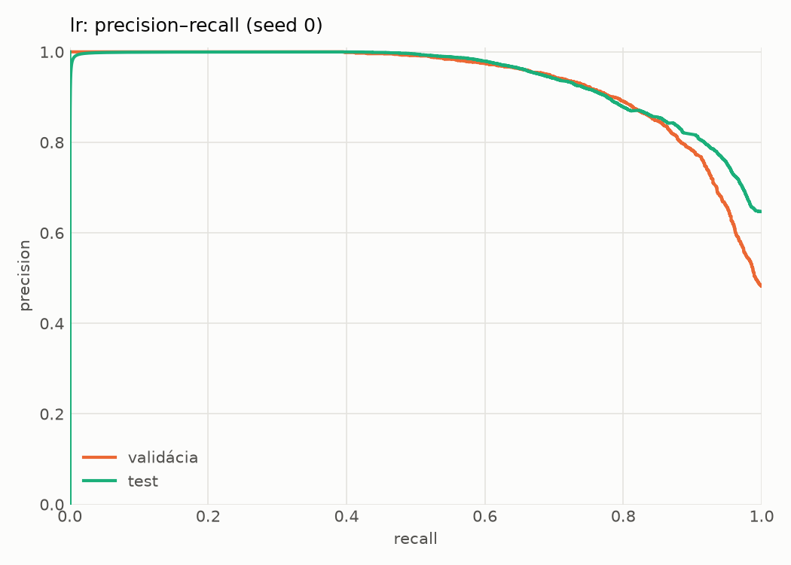
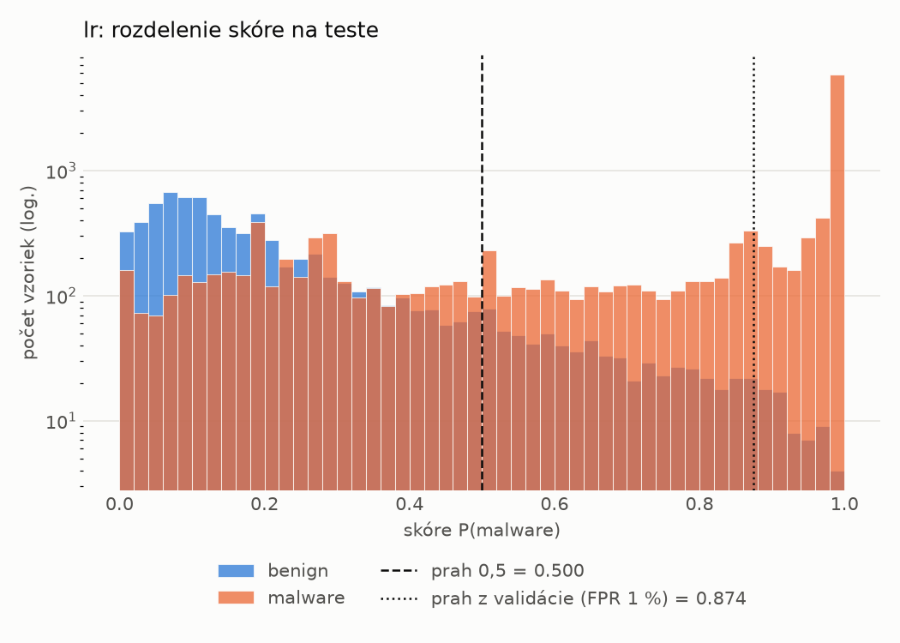
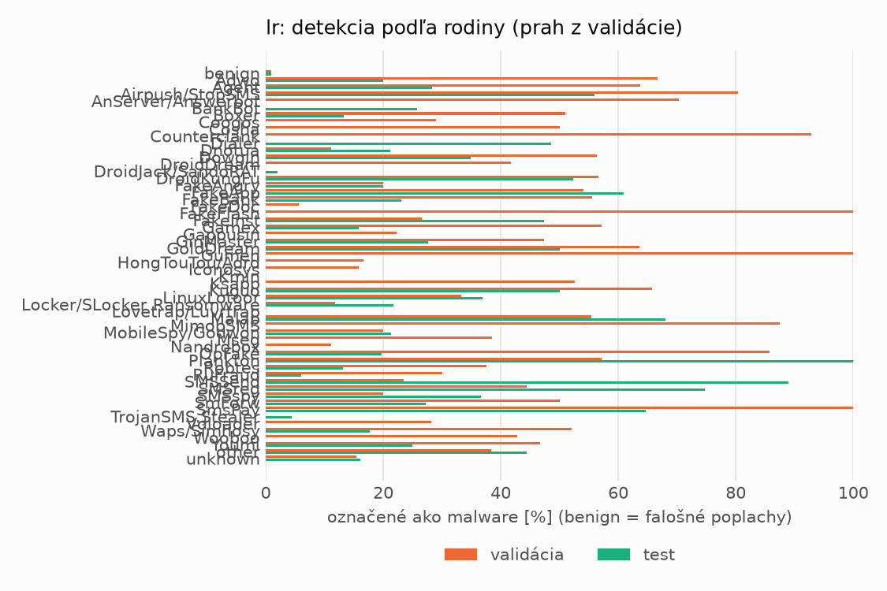
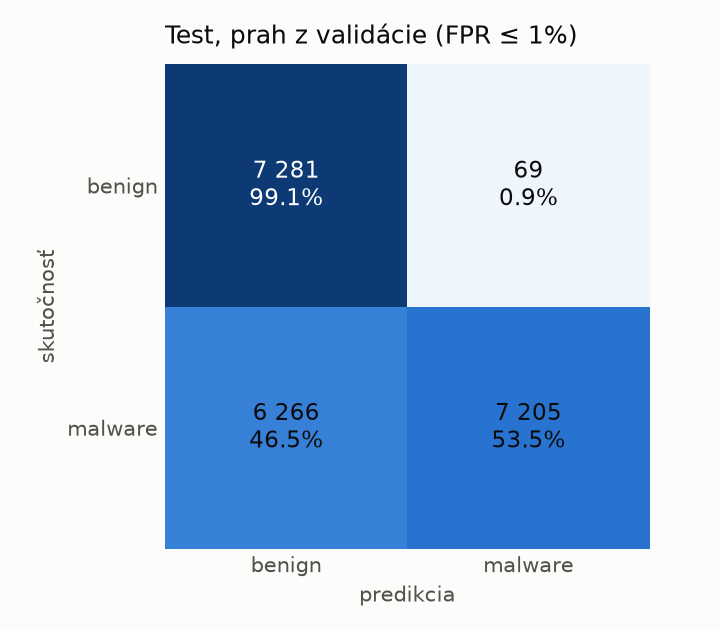
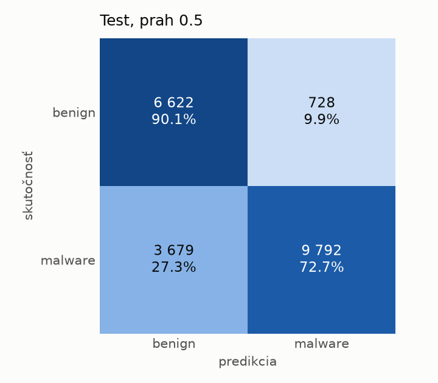

# dynamic/lr – beh `20261123-223244`

> Automaticky generované (`src/training/run_tabular.py`). Konfigurácia: `config.yaml`, protokol: `protocol.yaml`.

- **Model:** `logreg` – logistická regresia s L2 regularizáciou (vstup signed log1p + štandardizácia)
- **Ladenie:** bez ladenia – hyperparametre prevzaté z `runs_v4/real_full/full/dynamic/lr/20261122-191725`
- **Finálne modely:** seedy [0, 1, 2]; hodnoty sú priemer ± smerodajná odchýlka cez seedy
- **Najlepšie hyperparametre:** `{"max_iter": 2000, "C": 3.784688828069828}`

## Detekčná kvalita (bez prahu)
| metrika | train (podvzorka) | validácia | test |
|---|---|---|---|
| ROC-AUC | 0.9218 ± 0.0000 | 0.9225 ± 0.0000 | 0.8906 ± 0.0000 |
| PR-AUC | 0.9313 ± 0.0000 | 0.9347 ± 0.0000 | 0.9451 ± 0.0000 |
| TPR pri FPR 1 % | 0.5577 ± 0.0000 | 0.5605 ± 0.0000 | 0.5398 ± 0.0000 |
| TPR pri FPR 0,1 % | 0.4126 ± 0.0000 | 0.4133 ± 0.0000 | 0.4516 ± 0.0000 |
| log loss | 0.3433 ± 0.0000 | 0.3434 ± 0.0000 | 0.4722 ± 0.0000 |
| Brier skóre | 0.1053 ± 0.0000 | 0.1052 ± 0.0000 | 0.1455 ± 0.0000 |

Rozdiel ROC-AUC train − validácia: **-0.0007** (veľký rozdiel = preučenie).

## Pri prahu z validácie (FPR ≤ 1% na validácii)
| metrika | train (podvzorka) | validácia | test |
|---|---|---|---|
| accuracy | 0.7908 ± 0.0000 | 0.7829 ± 0.0000 | 0.6957 ± 0.0000 |
| balanced accuracy | 0.7812 ± 0.0000 | 0.7753 ± 0.0000 | 0.7627 ± 0.0000 |
| precision | 0.9796 ± 0.0000 | 0.9816 ± 0.0000 | 0.9905 ± 0.0000 |
| recall (TPR) | 0.5734 ± 0.0000 | 0.5605 ± 0.0000 | 0.5349 ± 0.0000 |
| FPR | 0.0109 ± 0.0000 | 0.0098 ± 0.0000 | 0.0094 ± 0.0000 |
| F1 | 0.7234 ± 0.0000 | 0.7135 ± 0.0000 | 0.6946 ± 0.0000 |
| MCC | 0.6263 ± 0.0000 | 0.6160 ± 0.0000 | 0.5267 ± 0.0000 |

## Pri pevnom prahu 0.5
| metrika | train (podvzorka) | validácia | test |
|---|---|---|---|
| accuracy | 0.8572 ± 0.0000 | 0.8555 ± 0.0000 | 0.7883 ± 0.0000 |
| balanced accuracy | 0.8555 ± 0.0000 | 0.8541 ± 0.0000 | 0.8139 ± 0.0000 |
| precision | 0.8743 ± 0.0000 | 0.8766 ± 0.0000 | 0.9308 ± 0.0000 |
| recall (TPR) | 0.8182 ± 0.0000 | 0.8151 ± 0.0000 | 0.7269 ± 0.0000 |
| FPR | 0.1073 ± 0.0000 | 0.1069 ± 0.0000 | 0.0990 ± 0.0000 |
| F1 | 0.8454 ± 0.0000 | 0.8447 ± 0.0000 | 0.8163 ± 0.0000 |
| MCC | 0.7143 ± 0.0000 | 0.7115 ± 0.0000 | 0.6001 ± 0.0000 |

## Výpočtové nároky (seed 0, testovacia množina)
| meranie | hodnota |
|---|---|
| tréning finálneho modelu | 0.3 s (priemer cez seedy) |
| ladenie spolu | 0 s |
| počet parametrov / uzlov | 130 |
| veľkosť modelu na disku | 0.01 MB |
| transformácia vstupu – latencia (1 vlákno) | 0.006 ms |
| transformácia vstupu – priepustnosť | 1 167 221 vzoriek/s |
| CPU latencia modelu (batch 1, 1 vlákno) | 0.004 ms (p95 0.004) |
| CPU priepustnosť (24 vlákien) | 5 047 515 vzoriek/s |

## Grafy
| | |
|---|---|
|  |  |
|  |  |
|  |  |
|  |  |

## Súbory
`metrics.json` (všetky metriky po seedoch vrátane rodín), `timing.json`, `hpo_trials.csv`,
`predictions/<časť>_seed<N>.parquet` (sha256, family, label, score), `model/seed_<N>/`, `log.txt`.
