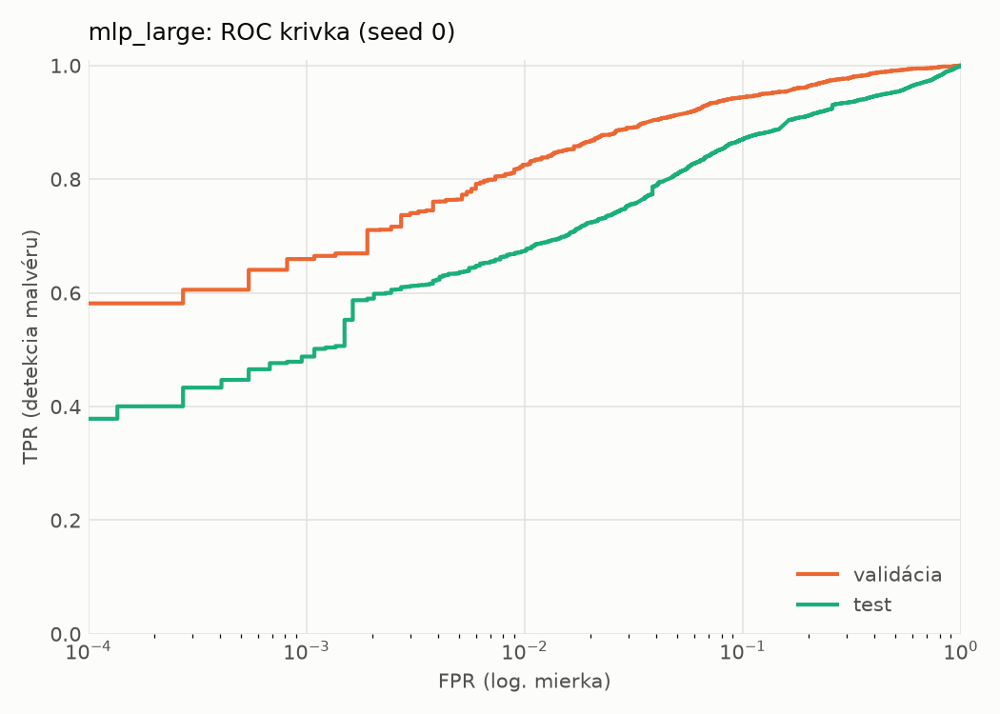
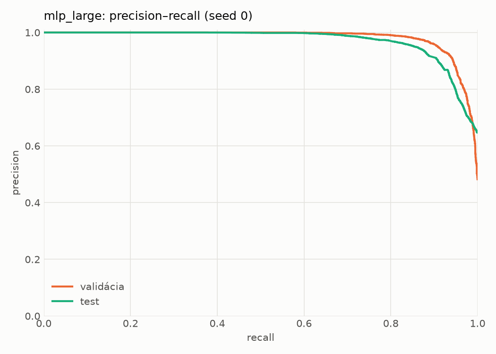
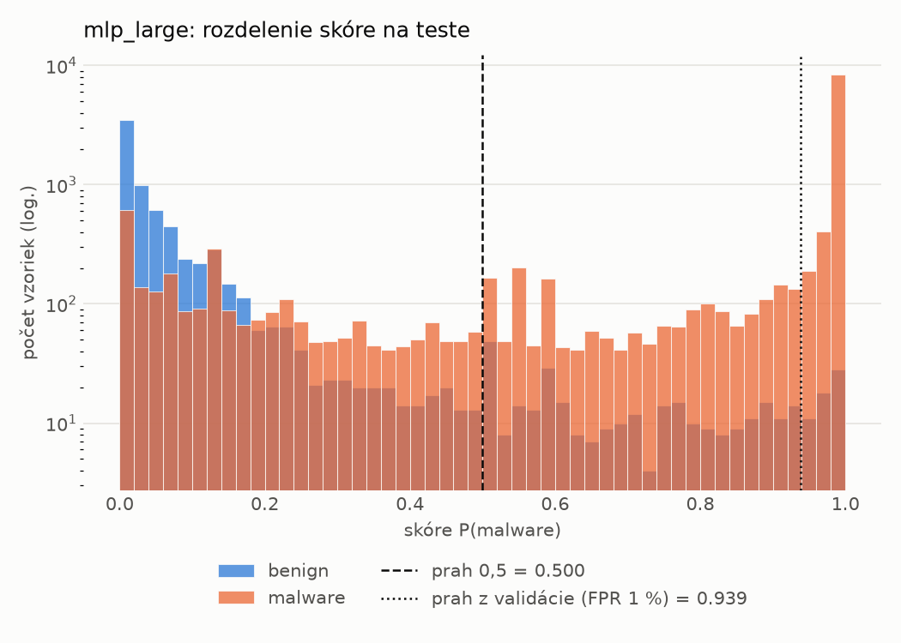
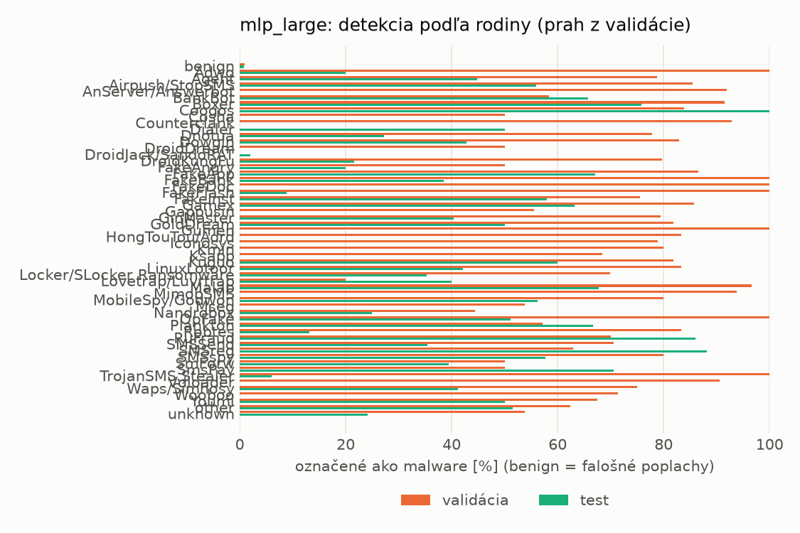
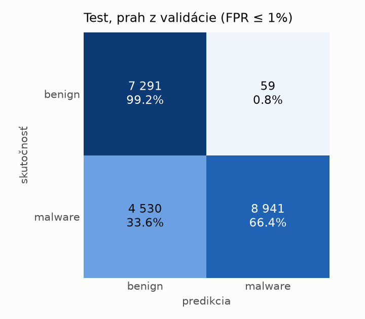
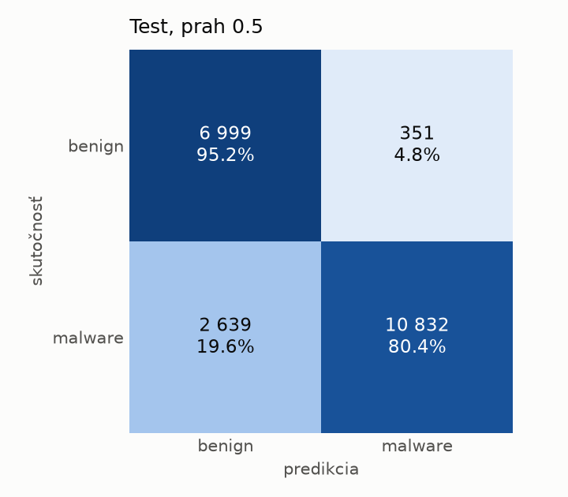
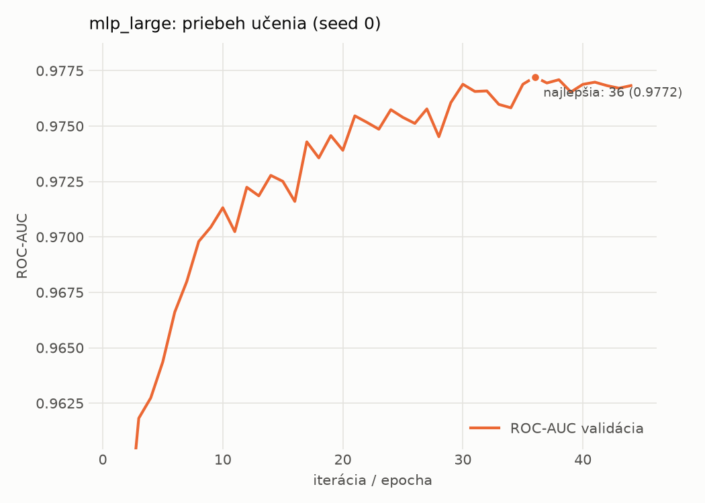

# dynamic/mlp_large – beh `20261123-223515`

> Automaticky generované (`src/training/run_tabular.py`). Konfigurácia: `config.yaml`, protokol: `protocol.yaml`.

- **Model:** `mlp` – veľká neurónová sieť (3–5 skrytých vrstiev, 512–2048 neurónov), kandidát na učiteľa
- **Ladenie:** bez ladenia – hyperparametre prevzaté z `runs_v4/real_full/full/dynamic/mlp_large/20261122-194320`
- **Finálne modely:** seedy [0, 1, 2]; hodnoty sú priemer ± smerodajná odchýlka cez seedy
- **Najlepšie hyperparametre:** `{"max_epochs": 100, "patience": 8, "hidden_layers": 3, "hidden_width": 512, "width_decay": 1.0, "dropout": 0.16077310300541978, "lr": 0.0005048635567863703, "weight_decay": 0.004783411439856203, "batch_size": 1024}`

## Detekčná kvalita (bez prahu)
| metrika | train (podvzorka) | validácia | test |
|---|---|---|---|
| ROC-AUC | 0.9891 ± 0.0014 | 0.9764 ± 0.0008 | 0.9398 ± 0.0031 |
| PR-AUC | 0.9902 ± 0.0012 | 0.9799 ± 0.0008 | 0.9717 ± 0.0014 |
| TPR pri FPR 1 % | 0.9045 ± 0.0086 | 0.8191 ± 0.0066 | 0.6729 ± 0.0093 |
| TPR pri FPR 0,1 % | 0.8207 ± 0.0086 | 0.6369 ± 0.0287 | 0.5205 ± 0.0286 |
| log loss | 0.1213 ± 0.0079 | 0.1929 ± 0.0043 | 0.4150 ± 0.0247 |
| Brier skóre | 0.0345 ± 0.0025 | 0.0536 ± 0.0015 | 0.1094 ± 0.0056 |

Rozdiel ROC-AUC train − validácia: **0.0127** (veľký rozdiel = preučenie).

## Pri prahu z validácie (FPR ≤ 1% na validácii)
| metrika | train (podvzorka) | validácia | test |
|---|---|---|---|
| accuracy | 0.9199 ± 0.0043 | 0.9077 ± 0.0031 | 0.7758 ± 0.0069 |
| balanced accuracy | 0.9161 ± 0.0045 | 0.9047 ± 0.0032 | 0.8249 ± 0.0053 |
| precision | 0.9979 ± 0.0005 | 0.9874 ± 0.0001 | 0.9935 ± 0.0001 |
| recall (TPR) | 0.8338 ± 0.0090 | 0.8191 ± 0.0066 | 0.6578 ± 0.0107 |
| FPR | 0.0016 ± 0.0004 | 0.0097 ± 0.0002 | 0.0079 ± 0.0001 |
| F1 | 0.9085 ± 0.0053 | 0.8954 ± 0.0039 | 0.7915 ± 0.0078 |
| MCC | 0.8490 ± 0.0076 | 0.8256 ± 0.0055 | 0.6277 ± 0.0090 |

## Pri pevnom prahu 0.5
| metrika | train (podvzorka) | validácia | test |
|---|---|---|---|
| accuracy | 0.9554 ± 0.0030 | 0.9277 ± 0.0027 | 0.8610 ± 0.0099 |
| balanced accuracy | 0.9548 ± 0.0030 | 0.9273 ± 0.0027 | 0.8808 ± 0.0071 |
| precision | 0.9645 ± 0.0043 | 0.9327 ± 0.0050 | 0.9665 ± 0.0018 |
| recall (TPR) | 0.9412 ± 0.0029 | 0.9162 ± 0.0029 | 0.8133 ± 0.0167 |
| FPR | 0.0316 ± 0.0039 | 0.0616 ± 0.0049 | 0.0517 ± 0.0035 |
| F1 | 0.9527 ± 0.0032 | 0.9244 ± 0.0028 | 0.8832 ± 0.0094 |
| MCC | 0.9108 ± 0.0060 | 0.8552 ± 0.0055 | 0.7310 ± 0.0153 |

## Výpočtové nároky (seed 0, testovacia množina)
| meranie | hodnota |
|---|---|
| tréning finálneho modelu | 3.9 s (priemer cez seedy) |
| ladenie spolu | 0 s |
| počet parametrov / uzlov | 595 457 |
| veľkosť modelu na disku | 2.41 MB |
| transformácia vstupu – latencia (1 vlákno) | 0.015 ms |
| transformácia vstupu – priepustnosť | 656 907 vzoriek/s |
| CPU latencia modelu (batch 1, 1 vlákno) | 0.139 ms (p95 0.175) |
| CPU priepustnosť (24 vlákien) | 524 583 vzoriek/s |
| GPU latencia (batch 1) | 0.448 ms (p95 0.946) |
| GPU priepustnosť | 2 110 914 vzoriek/s |
| GPU špičková pamäť | 125 MB |

## Grafy
| | |
|---|---|
|  |  |
|  |  |
|  |  |
|  |  |

## Súbory
`metrics.json` (všetky metriky po seedoch vrátane rodín), `timing.json`, `hpo_trials.csv`,
`predictions/<časť>_seed<N>.parquet` (sha256, family, label, score), `model/seed_<N>/`, `log.txt`.
