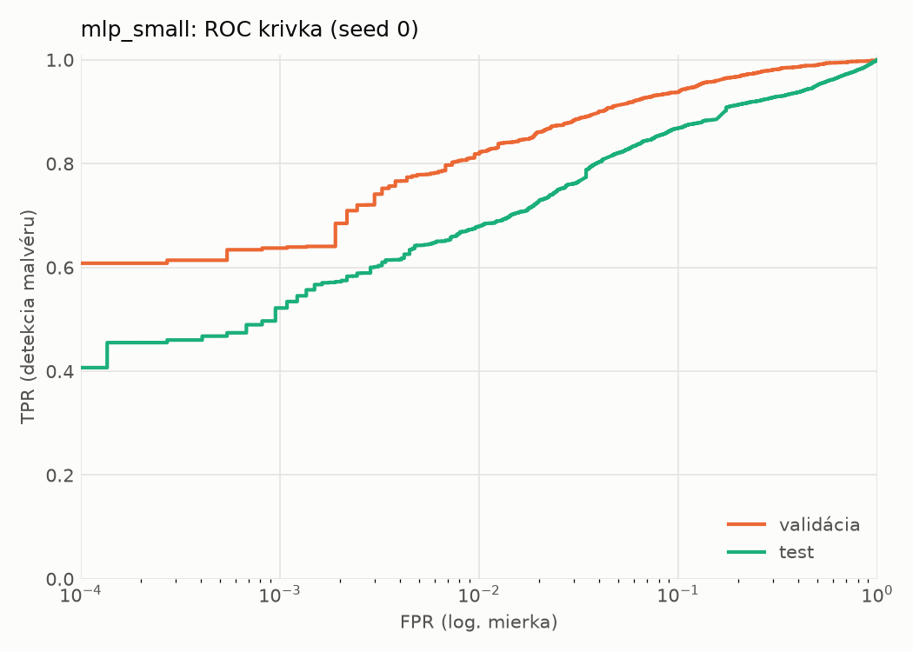
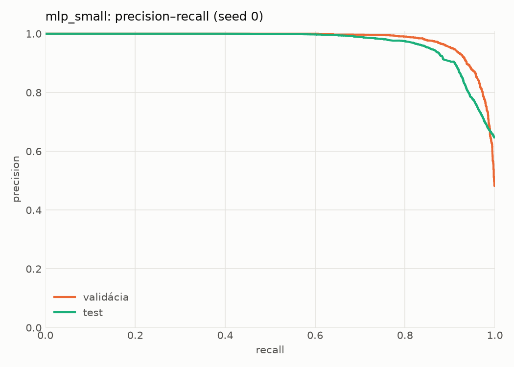
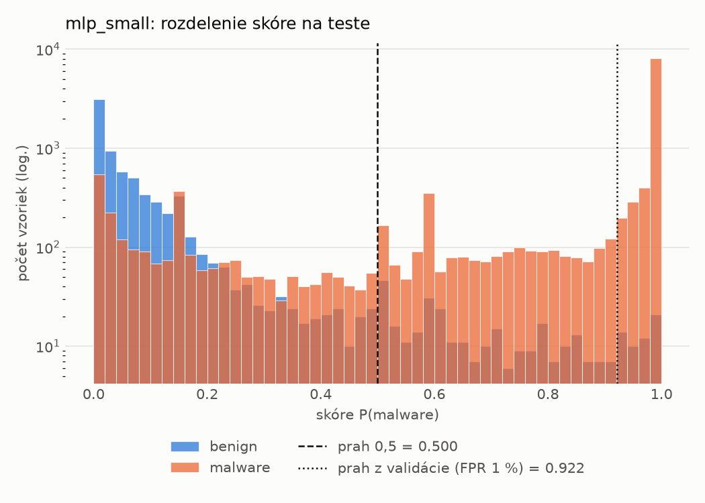
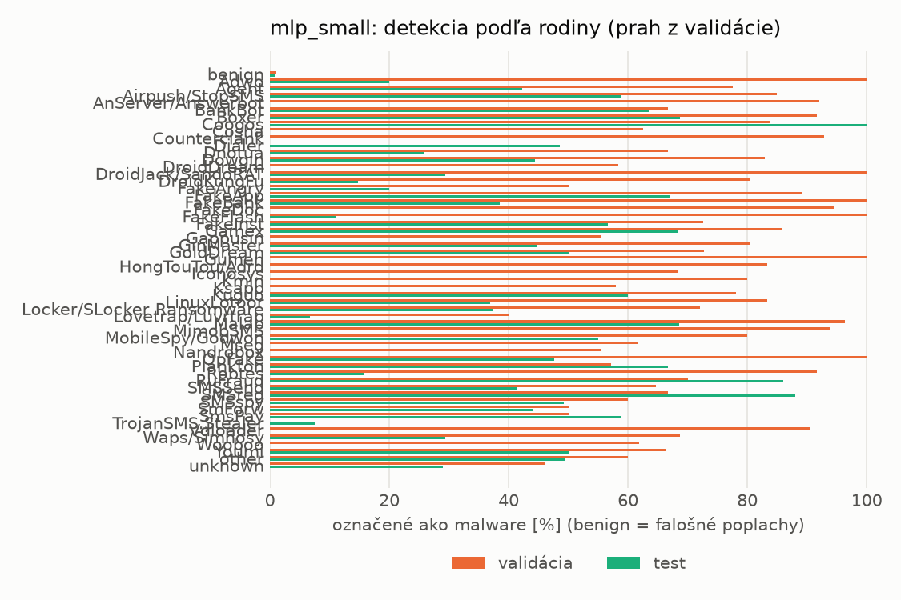
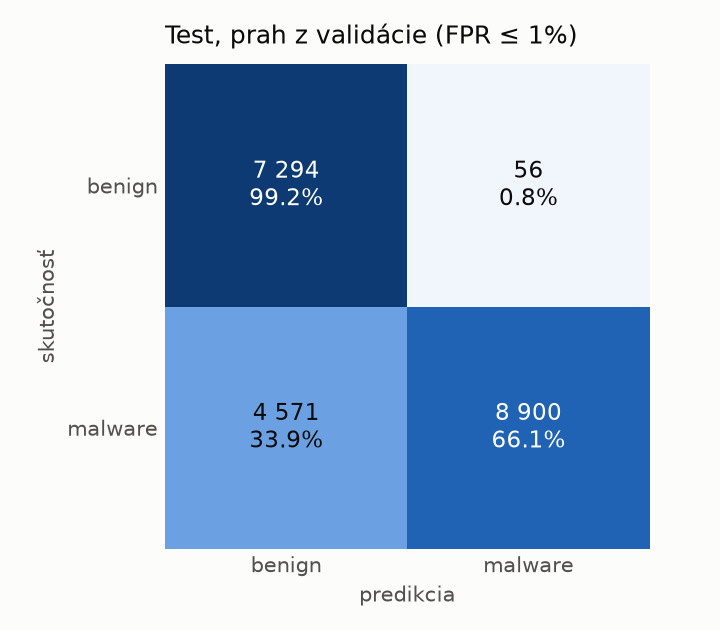
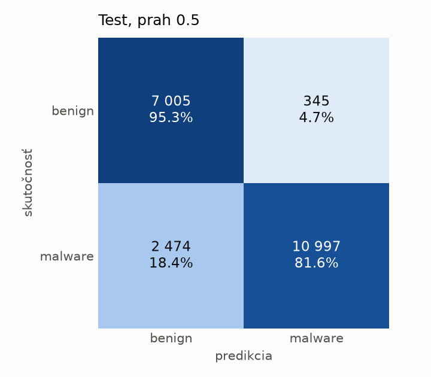
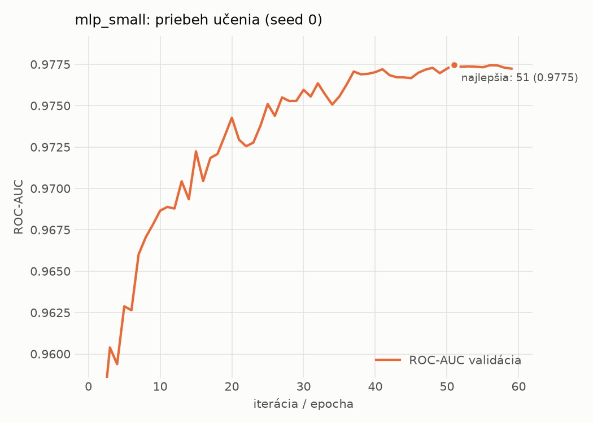

# dynamic/mlp_small – beh `20261123-223405`

> Automaticky generované (`src/training/run_tabular.py`). Konfigurácia: `config.yaml`, protokol: `protocol.yaml`.

- **Model:** `mlp` – malá neurónová sieť (1–2 skryté vrstvy), kandidát na ľahkého študenta
- **Ladenie:** bez ladenia – hyperparametre prevzaté z `runs_v4/real_full/full/dynamic/mlp_small/20261122-193213`
- **Finálne modely:** seedy [0, 1, 2]; hodnoty sú priemer ± smerodajná odchýlka cez seedy
- **Najlepšie hyperparametre:** `{"width_decay": 0.5, "max_epochs": 100, "patience": 8, "hidden_layers": 2, "hidden_width": 256, "dropout": 0.2449160262890371, "lr": 0.002872548733508973, "weight_decay": 4.509331245708397e-06, "batch_size": 256}`

## Detekčná kvalita (bez prahu)
| metrika | train (podvzorka) | validácia | test |
|---|---|---|---|
| ROC-AUC | 0.9894 ± 0.0008 | 0.9771 ± 0.0005 | 0.9361 ± 0.0049 |
| PR-AUC | 0.9904 ± 0.0007 | 0.9806 ± 0.0003 | 0.9703 ± 0.0021 |
| TPR pri FPR 1 % | 0.9022 ± 0.0066 | 0.8237 ± 0.0051 | 0.6702 ± 0.0112 |
| TPR pri FPR 0,1 % | 0.8240 ± 0.0111 | 0.6170 ± 0.0188 | 0.5389 ± 0.0205 |
| log loss | 0.1216 ± 0.0046 | 0.1919 ± 0.0025 | 0.4371 ± 0.0206 |
| Brier skóre | 0.0348 ± 0.0014 | 0.0521 ± 0.0006 | 0.1110 ± 0.0045 |

Rozdiel ROC-AUC train − validácia: **0.0123** (veľký rozdiel = preučenie).

## Pri prahu z validácie (FPR ≤ 1% na validácii)
| metrika | train (podvzorka) | validácia | test |
|---|---|---|---|
| accuracy | 0.9241 ± 0.0017 | 0.9099 ± 0.0024 | 0.7755 ± 0.0089 |
| balanced accuracy | 0.9205 ± 0.0018 | 0.9070 ± 0.0025 | 0.8246 ± 0.0070 |
| precision | 0.9974 ± 0.0008 | 0.9875 ± 0.0001 | 0.9930 ± 0.0008 |
| recall (TPR) | 0.8431 ± 0.0037 | 0.8237 ± 0.0051 | 0.6576 ± 0.0135 |
| FPR | 0.0020 ± 0.0006 | 0.0097 ± 0.0002 | 0.0085 ± 0.0008 |
| F1 | 0.9138 ± 0.0021 | 0.8982 ± 0.0030 | 0.7912 ± 0.0100 |
| MCC | 0.8564 ± 0.0031 | 0.8295 ± 0.0042 | 0.6269 ± 0.0120 |

## Pri pevnom prahu 0.5
| metrika | train (podvzorka) | validácia | test |
|---|---|---|---|
| accuracy | 0.9550 ± 0.0025 | 0.9318 ± 0.0010 | 0.8607 ± 0.0043 |
| balanced accuracy | 0.9541 ± 0.0024 | 0.9312 ± 0.0009 | 0.8823 ± 0.0026 |
| precision | 0.9690 ± 0.0053 | 0.9414 ± 0.0029 | 0.9709 ± 0.0019 |
| recall (TPR) | 0.9356 ± 0.0021 | 0.9156 ± 0.0024 | 0.8090 ± 0.0085 |
| FPR | 0.0273 ± 0.0048 | 0.0532 ± 0.0029 | 0.0445 ± 0.0034 |
| F1 | 0.9520 ± 0.0026 | 0.9283 ± 0.0010 | 0.8826 ± 0.0043 |
| MCC | 0.9101 ± 0.0052 | 0.8636 ± 0.0020 | 0.7330 ± 0.0057 |

## Výpočtové nároky (seed 0, testovacia množina)
| meranie | hodnota |
|---|---|
| tréning finálneho modelu | 22.9 s (priemer cez seedy) |
| ladenie spolu | 0 s |
| počet parametrov / uzlov | 67 073 |
| veľkosť modelu na disku | 0.28 MB |
| transformácia vstupu – latencia (1 vlákno) | 0.006 ms |
| transformácia vstupu – priepustnosť | 1 015 852 vzoriek/s |
| CPU latencia modelu (batch 1, 1 vlákno) | 0.079 ms (p95 0.227) |
| CPU priepustnosť (24 vlákien) | 2 168 131 vzoriek/s |
| GPU latencia (batch 1) | 0.579 ms (p95 0.711) |
| GPU priepustnosť | 2 702 973 vzoriek/s |
| GPU špičková pamäť | 75 MB |

## Grafy
| | |
|---|---|
|  |  |
|  |  |
|  |  |
|  |  |

## Súbory
`metrics.json` (všetky metriky po seedoch vrátane rodín), `timing.json`, `hpo_trials.csv`,
`predictions/<časť>_seed<N>.parquet` (sha256, family, label, score), `model/seed_<N>/`, `log.txt`.
