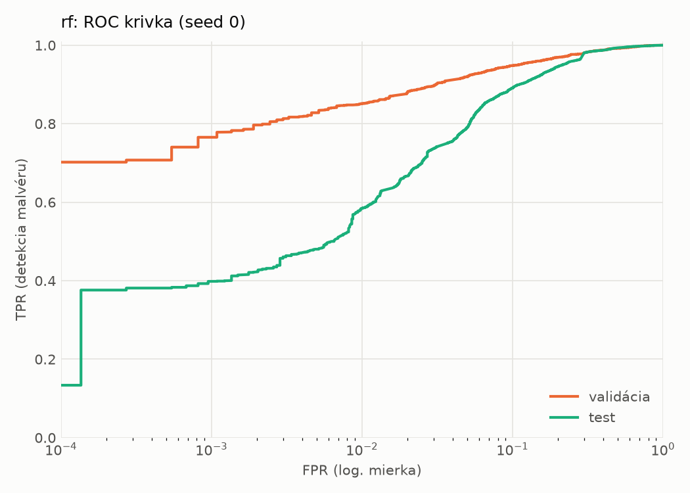
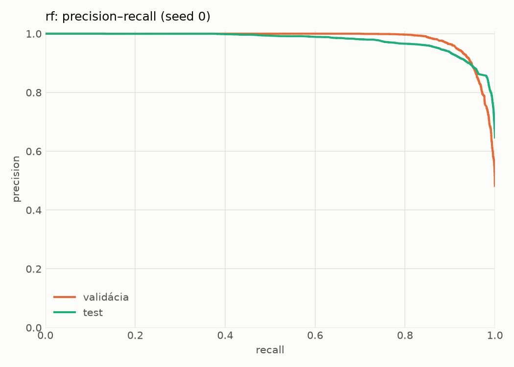
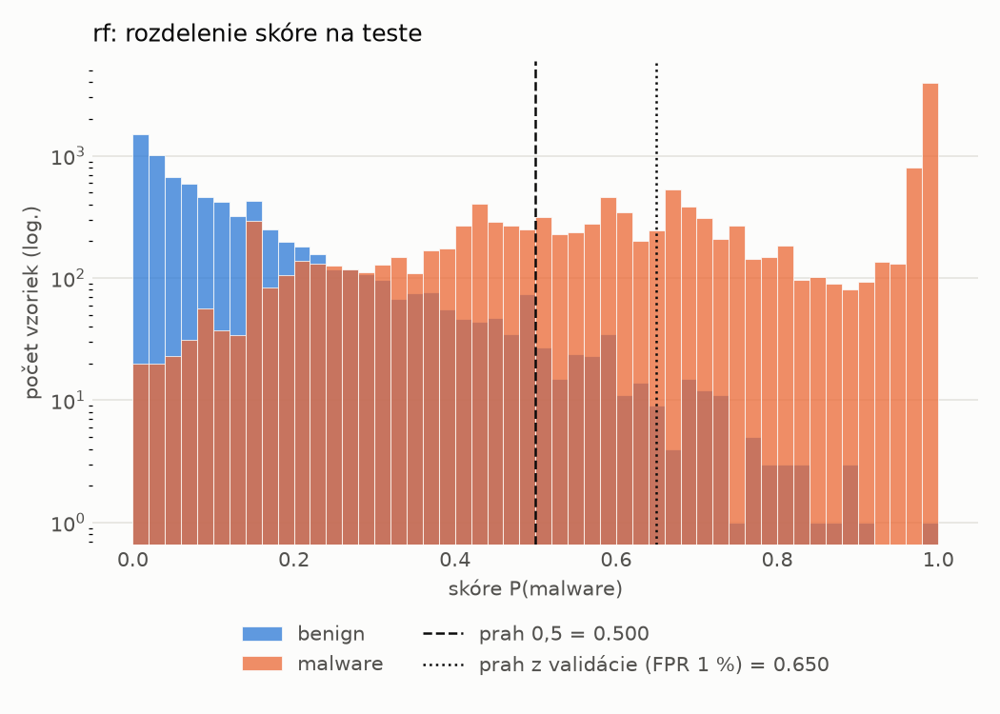
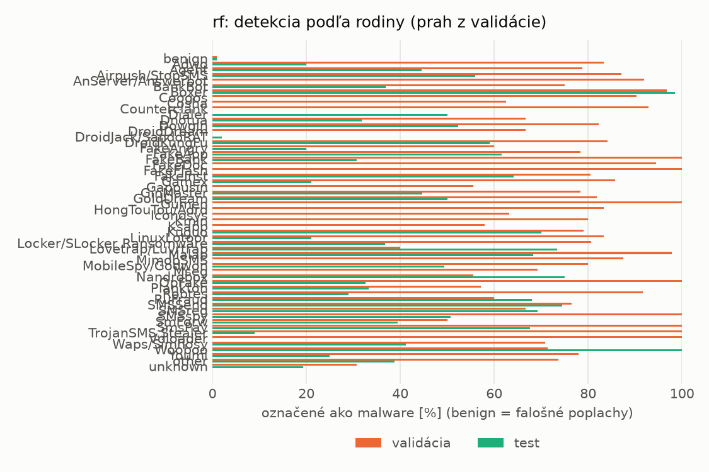
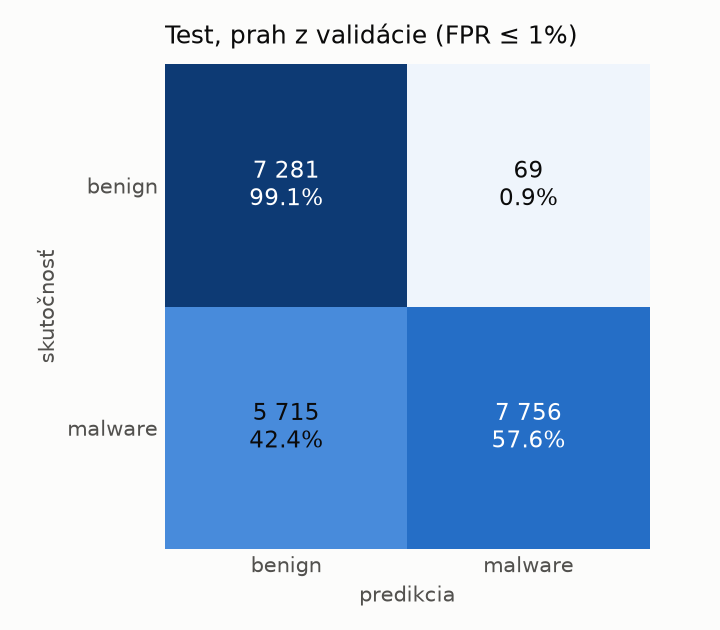
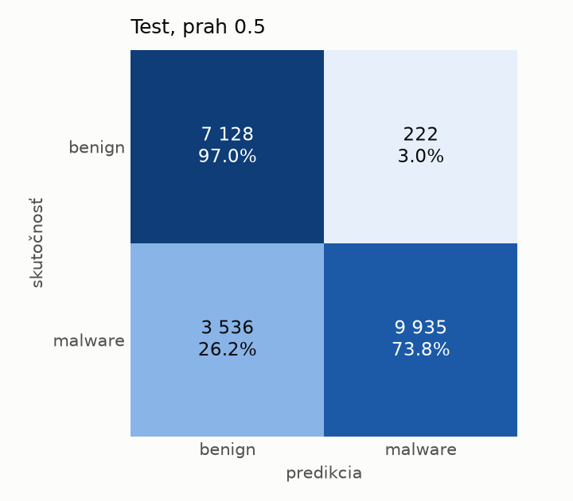

# dynamic/rf – beh `20261123-223247`

> Automaticky generované (`src/training/run_tabular.py`). Konfigurácia: `config.yaml`, protokol: `protocol.yaml`.

- **Model:** `random_forest` – Random Forest (pôvodné hodnoty príznakov)
- **Ladenie:** bez ladenia – hyperparametre prevzaté z `runs_v4/real_full/full/dynamic/rf/20261122-191738`
- **Finálne modely:** seedy [0, 1, 2]; hodnoty sú priemer ± smerodajná odchýlka cez seedy
- **Najlepšie hyperparametre:** `{"n_estimators": 500, "max_depth": 32, "min_samples_leaf": 1, "max_features": "sqrt"}`

## Detekčná kvalita (bez prahu)
| metrika | train (podvzorka) | validácia | test |
|---|---|---|---|
| ROC-AUC | 0.9991 ± 0.0000 | 0.9805 ± 0.0001 | 0.9603 ± 0.0004 |
| PR-AUC | 0.9992 ± 0.0000 | 0.9835 ± 0.0000 | 0.9777 ± 0.0003 |
| TPR pri FPR 1 % | 0.9950 ± 0.0002 | 0.8501 ± 0.0033 | 0.5814 ± 0.0101 |
| TPR pri FPR 0,1 % | 0.9747 ± 0.0001 | 0.7665 ± 0.0085 | 0.3994 ± 0.0019 |
| log loss | 0.0647 ± 0.0001 | 0.1800 ± 0.0001 | 0.3667 ± 0.0031 |
| Brier skóre | 0.0118 ± 0.0000 | 0.0513 ± 0.0000 | 0.1214 ± 0.0015 |

Rozdiel ROC-AUC train − validácia: **0.0186** (veľký rozdiel = preučenie).

## Pri prahu z validácie (FPR ≤ 1% na validácii)
| metrika | train (podvzorka) | validácia | test |
|---|---|---|---|
| accuracy | 0.9847 ± 0.0003 | 0.9226 ± 0.0016 | 0.7158 ± 0.0058 |
| balanced accuracy | 0.9840 ± 0.0003 | 0.9201 ± 0.0017 | 0.7783 ± 0.0044 |
| precision | 0.9998 ± 0.0000 | 0.9878 ± 0.0000 | 0.9912 ± 0.0005 |
| recall (TPR) | 0.9681 ± 0.0006 | 0.8501 ± 0.0033 | 0.5657 ± 0.0092 |
| FPR | 0.0002 ± 0.0000 | 0.0098 ± 0.0000 | 0.0092 ± 0.0006 |
| F1 | 0.9837 ± 0.0003 | 0.9138 ± 0.0019 | 0.7203 ± 0.0074 |
| MCC | 0.9697 ± 0.0006 | 0.8521 ± 0.0029 | 0.5511 ± 0.0069 |

## Pri pevnom prahu 0.5
| metrika | train (podvzorka) | validácia | test |
|---|---|---|---|
| accuracy | 0.9915 ± 0.0001 | 0.9374 ± 0.0009 | 0.8171 ± 0.0023 |
| balanced accuracy | 0.9912 ± 0.0001 | 0.9364 ± 0.0009 | 0.8515 ± 0.0021 |
| precision | 0.9956 ± 0.0000 | 0.9615 ± 0.0012 | 0.9772 ± 0.0010 |
| recall (TPR) | 0.9865 ± 0.0002 | 0.9065 ± 0.0018 | 0.7344 ± 0.0029 |
| FPR | 0.0040 ± 0.0000 | 0.0338 ± 0.0011 | 0.0314 ± 0.0012 |
| F1 | 0.9910 ± 0.0001 | 0.9332 ± 0.0010 | 0.8386 ± 0.0023 |
| MCC | 0.9829 ± 0.0002 | 0.8758 ± 0.0018 | 0.6722 ± 0.0039 |

## Výpočtové nároky (seed 0, testovacia množina)
| meranie | hodnota |
|---|---|
| tréning finálneho modelu | 2.9 s (priemer cez seedy) |
| ladenie spolu | 0 s |
| počet parametrov / uzlov | 4 386 172 |
| veľkosť modelu na disku | 351.29 MB |
| CPU latencia modelu (batch 1, 1 vlákno) | 14.427 ms (p95 15.073) |
| CPU priepustnosť (24 vlákien) | 122 557 vzoriek/s |

## Grafy
| | |
|---|---|
|  |  |
|  |  |
|  |  |
|  |  |

## Súbory
`metrics.json` (všetky metriky po seedoch vrátane rodín), `timing.json`, `hpo_trials.csv`,
`predictions/<časť>_seed<N>.parquet` (sha256, family, label, score), `model/seed_<N>/`, `log.txt`.
