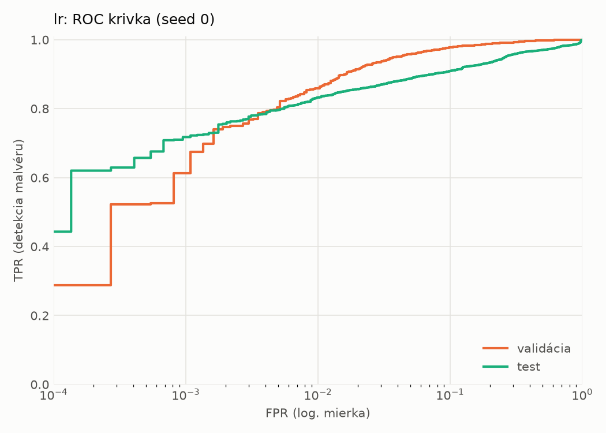
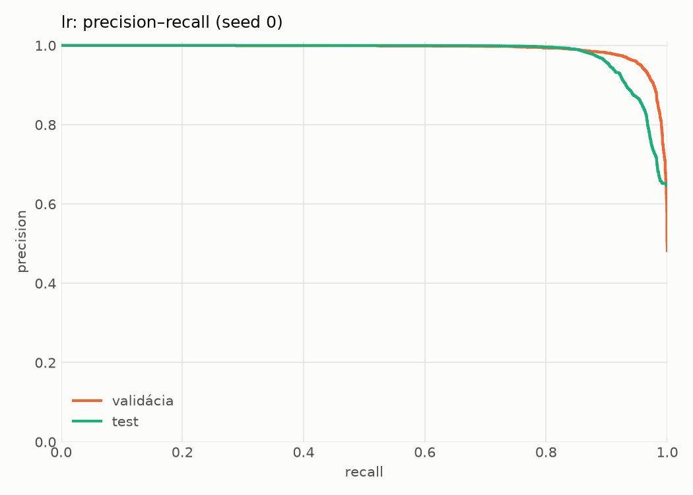
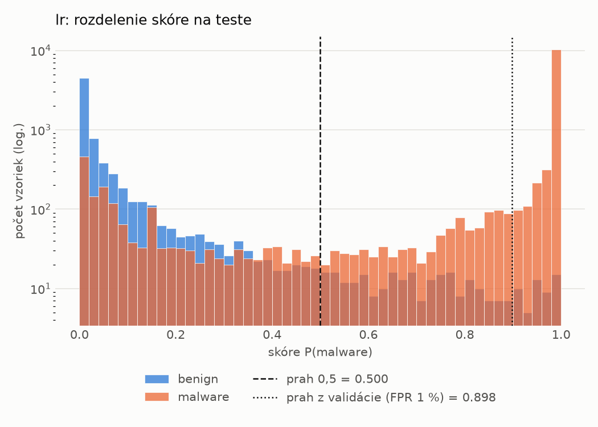
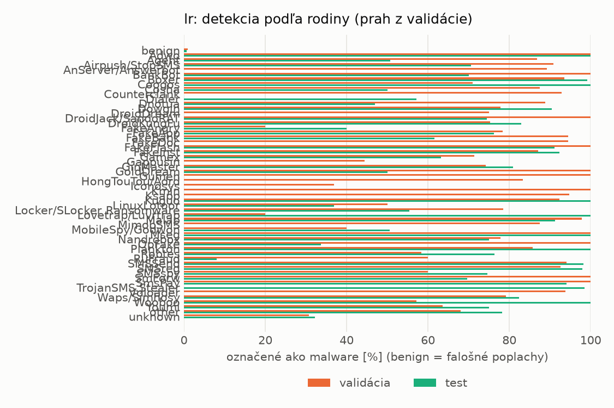
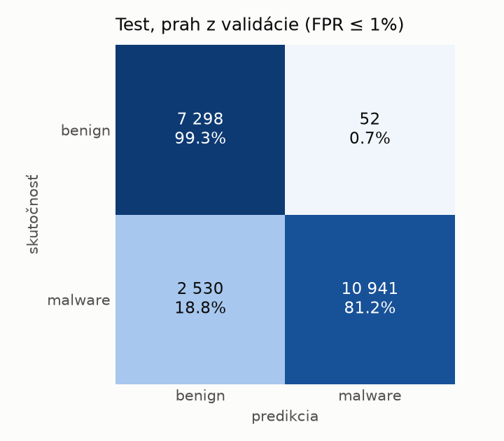
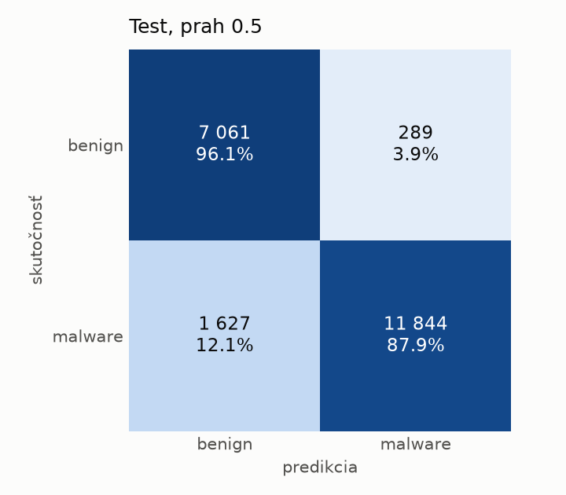

# hybrid/lr – beh `20261123-223532`

> Automaticky generované (`src/training/run_tabular.py`). Konfigurácia: `config.yaml`, protokol: `protocol.yaml`.

- **Model:** `logreg` – logistická regresia s L2 regularizáciou (vstup signed log1p + štandardizácia)
- **Ladenie:** bez ladenia – hyperparametre prevzaté z `runs_v4/real_full/full/hybrid/lr/20261122-195001`
- **Finálne modely:** seedy [0, 1, 2]; hodnoty sú priemer ± smerodajná odchýlka cez seedy
- **Najlepšie hyperparametre:** `{"max_iter": 2000, "C": 0.30240503427727145}`

## Detekčná kvalita (bez prahu)
| metrika | train (podvzorka) | validácia | test |
|---|---|---|---|
| ROC-AUC | 0.9900 ± 0.0000 | 0.9896 ± 0.0000 | 0.9584 ± 0.0000 |
| PR-AUC | 0.9905 ± 0.0000 | 0.9901 ± 0.0000 | 0.9817 ± 0.0000 |
| TPR pri FPR 1 % | 0.8820 ± 0.0000 | 0.8584 ± 0.0000 | 0.8327 ± 0.0000 |
| TPR pri FPR 0,1 % | 0.7136 ± 0.0000 | 0.6130 ± 0.0000 | 0.7177 ± 0.0000 |
| log loss | 0.1209 ± 0.0000 | 0.1255 ± 0.0000 | 0.3507 ± 0.0000 |
| Brier skóre | 0.0337 ± 0.0000 | 0.0348 ± 0.0000 | 0.0753 ± 0.0000 |

Rozdiel ROC-AUC train − validácia: **0.0004** (veľký rozdiel = preučenie).

## Pri prahu z validácie (FPR ≤ 1% na validácii)
| metrika | train (podvzorka) | validácia | test |
|---|---|---|---|
| accuracy | 0.9272 ± 0.0000 | 0.9268 ± 0.0000 | 0.8760 ± 0.0000 |
| balanced accuracy | 0.9239 ± 0.0000 | 0.9244 ± 0.0000 | 0.9026 ± 0.0000 |
| precision | 0.9932 ± 0.0000 | 0.9882 ± 0.0000 | 0.9953 ± 0.0000 |
| recall (TPR) | 0.8532 ± 0.0000 | 0.8584 ± 0.0000 | 0.8122 ± 0.0000 |
| FPR | 0.0054 ± 0.0000 | 0.0095 ± 0.0000 | 0.0071 ± 0.0000 |
| F1 | 0.9179 ± 0.0000 | 0.9187 ± 0.0000 | 0.8945 ± 0.0000 |
| MCC | 0.8611 ± 0.0000 | 0.8597 ± 0.0000 | 0.7707 ± 0.0000 |

## Pri pevnom prahu 0.5
| metrika | train (podvzorka) | validácia | test |
|---|---|---|---|
| accuracy | 0.9556 ± 0.0000 | 0.9546 ± 0.0000 | 0.9080 ± 0.0000 |
| balanced accuracy | 0.9553 ± 0.0000 | 0.9546 ± 0.0000 | 0.9200 ± 0.0000 |
| precision | 0.9571 ± 0.0000 | 0.9535 ± 0.0000 | 0.9762 ± 0.0000 |
| recall (TPR) | 0.9495 ± 0.0000 | 0.9524 ± 0.0000 | 0.8792 ± 0.0000 |
| FPR | 0.0388 ± 0.0000 | 0.0433 ± 0.0000 | 0.0393 ± 0.0000 |
| F1 | 0.9533 ± 0.0000 | 0.9530 ± 0.0000 | 0.9252 ± 0.0000 |
| MCC | 0.9110 ± 0.0000 | 0.9092 ± 0.0000 | 0.8140 ± 0.0000 |

## Výpočtové nároky (seed 0, testovacia množina)
| meranie | hodnota |
|---|---|
| tréning finálneho modelu | 0.3 s (priemer cez seedy) |
| ladenie spolu | 0 s |
| počet parametrov / uzlov | 293 |
| veľkosť modelu na disku | 0.01 MB |
| transformácia vstupu – latencia (1 vlákno) | 0.007 ms |
| transformácia vstupu – priepustnosť | 485 976 vzoriek/s |
| CPU latencia modelu (batch 1, 1 vlákno) | 0.004 ms (p95 0.004) |
| CPU priepustnosť (24 vlákien) | 2 188 551 vzoriek/s |

## Grafy
| | |
|---|---|
|  |  |
|  |  |
|  |  |
|  |  |

## Súbory
`metrics.json` (všetky metriky po seedoch vrátane rodín), `timing.json`, `hpo_trials.csv`,
`predictions/<časť>_seed<N>.parquet` (sha256, family, label, score), `model/seed_<N>/`, `log.txt`.
