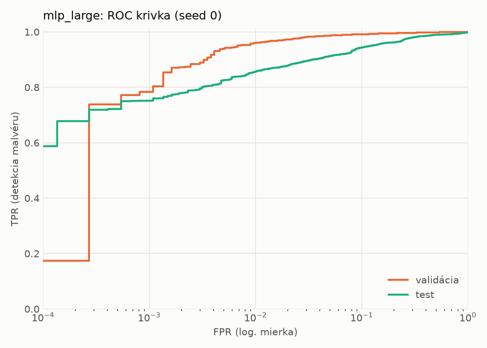
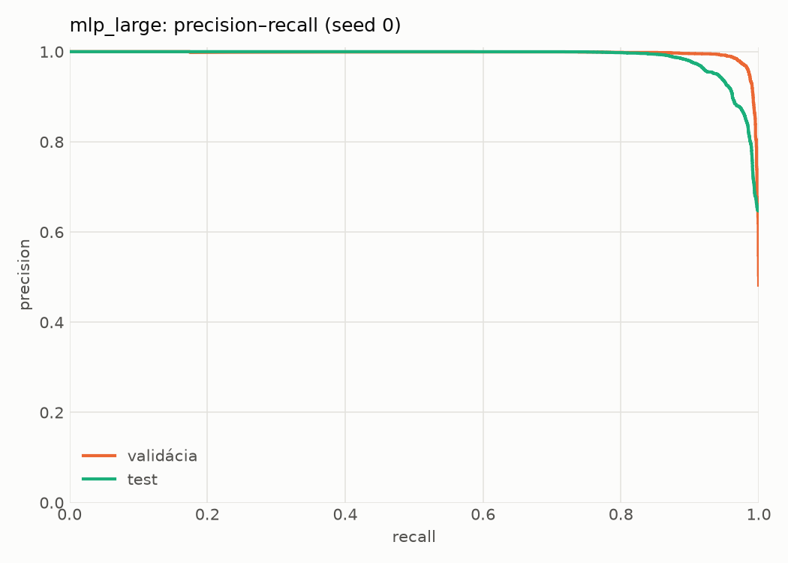
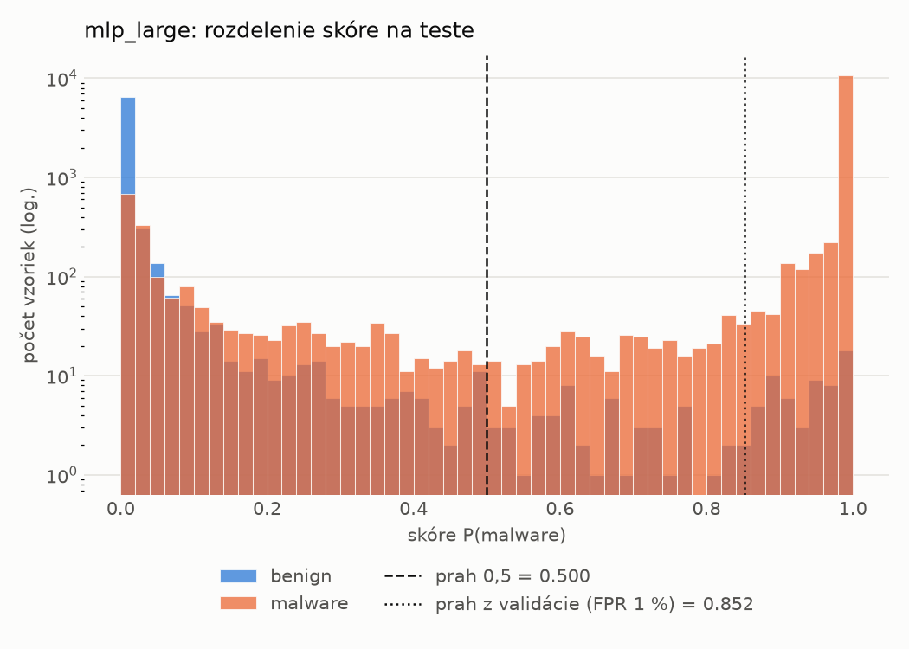
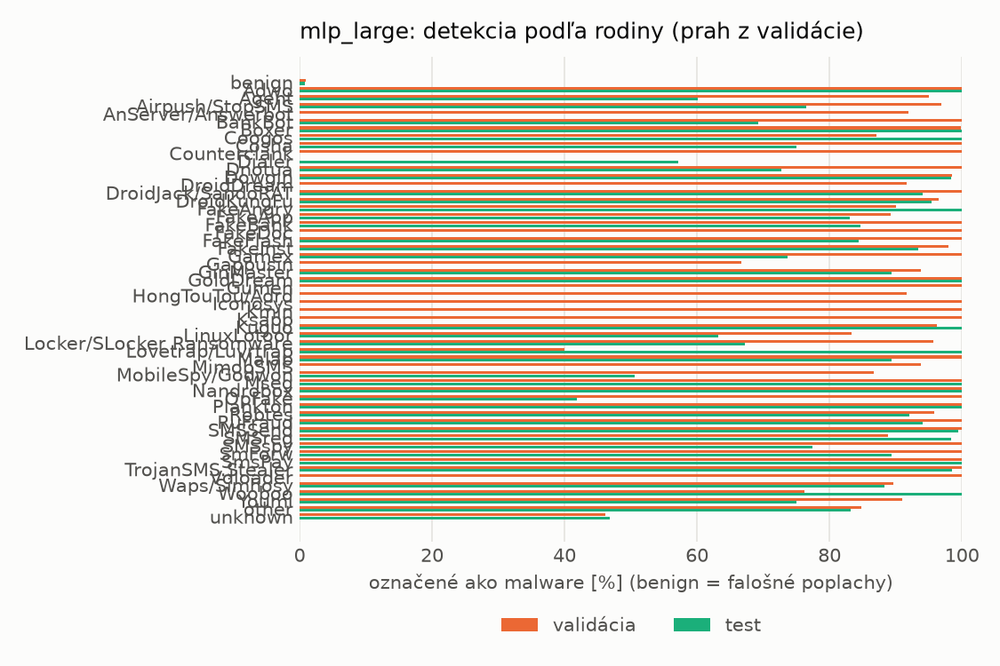
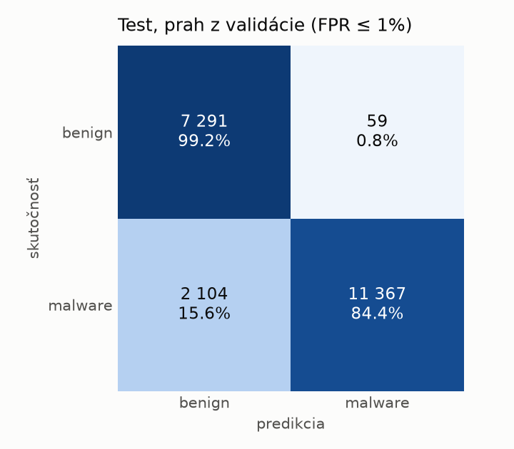
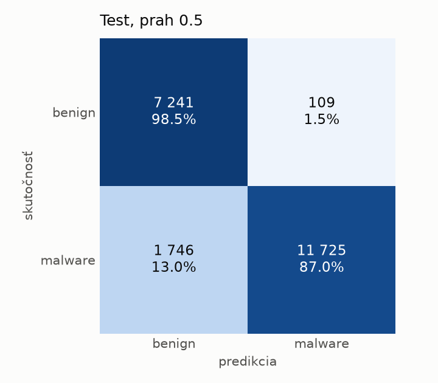
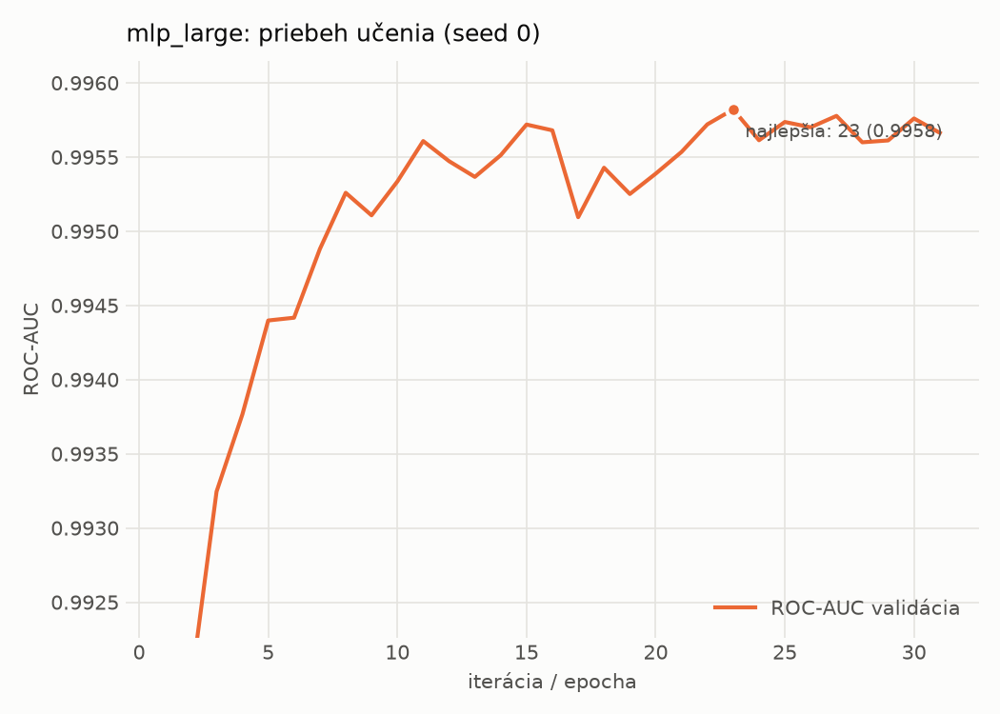

# hybrid/mlp_large – beh `20261123-223715`

> Automaticky generované (`src/training/run_tabular.py`). Konfigurácia: `config.yaml`, protokol: `protocol.yaml`.

- **Model:** `mlp` – veľká neurónová sieť (3–5 skrytých vrstiev, 512–2048 neurónov), kandidát na učiteľa
- **Ladenie:** bez ladenia – hyperparametre prevzaté z `runs_v4/real_full/full/hybrid/mlp_large/20261122-201300`
- **Finálne modely:** seedy [0, 1, 2]; hodnoty sú priemer ± smerodajná odchýlka cez seedy
- **Najlepšie hyperparametre:** `{"max_epochs": 100, "patience": 8, "hidden_layers": 3, "hidden_width": 512, "width_decay": 0.5, "dropout": 0.18171623767667733, "lr": 0.00010022812541545209, "weight_decay": 7.819097276436122e-06, "batch_size": 256}`

## Detekčná kvalita (bez prahu)
| metrika | train (podvzorka) | validácia | test |
|---|---|---|---|
| ROC-AUC | 0.9994 ± 0.0001 | 0.9960 ± 0.0004 | 0.9742 ± 0.0020 |
| PR-AUC | 0.9994 ± 0.0001 | 0.9963 ± 0.0004 | 0.9883 ± 0.0006 |
| TPR pri FPR 1 % | 0.9905 ± 0.0005 | 0.9579 ± 0.0022 | 0.8609 ± 0.0039 |
| TPR pri FPR 0,1 % | 0.9793 ± 0.0033 | 0.8005 ± 0.0149 | 0.7255 ± 0.0254 |
| log loss | 0.0261 ± 0.0009 | 0.0754 ± 0.0021 | 0.3367 ± 0.0107 |
| Brier skóre | 0.0067 ± 0.0003 | 0.0189 ± 0.0004 | 0.0728 ± 0.0035 |

Rozdiel ROC-AUC train − validácia: **0.0034** (veľký rozdiel = preučenie).

## Pri prahu z validácie (FPR ≤ 1% na validácii)
| metrika | train (podvzorka) | validácia | test |
|---|---|---|---|
| accuracy | 0.9866 ± 0.0008 | 0.9747 ± 0.0011 | 0.8977 ± 0.0023 |
| balanced accuracy | 0.9860 ± 0.0009 | 0.9742 ± 0.0011 | 0.9192 ± 0.0019 |
| precision | 0.9995 ± 0.0003 | 0.9893 ± 0.0003 | 0.9950 ± 0.0002 |
| recall (TPR) | 0.9725 ± 0.0015 | 0.9579 ± 0.0022 | 0.8462 ± 0.0035 |
| FPR | 0.0004 ± 0.0003 | 0.0096 ± 0.0003 | 0.0078 ± 0.0002 |
| F1 | 0.9858 ± 0.0009 | 0.9734 ± 0.0011 | 0.9146 ± 0.0021 |
| MCC | 0.9735 ± 0.0016 | 0.9498 ± 0.0021 | 0.8054 ± 0.0039 |

## Pri pevnom prahu 0.5
| metrika | train (podvzorka) | validácia | test |
|---|---|---|---|
| accuracy | 0.9915 ± 0.0006 | 0.9763 ± 0.0007 | 0.9156 ± 0.0040 |
| balanced accuracy | 0.9913 ± 0.0006 | 0.9762 ± 0.0007 | 0.9310 ± 0.0028 |
| precision | 0.9958 ± 0.0015 | 0.9779 ± 0.0010 | 0.9899 ± 0.0017 |
| recall (TPR) | 0.9863 ± 0.0007 | 0.9728 ± 0.0018 | 0.8784 ± 0.0072 |
| FPR | 0.0038 ± 0.0014 | 0.0205 ± 0.0010 | 0.0164 ± 0.0029 |
| F1 | 0.9910 ± 0.0006 | 0.9754 ± 0.0007 | 0.9308 ± 0.0036 |
| MCC | 0.9830 ± 0.0012 | 0.9525 ± 0.0014 | 0.8332 ± 0.0066 |

## Výpočtové nároky (seed 0, testovacia množina)
| meranie | hodnota |
|---|---|
| tréning finálneho modelu | 11.8 s (priemer cez seedy) |
| ladenie spolu | 0 s |
| počet parametrov / uzlov | 316 161 |
| veľkosť modelu na disku | 1.29 MB |
| transformácia vstupu – latencia (1 vlákno) | 0.017 ms |
| transformácia vstupu – priepustnosť | 273 127 vzoriek/s |
| CPU latencia modelu (batch 1, 1 vlákno) | 0.112 ms (p95 0.134) |
| CPU priepustnosť (24 vlákien) | 739 661 vzoriek/s |
| GPU latencia (batch 1) | 0.428 ms (p95 0.912) |
| GPU priepustnosť | 546 049 vzoriek/s |
| GPU špičková pamäť | 212 MB |

## Grafy
| | |
|---|---|
|  |  |
|  |  |
|  |  |
|  |  |

## Súbory
`metrics.json` (všetky metriky po seedoch vrátane rodín), `timing.json`, `hpo_trials.csv`,
`predictions/<časť>_seed<N>.parquet` (sha256, family, label, score), `model/seed_<N>/`, `log.txt`.
