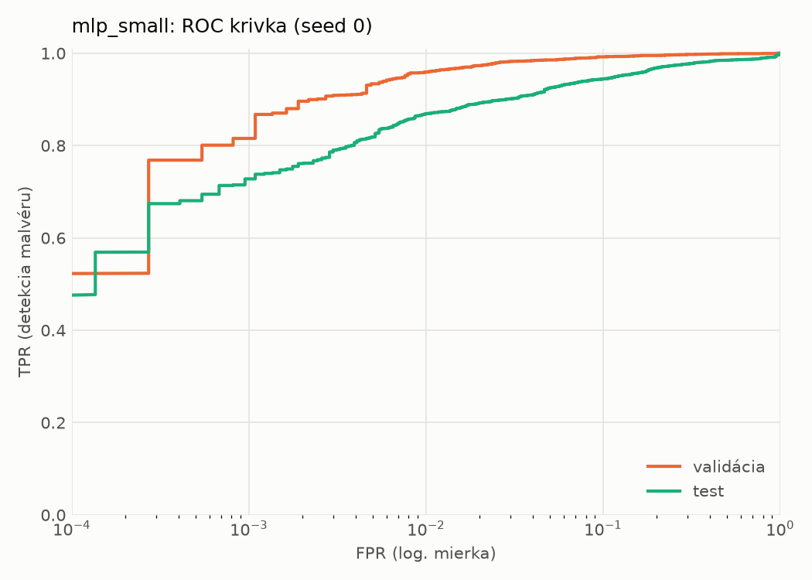
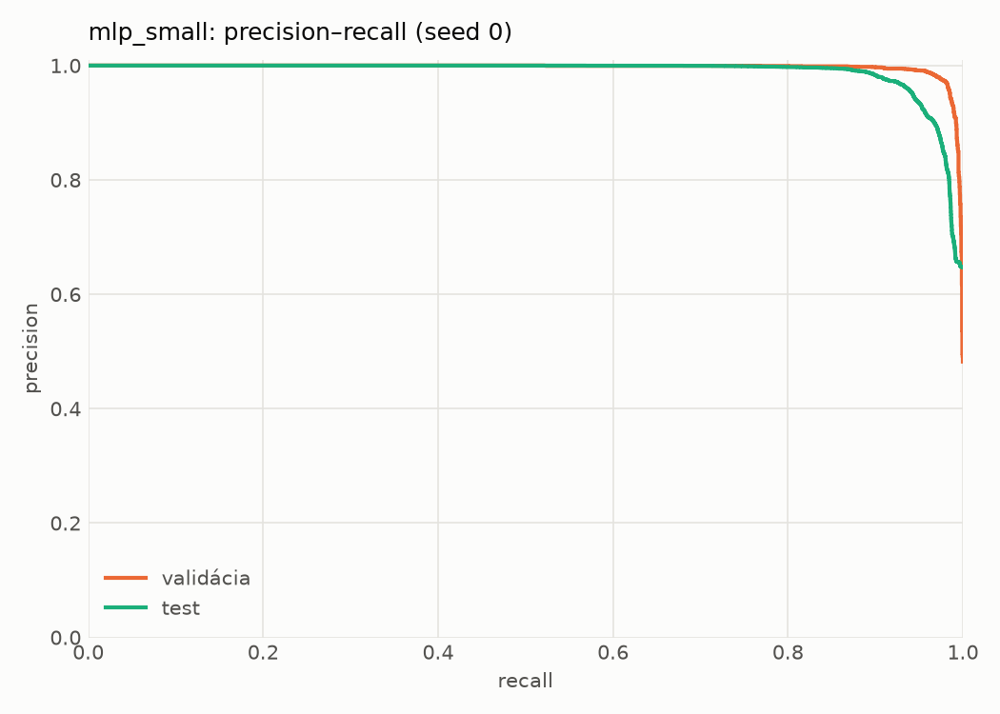
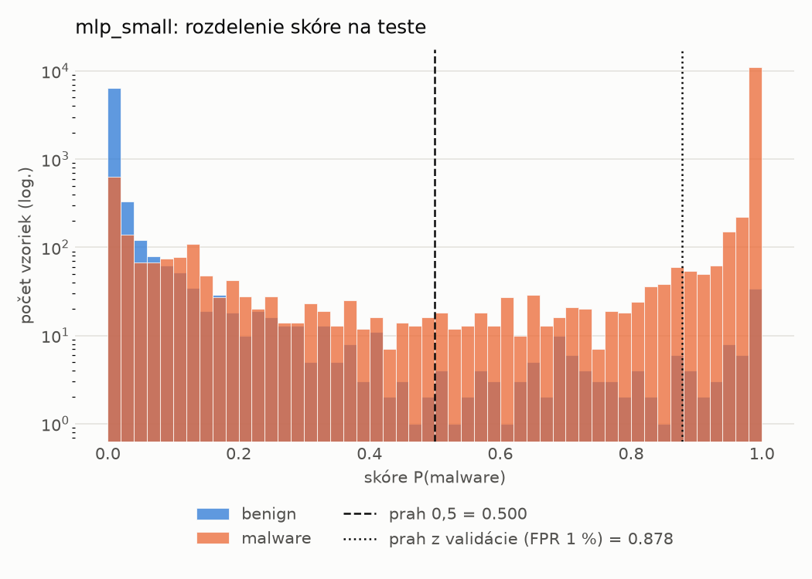
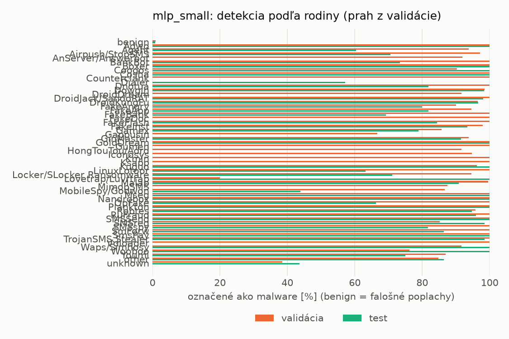
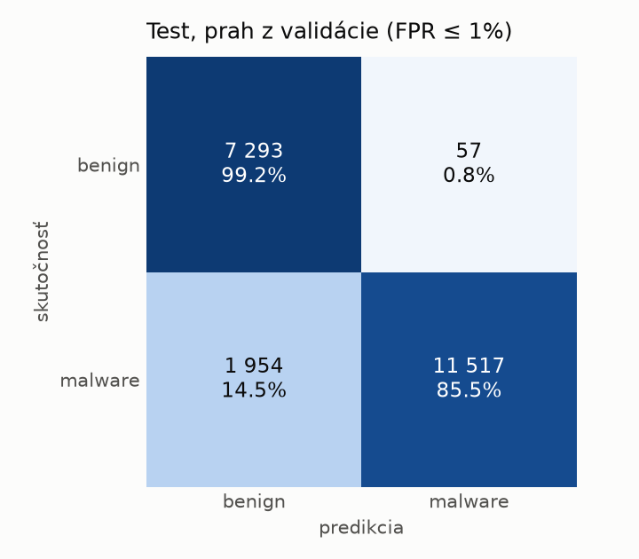
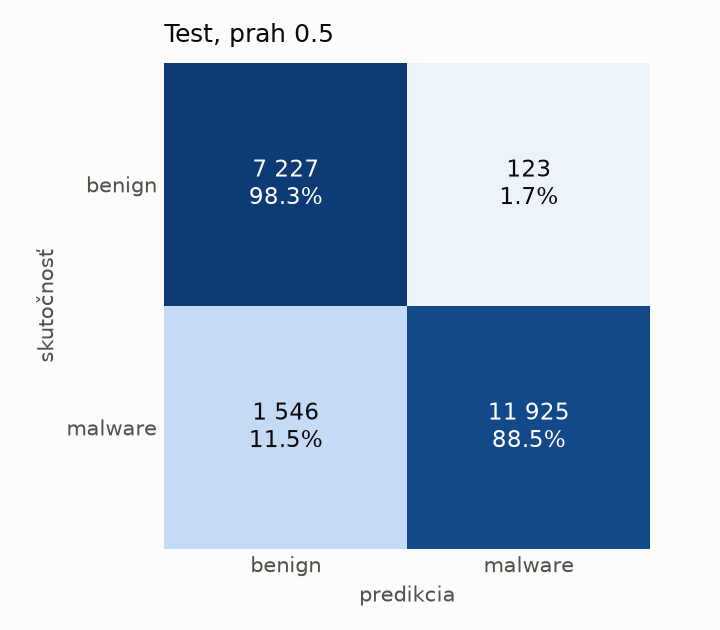
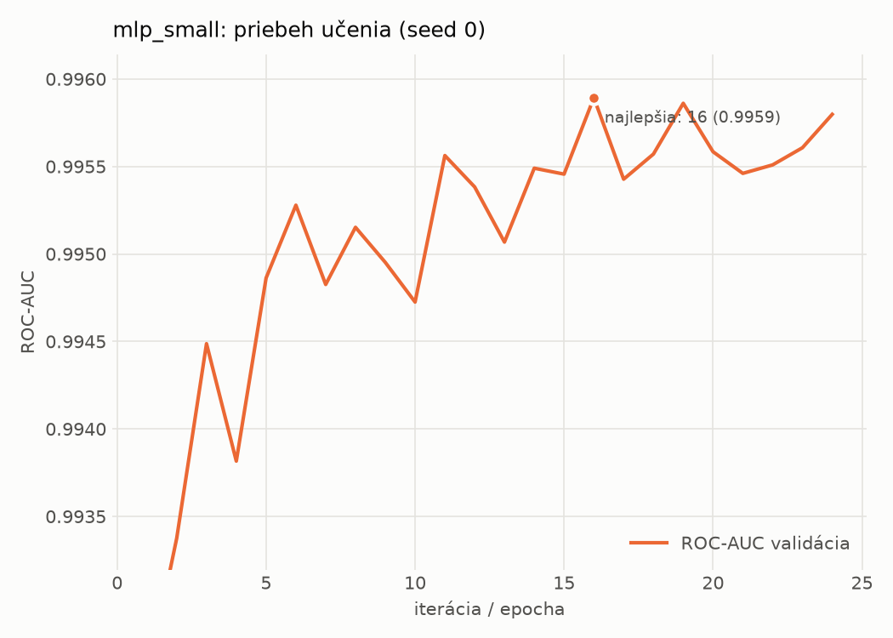

# hybrid/mlp_small – beh `20261123-223653`

> Automaticky generované (`src/training/run_tabular.py`). Konfigurácia: `config.yaml`, protokol: `protocol.yaml`.

- **Model:** `mlp` – malá neurónová sieť (1–2 skryté vrstvy), kandidát na ľahkého študenta
- **Ladenie:** bez ladenia – hyperparametre prevzaté z `runs_v4/real_full/full/hybrid/mlp_small/20261122-200826`
- **Finálne modely:** seedy [0, 1, 2]; hodnoty sú priemer ± smerodajná odchýlka cez seedy
- **Najlepšie hyperparametre:** `{"width_decay": 0.5, "max_epochs": 100, "patience": 8, "hidden_layers": 2, "hidden_width": 256, "dropout": 0.19625503285105284, "lr": 0.0008594281758471675, "weight_decay": 0.001025897876119634, "batch_size": 256}`

## Detekčná kvalita (bez prahu)
| metrika | train (podvzorka) | validácia | test |
|---|---|---|---|
| ROC-AUC | 0.9989 ± 0.0006 | 0.9957 ± 0.0002 | 0.9742 ± 0.0008 |
| PR-AUC | 0.9990 ± 0.0006 | 0.9961 ± 0.0003 | 0.9884 ± 0.0006 |
| TPR pri FPR 1 % | 0.9845 ± 0.0073 | 0.9557 ± 0.0037 | 0.8633 ± 0.0163 |
| TPR pri FPR 0,1 % | 0.9667 ± 0.0187 | 0.8360 ± 0.0190 | 0.7339 ± 0.0126 |
| log loss | 0.0351 ± 0.0112 | 0.0777 ± 0.0014 | 0.3206 ± 0.0221 |
| Brier skóre | 0.0094 ± 0.0032 | 0.0194 ± 0.0008 | 0.0683 ± 0.0014 |

Rozdiel ROC-AUC train − validácia: **0.0032** (veľký rozdiel = preučenie).

## Pri prahu z validácie (FPR ≤ 1% na validácii)
| metrika | train (podvzorka) | validácia | test |
|---|---|---|---|
| accuracy | 0.9842 ± 0.0035 | 0.9736 ± 0.0018 | 0.9007 ± 0.0049 |
| balanced accuracy | 0.9835 ± 0.0036 | 0.9730 ± 0.0018 | 0.9215 ± 0.0041 |
| precision | 0.9983 ± 0.0021 | 0.9892 ± 0.0002 | 0.9950 ± 0.0009 |
| recall (TPR) | 0.9686 ± 0.0057 | 0.9557 ± 0.0037 | 0.8508 ± 0.0069 |
| FPR | 0.0015 ± 0.0018 | 0.0097 ± 0.0002 | 0.0078 ± 0.0014 |
| F1 | 0.9832 ± 0.0038 | 0.9722 ± 0.0019 | 0.9173 ± 0.0044 |
| MCC | 0.9687 ± 0.0069 | 0.9476 ± 0.0035 | 0.8104 ± 0.0085 |

## Pri pevnom prahu 0.5
| metrika | train (podvzorka) | validácia | test |
|---|---|---|---|
| accuracy | 0.9881 ± 0.0038 | 0.9751 ± 0.0015 | 0.9191 ± 0.0015 |
| balanced accuracy | 0.9879 ± 0.0039 | 0.9750 ± 0.0015 | 0.9339 ± 0.0019 |
| precision | 0.9930 ± 0.0037 | 0.9776 ± 0.0020 | 0.9904 ± 0.0023 |
| recall (TPR) | 0.9820 ± 0.0047 | 0.9707 ± 0.0026 | 0.8835 ± 0.0015 |
| FPR | 0.0063 ± 0.0033 | 0.0208 ± 0.0019 | 0.0156 ± 0.0038 |
| F1 | 0.9875 ± 0.0041 | 0.9741 ± 0.0016 | 0.9339 ± 0.0012 |
| MCC | 0.9763 ± 0.0077 | 0.9502 ± 0.0030 | 0.8395 ± 0.0034 |

## Výpočtové nároky (seed 0, testovacia množina)
| meranie | hodnota |
|---|---|
| tréning finálneho modelu | 6.6 s (priemer cez seedy) |
| ladenie spolu | 0 s |
| počet parametrov / uzlov | 108 801 |
| veľkosť modelu na disku | 0.45 MB |
| transformácia vstupu – latencia (1 vlákno) | 0.017 ms |
| transformácia vstupu – priepustnosť | 304 562 vzoriek/s |
| CPU latencia modelu (batch 1, 1 vlákno) | 0.075 ms (p95 0.088) |
| CPU priepustnosť (24 vlákien) | 1 204 062 vzoriek/s |
| GPU latencia (batch 1) | 0.373 ms (p95 0.733) |
| GPU priepustnosť | 1 320 669 vzoriek/s |
| GPU špičková pamäť | 127 MB |

## Grafy
| | |
|---|---|
|  |  |
|  |  |
|  |  |
|  |  |

## Súbory
`metrics.json` (všetky metriky po seedoch vrátane rodín), `timing.json`, `hpo_trials.csv`,
`predictions/<časť>_seed<N>.parquet` (sha256, family, label, score), `model/seed_<N>/`, `log.txt`.
