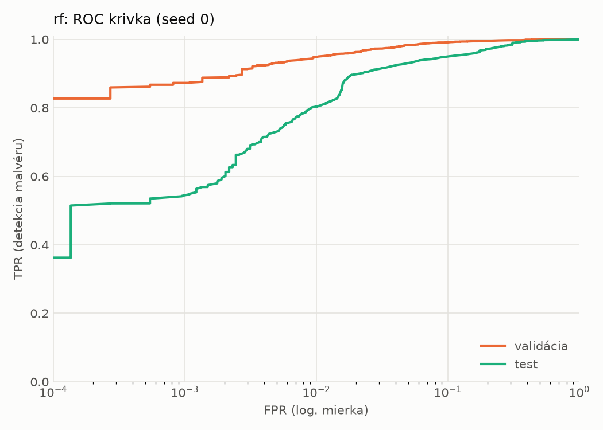
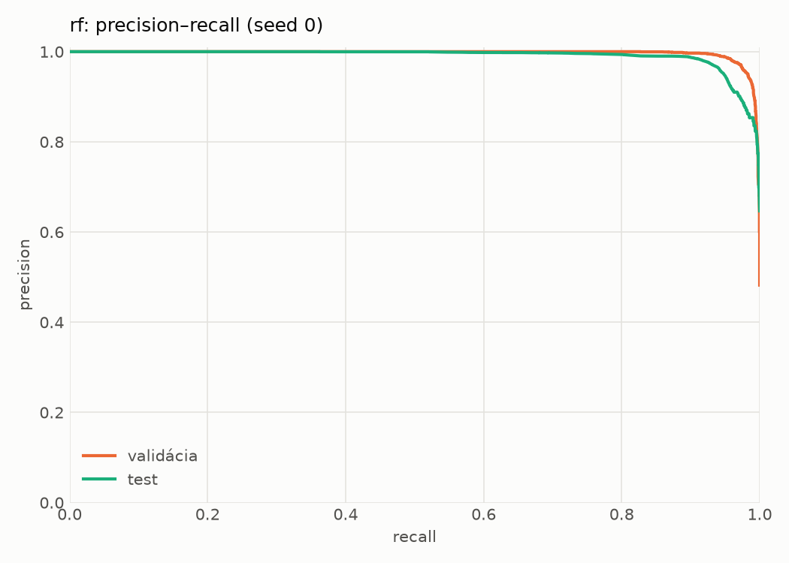
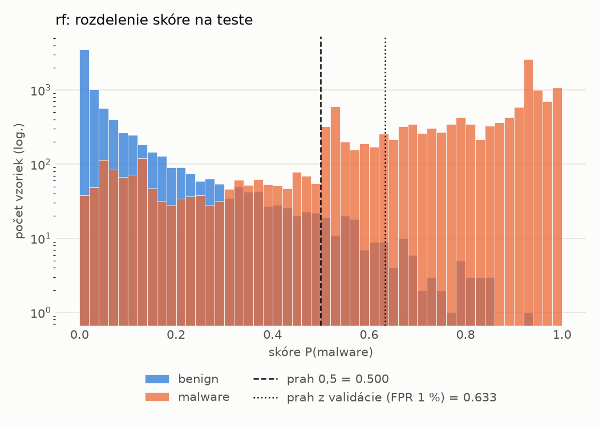
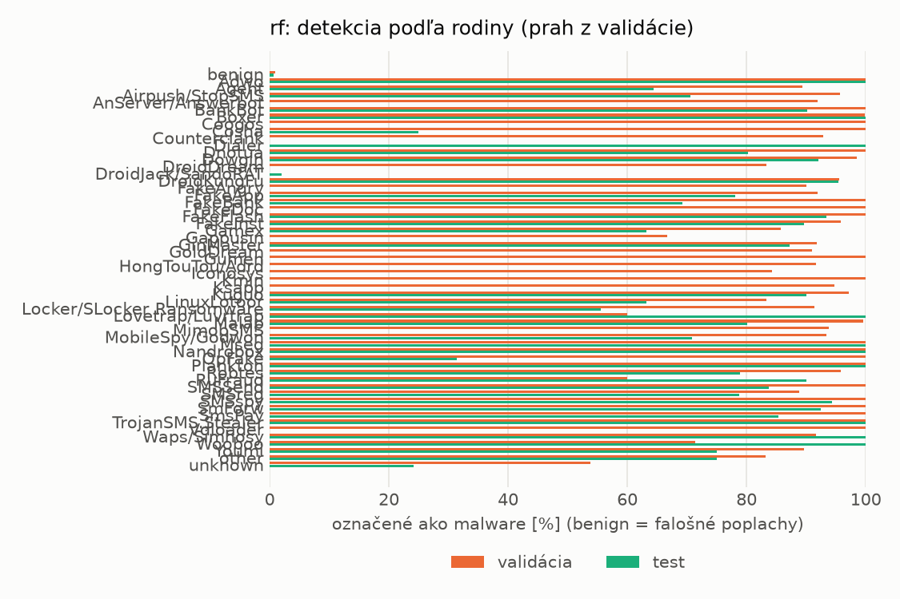
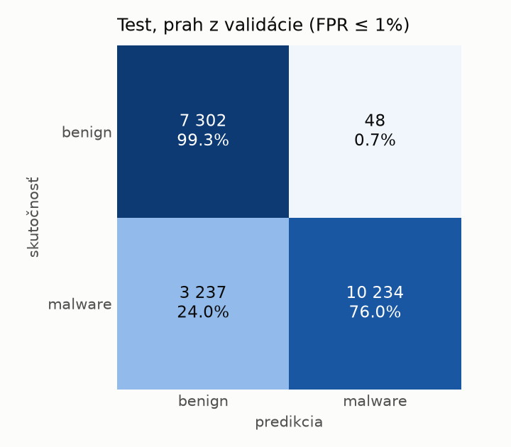
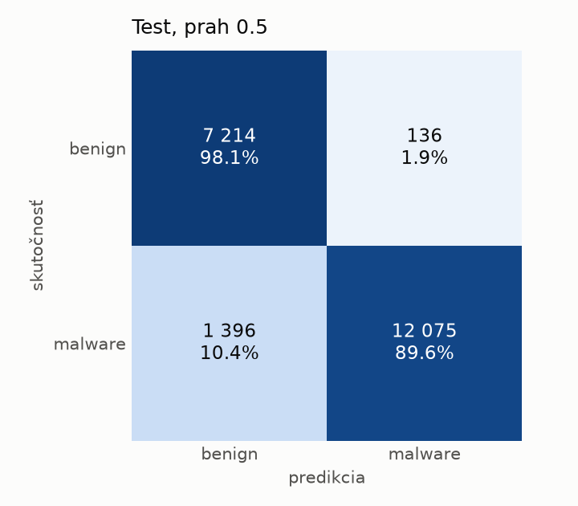

# hybrid/rf – beh `20261123-223535`

> Automaticky generované (`src/training/run_tabular.py`). Konfigurácia: `config.yaml`, protokol: `protocol.yaml`.

- **Model:** `random_forest` – Random Forest (pôvodné hodnoty príznakov)
- **Ladenie:** bez ladenia – hyperparametre prevzaté z `runs_v4/real_full/full/hybrid/rf/20261122-195013`
- **Finálne modely:** seedy [0, 1, 2]; hodnoty sú priemer ± smerodajná odchýlka cez seedy
- **Najlepšie hyperparametre:** `{"n_estimators": 150, "max_depth": 32, "min_samples_leaf": 1, "max_features": 0.05}`

## Detekčná kvalita (bez prahu)
| metrika | train (podvzorka) | validácia | test |
|---|---|---|---|
| ROC-AUC | 1.0000 ± 0.0000 | 0.9962 ± 0.0000 | 0.9836 ± 0.0015 |
| PR-AUC | 1.0000 ± 0.0000 | 0.9965 ± 0.0000 | 0.9914 ± 0.0007 |
| TPR pri FPR 1 % | 1.0000 ± 0.0000 | 0.9481 ± 0.0009 | 0.7936 ± 0.0091 |
| TPR pri FPR 0,1 % | 1.0000 ± 0.0000 | 0.8767 ± 0.0041 | 0.5659 ± 0.0206 |
| log loss | 0.0266 ± 0.0001 | 0.0915 ± 0.0001 | 0.2735 ± 0.0067 |
| Brier skóre | 0.0031 ± 0.0000 | 0.0237 ± 0.0000 | 0.0771 ± 0.0012 |

Rozdiel ROC-AUC train − validácia: **0.0038** (veľký rozdiel = preučenie).

## Pri prahu z validácie (FPR ≤ 1% na validácii)
| metrika | train (podvzorka) | validácia | test |
|---|---|---|---|
| accuracy | 0.9996 ± 0.0002 | 0.9700 ± 0.0004 | 0.8433 ± 0.0018 |
| balanced accuracy | 0.9996 ± 0.0002 | 0.9692 ± 0.0004 | 0.8775 ± 0.0013 |
| precision | 1.0000 ± 0.0000 | 0.9892 ± 0.0002 | 0.9957 ± 0.0005 |
| recall (TPR) | 0.9992 ± 0.0004 | 0.9481 ± 0.0009 | 0.7611 ± 0.0029 |
| FPR | 0.0000 ± 0.0000 | 0.0096 ± 0.0002 | 0.0061 ± 0.0008 |
| F1 | 0.9996 ± 0.0002 | 0.9682 ± 0.0004 | 0.8627 ± 0.0018 |
| MCC | 0.9992 ± 0.0004 | 0.9406 ± 0.0007 | 0.7217 ± 0.0024 |

## Pri pevnom prahu 0.5
| metrika | train (podvzorka) | validácia | test |
|---|---|---|---|
| accuracy | 1.0000 ± 0.0000 | 0.9724 ± 0.0005 | 0.9266 ± 0.0006 |
| balanced accuracy | 1.0000 ± 0.0000 | 0.9723 ± 0.0005 | 0.9391 ± 0.0004 |
| precision | 1.0000 ± 0.0000 | 0.9730 ± 0.0009 | 0.9889 ± 0.0001 |
| recall (TPR) | 1.0000 ± 0.0000 | 0.9696 ± 0.0005 | 0.8966 ± 0.0010 |
| FPR | 0.0000 ± 0.0000 | 0.0250 ± 0.0008 | 0.0184 ± 0.0002 |
| F1 | 1.0000 ± 0.0000 | 0.9713 ± 0.0005 | 0.9405 ± 0.0005 |
| MCC | 1.0000 ± 0.0000 | 0.9447 ± 0.0010 | 0.8523 ± 0.0011 |

## Výpočtové nároky (seed 0, testovacia množina)
| meranie | hodnota |
|---|---|
| tréning finálneho modelu | 1.2 s (priemer cez seedy) |
| ladenie spolu | 0 s |
| počet parametrov / uzlov | 756 140 |
| veľkosť modelu na disku | 60.75 MB |
| CPU latencia modelu (batch 1, 1 vlákno) | 4.506 ms (p95 4.812) |
| CPU priepustnosť (24 vlákien) | 223 198 vzoriek/s |

## Grafy
| | |
|---|---|
|  |  |
|  |  |
|  |  |
|  |  |

## Súbory
`metrics.json` (všetky metriky po seedoch vrátane rodín), `timing.json`, `hpo_trials.csv`,
`predictions/<časť>_seed<N>.parquet` (sha256, family, label, score), `model/seed_<N>/`, `log.txt`.
