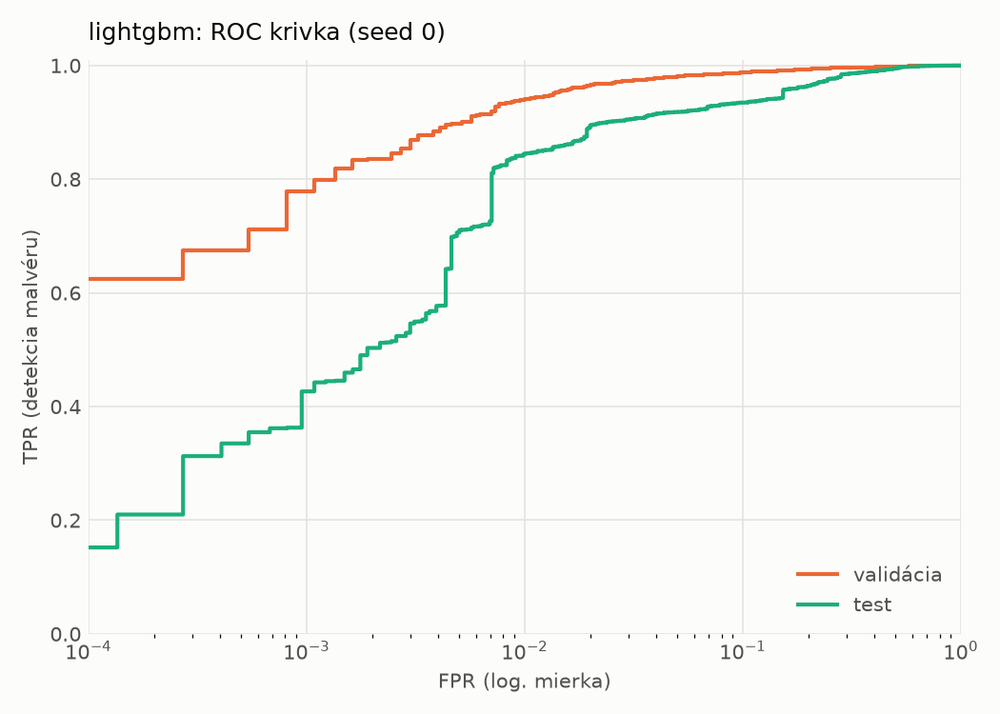
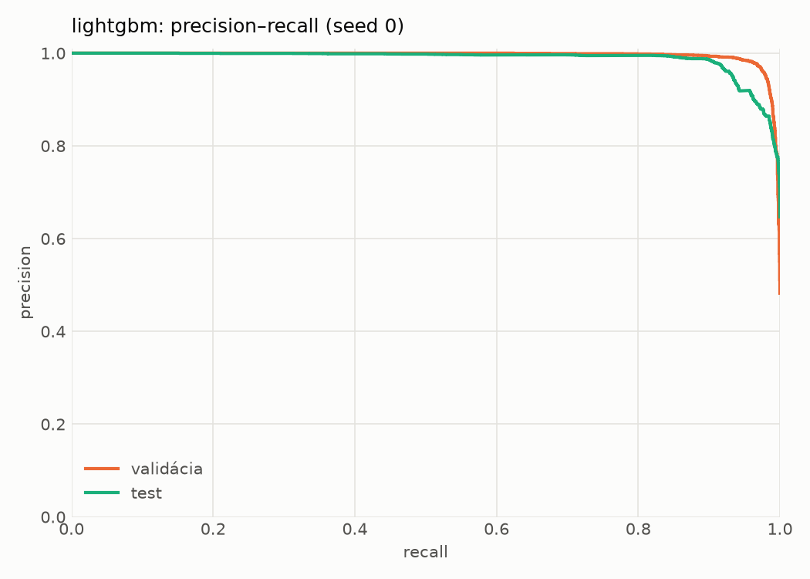
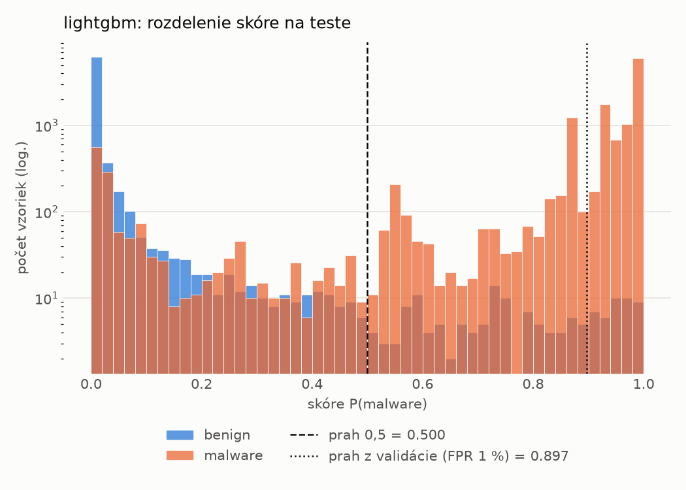
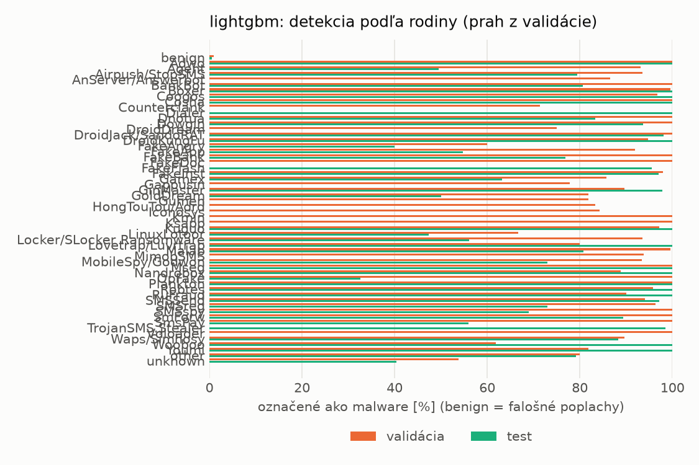
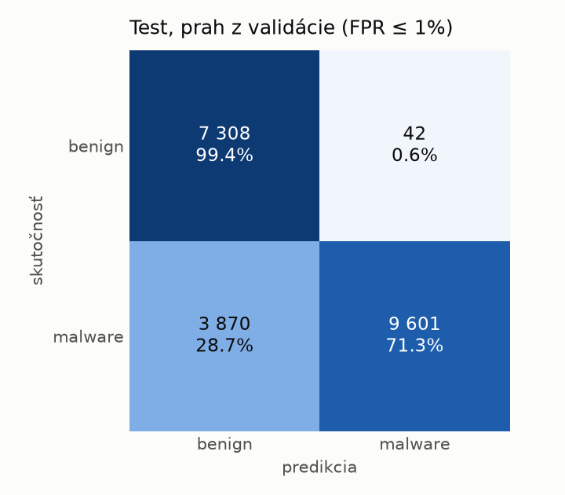
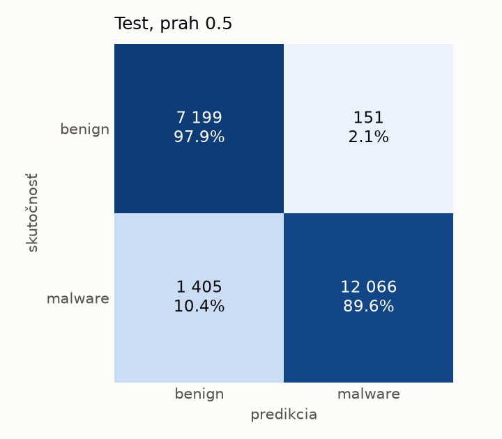
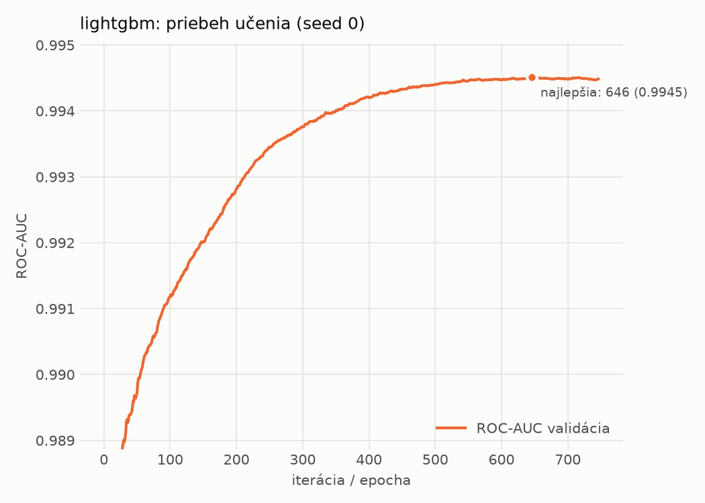

# static/lightgbm – beh `20261123-223043`

> Automaticky generované (`src/training/run_tabular.py`). Konfigurácia: `config.yaml`, protokol: `protocol.yaml`.

- **Model:** `lightgbm` – LightGBM, gradient boosting stromov s early stopping na validácii (pôvodné hodnoty príznakov)
- **Ladenie:** bez ladenia – hyperparametre prevzaté z `runs_v4/real_full/full/static/lightgbm/20261122-184829`
- **Finálne modely:** seedy [0, 1, 2]; hodnoty sú priemer ± smerodajná odchýlka cez seedy
- **Najlepšie hyperparametre:** `{"num_boost_round": 5000, "early_stopping_rounds": 100, "learning_rate": 0.015567978603457627, "num_leaves": 372, "min_child_samples": 12, "feature_fraction": 0.7551391358223217, "bagging_fraction": 0.6871892431836363, "lambda_l1": 1.3651906778474808e-06, "lambda_l2": 0.003382199534052785}`

## Detekčná kvalita (bez prahu)
| metrika | train (podvzorka) | validácia | test |
|---|---|---|---|
| ROC-AUC | 1.0000 ± 0.0000 | 0.9945 ± 0.0000 | 0.9788 ± 0.0002 |
| PR-AUC | 1.0000 ± 0.0000 | 0.9951 ± 0.0000 | 0.9890 ± 0.0002 |
| TPR pri FPR 1 % | 1.0000 ± 0.0000 | 0.9400 ± 0.0016 | 0.8456 ± 0.0033 |
| TPR pri FPR 0,1 % | 1.0000 ± 0.0000 | 0.7845 ± 0.0173 | 0.4331 ± 0.0100 |
| log loss | 0.0094 ± 0.0015 | 0.0878 ± 0.0009 | 0.2967 ± 0.0047 |
| Brier skóre | 0.0009 ± 0.0002 | 0.0224 ± 0.0001 | 0.0684 ± 0.0015 |

Rozdiel ROC-AUC train − validácia: **0.0055** (veľký rozdiel = preučenie).

## Pri prahu z validácie (FPR ≤ 1% na validácii)
| metrika | train (podvzorka) | validácia | test |
|---|---|---|---|
| accuracy | 0.9898 ± 0.0020 | 0.9661 ± 0.0007 | 0.8332 ± 0.0371 |
| balanced accuracy | 0.9893 ± 0.0021 | 0.9652 ± 0.0008 | 0.8697 ± 0.0285 |
| precision | 1.0000 ± 0.0000 | 0.9890 ± 0.0002 | 0.9955 ± 0.0001 |
| recall (TPR) | 0.9785 ± 0.0042 | 0.9400 ± 0.0016 | 0.7456 ± 0.0576 |
| FPR | 0.0000 ± 0.0000 | 0.0097 ± 0.0002 | 0.0062 ± 0.0006 |
| F1 | 0.9892 ± 0.0021 | 0.9639 ± 0.0008 | 0.8518 ± 0.0370 |
| MCC | 0.9797 ± 0.0039 | 0.9330 ± 0.0014 | 0.7084 ± 0.0541 |

## Pri pevnom prahu 0.5
| metrika | train (podvzorka) | validácia | test |
|---|---|---|---|
| accuracy | 0.9998 ± 0.0001 | 0.9724 ± 0.0003 | 0.9242 ± 0.0012 |
| balanced accuracy | 0.9998 ± 0.0001 | 0.9724 ± 0.0003 | 0.9367 ± 0.0009 |
| precision | 0.9998 ± 0.0000 | 0.9719 ± 0.0003 | 0.9875 ± 0.0001 |
| recall (TPR) | 0.9997 ± 0.0001 | 0.9709 ± 0.0004 | 0.8941 ± 0.0019 |
| FPR | 0.0002 ± 0.0000 | 0.0261 ± 0.0003 | 0.0207 ± 0.0002 |
| F1 | 0.9998 ± 0.0001 | 0.9714 ± 0.0003 | 0.9385 ± 0.0011 |
| MCC | 0.9995 ± 0.0001 | 0.9448 ± 0.0007 | 0.8474 ± 0.0022 |

## Výpočtové nároky (seed 0, testovacia množina)
| meranie | hodnota |
|---|---|
| tréning finálneho modelu | 10.7 s (priemer cez seedy) |
| ladenie spolu | 0 s |
| počet parametrov / uzlov | 479 978 |
| veľkosť modelu na disku | 26.57 MB |
| CPU latencia modelu (batch 1, 1 vlákno) | 0.121 ms (p95 0.160) |
| CPU priepustnosť (24 vlákien) | 129 030 vzoriek/s |

## Grafy
| | |
|---|---|
|  |  |
|  |  |
|  |  |
|  |  |

## Súbory
`metrics.json` (všetky metriky po seedoch vrátane rodín), `timing.json`, `hpo_trials.csv`,
`predictions/<časť>_seed<N>.parquet` (sha256, family, label, score), `model/seed_<N>/`, `log.txt`.
