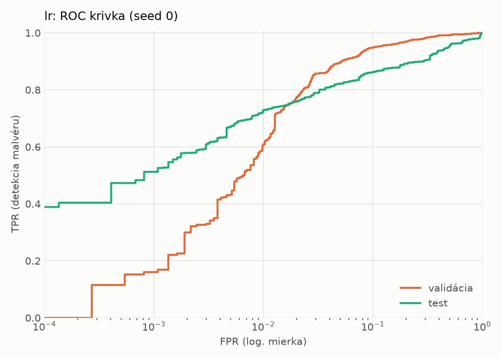
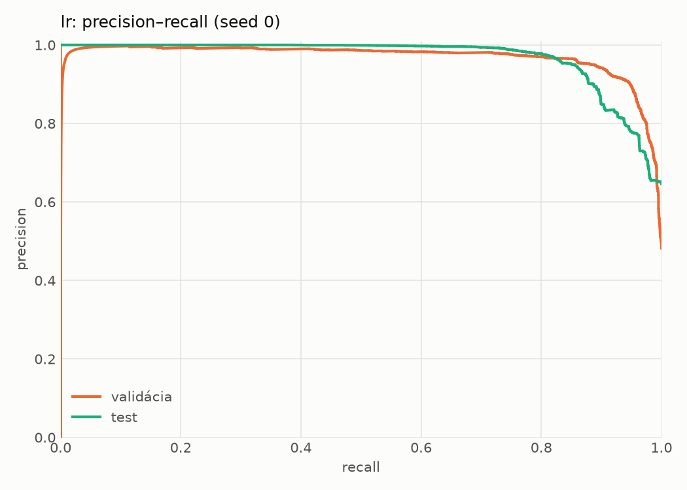
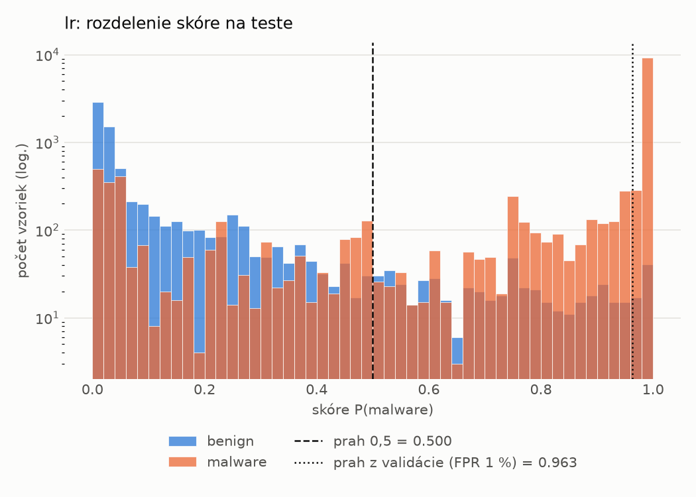
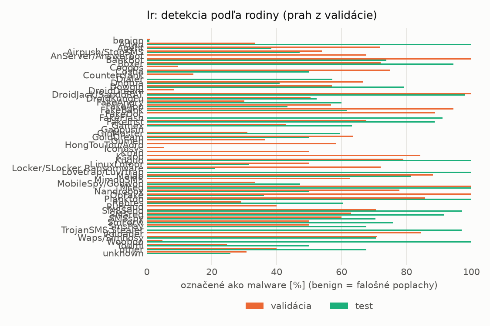
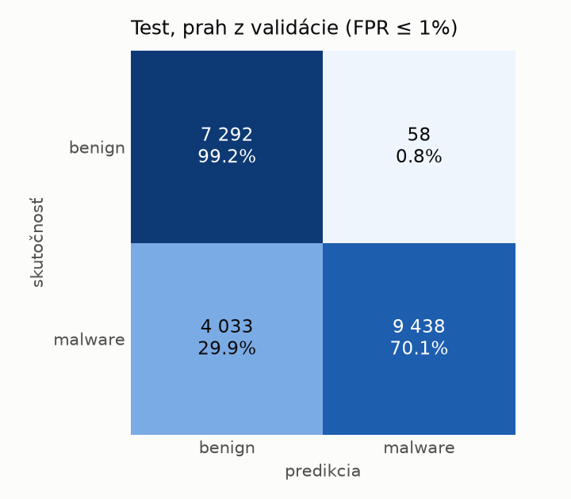
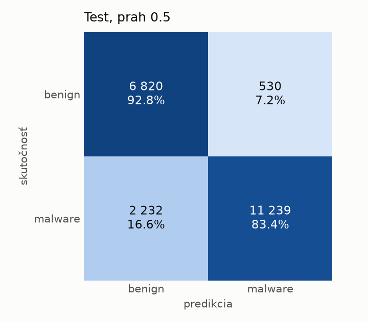

# static/lr – beh `20261123-223027`

> Automaticky generované (`src/training/run_tabular.py`). Konfigurácia: `config.yaml`, protokol: `protocol.yaml`.

- **Model:** `logreg` – logistická regresia s L2 regularizáciou (vstup signed log1p + štandardizácia)
- **Ladenie:** bez ladenia – hyperparametre prevzaté z `runs_v4/real_full/full/static/lr/20261122-184714`
- **Finálne modely:** seedy [0, 1, 2]; hodnoty sú priemer ± smerodajná odchýlka cez seedy
- **Najlepšie hyperparametre:** `{"max_iter": 2000, "C": 2.1423021757741068}`

## Detekčná kvalita (bez prahu)
| metrika | train (podvzorka) | validácia | test |
|---|---|---|---|
| ROC-AUC | 0.9734 ± 0.0000 | 0.9726 ± 0.0000 | 0.9307 ± 0.0000 |
| PR-AUC | 0.9699 ± 0.0000 | 0.9693 ± 0.0000 | 0.9685 ± 0.0000 |
| TPR pri FPR 1 % | 0.7017 ± 0.0000 | 0.6037 ± 0.0000 | 0.7284 ± 0.0000 |
| TPR pri FPR 0,1 % | 0.1623 ± 0.0000 | 0.1606 ± 0.0000 | 0.5124 ± 0.0000 |
| log loss | 0.2050 ± 0.0000 | 0.2087 ± 0.0000 | 0.4564 ± 0.0000 |
| Brier skóre | 0.0576 ± 0.0000 | 0.0576 ± 0.0000 | 0.1044 ± 0.0000 |

Rozdiel ROC-AUC train − validácia: **0.0008** (veľký rozdiel = preučenie).

## Pri prahu z validácie (FPR ≤ 1% na validácii)
| metrika | train (podvzorka) | validácia | test |
|---|---|---|---|
| accuracy | 0.8003 ± 0.0000 | 0.8038 ± 0.0000 | 0.8035 ± 0.0000 |
| balanced accuracy | 0.7910 ± 0.0000 | 0.7969 ± 0.0000 | 0.8464 ± 0.0000 |
| precision | 0.9884 ± 0.0000 | 0.9829 ± 0.0000 | 0.9939 ± 0.0000 |
| recall (TPR) | 0.5883 ± 0.0000 | 0.6037 ± 0.0000 | 0.7006 ± 0.0000 |
| FPR | 0.0063 ± 0.0000 | 0.0098 ± 0.0000 | 0.0079 ± 0.0000 |
| F1 | 0.7375 ± 0.0000 | 0.7480 ± 0.0000 | 0.8219 ± 0.0000 |
| MCC | 0.6447 ± 0.0000 | 0.6499 ± 0.0000 | 0.6647 ± 0.0000 |

## Pri pevnom prahu 0.5
| metrika | train (podvzorka) | validácia | test |
|---|---|---|---|
| accuracy | 0.9246 ± 0.0000 | 0.9246 ± 0.0000 | 0.8673 ± 0.0000 |
| balanced accuracy | 0.9244 ± 0.0000 | 0.9247 ± 0.0000 | 0.8811 ± 0.0000 |
| precision | 0.9226 ± 0.0000 | 0.9183 ± 0.0000 | 0.9550 ± 0.0000 |
| recall (TPR) | 0.9191 ± 0.0000 | 0.9261 ± 0.0000 | 0.8343 ± 0.0000 |
| FPR | 0.0704 ± 0.0000 | 0.0767 ± 0.0000 | 0.0721 ± 0.0000 |
| F1 | 0.9208 ± 0.0000 | 0.9222 ± 0.0000 | 0.8906 ± 0.0000 |
| MCC | 0.8489 ± 0.0000 | 0.8492 ± 0.0000 | 0.7348 ± 0.0000 |

## Výpočtové nároky (seed 0, testovacia množina)
| meranie | hodnota |
|---|---|
| tréning finálneho modelu | 0.2 s (priemer cez seedy) |
| ladenie spolu | 0 s |
| počet parametrov / uzlov | 164 |
| veľkosť modelu na disku | 0.01 MB |
| transformácia vstupu – latencia (1 vlákno) | 0.005 ms |
| transformácia vstupu – priepustnosť | 980 786 vzoriek/s |
| CPU latencia modelu (batch 1, 1 vlákno) | 0.004 ms (p95 0.005) |
| CPU priepustnosť (24 vlákien) | 3 942 251 vzoriek/s |

## Grafy
| | |
|---|---|
|  |  |
|  |  |
|  |  |
|  |  |

## Súbory
`metrics.json` (všetky metriky po seedoch vrátane rodín), `timing.json`, `hpo_trials.csv`,
`predictions/<časť>_seed<N>.parquet` (sha256, family, label, score), `model/seed_<N>/`, `log.txt`.
