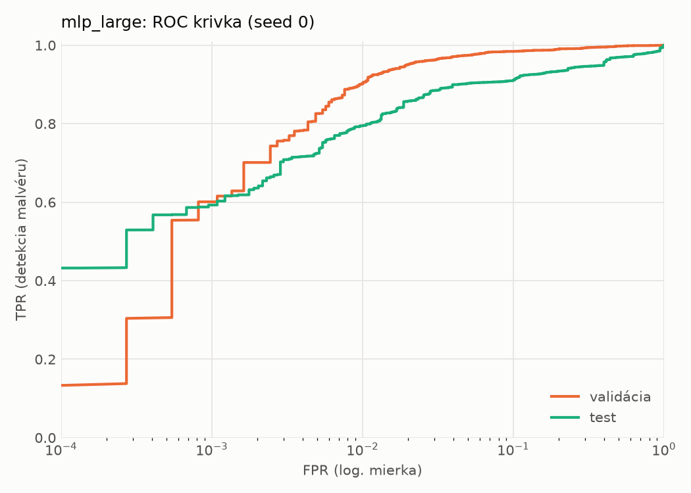
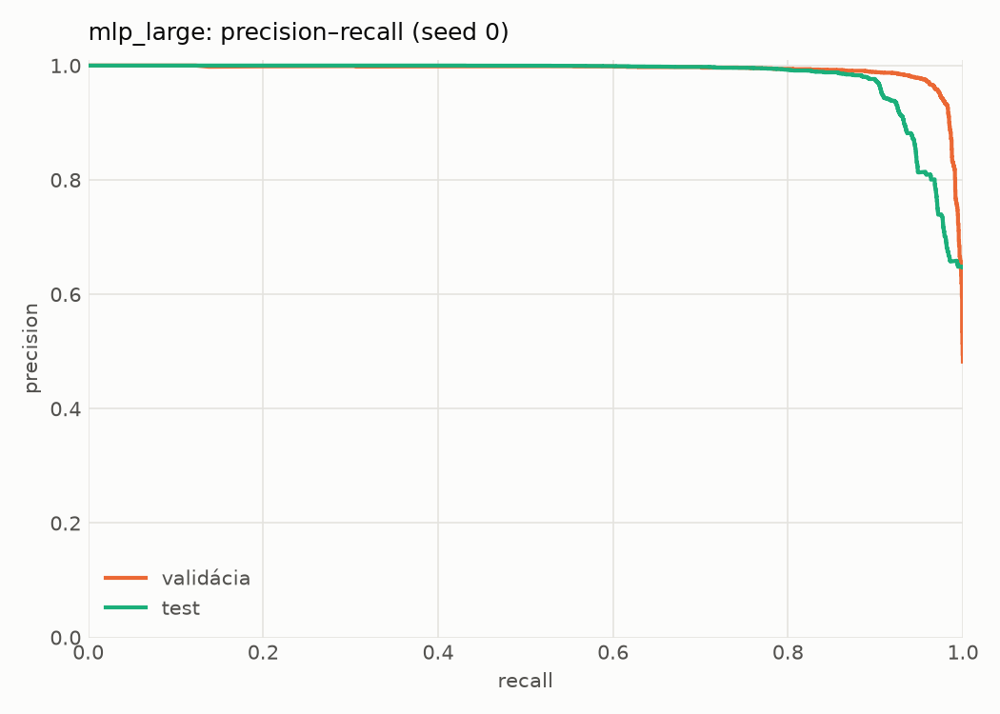
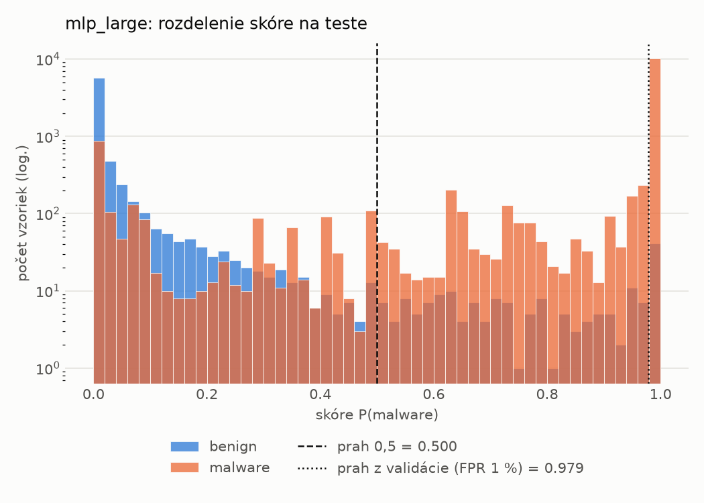
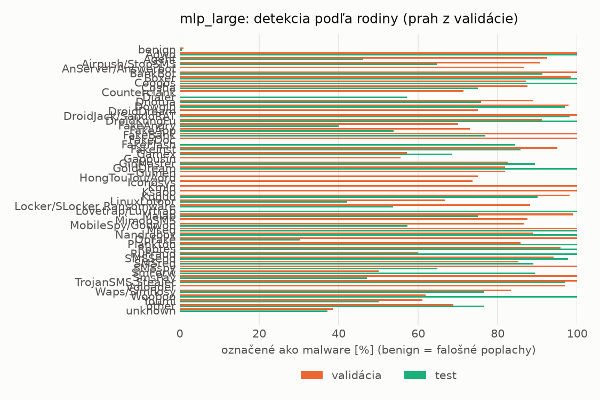
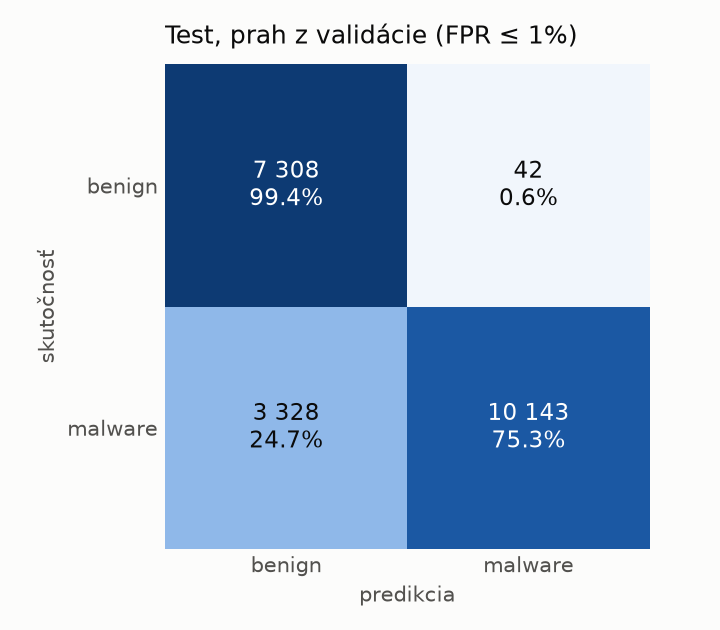
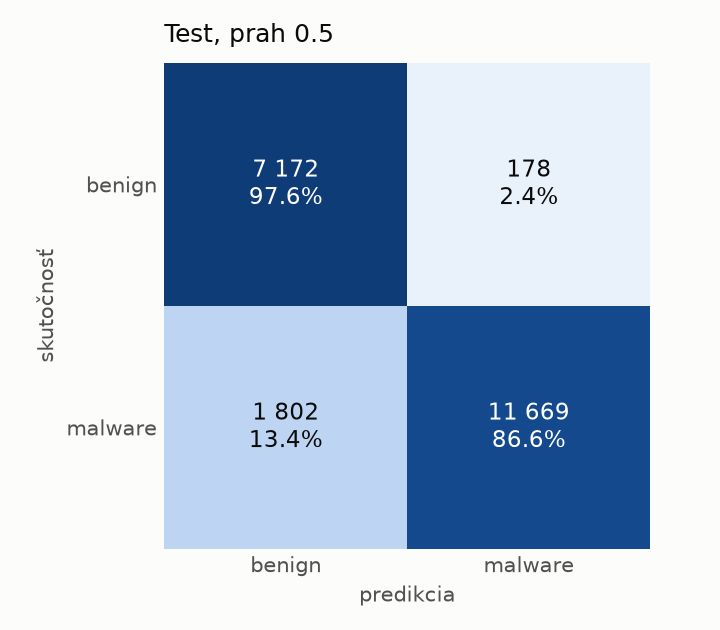
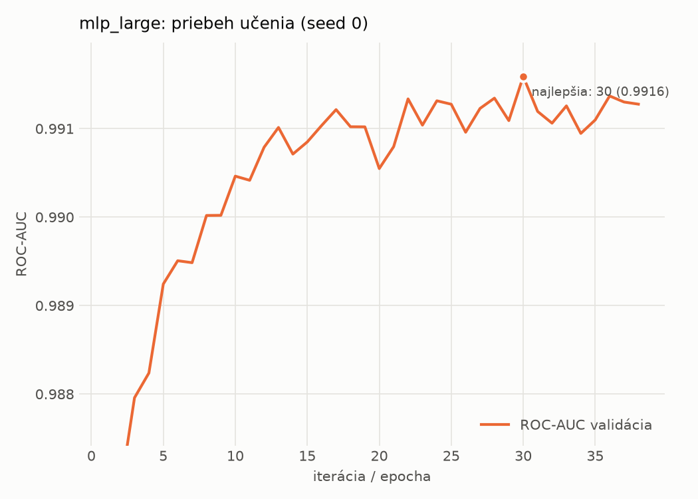

# static/mlp_large – beh `20261123-223201`

> Automaticky generované (`src/training/run_tabular.py`). Konfigurácia: `config.yaml`, protokol: `protocol.yaml`.

- **Model:** `mlp` – veľká neurónová sieť (3–5 skrytých vrstiev, 512–2048 neurónov), kandidát na učiteľa
- **Ladenie:** bez ladenia – hyperparametre prevzaté z `runs_v4/real_full/full/static/mlp_large/20261122-190815`
- **Finálne modely:** seedy [0, 1, 2]; hodnoty sú priemer ± smerodajná odchýlka cez seedy
- **Najlepšie hyperparametre:** `{"max_epochs": 100, "patience": 8, "hidden_layers": 3, "hidden_width": 512, "width_decay": 0.5, "dropout": 0.18301180344828658, "lr": 0.000378062291460712, "weight_decay": 1.421525321060219e-06, "batch_size": 256}`

## Detekčná kvalita (bez prahu)
| metrika | train (podvzorka) | validácia | test |
|---|---|---|---|
| ROC-AUC | 0.9978 ± 0.0006 | 0.9914 ± 0.0003 | 0.9648 ± 0.0089 |
| PR-AUC | 0.9979 ± 0.0005 | 0.9920 ± 0.0002 | 0.9839 ± 0.0033 |
| TPR pri FPR 1 % | 0.9750 ± 0.0051 | 0.9036 ± 0.0025 | 0.7864 ± 0.0146 |
| TPR pri FPR 0,1 % | 0.9037 ± 0.0178 | 0.6508 ± 0.0474 | 0.5949 ± 0.0178 |
| log loss | 0.0525 ± 0.0065 | 0.1177 ± 0.0013 | 0.3647 ± 0.0683 |
| Brier skóre | 0.0140 ± 0.0018 | 0.0282 ± 0.0011 | 0.0783 ± 0.0095 |

Rozdiel ROC-AUC train − validácia: **0.0064** (veľký rozdiel = preučenie).

## Pri prahu z validácie (FPR ≤ 1% na validácii)
| metrika | train (podvzorka) | validácia | test |
|---|---|---|---|
| accuracy | 0.9599 ± 0.0018 | 0.9484 ± 0.0012 | 0.8369 ± 0.0125 |
| balanced accuracy | 0.9580 ± 0.0019 | 0.9469 ± 0.0012 | 0.8725 ± 0.0097 |
| precision | 0.9981 ± 0.0008 | 0.9885 ± 0.0000 | 0.9956 ± 0.0004 |
| recall (TPR) | 0.9176 ± 0.0044 | 0.9036 ± 0.0025 | 0.7512 ± 0.0191 |
| FPR | 0.0016 ± 0.0007 | 0.0098 ± 0.0000 | 0.0061 ± 0.0004 |
| F1 | 0.9562 ± 0.0020 | 0.9442 ± 0.0014 | 0.8562 ± 0.0126 |
| MCC | 0.9220 ± 0.0032 | 0.8996 ± 0.0023 | 0.7125 ± 0.0181 |

## Pri pevnom prahu 0.5
| metrika | train (podvzorka) | validácia | test |
|---|---|---|---|
| accuracy | 0.9827 ± 0.0021 | 0.9652 ± 0.0012 | 0.9059 ± 0.0090 |
| balanced accuracy | 0.9824 ± 0.0021 | 0.9650 ± 0.0012 | 0.9216 ± 0.0065 |
| precision | 0.9876 ± 0.0008 | 0.9661 ± 0.0028 | 0.9844 ± 0.0010 |
| recall (TPR) | 0.9760 ± 0.0037 | 0.9615 ± 0.0026 | 0.8683 ± 0.0149 |
| FPR | 0.0112 ± 0.0007 | 0.0315 ± 0.0027 | 0.0252 ± 0.0021 |
| F1 | 0.9818 ± 0.0022 | 0.9638 ± 0.0012 | 0.9227 ± 0.0080 |
| MCC | 0.9654 ± 0.0041 | 0.9302 ± 0.0023 | 0.8142 ± 0.0150 |

## Výpočtové nároky (seed 0, testovacia množina)
| meranie | hodnota |
|---|---|
| tréning finálneho modelu | 12.7 s (priemer cez seedy) |
| ladenie spolu | 0 s |
| počet parametrov / uzlov | 250 113 |
| veľkosť modelu na disku | 1.02 MB |
| transformácia vstupu – latencia (1 vlákno) | 0.015 ms |
| transformácia vstupu – priepustnosť | 589 519 vzoriek/s |
| CPU latencia modelu (batch 1, 1 vlákno) | 0.116 ms (p95 0.141) |
| CPU priepustnosť (24 vlákien) | 936 723 vzoriek/s |
| GPU latencia (batch 1) | 0.421 ms (p95 0.905) |
| GPU priepustnosť | 855 388 vzoriek/s |
| GPU špičková pamäť | 140 MB |

## Grafy
| | |
|---|---|
|  |  |
|  |  |
|  |  |
|  |  |

## Súbory
`metrics.json` (všetky metriky po seedoch vrátane rodín), `timing.json`, `hpo_trials.csv`,
`predictions/<časť>_seed<N>.parquet` (sha256, family, label, score), `model/seed_<N>/`, `log.txt`.
