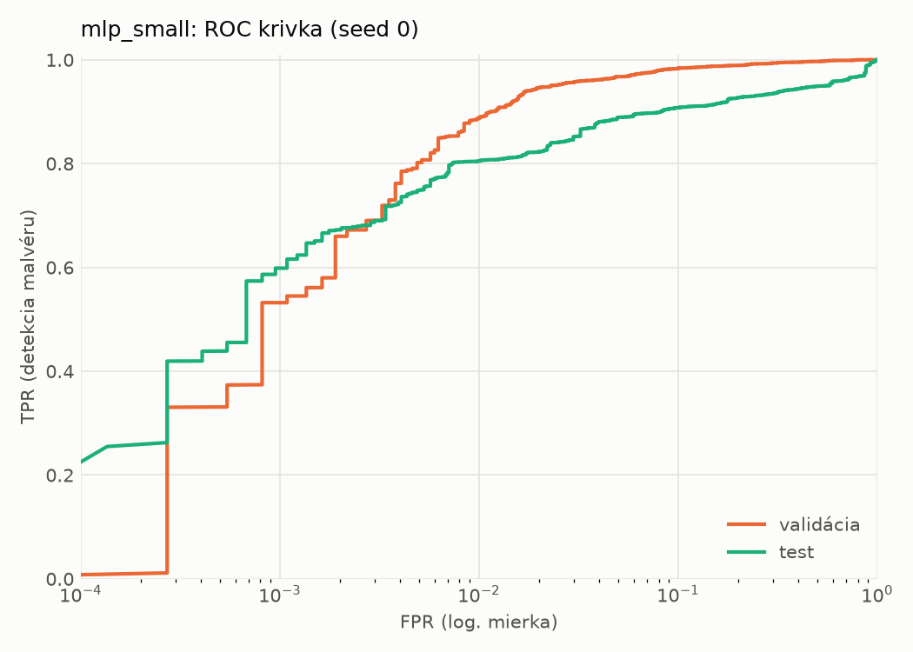
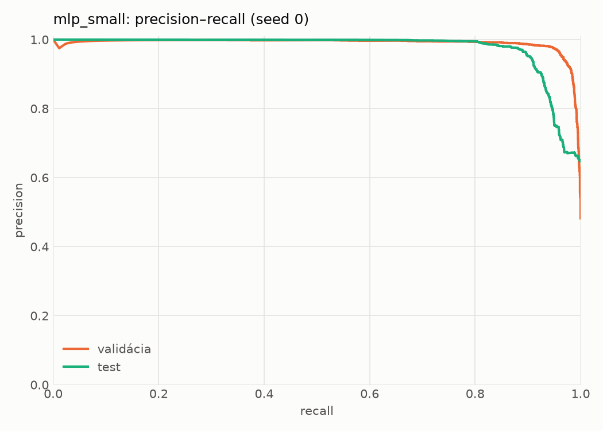
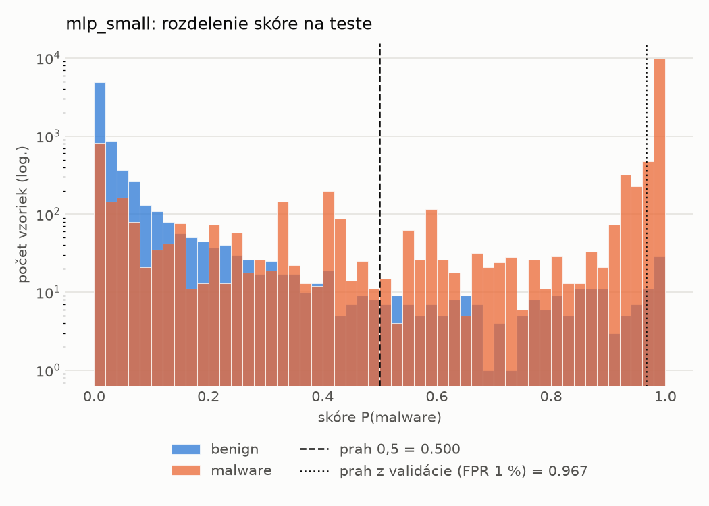
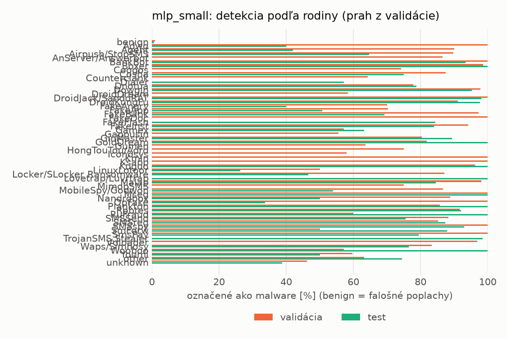
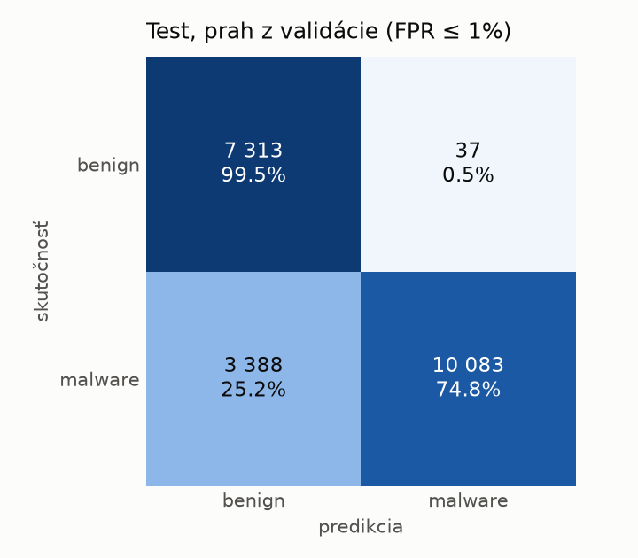
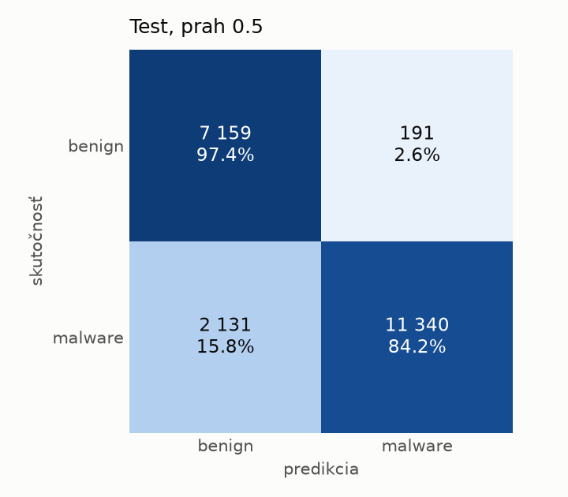
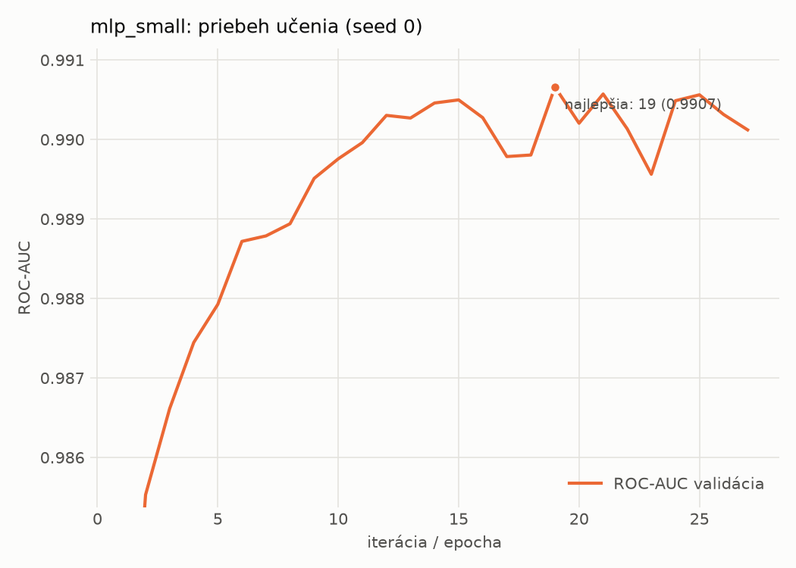

# static/mlp_small – beh `20261123-223131`

> Automaticky generované (`src/training/run_tabular.py`). Konfigurácia: `config.yaml`, protokol: `protocol.yaml`.

- **Model:** `mlp` – malá neurónová sieť (1–2 skryté vrstvy), kandidát na ľahkého študenta
- **Ladenie:** bez ladenia – hyperparametre prevzaté z `runs_v4/real_full/full/static/mlp_small/20261122-190134`
- **Finálne modely:** seedy [0, 1, 2]; hodnoty sú priemer ± smerodajná odchýlka cez seedy
- **Najlepšie hyperparametre:** `{"width_decay": 0.5, "max_epochs": 100, "patience": 8, "hidden_layers": 2, "hidden_width": 256, "dropout": 0.05428236214064427, "lr": 0.00041374253133077954, "weight_decay": 5.569517746104647e-06, "batch_size": 256}`

## Detekčná kvalita (bez prahu)
| metrika | train (podvzorka) | validácia | test |
|---|---|---|---|
| ROC-AUC | 0.9969 ± 0.0004 | 0.9908 ± 0.0002 | 0.9495 ± 0.0048 |
| PR-AUC | 0.9971 ± 0.0004 | 0.9909 ± 0.0009 | 0.9778 ± 0.0016 |
| TPR pri FPR 1 % | 0.9667 ± 0.0030 | 0.8967 ± 0.0108 | 0.7895 ± 0.0234 |
| TPR pri FPR 0,1 % | 0.8414 ± 0.0360 | 0.5753 ± 0.0420 | 0.5861 ± 0.0365 |
| log loss | 0.0628 ± 0.0043 | 0.1177 ± 0.0016 | 0.4561 ± 0.0240 |
| Brier skóre | 0.0165 ± 0.0012 | 0.0292 ± 0.0007 | 0.0912 ± 0.0069 |

Rozdiel ROC-AUC train − validácia: **0.0061** (veľký rozdiel = preučenie).

## Pri prahu z validácie (FPR ≤ 1% na validácii)
| metrika | train (podvzorka) | validácia | test |
|---|---|---|---|
| accuracy | 0.9534 ± 0.0055 | 0.9451 ± 0.0052 | 0.8426 ± 0.0162 |
| balanced accuracy | 0.9513 ± 0.0057 | 0.9435 ± 0.0054 | 0.8770 ± 0.0125 |
| precision | 0.9972 ± 0.0002 | 0.9884 ± 0.0001 | 0.9957 ± 0.0006 |
| recall (TPR) | 0.9048 ± 0.0115 | 0.8967 ± 0.0108 | 0.7600 ± 0.0254 |
| FPR | 0.0023 ± 0.0002 | 0.0098 ± 0.0000 | 0.0060 ± 0.0009 |
| F1 | 0.9488 ± 0.0063 | 0.9403 ± 0.0060 | 0.8619 ± 0.0161 |
| MCC | 0.9099 ± 0.0102 | 0.8934 ± 0.0097 | 0.7210 ± 0.0237 |

## Pri pevnom prahu 0.5
| metrika | train (podvzorka) | validácia | test |
|---|---|---|---|
| accuracy | 0.9790 ± 0.0020 | 0.9636 ± 0.0013 | 0.8858 ± 0.0099 |
| balanced accuracy | 0.9786 ± 0.0020 | 0.9635 ± 0.0013 | 0.9059 ± 0.0078 |
| precision | 0.9843 ± 0.0020 | 0.9652 ± 0.0007 | 0.9835 ± 0.0005 |
| recall (TPR) | 0.9714 ± 0.0022 | 0.9591 ± 0.0020 | 0.8375 ± 0.0152 |
| FPR | 0.0141 ± 0.0018 | 0.0322 ± 0.0006 | 0.0257 ± 0.0005 |
| F1 | 0.9778 ± 0.0021 | 0.9622 ± 0.0013 | 0.9046 ± 0.0091 |
| MCC | 0.9579 ± 0.0040 | 0.9271 ± 0.0025 | 0.7801 ± 0.0164 |

## Výpočtové nároky (seed 0, testovacia množina)
| meranie | hodnota |
|---|---|
| tréning finálneho modelu | 9.4 s (priemer cez seedy) |
| ladenie spolu | 0 s |
| počet parametrov / uzlov | 75 777 |
| veľkosť modelu na disku | 0.32 MB |
| transformácia vstupu – latencia (1 vlákno) | 0.015 ms |
| transformácia vstupu – priepustnosť | 488 688 vzoriek/s |
| CPU latencia modelu (batch 1, 1 vlákno) | 0.081 ms (p95 0.095) |
| CPU priepustnosť (24 vlákien) | 1 296 362 vzoriek/s |
| GPU latencia (batch 1) | 0.640 ms (p95 0.695) |
| GPU priepustnosť | 1 140 377 vzoriek/s |
| GPU špičková pamäť | 85 MB |

## Grafy
| | |
|---|---|
|  |  |
|  |  |
|  |  |
|  |  |

## Súbory
`metrics.json` (všetky metriky po seedoch vrátane rodín), `timing.json`, `hpo_trials.csv`,
`predictions/<časť>_seed<N>.parquet` (sha256, family, label, score), `model/seed_<N>/`, `log.txt`.
