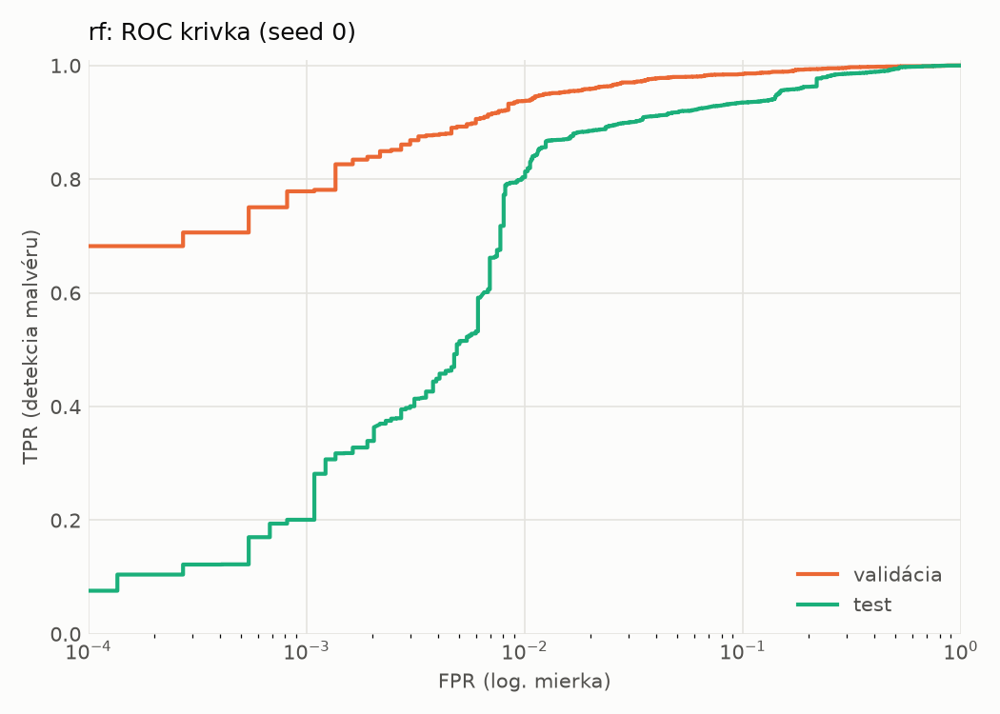
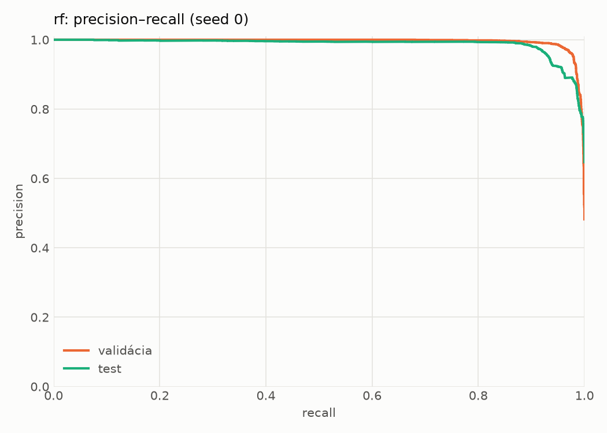
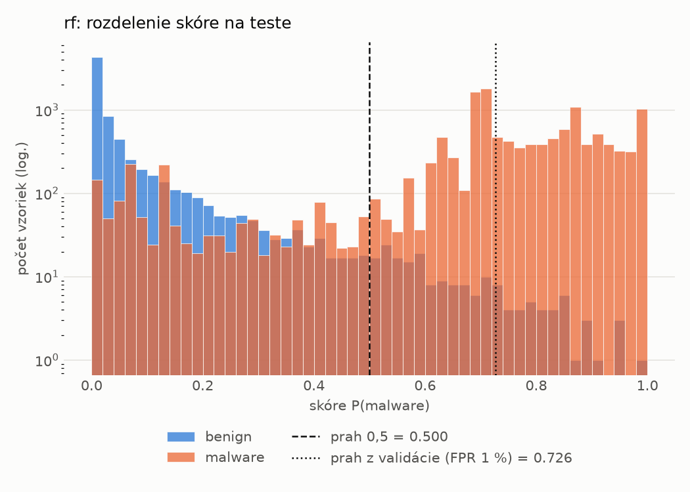
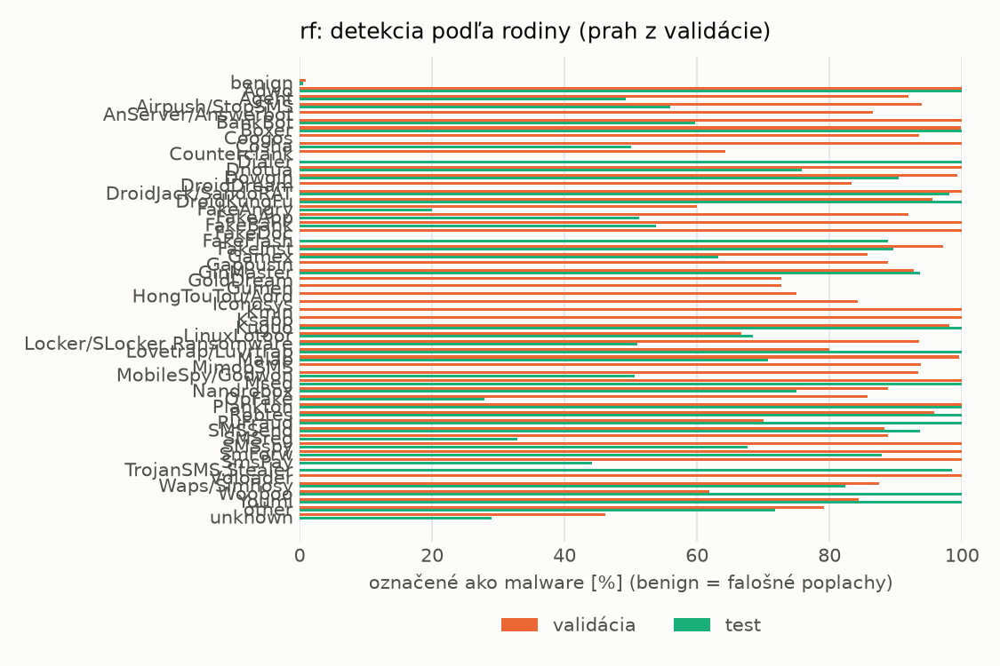
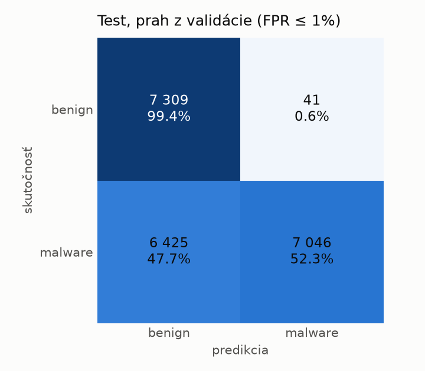
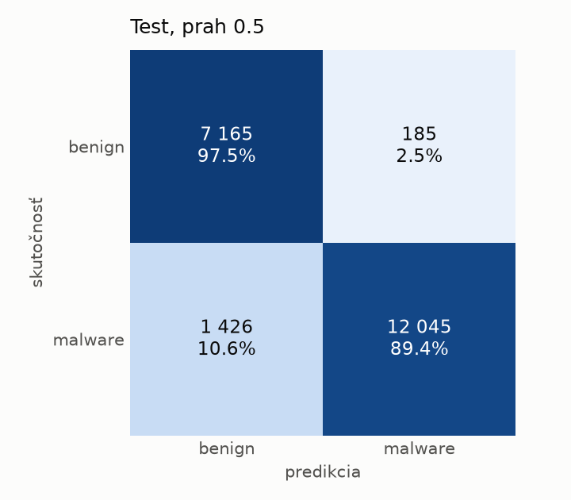

# static/rf – beh `20261123-223029`

> Automaticky generované (`src/training/run_tabular.py`). Konfigurácia: `config.yaml`, protokol: `protocol.yaml`.

- **Model:** `random_forest` – Random Forest (pôvodné hodnoty príznakov)
- **Ladenie:** bez ladenia – hyperparametre prevzaté z `runs_v4/real_full/full/static/rf/20261122-184723`
- **Finálne modely:** seedy [0, 1, 2]; hodnoty sú priemer ± smerodajná odchýlka cez seedy
- **Najlepšie hyperparametre:** `{"n_estimators": 400, "max_depth": 32, "min_samples_leaf": 1, "max_features": "sqrt"}`

## Detekčná kvalita (bez prahu)
| metrika | train (podvzorka) | validácia | test |
|---|---|---|---|
| ROC-AUC | 1.0000 ± 0.0000 | 0.9942 ± 0.0000 | 0.9777 ± 0.0005 |
| PR-AUC | 1.0000 ± 0.0000 | 0.9948 ± 0.0000 | 0.9875 ± 0.0003 |
| TPR pri FPR 1 % | 1.0000 ± 0.0000 | 0.9402 ± 0.0024 | 0.8272 ± 0.0205 |
| TPR pri FPR 0,1 % | 0.9996 ± 0.0000 | 0.7763 ± 0.0027 | 0.2111 ± 0.0318 |
| log loss | 0.0271 ± 0.0001 | 0.0956 ± 0.0001 | 0.3122 ± 0.0061 |
| Brier skóre | 0.0040 ± 0.0000 | 0.0251 ± 0.0000 | 0.0850 ± 0.0023 |

Rozdiel ROC-AUC train − validácia: **0.0058** (veľký rozdiel = preučenie).

## Pri prahu z validácie (FPR ≤ 1% na validácii)
| metrika | train (podvzorka) | validácia | test |
|---|---|---|---|
| accuracy | 0.9924 ± 0.0007 | 0.9661 ± 0.0011 | 0.7848 ± 0.0825 |
| balanced accuracy | 0.9920 ± 0.0008 | 0.9652 ± 0.0012 | 0.8322 ± 0.0636 |
| precision | 1.0000 ± 0.0000 | 0.9889 ± 0.0000 | 0.9948 ± 0.0005 |
| recall (TPR) | 0.9841 ± 0.0015 | 0.9402 ± 0.0024 | 0.6707 ± 0.1279 |
| FPR | 0.0000 ± 0.0000 | 0.0098 ± 0.0000 | 0.0063 ± 0.0006 |
| F1 | 0.9920 ± 0.0008 | 0.9640 ± 0.0013 | 0.7964 ± 0.0960 |
| MCC | 0.9849 ± 0.0014 | 0.9331 ± 0.0022 | 0.6444 ± 0.1061 |

## Pri pevnom prahu 0.5
| metrika | train (podvzorka) | validácia | test |
|---|---|---|---|
| accuracy | 0.9991 ± 0.0002 | 0.9699 ± 0.0005 | 0.9220 ± 0.0012 |
| balanced accuracy | 0.9990 ± 0.0002 | 0.9699 ± 0.0005 | 0.9341 ± 0.0009 |
| precision | 0.9999 ± 0.0001 | 0.9654 ± 0.0011 | 0.9853 ± 0.0004 |
| recall (TPR) | 0.9982 ± 0.0002 | 0.9724 ± 0.0004 | 0.8927 ± 0.0021 |
| FPR | 0.0001 ± 0.0001 | 0.0325 ± 0.0011 | 0.0244 ± 0.0007 |
| F1 | 0.9990 ± 0.0002 | 0.9689 ± 0.0005 | 0.9367 ± 0.0011 |
| MCC | 0.9981 ± 0.0003 | 0.9397 ± 0.0010 | 0.8425 ± 0.0022 |

## Výpočtové nároky (seed 0, testovacia množina)
| meranie | hodnota |
|---|---|
| tréning finálneho modelu | 1.8 s (priemer cez seedy) |
| ladenie spolu | 0 s |
| počet parametrov / uzlov | 2 557 584 |
| veľkosť modelu na disku | 204.97 MB |
| CPU latencia modelu (batch 1, 1 vlákno) | 11.656 ms (p95 12.360) |
| CPU priepustnosť (24 vlákien) | 178 550 vzoriek/s |

## Grafy
| | |
|---|---|
|  |  |
|  |  |
|  |  |
|  |  |

## Súbory
`metrics.json` (všetky metriky po seedoch vrátane rodín), `timing.json`, `hpo_trials.csv`,
`predictions/<časť>_seed<N>.parquet` (sha256, family, label, score), `model/seed_<N>/`, `log.txt`.
