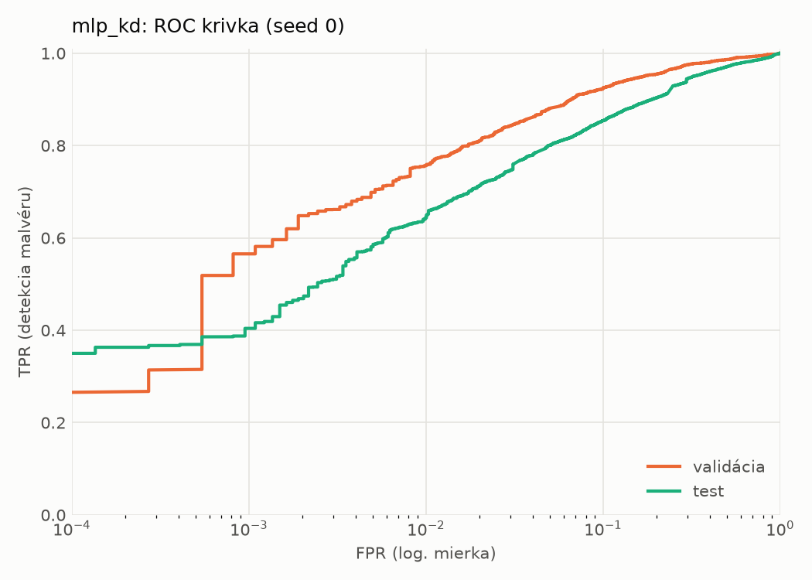
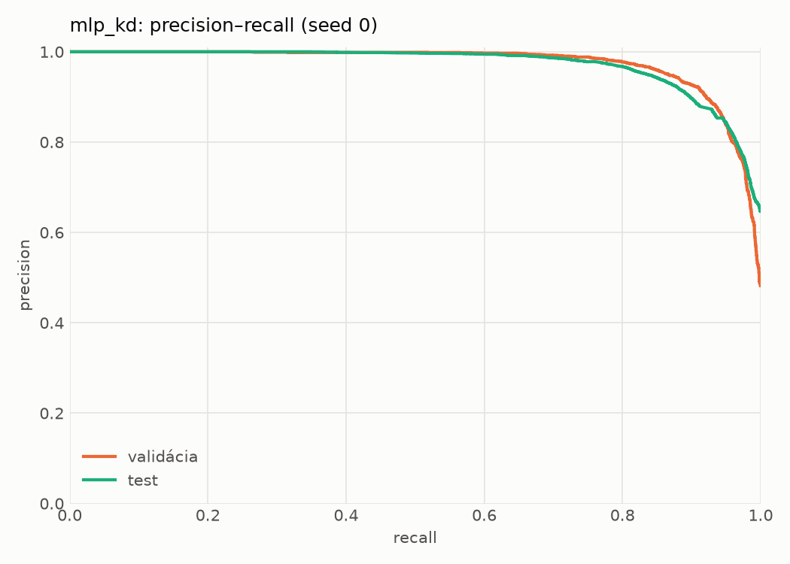
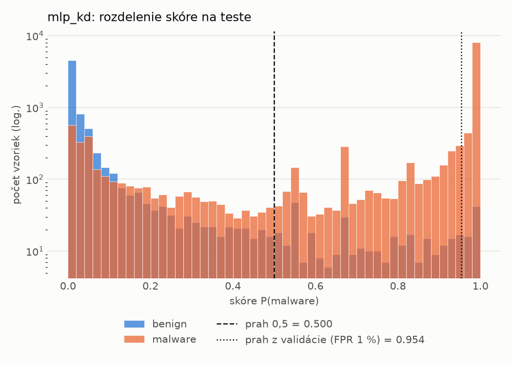
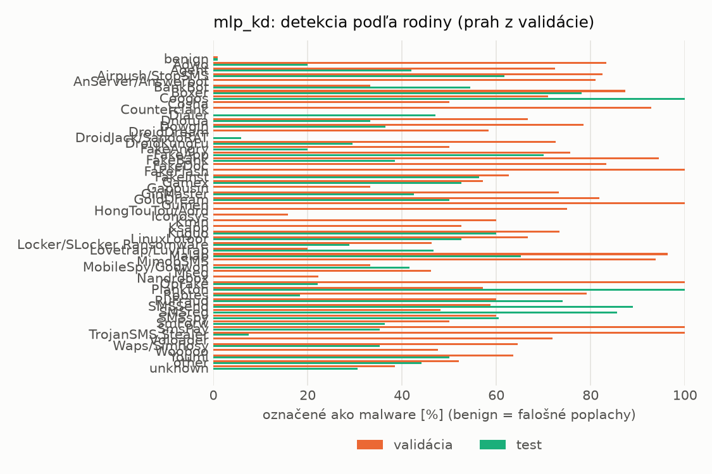
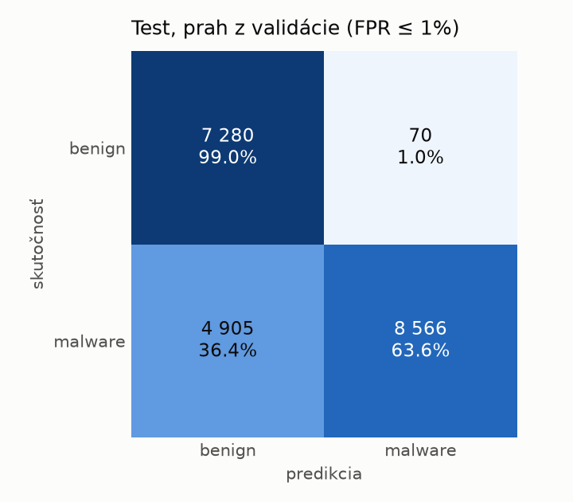
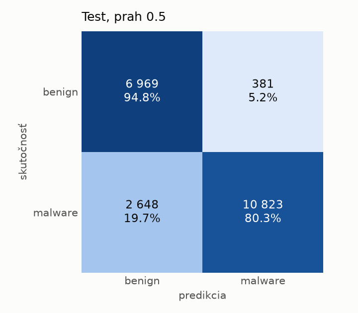
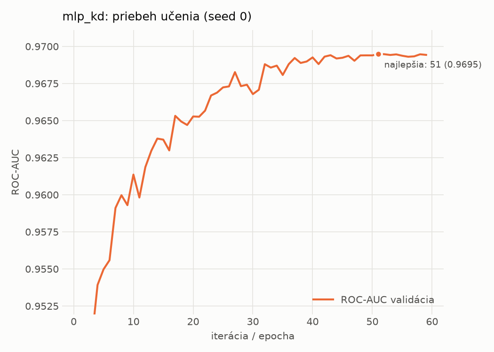

# dynamic/mlp_kd – beh `20261123-224410`

> Automaticky generované (`src/training/run_tabular.py`). Konfigurácia: `config.yaml`, protokol: `protocol.yaml`.

- **Model:** `mlp` – študent – malé MLP učené destiláciou z hybridného učiteľa
- **Ladenie:** bez ladenia – hyperparametre prevzaté z `runs_v4/real_full/full/students_dynamic/mlp_kd/20261122-205301`
- **Finálne modely:** seedy [0, 1, 2]; hodnoty sú priemer ± smerodajná odchýlka cez seedy
- **Najlepšie hyperparametre:** `{"hidden_layers": 1, "max_epochs": 100, "patience": 8, "hidden_width": 64, "dropout": 0.03643763137351852, "lr": 0.0028753520300020953, "weight_decay": 0.00022273244560059002, "batch_size": 512, "kd_alpha": 0.33129867518829337, "kd_temperature": 1.9602594769462303}`

## Detekčná kvalita (bez prahu)
| metrika | train (podvzorka) | validácia | test |
|---|---|---|---|
| ROC-AUC | 0.9740 ± 0.0014 | 0.9692 ± 0.0009 | 0.9418 ± 0.0013 |
| PR-AUC | 0.9771 ± 0.0012 | 0.9732 ± 0.0007 | 0.9714 ± 0.0006 |
| TPR pri FPR 1 % | 0.7947 ± 0.0110 | 0.7479 ± 0.0126 | 0.6544 ± 0.0104 |
| TPR pri FPR 0,1 % | 0.5874 ± 0.0415 | 0.5318 ± 0.0381 | 0.4284 ± 0.0333 |
| log loss | 0.2146 ± 0.0084 | 0.2478 ± 0.0055 | 0.4870 ± 0.0173 |
| Brier skóre | 0.0575 ± 0.0020 | 0.0649 ± 0.0017 | 0.1208 ± 0.0020 |

Rozdiel ROC-AUC train − validácia: **0.0048** (veľký rozdiel = preučenie).

## Pri prahu z validácie (FPR ≤ 1% na validácii)
| metrika | train (podvzorka) | validácia | test |
|---|---|---|---|
| accuracy | 0.8835 ± 0.0066 | 0.8734 ± 0.0061 | 0.7598 ± 0.0079 |
| balanced accuracy | 0.8782 ± 0.0069 | 0.8691 ± 0.0063 | 0.8125 ± 0.0060 |
| precision | 0.9902 ± 0.0006 | 0.9863 ± 0.0004 | 0.9929 ± 0.0009 |
| recall (TPR) | 0.7632 ± 0.0136 | 0.7479 ± 0.0126 | 0.6333 ± 0.0125 |
| FPR | 0.0069 ± 0.0003 | 0.0097 ± 0.0002 | 0.0083 ± 0.0011 |
| F1 | 0.8620 ± 0.0088 | 0.8506 ± 0.0083 | 0.7733 ± 0.0093 |
| MCC | 0.7835 ± 0.0114 | 0.7658 ± 0.0105 | 0.6067 ± 0.0098 |

## Pri pevnom prahu 0.5
| metrika | train (podvzorka) | validácia | test |
|---|---|---|---|
| accuracy | 0.9253 ± 0.0026 | 0.9149 ± 0.0034 | 0.8512 ± 0.0037 |
| balanced accuracy | 0.9239 ± 0.0027 | 0.9138 ± 0.0036 | 0.8742 ± 0.0018 |
| precision | 0.9474 ± 0.0034 | 0.9359 ± 0.0048 | 0.9685 ± 0.0027 |
| recall (TPR) | 0.8930 ± 0.0060 | 0.8842 ± 0.0114 | 0.7960 ± 0.0083 |
| FPR | 0.0453 ± 0.0032 | 0.0565 ± 0.0052 | 0.0475 ± 0.0047 |
| F1 | 0.9194 ± 0.0030 | 0.9092 ± 0.0043 | 0.8738 ± 0.0039 |
| MCC | 0.8512 ± 0.0050 | 0.8305 ± 0.0063 | 0.7169 ± 0.0040 |

## Výpočtové nároky (seed 0, testovacia množina)
| meranie | hodnota |
|---|---|
| tréning finálneho modelu | 10.3 s (priemer cez seedy) |
| ladenie spolu | 0 s |
| počet parametrov / uzlov | 8 513 |
| veľkosť modelu na disku | 0.04 MB |
| transformácia vstupu – latencia (1 vlákno) | 0.006 ms |
| transformácia vstupu – priepustnosť | 1 059 825 vzoriek/s |
| CPU latencia modelu (batch 1, 1 vlákno) | 0.051 ms (p95 0.059) |
| CPU priepustnosť (24 vlákien) | 3 754 508 vzoriek/s |
| GPU latencia (batch 1) | 0.266 ms (p95 0.295) |
| GPU priepustnosť | 1 998 445 vzoriek/s |
| GPU špičková pamäť | 62 MB |

## Grafy
| | |
|---|---|
|  |  |
|  |  |
|  |  |
|  |  |

## Súbory
`metrics.json` (všetky metriky po seedoch vrátane rodín), `timing.json`, `hpo_trials.csv`,
`predictions/<časť>_seed<N>.parquet` (sha256, family, label, score), `model/seed_<N>/`, `log.txt`.
