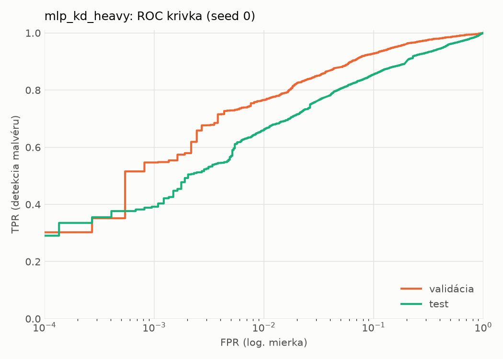
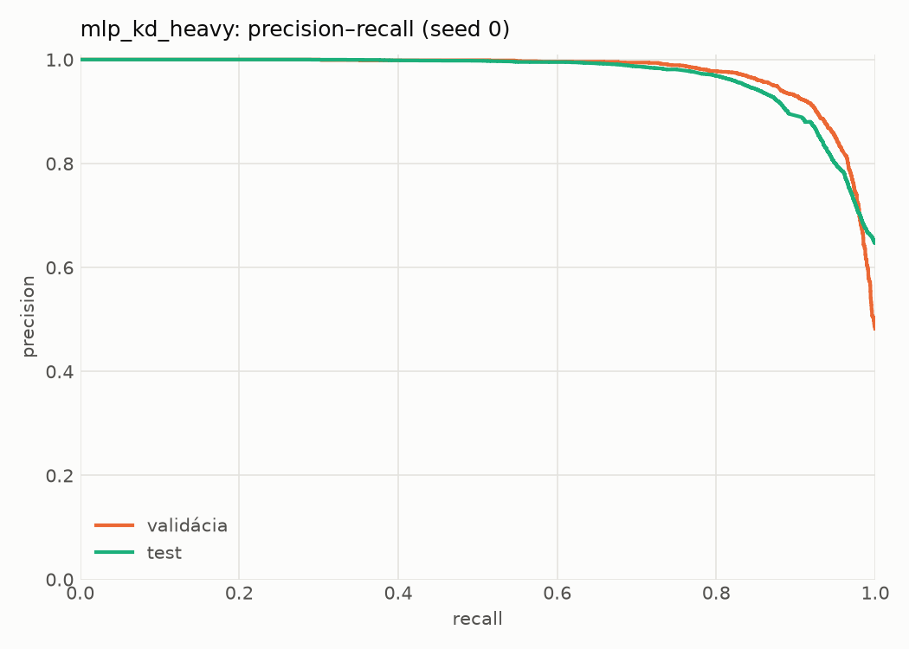
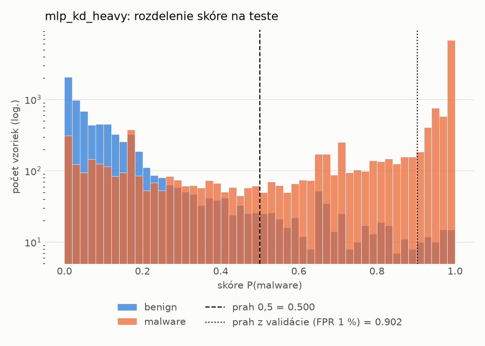
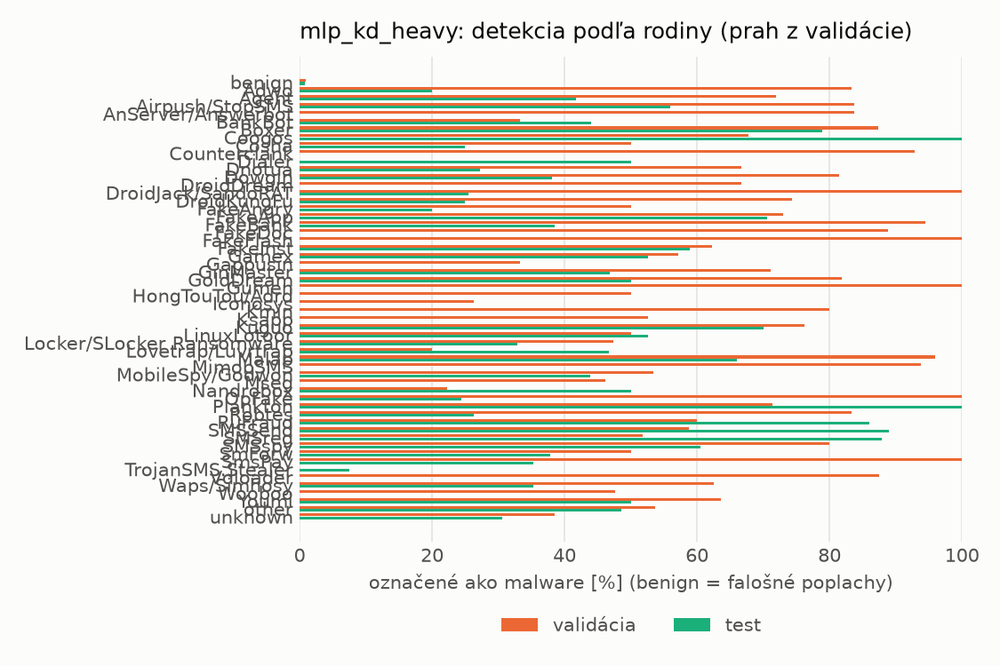
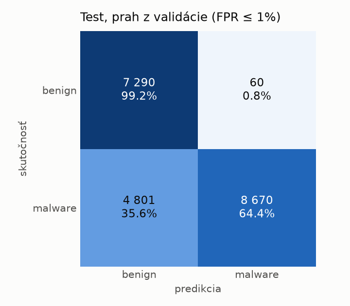
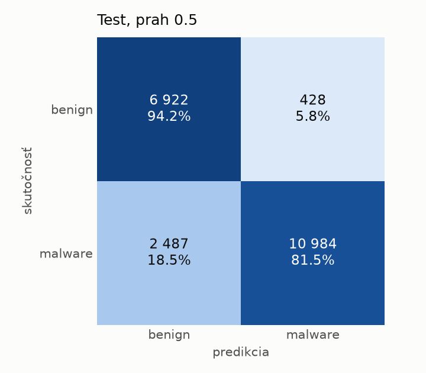
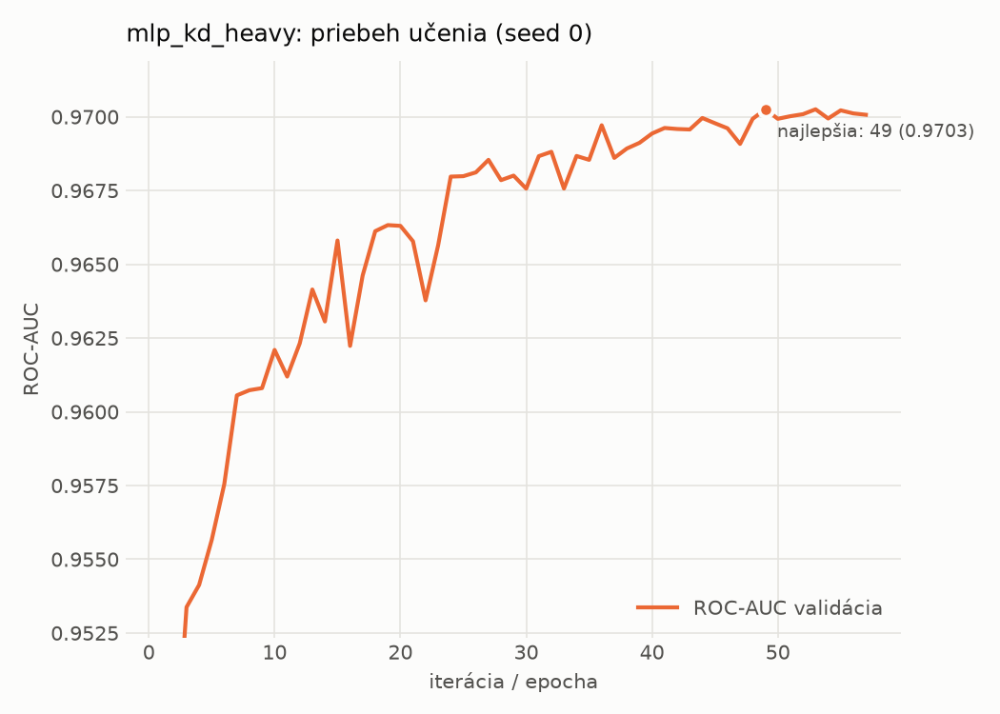

# dynamic/mlp_kd_heavy – beh `20261123-224558`

> Automaticky generované (`src/training/run_tabular.py`). Konfigurácia: `config.yaml`, protokol: `protocol.yaml`.

- **Model:** `mlp` – študent – malé MLP učené destiláciou z mlp_large hybridu (V4)
- **Ladenie:** bez ladenia – hyperparametre prevzaté z `runs_v4/real_full/full/students_dynamic/mlp_kd_heavy/20261122-211545`
- **Finálne modely:** seedy [0, 1, 2]; hodnoty sú priemer ± smerodajná odchýlka cez seedy
- **Najlepšie hyperparametre:** `{"hidden_layers": 1, "max_epochs": 100, "patience": 8, "hidden_width": 64, "dropout": 0.029123066185724737, "lr": 0.0017081972585601675, "weight_decay": 1.0334419171964511e-06, "batch_size": 256, "kd_alpha": 0.8514630095462001, "kd_temperature": 1.2684929468645387}`

## Detekčná kvalita (bez prahu)
| metrika | train (podvzorka) | validácia | test |
|---|---|---|---|
| ROC-AUC | 0.9779 ± 0.0003 | 0.9701 ± 0.0005 | 0.9360 ± 0.0001 |
| PR-AUC | 0.9804 ± 0.0003 | 0.9743 ± 0.0003 | 0.9694 ± 0.0003 |
| TPR pri FPR 1 % | 0.8159 ± 0.0032 | 0.7619 ± 0.0145 | 0.6618 ± 0.0084 |
| TPR pri FPR 0,1 % | 0.6421 ± 0.0303 | 0.5622 ± 0.0575 | 0.3994 ± 0.0108 |
| log loss | 0.1801 ± 0.0008 | 0.2159 ± 0.0015 | 0.3948 ± 0.0136 |
| Brier skóre | 0.0519 ± 0.0004 | 0.0608 ± 0.0002 | 0.1099 ± 0.0030 |

Rozdiel ROC-AUC train − validácia: **0.0078** (veľký rozdiel = preučenie).

## Pri prahu z validácie (FPR ≤ 1% na validácii)
| metrika | train (podvzorka) | validácia | test |
|---|---|---|---|
| accuracy | 0.8891 ± 0.0086 | 0.8801 ± 0.0070 | 0.7604 ± 0.0255 |
| balanced accuracy | 0.8840 ± 0.0091 | 0.8760 ± 0.0073 | 0.8131 ± 0.0193 |
| precision | 0.9919 ± 0.0025 | 0.9864 ± 0.0003 | 0.9933 ± 0.0011 |
| recall (TPR) | 0.7739 ± 0.0201 | 0.7619 ± 0.0145 | 0.6340 ± 0.0404 |
| FPR | 0.0058 ± 0.0019 | 0.0098 ± 0.0000 | 0.0079 ± 0.0018 |
| F1 | 0.8693 ± 0.0118 | 0.8597 ± 0.0094 | 0.7735 ± 0.0300 |
| MCC | 0.7937 ± 0.0142 | 0.7773 ± 0.0120 | 0.6081 ± 0.0314 |

## Pri pevnom prahu 0.5
| metrika | train (podvzorka) | validácia | test |
|---|---|---|---|
| accuracy | 0.9324 ± 0.0019 | 0.9190 ± 0.0005 | 0.8557 ± 0.0066 |
| balanced accuracy | 0.9314 ± 0.0023 | 0.9184 ± 0.0009 | 0.8765 ± 0.0034 |
| precision | 0.9467 ± 0.0053 | 0.9299 ± 0.0093 | 0.9656 ± 0.0043 |
| recall (TPR) | 0.9094 ± 0.0098 | 0.9001 ± 0.0115 | 0.8057 ± 0.0144 |
| FPR | 0.0467 ± 0.0054 | 0.0633 ± 0.0097 | 0.0527 ± 0.0077 |
| F1 | 0.9277 ± 0.0026 | 0.9147 ± 0.0015 | 0.8784 ± 0.0068 |
| MCC | 0.8649 ± 0.0034 | 0.8382 ± 0.0006 | 0.7221 ± 0.0077 |

## Výpočtové nároky (seed 0, testovacia množina)
| meranie | hodnota |
|---|---|
| tréning finálneho modelu | 23.8 s (priemer cez seedy) |
| ladenie spolu | 0 s |
| počet parametrov / uzlov | 8 513 |
| veľkosť modelu na disku | 0.04 MB |
| transformácia vstupu – latencia (1 vlákno) | 0.015 ms |
| transformácia vstupu – priepustnosť | 654 759 vzoriek/s |
| CPU latencia modelu (batch 1, 1 vlákno) | 0.052 ms (p95 0.155) |
| CPU priepustnosť (24 vlákien) | 4 975 387 vzoriek/s |
| GPU latencia (batch 1) | 0.448 ms (p95 0.479) |
| GPU priepustnosť | 2 310 415 vzoriek/s |
| GPU špičková pamäť | 91 MB |

## Grafy
| | |
|---|---|
|  |  |
|  |  |
|  |  |
|  |  |

## Súbory
`metrics.json` (všetky metriky po seedoch vrátane rodín), `timing.json`, `hpo_trials.csv`,
`predictions/<časť>_seed<N>.parquet` (sha256, family, label, score), `model/seed_<N>/`, `log.txt`.
