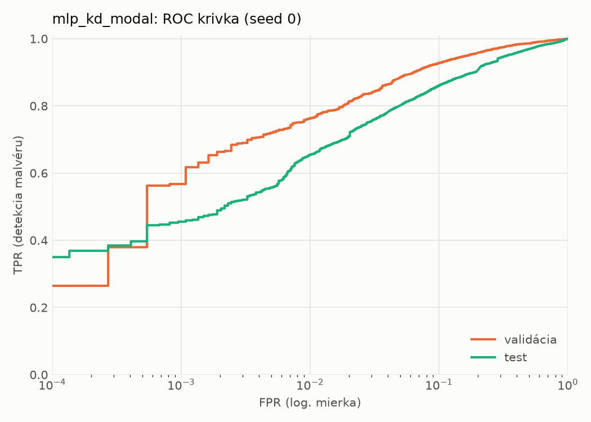
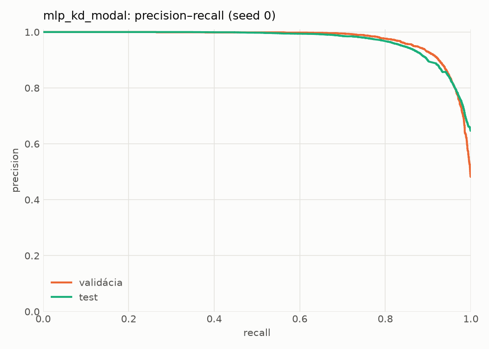
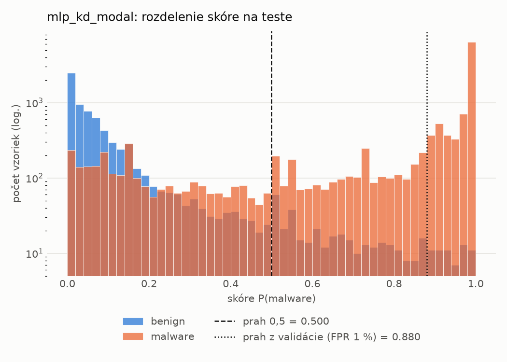
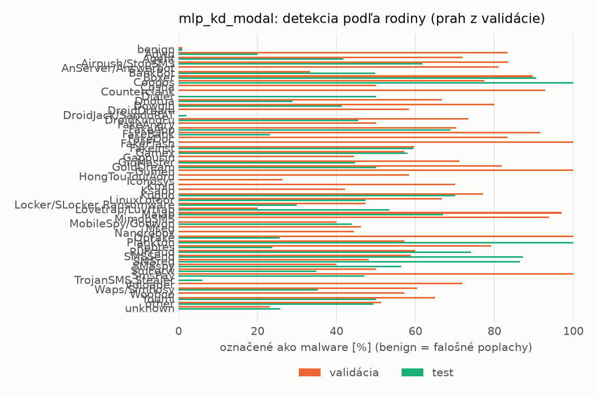
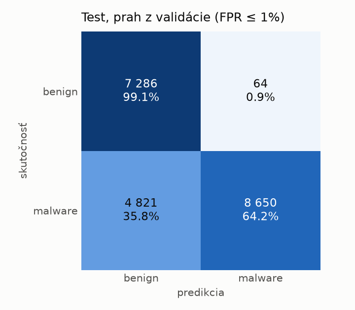
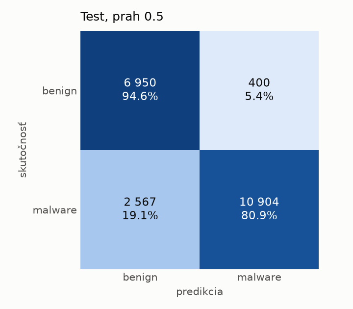
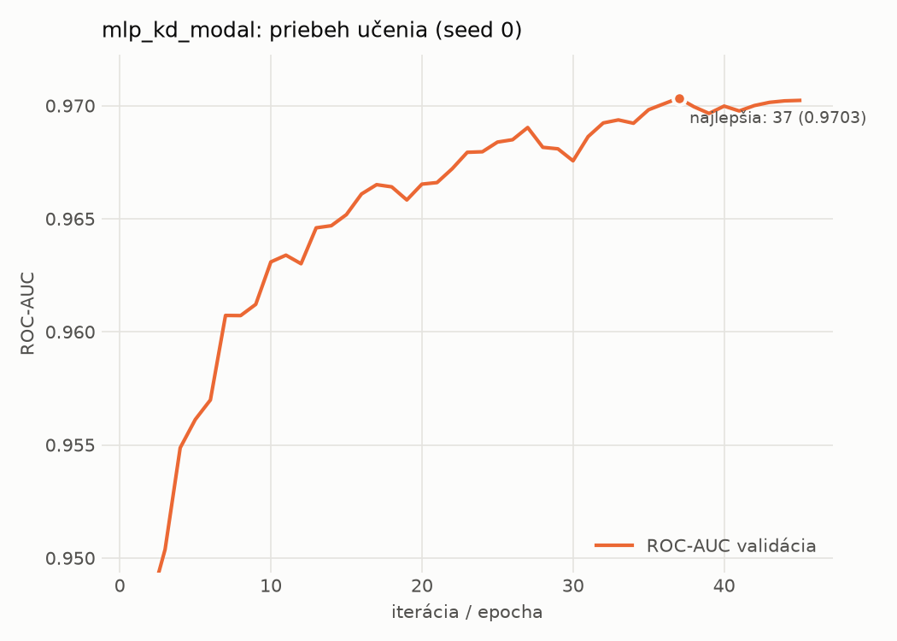

# dynamic/mlp_kd_modal – beh `20261123-224525`

> Automaticky generované (`src/training/run_tabular.py`). Konfigurácia: `config.yaml`, protokol: `protocol.yaml`.

- **Model:** `mlp` – študent – malé MLP učené destiláciou z učiteľa rovnakej modality (variant A)
- **Ladenie:** bez ladenia – hyperparametre prevzaté z `runs_v4/real_full/full/students_dynamic/mlp_kd_modal/20261122-210858`
- **Finálne modely:** seedy [0, 1, 2]; hodnoty sú priemer ± smerodajná odchýlka cez seedy
- **Najlepšie hyperparametre:** `{"hidden_layers": 1, "max_epochs": 100, "patience": 8, "hidden_width": 64, "dropout": 0.014842517384265013, "lr": 0.0018389280483922955, "weight_decay": 7.464279126466132e-05, "batch_size": 512, "kd_alpha": 0.45301900884301544, "kd_temperature": 1.2914074151312493}`

## Detekčná kvalita (bez prahu)
| metrika | train (podvzorka) | validácia | test |
|---|---|---|---|
| ROC-AUC | 0.9748 ± 0.0007 | 0.9704 ± 0.0002 | 0.9424 ± 0.0006 |
| PR-AUC | 0.9778 ± 0.0005 | 0.9743 ± 0.0002 | 0.9716 ± 0.0002 |
| TPR pri FPR 1 % | 0.8021 ± 0.0047 | 0.7598 ± 0.0085 | 0.6498 ± 0.0059 |
| TPR pri FPR 0,1 % | 0.5882 ± 0.0129 | 0.5843 ± 0.0403 | 0.4364 ± 0.0211 |
| log loss | 0.1911 ± 0.0021 | 0.2123 ± 0.0006 | 0.3778 ± 0.0047 |
| Brier skóre | 0.0552 ± 0.0008 | 0.0613 ± 0.0001 | 0.1107 ± 0.0021 |

Rozdiel ROC-AUC train − validácia: **0.0044** (veľký rozdiel = preučenie).

## Pri prahu z validácie (FPR ≤ 1% na validácii)
| metrika | train (podvzorka) | validácia | test |
|---|---|---|---|
| accuracy | 0.8891 ± 0.0041 | 0.8791 ± 0.0041 | 0.7632 ± 0.0047 |
| balanced accuracy | 0.8841 ± 0.0043 | 0.8750 ± 0.0042 | 0.8151 ± 0.0034 |
| precision | 0.9904 ± 0.0007 | 0.9864 ± 0.0002 | 0.9929 ± 0.0007 |
| recall (TPR) | 0.7751 ± 0.0091 | 0.7598 ± 0.0085 | 0.6385 ± 0.0077 |
| FPR | 0.0069 ± 0.0006 | 0.0098 ± 0.0000 | 0.0084 ± 0.0009 |
| F1 | 0.8696 ± 0.0055 | 0.8584 ± 0.0055 | 0.7772 ± 0.0055 |
| MCC | 0.7933 ± 0.0068 | 0.7756 ± 0.0070 | 0.6110 ± 0.0055 |

## Pri pevnom prahu 0.5
| metrika | train (podvzorka) | validácia | test |
|---|---|---|---|
| accuracy | 0.9278 ± 0.0009 | 0.9183 ± 0.0004 | 0.8536 ± 0.0054 |
| balanced accuracy | 0.9266 ± 0.0010 | 0.9175 ± 0.0005 | 0.8747 ± 0.0034 |
| precision | 0.9455 ± 0.0030 | 0.9318 ± 0.0042 | 0.9650 ± 0.0022 |
| recall (TPR) | 0.9006 ± 0.0038 | 0.8962 ± 0.0055 | 0.8029 ± 0.0104 |
| FPR | 0.0474 ± 0.0030 | 0.0611 ± 0.0044 | 0.0535 ± 0.0041 |
| F1 | 0.9225 ± 0.0011 | 0.9137 ± 0.0008 | 0.8765 ± 0.0054 |
| MCC | 0.8560 ± 0.0018 | 0.8368 ± 0.0005 | 0.7185 ± 0.0072 |

## Výpočtové nároky (seed 0, testovacia množina)
| meranie | hodnota |
|---|---|
| tréning finálneho modelu | 10.2 s (priemer cez seedy) |
| ladenie spolu | 0 s |
| počet parametrov / uzlov | 8 513 |
| veľkosť modelu na disku | 0.04 MB |
| transformácia vstupu – latencia (1 vlákno) | 0.015 ms |
| transformácia vstupu – priepustnosť | 649 107 vzoriek/s |
| CPU latencia modelu (batch 1, 1 vlákno) | 0.052 ms (p95 0.154) |
| CPU priepustnosť (24 vlákien) | 4 197 021 vzoriek/s |
| GPU latencia (batch 1) | 0.443 ms (p95 0.465) |
| GPU priepustnosť | 1 989 908 vzoriek/s |
| GPU špičková pamäť | 62 MB |

## Grafy
| | |
|---|---|
|  |  |
|  |  |
|  |  |
|  |  |

## Súbory
`metrics.json` (všetky metriky po seedoch vrátane rodín), `timing.json`, `hpo_trials.csv`,
`predictions/<časť>_seed<N>.parquet` (sha256, family, label, score), `model/seed_<N>/`, `log.txt`.
