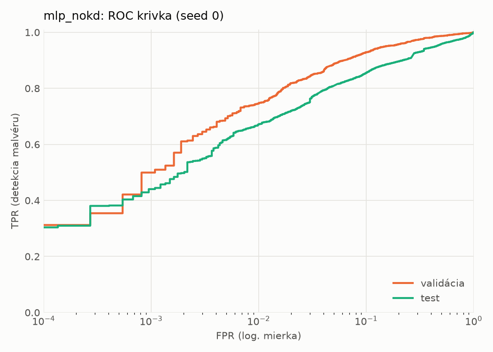
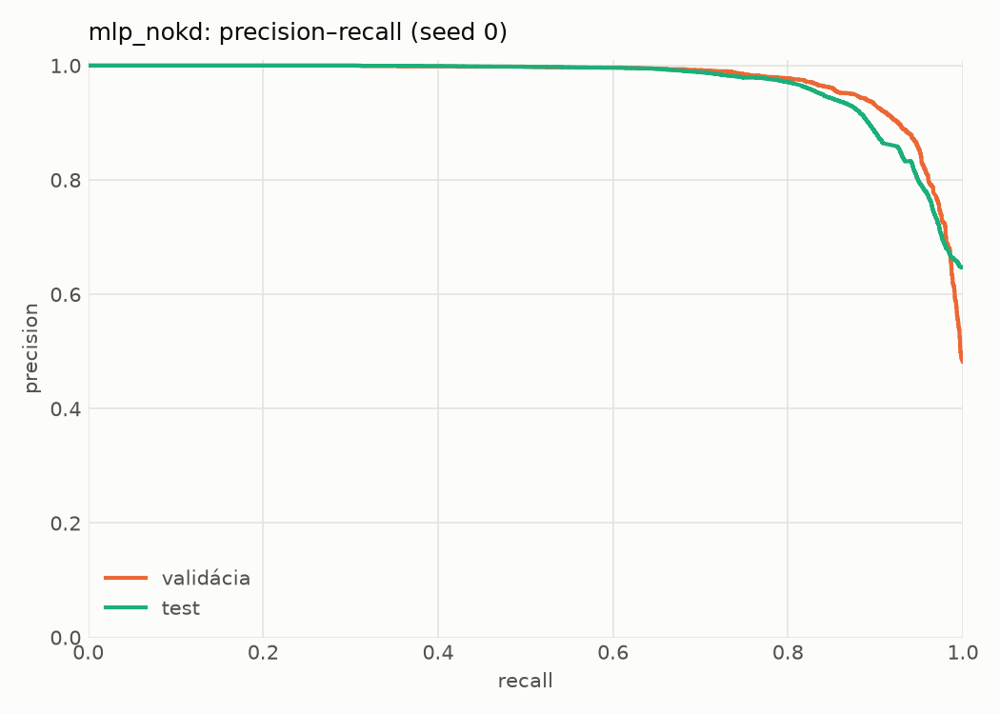
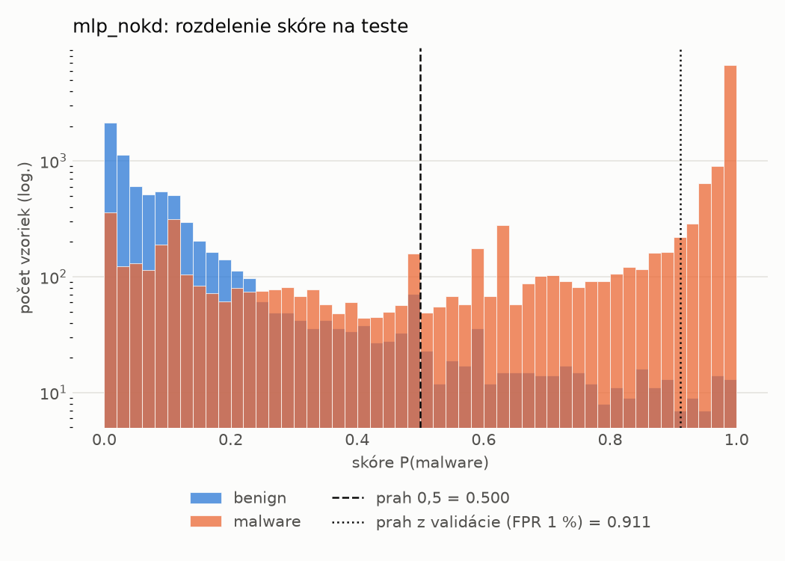
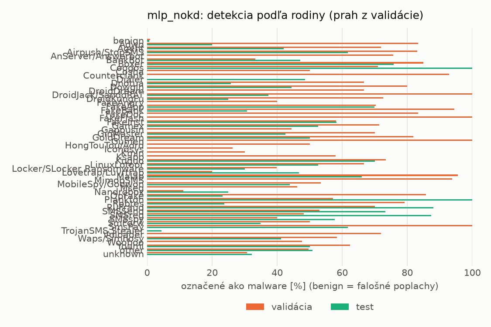
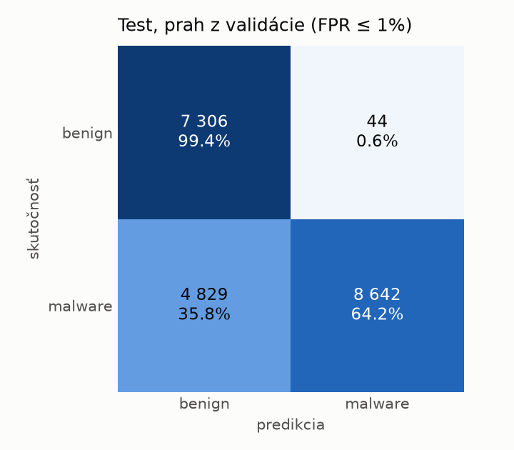
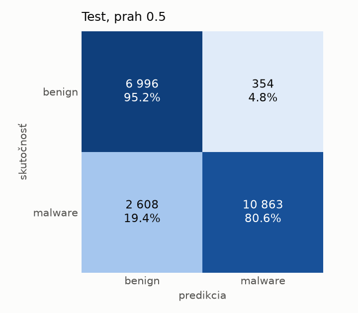
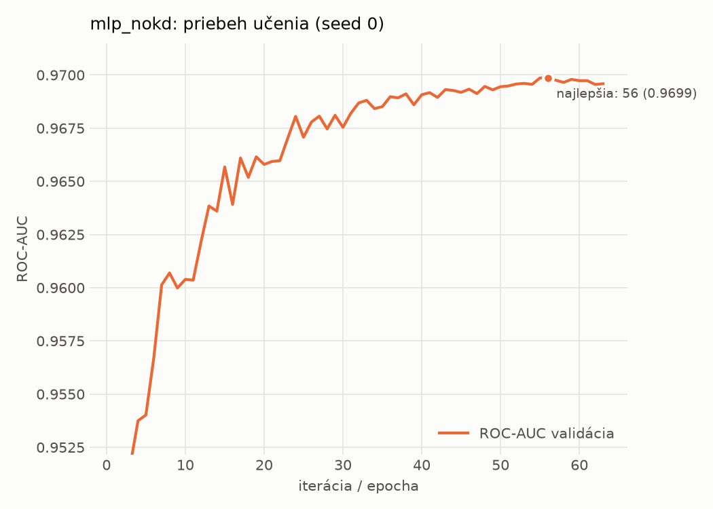

# dynamic/mlp_nokd – beh `20261123-224443`

> Automaticky generované (`src/training/run_tabular.py`). Konfigurácia: `config.yaml`, protokol: `protocol.yaml`.

- **Model:** `mlp` – kontrola – rovnaké malé MLP bez destilácie (iba skutočné označenia)
- **Ladenie:** bez ladenia – hyperparametre prevzaté z `runs_v4/real_full/full/students_dynamic/mlp_nokd/20261122-205917`
- **Finálne modely:** seedy [0, 1, 2]; hodnoty sú priemer ± smerodajná odchýlka cez seedy
- **Najlepšie hyperparametre:** `{"hidden_layers": 1, "max_epochs": 100, "patience": 8, "hidden_width": 64, "dropout": 0.014622282919838341, "lr": 0.0013105433289036465, "weight_decay": 1.7870054646247664e-05, "batch_size": 256}`

## Detekčná kvalita (bez prahu)
| metrika | train (podvzorka) | validácia | test |
|---|---|---|---|
| ROC-AUC | 0.9770 ± 0.0001 | 0.9698 ± 0.0001 | 0.9347 ± 0.0014 |
| PR-AUC | 0.9797 ± 0.0001 | 0.9740 ± 0.0002 | 0.9691 ± 0.0005 |
| TPR pri FPR 1 % | 0.8114 ± 0.0066 | 0.7526 ± 0.0129 | 0.6660 ± 0.0059 |
| TPR pri FPR 0,1 % | 0.6231 ± 0.0206 | 0.5333 ± 0.0564 | 0.4526 ± 0.0165 |
| log loss | 0.1833 ± 0.0011 | 0.2155 ± 0.0016 | 0.3973 ± 0.0098 |
| Brier skóre | 0.0527 ± 0.0002 | 0.0612 ± 0.0001 | 0.1096 ± 0.0003 |

Rozdiel ROC-AUC train − validácia: **0.0072** (veľký rozdiel = preučenie).

## Pri prahu z validácie (FPR ≤ 1% na validácii)
| metrika | train (podvzorka) | validácia | test |
|---|---|---|---|
| accuracy | 0.8848 ± 0.0058 | 0.8756 ± 0.0062 | 0.7686 ± 0.0078 |
| balanced accuracy | 0.8795 ± 0.0062 | 0.8714 ± 0.0065 | 0.8194 ± 0.0055 |
| precision | 0.9921 ± 0.0017 | 0.9862 ± 0.0002 | 0.9937 ± 0.0017 |
| recall (TPR) | 0.7646 ± 0.0137 | 0.7526 ± 0.0129 | 0.6464 ± 0.0132 |
| FPR | 0.0055 ± 0.0013 | 0.0098 ± 0.0000 | 0.0075 ± 0.0022 |
| F1 | 0.8636 ± 0.0080 | 0.8537 ± 0.0084 | 0.7832 ± 0.0091 |
| MCC | 0.7863 ± 0.0096 | 0.7697 ± 0.0107 | 0.6185 ± 0.0089 |

## Pri pevnom prahu 0.5
| metrika | train (podvzorka) | validácia | test |
|---|---|---|---|
| accuracy | 0.9313 ± 0.0010 | 0.9190 ± 0.0009 | 0.8561 ± 0.0015 |
| balanced accuracy | 0.9302 ± 0.0009 | 0.9183 ± 0.0008 | 0.8770 ± 0.0018 |
| precision | 0.9460 ± 0.0034 | 0.9299 ± 0.0035 | 0.9662 ± 0.0020 |
| recall (TPR) | 0.9078 ± 0.0025 | 0.8998 ± 0.0023 | 0.8057 ± 0.0006 |
| FPR | 0.0473 ± 0.0032 | 0.0632 ± 0.0035 | 0.0517 ± 0.0031 |
| F1 | 0.9265 ± 0.0009 | 0.9146 ± 0.0007 | 0.8787 ± 0.0012 |
| MCC | 0.8627 ± 0.0020 | 0.8379 ± 0.0019 | 0.7230 ± 0.0034 |

## Výpočtové nároky (seed 0, testovacia množina)
| meranie | hodnota |
|---|---|
| tréning finálneho modelu | 13.5 s (priemer cez seedy) |
| ladenie spolu | 0 s |
| počet parametrov / uzlov | 8 513 |
| veľkosť modelu na disku | 0.04 MB |
| transformácia vstupu – latencia (1 vlákno) | 0.015 ms |
| transformácia vstupu – priepustnosť | 653 870 vzoriek/s |
| CPU latencia modelu (batch 1, 1 vlákno) | 0.053 ms (p95 0.154) |
| CPU priepustnosť (24 vlákien) | 4 529 751 vzoriek/s |
| GPU latencia (batch 1) | 0.441 ms (p95 0.473) |
| GPU priepustnosť | 2 328 736 vzoriek/s |
| GPU špičková pamäť | 91 MB |

## Grafy
| | |
|---|---|
|  |  |
|  |  |
|  |  |
|  |  |

## Súbory
`metrics.json` (všetky metriky po seedoch vrátane rodín), `timing.json`, `hpo_trials.csv`,
`predictions/<časť>_seed<N>.parquet` (sha256, family, label, score), `model/seed_<N>/`, `log.txt`.
