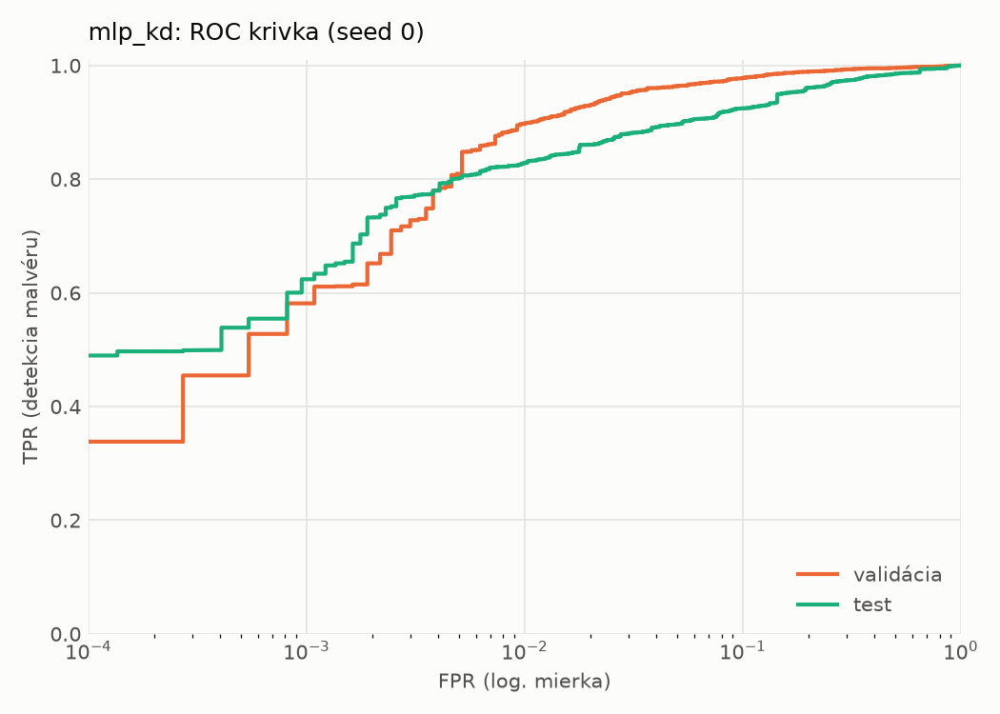
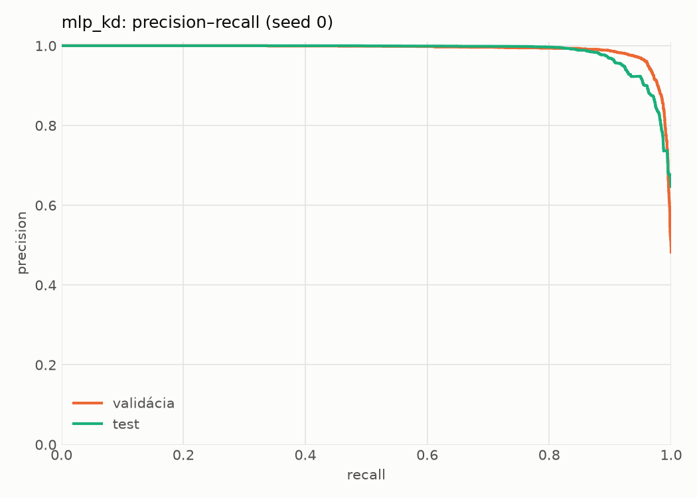
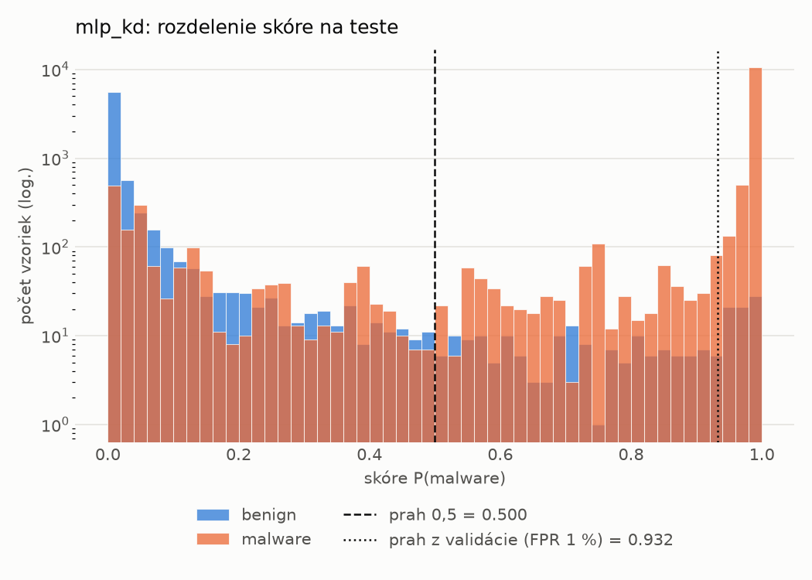
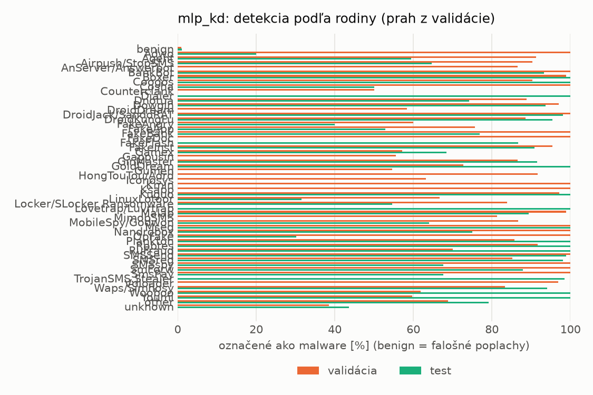
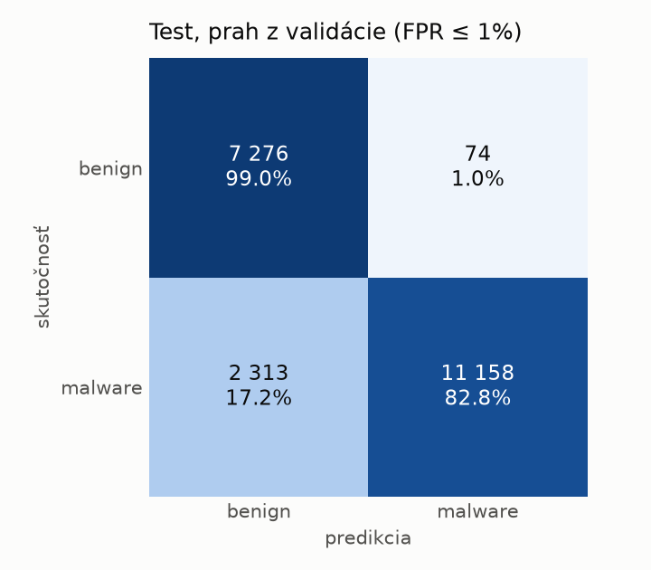
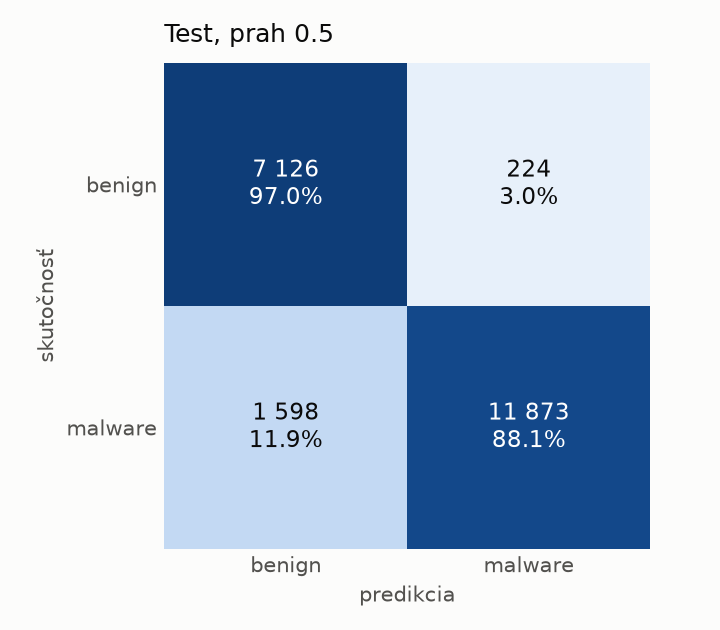
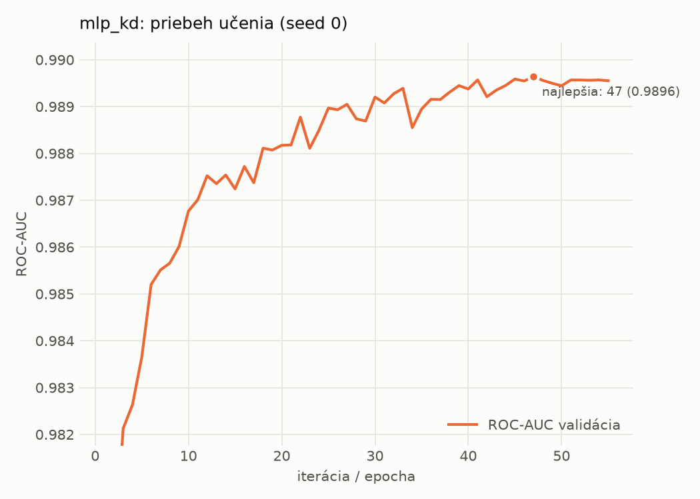

# static/mlp_kd – beh `20261123-224256`

> Automaticky generované (`src/training/run_tabular.py`). Konfigurácia: `config.yaml`, protokol: `protocol.yaml`.

- **Model:** `mlp` – študent – malé MLP učené destiláciou z hybridného učiteľa
- **Ladenie:** bez ladenia – hyperparametre prevzaté z `runs_v4/real_full/full/students_static/mlp_kd/20261122-203423`
- **Finálne modely:** seedy [0, 1, 2]; hodnoty sú priemer ± smerodajná odchýlka cez seedy
- **Najlepšie hyperparametre:** `{"hidden_layers": 1, "max_epochs": 100, "patience": 8, "hidden_width": 64, "dropout": 0.018096880153353218, "lr": 0.002445898909575082, "weight_decay": 6.315937377471515e-05, "batch_size": 1024, "kd_alpha": 0.6461462865023861, "kd_temperature": 1.5048732616232385}`

## Detekčná kvalita (bez prahu)
| metrika | train (podvzorka) | validácia | test |
|---|---|---|---|
| ROC-AUC | 0.9936 ± 0.0003 | 0.9889 ± 0.0006 | 0.9717 ± 0.0008 |
| PR-AUC | 0.9942 ± 0.0002 | 0.9893 ± 0.0011 | 0.9865 ± 0.0005 |
| TPR pri FPR 1 % | 0.9325 ± 0.0045 | 0.8769 ± 0.0178 | 0.8224 ± 0.0067 |
| TPR pri FPR 0,1 % | 0.7701 ± 0.0261 | 0.5601 ± 0.0326 | 0.6251 ± 0.0049 |
| log loss | 0.0926 ± 0.0017 | 0.1318 ± 0.0044 | 0.3061 ± 0.0050 |
| Brier skóre | 0.0245 ± 0.0005 | 0.0330 ± 0.0008 | 0.0736 ± 0.0011 |

Rozdiel ROC-AUC train − validácia: **0.0047** (veľký rozdiel = preučenie).

## Pri prahu z validácie (FPR ≤ 1% na validácii)
| metrika | train (podvzorka) | validácia | test |
|---|---|---|---|
| accuracy | 0.9382 ± 0.0074 | 0.9356 ± 0.0086 | 0.8696 ± 0.0150 |
| balanced accuracy | 0.9355 ± 0.0078 | 0.9336 ± 0.0089 | 0.8974 ± 0.0112 |
| precision | 0.9935 ± 0.0006 | 0.9881 ± 0.0002 | 0.9947 ± 0.0011 |
| recall (TPR) | 0.8762 ± 0.0162 | 0.8769 ± 0.0178 | 0.8028 ± 0.0242 |
| FPR | 0.0052 ± 0.0006 | 0.0098 ± 0.0000 | 0.0079 ± 0.0019 |
| F1 | 0.9311 ± 0.0089 | 0.9292 ± 0.0101 | 0.8884 ± 0.0143 |
| MCC | 0.8813 ± 0.0136 | 0.8758 ± 0.0158 | 0.7608 ± 0.0226 |

## Pri pevnom prahu 0.5
| metrika | train (podvzorka) | validácia | test |
|---|---|---|---|
| accuracy | 0.9697 ± 0.0010 | 0.9590 ± 0.0015 | 0.9132 ± 0.0006 |
| balanced accuracy | 0.9694 ± 0.0009 | 0.9589 ± 0.0015 | 0.9257 ± 0.0002 |
| precision | 0.9740 ± 0.0033 | 0.9574 ± 0.0032 | 0.9806 ± 0.0008 |
| recall (TPR) | 0.9622 ± 0.0012 | 0.9576 ± 0.0010 | 0.8834 ± 0.0017 |
| FPR | 0.0234 ± 0.0030 | 0.0397 ± 0.0031 | 0.0320 ± 0.0014 |
| F1 | 0.9681 ± 0.0010 | 0.9575 ± 0.0015 | 0.9294 ± 0.0006 |
| MCC | 0.9394 ± 0.0021 | 0.9178 ± 0.0030 | 0.8251 ± 0.0008 |

## Výpočtové nároky (seed 0, testovacia množina)
| meranie | hodnota |
|---|---|
| tréning finálneho modelu | 4.9 s (priemer cez seedy) |
| ladenie spolu | 0 s |
| počet parametrov / uzlov | 10 689 |
| veľkosť modelu na disku | 0.05 MB |
| transformácia vstupu – latencia (1 vlákno) | 0.015 ms |
| transformácia vstupu – priepustnosť | 596 436 vzoriek/s |
| CPU latencia modelu (batch 1, 1 vlákno) | 0.048 ms (p95 0.055) |
| CPU priepustnosť (24 vlákien) | 3 370 566 vzoriek/s |
| GPU latencia (batch 1) | 0.444 ms (p95 0.467) |
| GPU priepustnosť | 1 842 045 vzoriek/s |
| GPU špičková pamäť | 72 MB |

## Grafy
| | |
|---|---|
|  |  |
|  |  |
|  |  |
|  |  |

## Súbory
`metrics.json` (všetky metriky po seedoch vrátane rodín), `timing.json`, `hpo_trials.csv`,
`predictions/<časť>_seed<N>.parquet` (sha256, family, label, score), `model/seed_<N>/`, `log.txt`.
