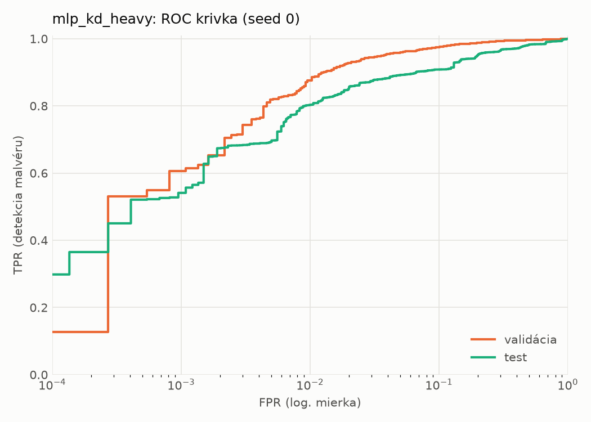
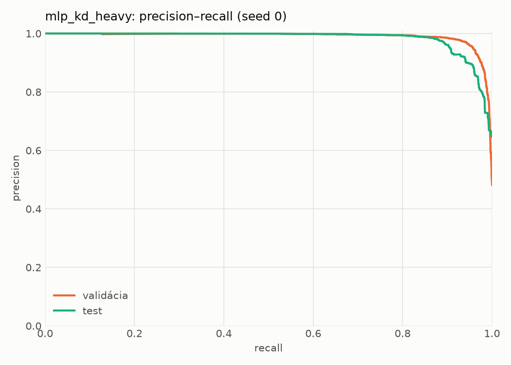
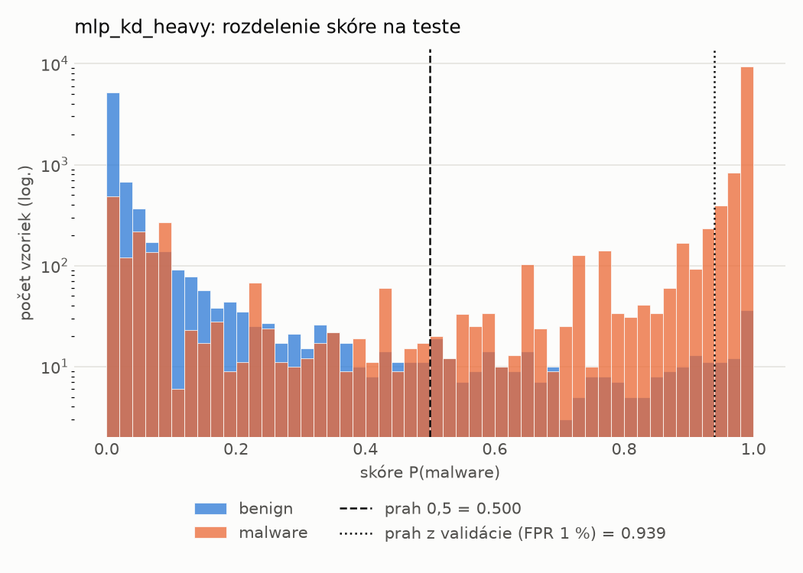
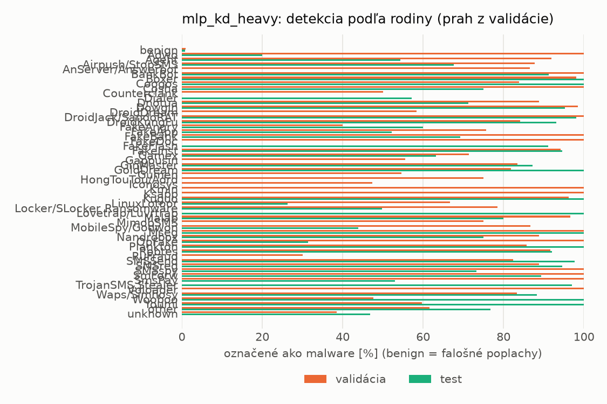
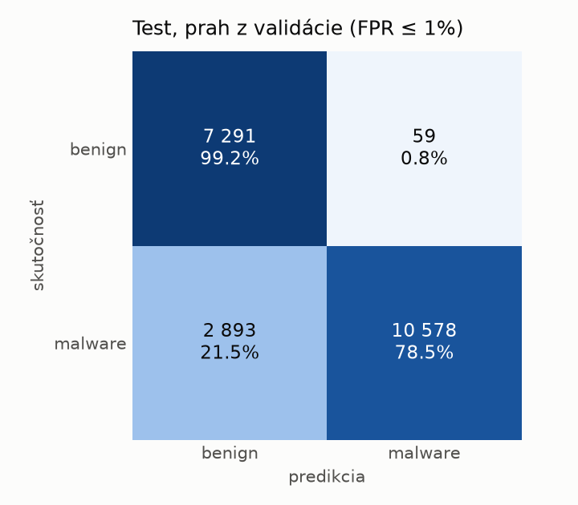
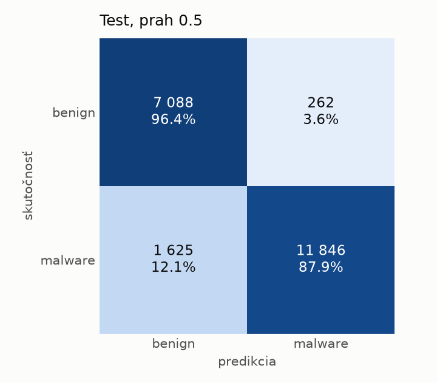
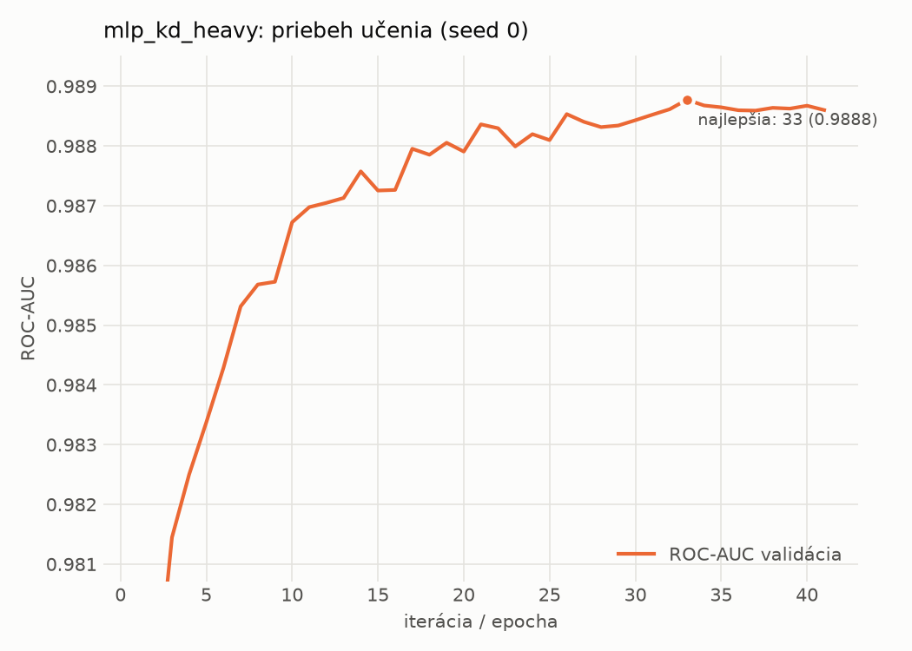

# static/mlp_kd_heavy – beh `20261123-224355`

> Automaticky generované (`src/training/run_tabular.py`). Konfigurácia: `config.yaml`, protokol: `protocol.yaml`.

- **Model:** `mlp` – študent – malé MLP učené destiláciou z mlp_large hybridu (V4)
- **Ladenie:** bez ladenia – hyperparametre prevzaté z `runs_v4/real_full/full/students_static/mlp_kd_heavy/20261122-204855`
- **Finálne modely:** seedy [0, 1, 2]; hodnoty sú priemer ± smerodajná odchýlka cez seedy
- **Najlepšie hyperparametre:** `{"hidden_layers": 1, "max_epochs": 100, "patience": 8, "hidden_width": 64, "dropout": 0.04239795529418809, "lr": 0.0021920597062990285, "weight_decay": 0.0001469802566586536, "batch_size": 1024, "kd_alpha": 0.8931311185241001, "kd_temperature": 5.447798930063548}`

## Detekčná kvalita (bez prahu)
| metrika | train (podvzorka) | validácia | test |
|---|---|---|---|
| ROC-AUC | 0.9931 ± 0.0004 | 0.9887 ± 0.0003 | 0.9627 ± 0.0023 |
| PR-AUC | 0.9936 ± 0.0003 | 0.9889 ± 0.0009 | 0.9821 ± 0.0014 |
| TPR pri FPR 1 % | 0.9213 ± 0.0043 | 0.8617 ± 0.0129 | 0.7703 ± 0.0283 |
| TPR pri FPR 0,1 % | 0.7809 ± 0.0170 | 0.5838 ± 0.0332 | 0.5781 ± 0.0358 |
| log loss | 0.0981 ± 0.0022 | 0.1312 ± 0.0014 | 0.3480 ± 0.0275 |
| Brier skóre | 0.0267 ± 0.0005 | 0.0344 ± 0.0001 | 0.0870 ± 0.0086 |

Rozdiel ROC-AUC train − validácia: **0.0044** (veľký rozdiel = preučenie).

## Pri prahu z validácie (FPR ≤ 1% na validácii)
| metrika | train (podvzorka) | validácia | test |
|---|---|---|---|
| accuracy | 0.9317 ± 0.0043 | 0.9283 ± 0.0063 | 0.8322 ± 0.0228 |
| balanced accuracy | 0.9287 ± 0.0045 | 0.9260 ± 0.0065 | 0.8688 ± 0.0173 |
| precision | 0.9938 ± 0.0007 | 0.9881 ± 0.0004 | 0.9952 ± 0.0006 |
| recall (TPR) | 0.8623 ± 0.0096 | 0.8617 ± 0.0129 | 0.7442 ± 0.0358 |
| FPR | 0.0049 ± 0.0006 | 0.0097 ± 0.0002 | 0.0067 ± 0.0012 |
| F1 | 0.9234 ± 0.0052 | 0.9205 ± 0.0075 | 0.8513 ± 0.0230 |
| MCC | 0.8695 ± 0.0077 | 0.8624 ± 0.0115 | 0.7059 ± 0.0325 |

## Pri pevnom prahu 0.5
| metrika | train (podvzorka) | validácia | test |
|---|---|---|---|
| accuracy | 0.9658 ± 0.0006 | 0.9568 ± 0.0007 | 0.8961 ± 0.0116 |
| balanced accuracy | 0.9655 ± 0.0006 | 0.9568 ± 0.0007 | 0.9115 ± 0.0090 |
| precision | 0.9687 ± 0.0012 | 0.9538 ± 0.0018 | 0.9776 ± 0.0011 |
| recall (TPR) | 0.9592 ± 0.0021 | 0.9568 ± 0.0011 | 0.8591 ± 0.0178 |
| FPR | 0.0282 ± 0.0012 | 0.0432 ± 0.0018 | 0.0361 ± 0.0016 |
| F1 | 0.9639 ± 0.0006 | 0.9553 ± 0.0007 | 0.9144 ± 0.0103 |
| MCC | 0.9314 ± 0.0011 | 0.9135 ± 0.0014 | 0.7943 ± 0.0200 |

## Výpočtové nároky (seed 0, testovacia množina)
| meranie | hodnota |
|---|---|
| tréning finálneho modelu | 3.6 s (priemer cez seedy) |
| ladenie spolu | 0 s |
| počet parametrov / uzlov | 10 689 |
| veľkosť modelu na disku | 0.05 MB |
| transformácia vstupu – latencia (1 vlákno) | 0.015 ms |
| transformácia vstupu – priepustnosť | 582 740 vzoriek/s |
| CPU latencia modelu (batch 1, 1 vlákno) | 0.051 ms (p95 0.060) |
| CPU priepustnosť (24 vlákien) | 2 686 407 vzoriek/s |
| GPU latencia (batch 1) | 0.464 ms (p95 0.489) |
| GPU priepustnosť | 2 599 473 vzoriek/s |
| GPU špičková pamäť | 109 MB |

## Grafy
| | |
|---|---|
|  |  |
|  |  |
|  |  |
|  |  |

## Súbory
`metrics.json` (všetky metriky po seedoch vrátane rodín), `timing.json`, `hpo_trials.csv`,
`predictions/<časť>_seed<N>.parquet` (sha256, family, label, score), `model/seed_<N>/`, `log.txt`.
