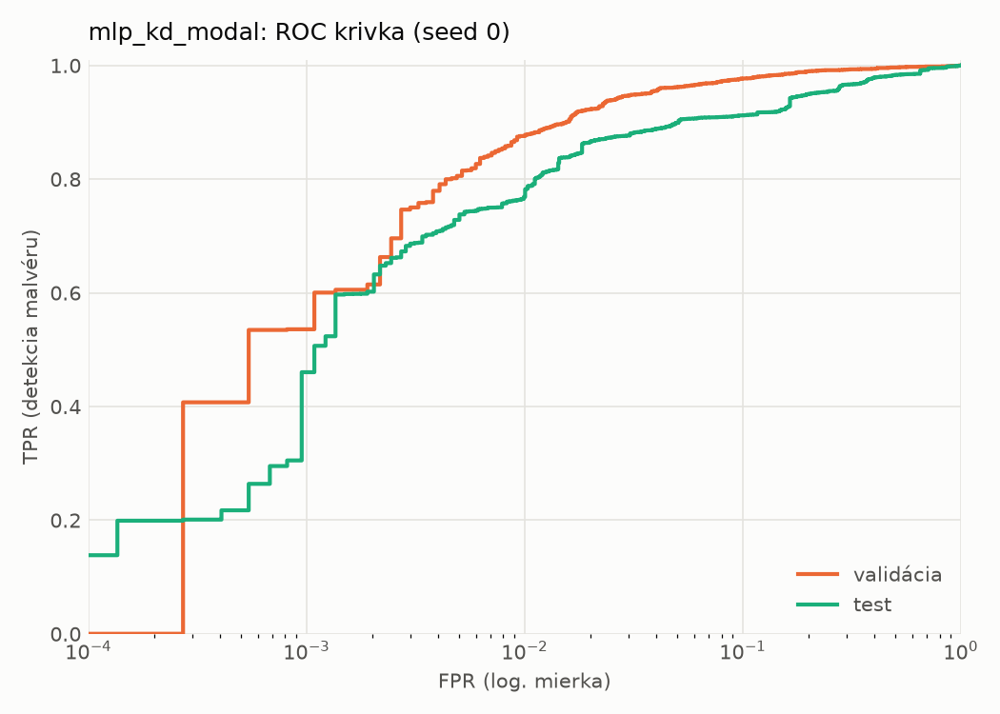
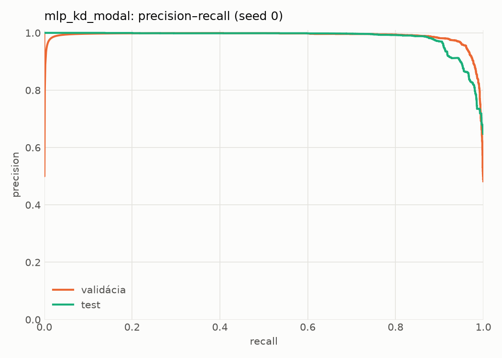
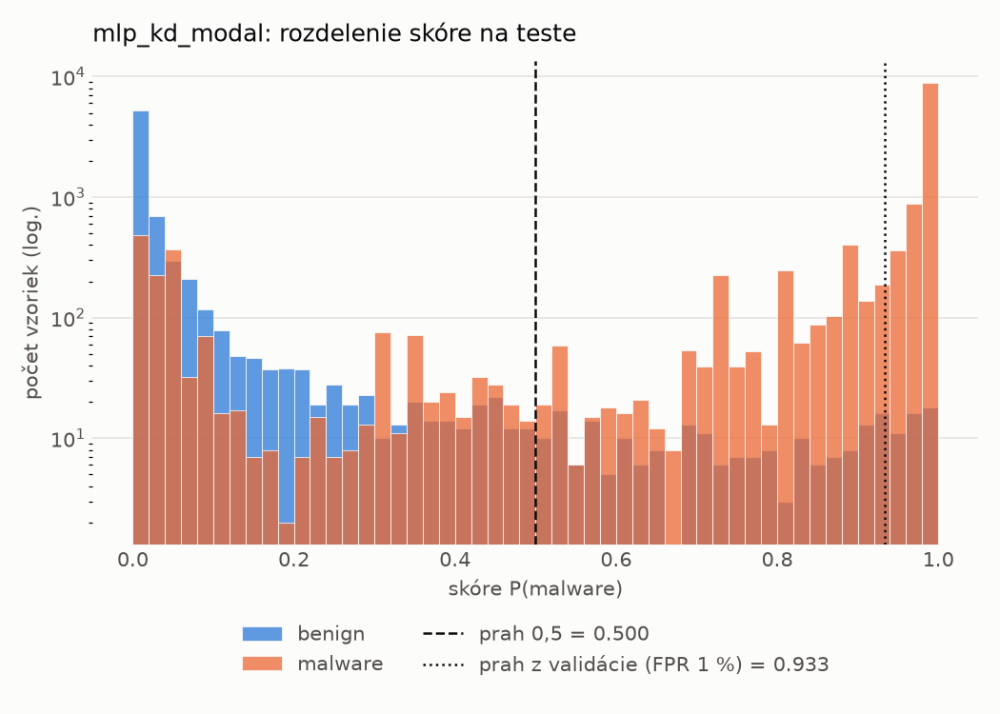
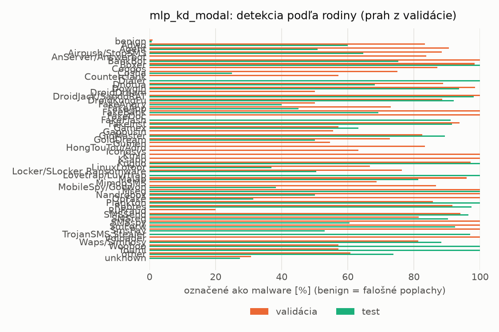
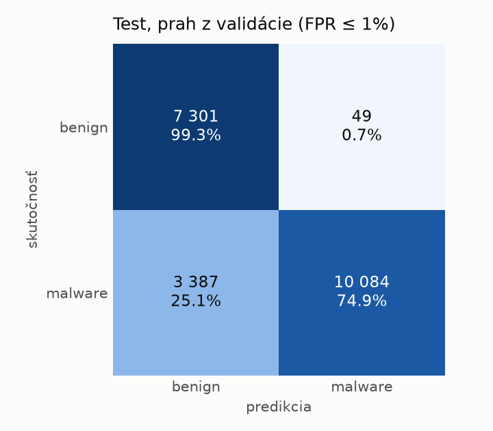
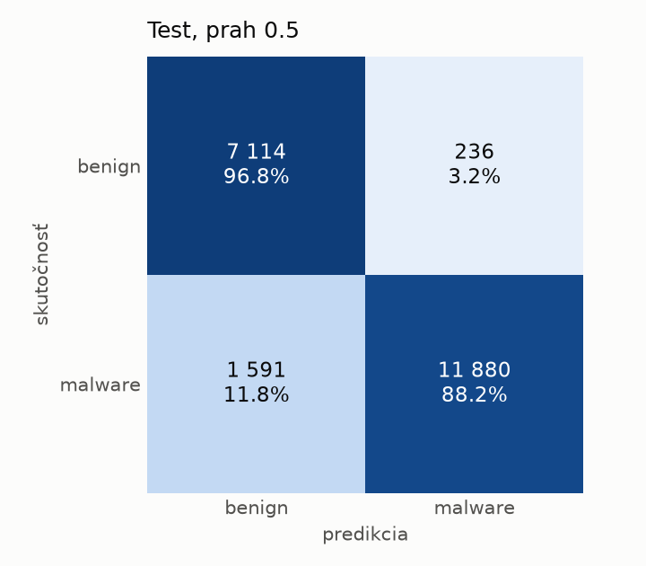
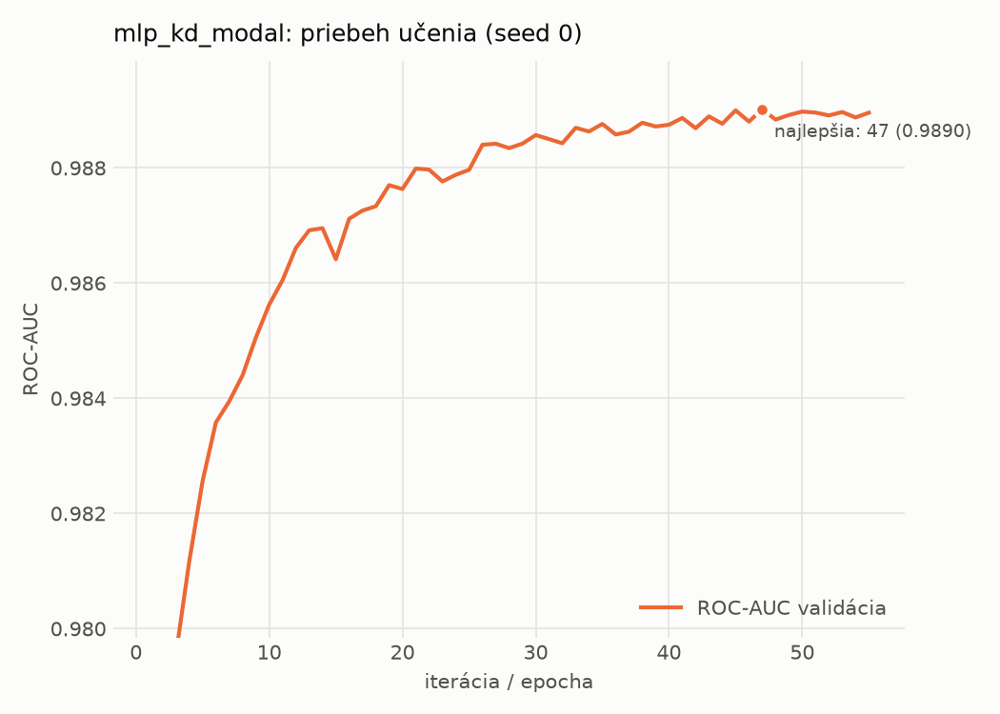

# static/mlp_kd_modal – beh `20261123-224339`

> Automaticky generované (`src/training/run_tabular.py`). Konfigurácia: `config.yaml`, protokol: `protocol.yaml`.

- **Model:** `mlp` – študent – malé MLP učené destiláciou z učiteľa rovnakej modality (variant A)
- **Ladenie:** bez ladenia – hyperparametre prevzaté z `runs_v4/real_full/full/students_static/mlp_kd_modal/20261122-204432`
- **Finálne modely:** seedy [0, 1, 2]; hodnoty sú priemer ± smerodajná odchýlka cez seedy
- **Najlepšie hyperparametre:** `{"hidden_layers": 1, "max_epochs": 100, "patience": 8, "hidden_width": 64, "dropout": 0.005196375734621726, "lr": 0.0014172842807441423, "weight_decay": 1.1835949733056038e-05, "batch_size": 1024, "kd_alpha": 0.5211229932470658, "kd_temperature": 1.6263320735090332}`

## Detekčná kvalita (bez prahu)
| metrika | train (podvzorka) | validácia | test |
|---|---|---|---|
| ROC-AUC | 0.9927 ± 0.0002 | 0.9887 ± 0.0003 | 0.9681 ± 0.0012 |
| PR-AUC | 0.9933 ± 0.0001 | 0.9878 ± 0.0004 | 0.9846 ± 0.0006 |
| TPR pri FPR 1 % | 0.9189 ± 0.0036 | 0.8696 ± 0.0058 | 0.7664 ± 0.0084 |
| TPR pri FPR 0,1 % | 0.7442 ± 0.0038 | 0.5713 ± 0.0364 | 0.5051 ± 0.0436 |
| log loss | 0.1005 ± 0.0012 | 0.1305 ± 0.0025 | 0.3094 ± 0.0020 |
| Brier skóre | 0.0272 ± 0.0003 | 0.0338 ± 0.0008 | 0.0756 ± 0.0004 |

Rozdiel ROC-AUC train − validácia: **0.0040** (veľký rozdiel = preučenie).

## Pri prahu z validácie (FPR ≤ 1% na validácii)
| metrika | train (podvzorka) | validácia | test |
|---|---|---|---|
| accuracy | 0.9369 ± 0.0030 | 0.9321 ± 0.0029 | 0.8208 ± 0.0170 |
| balanced accuracy | 0.9342 ± 0.0031 | 0.9300 ± 0.0030 | 0.8600 ± 0.0133 |
| precision | 0.9930 ± 0.0006 | 0.9882 ± 0.0003 | 0.9949 ± 0.0008 |
| recall (TPR) | 0.8739 ± 0.0065 | 0.8696 ± 0.0058 | 0.7267 ± 0.0260 |
| FPR | 0.0056 ± 0.0005 | 0.0097 ± 0.0002 | 0.0068 ± 0.0008 |
| F1 | 0.9297 ± 0.0036 | 0.9251 ± 0.0034 | 0.8398 ± 0.0177 |
| MCC | 0.8788 ± 0.0054 | 0.8694 ± 0.0053 | 0.6894 ± 0.0241 |

## Pri pevnom prahu 0.5
| metrika | train (podvzorka) | validácia | test |
|---|---|---|---|
| accuracy | 0.9655 ± 0.0008 | 0.9583 ± 0.0015 | 0.9093 ± 0.0027 |
| balanced accuracy | 0.9652 ± 0.0008 | 0.9582 ± 0.0015 | 0.9225 ± 0.0022 |
| precision | 0.9692 ± 0.0005 | 0.9577 ± 0.0017 | 0.9803 ± 0.0004 |
| recall (TPR) | 0.9581 ± 0.0013 | 0.9558 ± 0.0014 | 0.8775 ± 0.0040 |
| FPR | 0.0278 ± 0.0005 | 0.0394 ± 0.0016 | 0.0324 ± 0.0005 |
| F1 | 0.9636 ± 0.0008 | 0.9567 ± 0.0015 | 0.9260 ± 0.0024 |
| MCC | 0.9309 ± 0.0016 | 0.9165 ± 0.0029 | 0.8181 ± 0.0049 |

## Výpočtové nároky (seed 0, testovacia množina)
| meranie | hodnota |
|---|---|
| tréning finálneho modelu | 4.5 s (priemer cez seedy) |
| ladenie spolu | 0 s |
| počet parametrov / uzlov | 10 689 |
| veľkosť modelu na disku | 0.05 MB |
| transformácia vstupu – latencia (1 vlákno) | 0.015 ms |
| transformácia vstupu – priepustnosť | 597 143 vzoriek/s |
| CPU latencia modelu (batch 1, 1 vlákno) | 0.051 ms (p95 0.060) |
| CPU priepustnosť (24 vlákien) | 3 395 134 vzoriek/s |
| GPU latencia (batch 1) | 0.448 ms (p95 0.476) |
| GPU priepustnosť | 1 819 588 vzoriek/s |
| GPU špičková pamäť | 72 MB |

## Grafy
| | |
|---|---|
|  |  |
|  |  |
|  |  |
|  |  |

## Súbory
`metrics.json` (všetky metriky po seedoch vrátane rodín), `timing.json`, `hpo_trials.csv`,
`predictions/<časť>_seed<N>.parquet` (sha256, family, label, score), `model/seed_<N>/`, `log.txt`.
