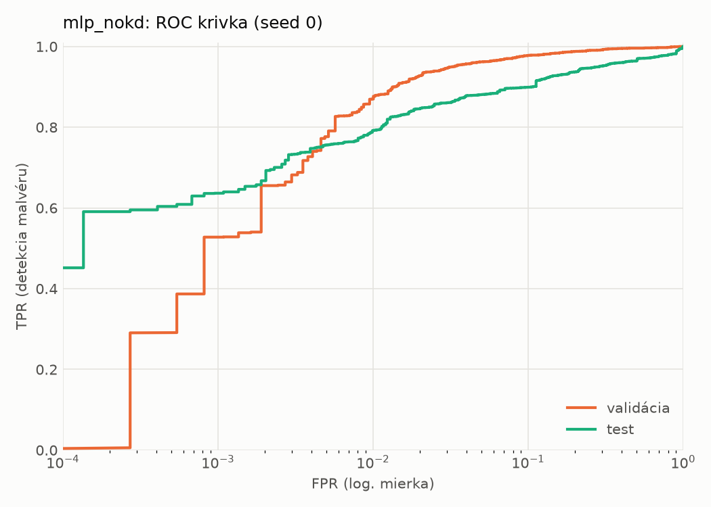
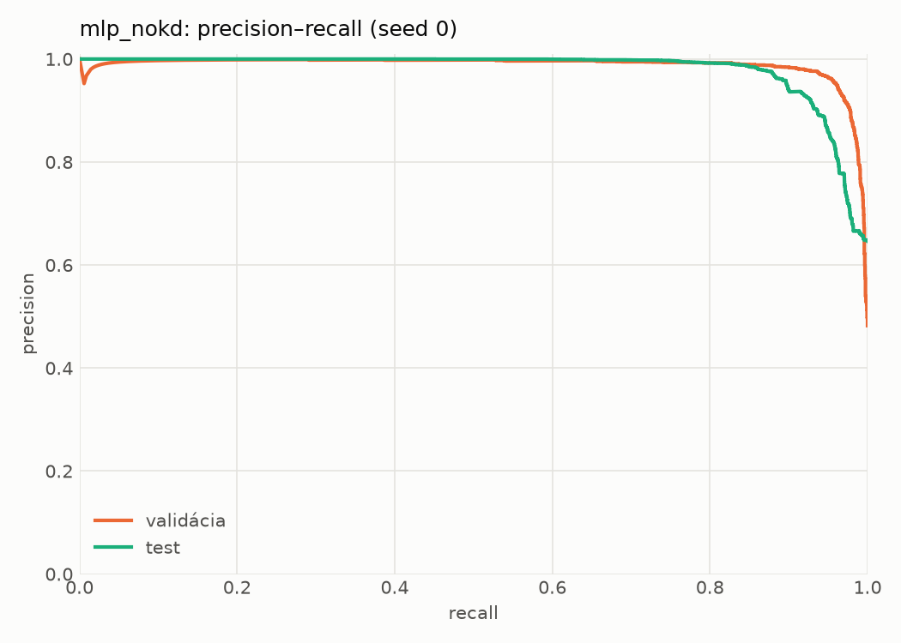
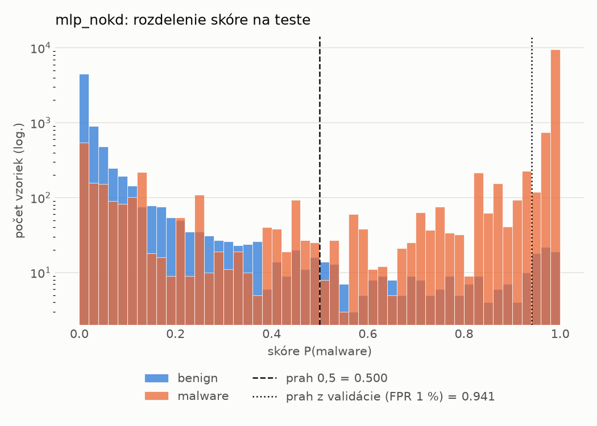
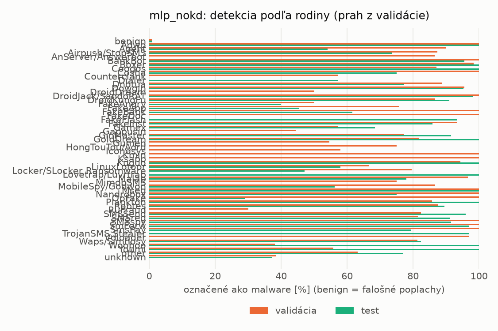
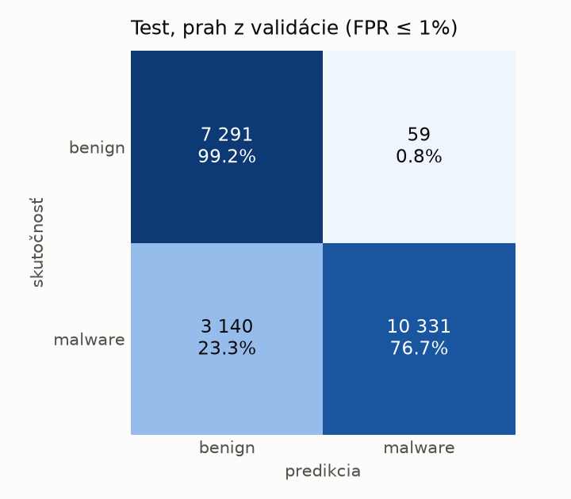
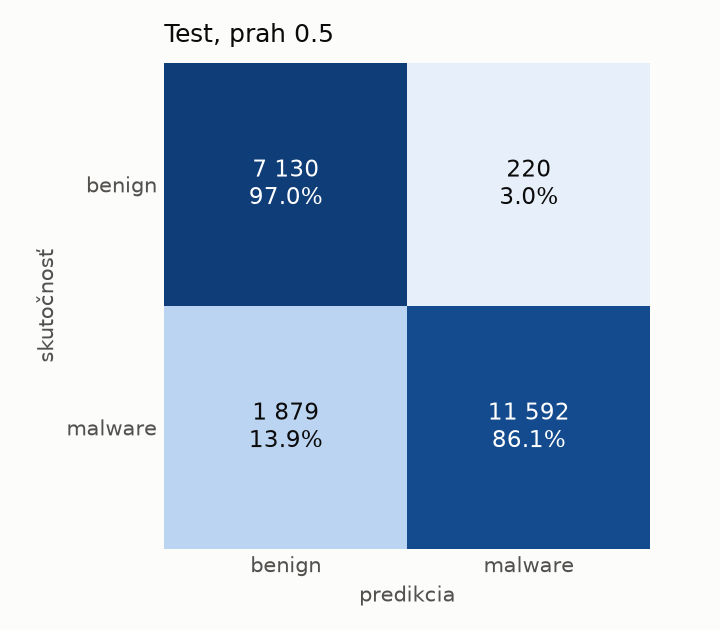
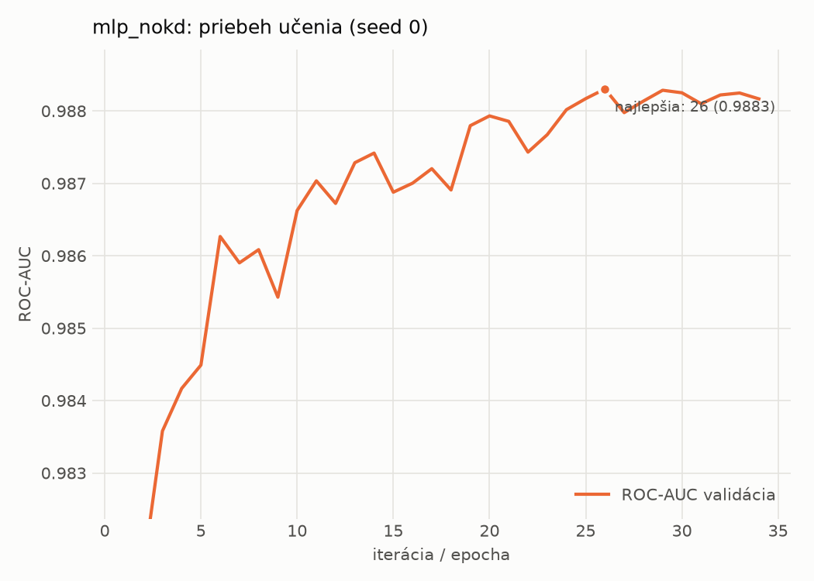

# static/mlp_nokd – beh `20261123-224313`

> Automaticky generované (`src/training/run_tabular.py`). Konfigurácia: `config.yaml`, protokol: `protocol.yaml`.

- **Model:** `mlp` – kontrola – rovnaké malé MLP bez destilácie (iba skutočné označenia)
- **Ladenie:** bez ladenia – hyperparametre prevzaté z `runs_v4/real_full/full/students_static/mlp_nokd/20261122-203844`
- **Finálne modely:** seedy [0, 1, 2]; hodnoty sú priemer ± smerodajná odchýlka cez seedy
- **Najlepšie hyperparametre:** `{"hidden_layers": 1, "max_epochs": 100, "patience": 8, "hidden_width": 64, "dropout": 0.011630579234704915, "lr": 0.0010706598847019353, "weight_decay": 3.845140400781195e-05, "batch_size": 256}`

## Detekčná kvalita (bez prahu)
| metrika | train (podvzorka) | validácia | test |
|---|---|---|---|
| ROC-AUC | 0.9941 ± 0.0004 | 0.9883 ± 0.0002 | 0.9629 ± 0.0072 |
| PR-AUC | 0.9945 ± 0.0003 | 0.9883 ± 0.0011 | 0.9830 ± 0.0026 |
| TPR pri FPR 1 % | 0.9341 ± 0.0046 | 0.8643 ± 0.0071 | 0.8135 ± 0.0193 |
| TPR pri FPR 0,1 % | 0.7911 ± 0.0074 | 0.5096 ± 0.0881 | 0.6409 ± 0.0290 |
| log loss | 0.0901 ± 0.0031 | 0.1303 ± 0.0023 | 0.3189 ± 0.0506 |
| Brier skóre | 0.0243 ± 0.0009 | 0.0339 ± 0.0004 | 0.0768 ± 0.0050 |

Rozdiel ROC-AUC train − validácia: **0.0058** (veľký rozdiel = preučenie).

## Pri prahu z validácie (FPR ≤ 1% na validácii)
| metrika | train (podvzorka) | validácia | test |
|---|---|---|---|
| accuracy | 0.9346 ± 0.0020 | 0.9295 ± 0.0034 | 0.8506 ± 0.0081 |
| balanced accuracy | 0.9316 ± 0.0021 | 0.9273 ± 0.0036 | 0.8830 ± 0.0066 |
| precision | 0.9950 ± 0.0009 | 0.9881 ± 0.0002 | 0.9951 ± 0.0012 |
| recall (TPR) | 0.8672 ± 0.0050 | 0.8643 ± 0.0071 | 0.7728 ± 0.0116 |
| FPR | 0.0040 ± 0.0008 | 0.0097 ± 0.0002 | 0.0069 ± 0.0016 |
| F1 | 0.9267 ± 0.0025 | 0.9220 ± 0.0041 | 0.8700 ± 0.0078 |
| MCC | 0.8748 ± 0.0035 | 0.8647 ± 0.0063 | 0.7321 ± 0.0127 |

## Pri pevnom prahu 0.5
| metrika | train (podvzorka) | validácia | test |
|---|---|---|---|
| accuracy | 0.9693 ± 0.0010 | 0.9581 ± 0.0007 | 0.9053 ± 0.0074 |
| balanced accuracy | 0.9690 ± 0.0009 | 0.9581 ± 0.0007 | 0.9192 ± 0.0055 |
| precision | 0.9721 ± 0.0028 | 0.9558 ± 0.0019 | 0.9794 ± 0.0019 |
| recall (TPR) | 0.9632 ± 0.0016 | 0.9575 ± 0.0016 | 0.8720 ± 0.0124 |
| FPR | 0.0252 ± 0.0026 | 0.0413 ± 0.0019 | 0.0336 ± 0.0034 |
| F1 | 0.9676 ± 0.0010 | 0.9566 ± 0.0007 | 0.9226 ± 0.0066 |
| MCC | 0.9384 ± 0.0020 | 0.9161 ± 0.0014 | 0.8109 ± 0.0127 |

## Výpočtové nároky (seed 0, testovacia množina)
| meranie | hodnota |
|---|---|
| tréning finálneho modelu | 8.3 s (priemer cez seedy) |
| ladenie spolu | 0 s |
| počet parametrov / uzlov | 10 689 |
| veľkosť modelu na disku | 0.05 MB |
| transformácia vstupu – latencia (1 vlákno) | 0.015 ms |
| transformácia vstupu – priepustnosť | 589 314 vzoriek/s |
| CPU latencia modelu (batch 1, 1 vlákno) | 0.051 ms (p95 0.060) |
| CPU priepustnosť (24 vlákien) | 2 842 108 vzoriek/s |
| GPU latencia (batch 1) | 0.440 ms (p95 0.466) |
| GPU priepustnosť | 1 762 594 vzoriek/s |
| GPU špičková pamäť | 109 MB |

## Grafy
| | |
|---|---|
|  |  |
|  |  |
|  |  |
|  |  |

## Súbory
`metrics.json` (všetky metriky po seedoch vrátane rodín), `timing.json`, `hpo_trials.csv`,
`predictions/<časť>_seed<N>.parquet` (sha256, family, label, score), `model/seed_<N>/`, `log.txt`.
