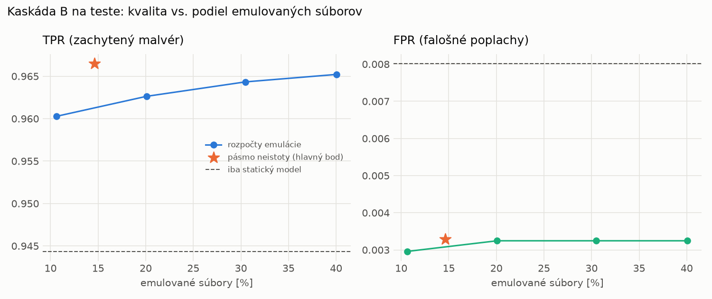

# Kaskáda B `b_baselines` – beh `20261123-010148`

> Generované `src/cascade/evaluate_b.py` (2026-11-23T01:01:49+01:00). Seedy: [0, 1, 2]; hodnoty = priemer ± sm. odchýlka.
> Všetky prahy a pásmo neistoty sú z validácie; test sa na nič nenastavuje. Postup: `docs/09_plan_v2.md`.

| rola | beh |
|---|---|
| static | `runs_v4/real_p/full/static/lightgbm/20261122-231010` |
| dynamic | `runs_v4/real_p/full/dynamic/lightgbm/20261122-233440` |
| hybrid | `runs_v4/real_p/full/hybrid/lightgbm/20261122-235912` |

Druhý stupeň: **dynamic**. Pásmo neistoty statického modelu: FPR ≤ 0.1% nad `hi`,
najviac 1% malvéru validácie pod `lo` (seed 0: lo = 0.0015, hi = 0.9993, seed 1: lo = 0.0042, hi = 0.9983, seed 2: lo = 0.0063, hi = 0.9976).

## Test
| prístup | accuracy | balanced_accuracy | precision | recall_tpr | fpr | f1 | mcc |
|---|---|---|---|---|---|---|---|
| kaskáda B | 0.9832 ± 0.0006 | 0.9816 ± 0.0007 | 0.9958 ± 0.0003 | 0.9665 ± 0.0016 | 0.0033 ± 0.0002 | 0.9809 ± 0.0007 | 0.9662 ± 0.0012 |
| statický | 0.9706 ± 0.0015 | 0.9682 ± 0.0017 | 0.9897 ± 0.0011 | 0.9444 ± 0.0043 | 0.0080 ± 0.0009 | 0.9665 ± 0.0018 | 0.9412 ± 0.0028 |
| dynamický | 0.9267 ± 0.0007 | 0.9191 ± 0.0009 | 0.9894 ± 0.0009 | 0.8455 ± 0.0023 | 0.0074 ± 0.0007 | 0.9118 ± 0.0010 | 0.8575 ± 0.0013 |
| hybrid (každá vzorka) | 0.9835 ± 0.0003 | 0.9824 ± 0.0004 | 0.9922 ± 0.0004 | 0.9709 ± 0.0006 | 0.0062 ± 0.0003 | 0.9814 ± 0.0004 | 0.9668 ± 0.0007 |

- **emulované súbory: 14.62%** (ostatné rozhodne iba statický model); na hybrid ide 3.31% súborov
- chyby pri istom rozhodnutí statického modelu (seed 0): 51
- validácia: emulované 13.61%, na hybrid 3.00%

## Validácia
| prístup | accuracy | balanced_accuracy | precision | recall_tpr | fpr | f1 | mcc |
|---|---|---|---|---|---|---|---|
| kaskáda B | 0.9808 ± 0.0002 | 0.9792 ± 0.0003 | 0.9929 ± 0.0002 | 0.9640 ± 0.0006 | 0.0056 ± 0.0002 | 0.9782 ± 0.0003 | 0.9613 ± 0.0005 |
| statický | 0.9702 ± 0.0025 | 0.9679 ± 0.0028 | 0.9875 ± 0.0001 | 0.9456 ± 0.0056 | 0.0097 ± 0.0000 | 0.9661 ± 0.0030 | 0.9403 ± 0.0050 |
| dynamický | 0.9230 ± 0.0011 | 0.9153 ± 0.0012 | 0.9862 ± 0.0004 | 0.8401 ± 0.0027 | 0.0096 ± 0.0003 | 0.9073 ± 0.0014 | 0.8502 ± 0.0019 |
| hybrid (každá vzorka) | 0.9816 ± 0.0004 | 0.9805 ± 0.0004 | 0.9879 ± 0.0002 | 0.9707 ± 0.0007 | 0.0096 ± 0.0002 | 0.9792 ± 0.0005 | 0.9628 ± 0.0008 |

## Krivka rozpočtu emulácie (test, priemer cez seedy)
| budget_val | emulation_rate | hybrid_rate | recall_tpr | fpr | f1 |
|---|---|---|---|---|---|
| 0.1000 | 0.1064 | 0.0347 | 0.9603 | 0.0030 | 0.9779 |
| 0.2000 | 0.2008 | 0.0473 | 0.9626 | 0.0032 | 0.9790 |
| 0.3000 | 0.3048 | 0.0563 | 0.9643 | 0.0032 | 0.9798 |
| 0.4000 | 0.4006 | 0.0644 | 0.9652 | 0.0032 | 0.9803 |

## Výpočtové nároky
Čas dynamickej analýzy (beh v emulátore alebo na zariadení) dataset neuvádza, preto sa neodhaduje. Úspora kaskády B = podiel súborov s dynamickou analýzou: **14.62%** (ostatné prístupy 100 %).

| meranie | statický | dynamický | hybrid na každej vzorke | kaskáda B (odhad) |
|---|---|---|---|---|
| CPU čas ms/vz. (dávka) | 0.2006 | 0.1169 | 0.0575 | 0.2196 |
| CPU čas ms/vz. (1 vz.) | 0.1489 | 0.0932 | 0.0496 | 0.1642 |

