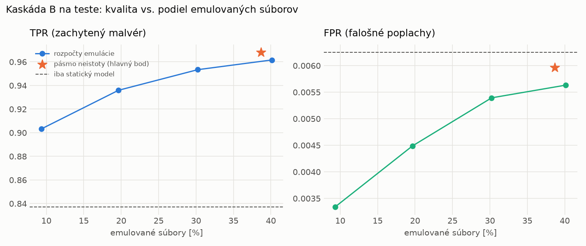

# Kaskáda B `b_direct` – beh `20261123-010145`

> Generované `src/cascade/evaluate_b.py` (2026-11-23T01:01:45+01:00). Seedy: [0, 1, 2]; hodnoty = priemer ± sm. odchýlka.
> Všetky prahy a pásmo neistoty sú z validácie; test sa na nič nenastavuje. Postup: `docs/09_plan_v2.md`.

| rola | beh |
|---|---|
| static | `runs_v4/real_p/full/students_static/mlp_kd/20261123-002115` |
| hybrid | `runs_v4/real_p/full/hybrid/lightgbm/20261122-235912` |

Druhý stupeň: **hybrid**. Pásmo neistoty statického modelu: FPR ≤ 0.1% nad `hi`,
najviac 1% malvéru validácie pod `lo` (seed 0: lo = 0.0043, hi = 0.9999, seed 1: lo = 0.0055, hi = 0.9999, seed 2: lo = 0.0058, hi = 0.9998).

## Test
| prístup | accuracy | balanced_accuracy | precision | recall_tpr | fpr | f1 | mcc |
|---|---|---|---|---|---|---|---|
| kaskáda B | 0.9825 ± 0.0002 | 0.9811 ± 0.0002 | 0.9925 ± 0.0005 | 0.9682 ± 0.0003 | 0.0060 ± 0.0004 | 0.9802 ± 0.0002 | 0.9647 ± 0.0004 |
| statický | 0.9236 ± 0.0011 | 0.9155 ± 0.0011 | 0.9909 ± 0.0015 | 0.8372 ± 0.0019 | 0.0063 ± 0.0011 | 0.9076 ± 0.0014 | 0.8520 ± 0.0022 |
| hybrid (každá vzorka) | 0.9835 ± 0.0003 | 0.9824 ± 0.0004 | 0.9922 ± 0.0004 | 0.9709 ± 0.0006 | 0.0062 ± 0.0003 | 0.9814 ± 0.0004 | 0.9668 ± 0.0007 |

- **emulované súbory: 38.67%** (ostatné rozhodne iba statický model); na hybrid ide 38.67% súborov
- chyby pri istom rozhodnutí statického modelu (seed 0): 55
- validácia: emulované 38.59%, na hybrid 38.59%

## Validácia
| prístup | accuracy | balanced_accuracy | precision | recall_tpr | fpr | f1 | mcc |
|---|---|---|---|---|---|---|---|
| kaskáda B | 0.9802 ± 0.0004 | 0.9791 ± 0.0005 | 0.9879 ± 0.0002 | 0.9678 ± 0.0010 | 0.0096 ± 0.0002 | 0.9777 ± 0.0005 | 0.9601 ± 0.0008 |
| statický | 0.9157 ± 0.0003 | 0.9071 ± 0.0003 | 0.9857 ± 0.0000 | 0.8240 ± 0.0006 | 0.0097 ± 0.0000 | 0.8976 ± 0.0004 | 0.8365 ± 0.0005 |
| hybrid (každá vzorka) | 0.9816 ± 0.0004 | 0.9805 ± 0.0004 | 0.9879 ± 0.0002 | 0.9707 ± 0.0007 | 0.0096 ± 0.0002 | 0.9792 ± 0.0005 | 0.9628 ± 0.0008 |

## Krivka rozpočtu emulácie (test, priemer cez seedy)
| budget_val | emulation_rate | hybrid_rate | recall_tpr | fpr | f1 |
|---|---|---|---|---|---|
| 0.1000 | 0.0933 | 0.0933 | 0.9032 | 0.0033 | 0.9471 |
| 0.2000 | 0.1964 | 0.1964 | 0.9360 | 0.0045 | 0.9642 |
| 0.3000 | 0.3023 | 0.3023 | 0.9534 | 0.0054 | 0.9728 |
| 0.4000 | 0.4012 | 0.4012 | 0.9616 | 0.0056 | 0.9770 |

## Výpočtové nároky
Čas dynamickej analýzy (beh v emulátore alebo na zariadení) dataset neuvádza, preto sa neodhaduje. Úspora kaskády B = podiel súborov s dynamickou analýzou: **38.67%** (ostatné prístupy 100 %).

| meranie | statický | hybrid na každej vzorke | kaskáda B (odhad) |
|---|---|---|---|
| CPU čas ms/vz. (dávka) | 0.0352 | 0.0575 | 0.0574 |
| CPU čas ms/vz. (1 vz.) | 0.1375 | 0.0496 | 0.1567 |

