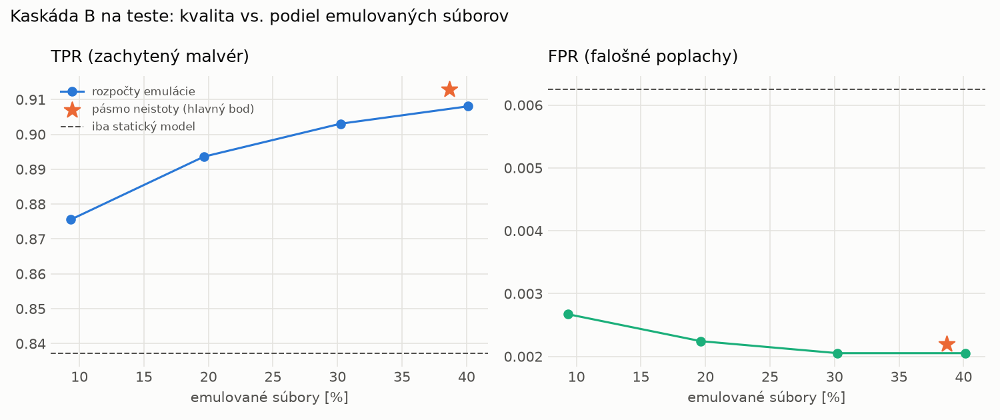

# Kaskáda B `b_heavy` – beh `20261123-010147`

> Generované `src/cascade/evaluate_b.py` (2026-11-23T01:01:47+01:00). Seedy: [0, 1, 2]; hodnoty = priemer ± sm. odchýlka.
> Všetky prahy a pásmo neistoty sú z validácie; test sa na nič nenastavuje. Postup: `docs/09_plan_v2.md`.

| rola | beh |
|---|---|
| static | `runs_v4/real_p/full/students_static/mlp_kd/20261123-002115` |
| dynamic | `runs_v4/real_p/full/students_dynamic/mlp_kd/20261123-003616` |
| hybrid | `runs_v4/real_p/full/hybrid/mlp_large/20261123-000809` |

Druhý stupeň: **dynamic**. Pásmo neistoty statického modelu: FPR ≤ 0.1% nad `hi`,
najviac 1% malvéru validácie pod `lo` (seed 0: lo = 0.0043, hi = 0.9999, seed 1: lo = 0.0055, hi = 0.9999, seed 2: lo = 0.0058, hi = 0.9998).

## Test
| prístup | accuracy | balanced_accuracy | precision | recall_tpr | fpr | f1 | mcc |
|---|---|---|---|---|---|---|---|
| kaskáda B | 0.9598 ± 0.0011 | 0.9554 ± 0.0013 | 0.9970 ± 0.0005 | 0.9130 ± 0.0030 | 0.0022 ± 0.0004 | 0.9532 ± 0.0014 | 0.9208 ± 0.0021 |
| statický | 0.9236 ± 0.0011 | 0.9155 ± 0.0011 | 0.9909 ± 0.0015 | 0.8372 ± 0.0019 | 0.0063 ± 0.0011 | 0.9076 ± 0.0014 | 0.8520 ± 0.0022 |
| dynamický | 0.8717 ± 0.0041 | 0.8579 ± 0.0045 | 0.9857 ± 0.0014 | 0.7242 ± 0.0087 | 0.0085 ± 0.0008 | 0.8350 ± 0.0061 | 0.7573 ± 0.0075 |
| hybrid (každá vzorka) | 0.9728 ± 0.0015 | 0.9706 ± 0.0017 | 0.9900 ± 0.0010 | 0.9490 ± 0.0042 | 0.0078 ± 0.0008 | 0.9691 ± 0.0017 | 0.9456 ± 0.0028 |

- **emulované súbory: 38.67%** (ostatné rozhodne iba statický model); na hybrid ide 8.99% súborov
- chyby pri istom rozhodnutí statického modelu (seed 0): 55
- validácia: emulované 38.59%, na hybrid 9.72%

## Validácia
| prístup | accuracy | balanced_accuracy | precision | recall_tpr | fpr | f1 | mcc |
|---|---|---|---|---|---|---|---|
| kaskáda B | 0.9552 ± 0.0008 | 0.9506 ± 0.0010 | 0.9937 ± 0.0011 | 0.9058 ± 0.0027 | 0.0047 ± 0.0008 | 0.9477 ± 0.0010 | 0.9117 ± 0.0014 |
| statický | 0.9157 ± 0.0003 | 0.9071 ± 0.0003 | 0.9857 ± 0.0000 | 0.8240 ± 0.0006 | 0.0097 ± 0.0000 | 0.8976 ± 0.0004 | 0.8365 ± 0.0005 |
| dynamický | 0.8711 ± 0.0035 | 0.8574 ± 0.0039 | 0.9839 ± 0.0004 | 0.7244 ± 0.0076 | 0.0096 ± 0.0002 | 0.8344 ± 0.0052 | 0.7559 ± 0.0062 |
| hybrid (každá vzorka) | 0.9700 ± 0.0027 | 0.9676 ± 0.0030 | 0.9877 ± 0.0004 | 0.9447 ± 0.0064 | 0.0096 ± 0.0003 | 0.9657 ± 0.0032 | 0.9398 ± 0.0053 |

## Krivka rozpočtu emulácie (test, priemer cez seedy)
| budget_val | emulation_rate | hybrid_rate | recall_tpr | fpr | f1 |
|---|---|---|---|---|---|
| 0.1000 | 0.0933 | 0.0420 | 0.8756 | 0.0027 | 0.9320 |
| 0.2000 | 0.1964 | 0.0745 | 0.8936 | 0.0022 | 0.9424 |
| 0.3000 | 0.3023 | 0.0946 | 0.9030 | 0.0021 | 0.9478 |
| 0.4000 | 0.4012 | 0.1076 | 0.9080 | 0.0021 | 0.9505 |

## Výpočtové nároky
Čas dynamickej analýzy (beh v emulátore alebo na zariadení) dataset neuvádza, preto sa neodhaduje. Úspora kaskády B = podiel súborov s dynamickou analýzou: **38.67%** (ostatné prístupy 100 %).

| meranie | statický | dynamický | hybrid na každej vzorke | kaskáda B (odhad) |
|---|---|---|---|---|
| CPU čas ms/vz. (dávka) | 0.0352 | 0.0323 | 0.2411 | 0.0693 |
| CPU čas ms/vz. (1 vz.) | 0.1375 | 0.1310 | 0.5125 | 0.2342 |

