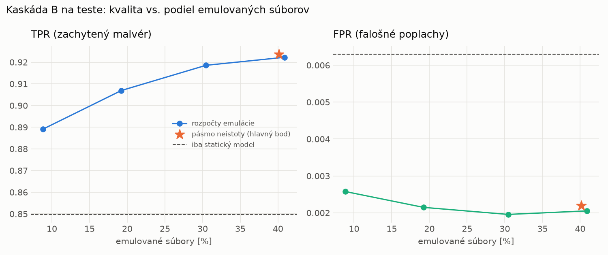

# Kaskáda B `b_heavyteacher` – beh `20261123-010152`

> Generované `src/cascade/evaluate_b.py` (2026-11-23T01:01:52+01:00). Seedy: [0, 1, 2]; hodnoty = priemer ± sm. odchýlka.
> Všetky prahy a pásmo neistoty sú z validácie; test sa na nič nenastavuje. Postup: `docs/09_plan_v2.md`.

| rola | beh |
|---|---|
| static | `runs_v4/real_p/full/students_static/mlp_kd_heavy/20261123-003302` |
| dynamic | `runs_v4/real_p/full/students_dynamic/mlp_kd_heavy/20261123-005328` |
| hybrid | `runs_v4/real_p/full/hybrid/lightgbm/20261122-235912` |

Druhý stupeň: **dynamic**. Pásmo neistoty statického modelu: FPR ≤ 0.1% nad `hi`,
najviac 1% malvéru validácie pod `lo` (seed 0: lo = 0.0325, hi = 0.9996, seed 1: lo = 0.0388, hi = 0.9986, seed 2: lo = 0.0341, hi = 0.9989).

## Test
| prístup | accuracy | balanced_accuracy | precision | recall_tpr | fpr | f1 | mcc |
|---|---|---|---|---|---|---|---|
| kaskáda B | 0.9646 ± 0.0036 | 0.9608 ± 0.0039 | 0.9971 ± 0.0007 | 0.9237 ± 0.0075 | 0.0022 ± 0.0005 | 0.9590 ± 0.0043 | 0.9300 ± 0.0069 |
| statický | 0.9292 ± 0.0079 | 0.9217 ± 0.0089 | 0.9910 ± 0.0013 | 0.8498 ± 0.0186 | 0.0063 ± 0.0010 | 0.9149 ± 0.0104 | 0.8624 ± 0.0144 |
| dynamický | 0.8759 ± 0.0013 | 0.8627 ± 0.0015 | 0.9838 ± 0.0012 | 0.7353 ± 0.0034 | 0.0098 ± 0.0008 | 0.8416 ± 0.0020 | 0.7644 ± 0.0023 |
| hybrid (každá vzorka) | 0.9835 ± 0.0003 | 0.9824 ± 0.0004 | 0.9922 ± 0.0004 | 0.9709 ± 0.0006 | 0.0062 ± 0.0003 | 0.9814 ± 0.0004 | 0.9668 ± 0.0007 |

- **emulované súbory: 40.14%** (ostatné rozhodne iba statický model); na hybrid ide 8.49% súborov
- chyby pri istom rozhodnutí statického modelu (seed 0): 48
- validácia: emulované 39.60%, na hybrid 9.26%

## Validácia
| prístup | accuracy | balanced_accuracy | precision | recall_tpr | fpr | f1 | mcc |
|---|---|---|---|---|---|---|---|
| kaskáda B | 0.9638 ± 0.0049 | 0.9602 ± 0.0054 | 0.9941 ± 0.0002 | 0.9249 ± 0.0109 | 0.0045 ± 0.0002 | 0.9582 ± 0.0059 | 0.9283 ± 0.0094 |
| statický | 0.9242 ± 0.0124 | 0.9165 ± 0.0138 | 0.9860 ± 0.0005 | 0.8428 ± 0.0277 | 0.0097 ± 0.0000 | 0.9086 ± 0.0164 | 0.8523 ± 0.0230 |
| dynamický | 0.8775 ± 0.0032 | 0.8645 ± 0.0036 | 0.9840 ± 0.0002 | 0.7387 ± 0.0071 | 0.0097 ± 0.0000 | 0.8439 ± 0.0047 | 0.7672 ± 0.0057 |
| hybrid (každá vzorka) | 0.9816 ± 0.0004 | 0.9805 ± 0.0004 | 0.9879 ± 0.0002 | 0.9707 ± 0.0007 | 0.0096 ± 0.0002 | 0.9792 ± 0.0005 | 0.9628 ± 0.0008 |

## Krivka rozpočtu emulácie (test, priemer cez seedy)
| budget_val | emulation_rate | hybrid_rate | recall_tpr | fpr | f1 |
|---|---|---|---|---|---|
| 0.1000 | 0.0883 | 0.0375 | 0.8891 | 0.0026 | 0.9397 |
| 0.2000 | 0.1922 | 0.0678 | 0.9069 | 0.0021 | 0.9499 |
| 0.3000 | 0.3045 | 0.0818 | 0.9186 | 0.0020 | 0.9563 |
| 0.4000 | 0.4088 | 0.0922 | 0.9223 | 0.0021 | 0.9583 |

## Výpočtové nároky
Čas dynamickej analýzy (beh v emulátore alebo na zariadení) dataset neuvádza, preto sa neodhaduje. Úspora kaskády B = podiel súborov s dynamickou analýzou: **40.14%** (ostatné prístupy 100 %).

| meranie | statický | dynamický | hybrid na každej vzorke | kaskáda B (odhad) |
|---|---|---|---|---|
| CPU čas ms/vz. (dávka) | 0.0352 | 0.0316 | 0.0575 | 0.0527 |
| CPU čas ms/vz. (1 vz.) | 0.1401 | 0.1400 | 0.0496 | 0.2005 |

