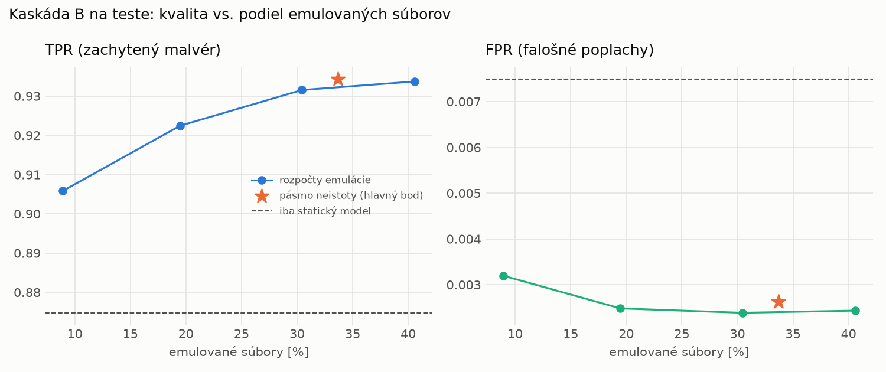

# Kaskáda B `b_nokd` – beh `20261123-010150`

> Generované `src/cascade/evaluate_b.py` (2026-11-23T01:01:50+01:00). Seedy: [0, 1, 2]; hodnoty = priemer ± sm. odchýlka.
> Všetky prahy a pásmo neistoty sú z validácie; test sa na nič nenastavuje. Postup: `docs/09_plan_v2.md`.

| rola | beh |
|---|---|
| static | `runs_v4/real_p/full/students_static/mlp_nokd/20261123-002453` |
| dynamic | `runs_v4/real_p/full/students_dynamic/mlp_nokd/20261123-004046` |
| hybrid | `runs_v4/real_p/full/hybrid/lightgbm/20261122-235912` |

Druhý stupeň: **dynamic**. Pásmo neistoty statického modelu: FPR ≤ 0.1% nad `hi`,
najviac 1% malvéru validácie pod `lo` (seed 0: lo = 0.0306, hi = 0.9992, seed 1: lo = 0.0277, hi = 0.9973, seed 2: lo = 0.0314, hi = 0.9970).

## Test
| prístup | accuracy | balanced_accuracy | precision | recall_tpr | fpr | f1 | mcc |
|---|---|---|---|---|---|---|---|
| kaskáda B | 0.9691 ± 0.0004 | 0.9659 ± 0.0005 | 0.9966 ± 0.0007 | 0.9344 ± 0.0008 | 0.0026 ± 0.0005 | 0.9645 ± 0.0005 | 0.9387 ± 0.0009 |
| statický | 0.9397 ± 0.0013 | 0.9336 ± 0.0014 | 0.9896 ± 0.0009 | 0.8748 ± 0.0033 | 0.0075 ± 0.0007 | 0.9286 ± 0.0016 | 0.8818 ± 0.0023 |
| dynamický | 0.8692 ± 0.0022 | 0.8550 ± 0.0025 | 0.9866 ± 0.0005 | 0.7180 ± 0.0053 | 0.0079 ± 0.0004 | 0.8311 ± 0.0034 | 0.7532 ± 0.0038 |
| hybrid (každá vzorka) | 0.9835 ± 0.0003 | 0.9824 ± 0.0004 | 0.9922 ± 0.0004 | 0.9709 ± 0.0006 | 0.0062 ± 0.0003 | 0.9814 ± 0.0004 | 0.9668 ± 0.0007 |

- **emulované súbory: 33.69%** (ostatné rozhodne iba statický model); na hybrid ide 7.54% súborov
- chyby pri istom rozhodnutí statického modelu (seed 0): 47
- validácia: emulované 33.38%, na hybrid 8.10%

## Validácia
| prístup | accuracy | balanced_accuracy | precision | recall_tpr | fpr | f1 | mcc |
|---|---|---|---|---|---|---|---|
| kaskáda B | 0.9678 ± 0.0016 | 0.9647 ± 0.0017 | 0.9941 ± 0.0009 | 0.9338 ± 0.0027 | 0.0045 ± 0.0007 | 0.9630 ± 0.0018 | 0.9361 ± 0.0031 |
| statický | 0.9353 ± 0.0044 | 0.9290 ± 0.0049 | 0.9864 ± 0.0002 | 0.8677 ± 0.0097 | 0.0097 ± 0.0000 | 0.9232 ± 0.0056 | 0.8731 ± 0.0082 |
| dynamický | 0.8683 ± 0.0021 | 0.8542 ± 0.0023 | 0.9836 ± 0.0001 | 0.7182 ± 0.0046 | 0.0097 ± 0.0000 | 0.8302 ± 0.0031 | 0.7508 ± 0.0037 |
| hybrid (každá vzorka) | 0.9816 ± 0.0004 | 0.9805 ± 0.0004 | 0.9879 ± 0.0002 | 0.9707 ± 0.0007 | 0.0096 ± 0.0002 | 0.9792 ± 0.0005 | 0.9628 ± 0.0008 |

## Krivka rozpočtu emulácie (test, priemer cez seedy)
| budget_val | emulation_rate | hybrid_rate | recall_tpr | fpr | f1 |
|---|---|---|---|---|---|
| 0.1000 | 0.0891 | 0.0392 | 0.9058 | 0.0032 | 0.9486 |
| 0.2000 | 0.1948 | 0.0672 | 0.9224 | 0.0025 | 0.9581 |
| 0.3000 | 0.3044 | 0.0820 | 0.9315 | 0.0024 | 0.9631 |
| 0.4000 | 0.4059 | 0.0898 | 0.9337 | 0.0024 | 0.9642 |

## Výpočtové nároky
Čas dynamickej analýzy (beh v emulátore alebo na zariadení) dataset neuvádza, preto sa neodhaduje. Úspora kaskády B = podiel súborov s dynamickou analýzou: **33.69%** (ostatné prístupy 100 %).

| meranie | statický | dynamický | hybrid na každej vzorke | kaskáda B (odhad) |
|---|---|---|---|---|
| CPU čas ms/vz. (dávka) | 0.0349 | 0.0328 | 0.0575 | 0.0503 |
| CPU čas ms/vz. (1 vz.) | 0.1341 | 0.1375 | 0.0496 | 0.1842 |

