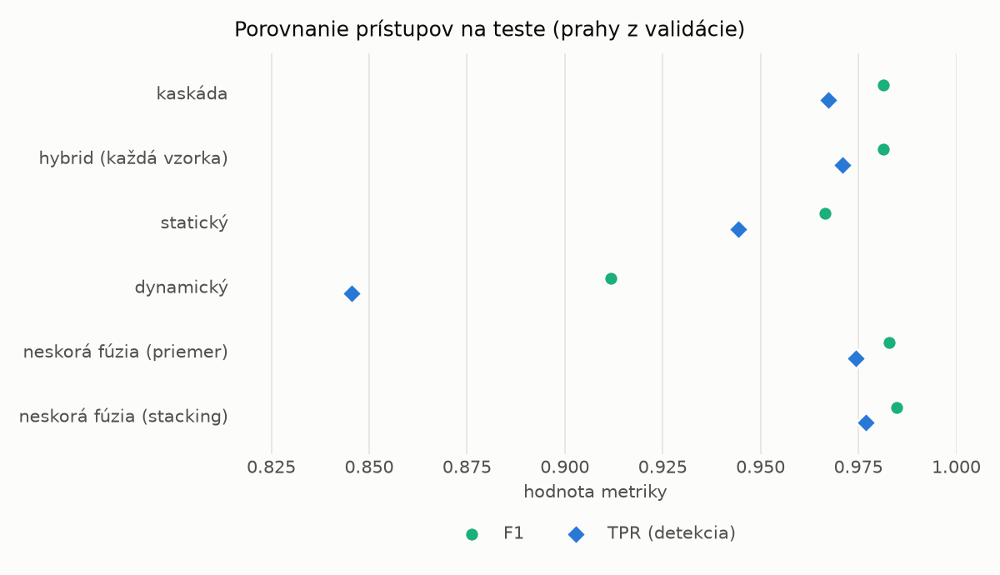
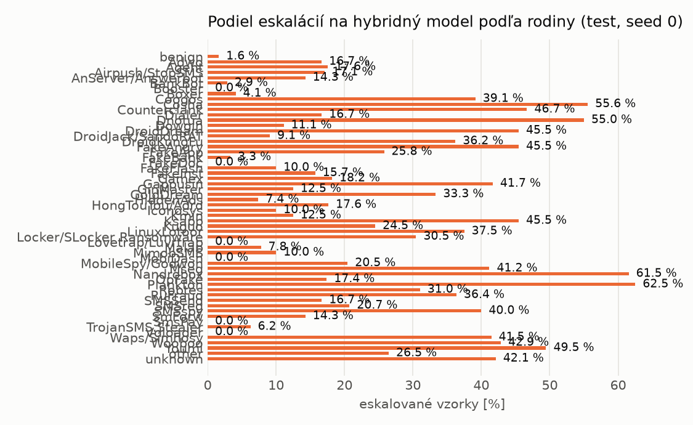

# Kaskáda `baselines` – beh `20261123-010139`

> Generované `src/cascade/evaluate.py` (2026-11-23T01:01:39+01:00). Seedy: [0, 1, 2]; hodnoty = priemer ± sm. odchýlka.
> Všetky prahy sú určené na validácii (FPR ≤ 1 %); test sa na nič nenastavuje.

| rola | beh |
|---|---|
| static | `runs_v4/real_p/full/static/lightgbm/20261122-231010` |
| dynamic | `runs_v4/real_p/full/dynamic/lightgbm/20261122-233440` |
| hybrid | `runs_v4/real_p/full/hybrid/lightgbm/20261122-235912` |

## Test
| prístup | accuracy | balanced_accuracy | precision | recall_tpr | fpr | f1 | mcc |
|---|---|---|---|---|---|---|---|
| kaskáda | 0.9835 ± 0.0006 | 0.9820 ± 0.0007 | 0.9959 ± 0.0003 | 0.9673 ± 0.0015 | 0.0032 ± 0.0002 | 0.9814 ± 0.0007 | 0.9670 ± 0.0011 |
| hybrid (každá vzorka) | 0.9835 ± 0.0003 | 0.9824 ± 0.0004 | 0.9922 ± 0.0004 | 0.9709 ± 0.0006 | 0.0062 ± 0.0003 | 0.9814 ± 0.0004 | 0.9668 ± 0.0007 |
| statický | 0.9706 ± 0.0015 | 0.9682 ± 0.0017 | 0.9897 ± 0.0011 | 0.9444 ± 0.0043 | 0.0080 ± 0.0009 | 0.9665 ± 0.0018 | 0.9412 ± 0.0028 |
| dynamický | 0.9267 ± 0.0007 | 0.9191 ± 0.0009 | 0.9894 ± 0.0009 | 0.8455 ± 0.0023 | 0.0074 ± 0.0007 | 0.9118 ± 0.0010 | 0.8575 ± 0.0013 |
| neskorá fúzia (priemer) | 0.9847 ± 0.0009 | 0.9838 ± 0.0011 | 0.9914 ± 0.0012 | 0.9744 ± 0.0032 | 0.0069 ± 0.0010 | 0.9828 ± 0.0010 | 0.9692 ± 0.0017 |
| neskorá fúzia (stacking) | 0.9865 ± 0.0003 | 0.9856 ± 0.0004 | 0.9930 ± 0.0011 | 0.9769 ± 0.0017 | 0.0056 ± 0.0009 | 0.9849 ± 0.0004 | 0.9729 ± 0.0006 |

## Validácia
| prístup | accuracy | balanced_accuracy | precision | recall_tpr | fpr | f1 | mcc |
|---|---|---|---|---|---|---|---|
| kaskáda | 0.9818 ± 0.0002 | 0.9803 ± 0.0003 | 0.9932 ± 0.0002 | 0.9659 ± 0.0005 | 0.0054 ± 0.0002 | 0.9794 ± 0.0003 | 0.9633 ± 0.0005 |
| hybrid (každá vzorka) | 0.9816 ± 0.0004 | 0.9805 ± 0.0004 | 0.9879 ± 0.0002 | 0.9707 ± 0.0007 | 0.0096 ± 0.0002 | 0.9792 ± 0.0005 | 0.9628 ± 0.0008 |
| statický | 0.9702 ± 0.0025 | 0.9679 ± 0.0028 | 0.9875 ± 0.0001 | 0.9456 ± 0.0056 | 0.0097 ± 0.0000 | 0.9661 ± 0.0030 | 0.9403 ± 0.0050 |
| dynamický | 0.9230 ± 0.0011 | 0.9153 ± 0.0012 | 0.9862 ± 0.0004 | 0.8401 ± 0.0027 | 0.0096 ± 0.0003 | 0.9073 ± 0.0014 | 0.8502 ± 0.0019 |
| neskorá fúzia (priemer) | 0.9822 ± 0.0012 | 0.9813 ± 0.0013 | 0.9878 ± 0.0000 | 0.9723 ± 0.0026 | 0.0097 ± 0.0000 | 0.9800 ± 0.0013 | 0.9640 ± 0.0023 |
| neskorá fúzia (stacking) | 0.9845 ± 0.0009 | 0.9837 ± 0.0009 | 0.9883 ± 0.0006 | 0.9768 ± 0.0015 | 0.0094 ± 0.0004 | 0.9826 ± 0.0010 | 0.9686 ± 0.0018 |

## Správanie kaskády (test, seed 0)
- podiel eskalácií na hybrid: **8.45%** (1070 vzoriek)
- chyby pri zhode študentov (kaskáda ich nemôže opraviť): **100**
  (0.863% zo zhôd; FP 2, FN 98)
- úspešnosť na eskalovaných vzorkách: hybrid 0.9065420560747663, statický 0.7635514018691589,
  dynamický 0.23644859813084113  → prínos hybridu pri nezhode

## Výpočtové nároky (odhad z benchmarkov komponentov)
| meranie | statický | dynamický | hybrid na každej vzorke | neskorá fúzia | kaskáda (odhad) |
|---|---|---|---|---|---|
| CPU čas ms/vz. (dávka) | 0.2006 | 0.1169 | 0.0575 | 0.3175 | 0.3224 |
| CPU čas ms/vz. (1 vz.) | 0.1489 | 0.0932 | 0.0496 | 0.2421 | 0.2463 |
| latencia ms (1 vz., postupne) | 0.1485 | 0.0974 | 0.0496 | 0.2459 | 0.2501 |

