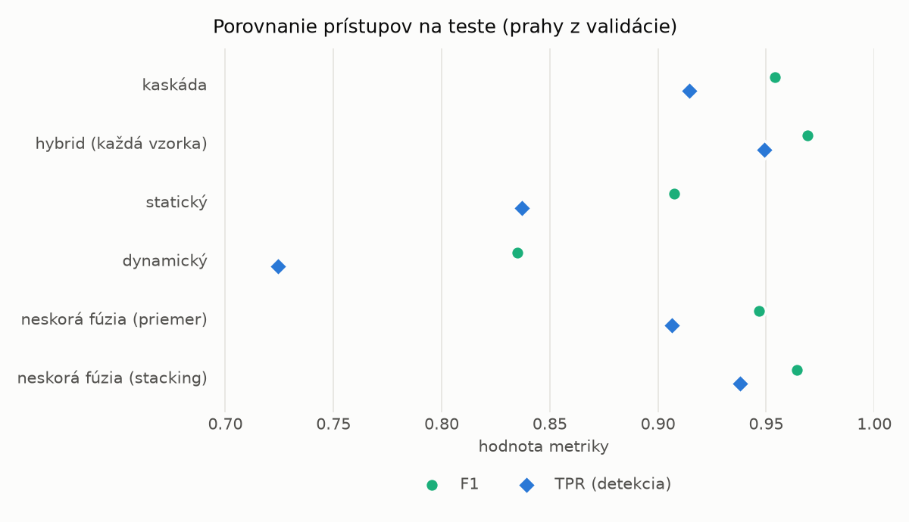
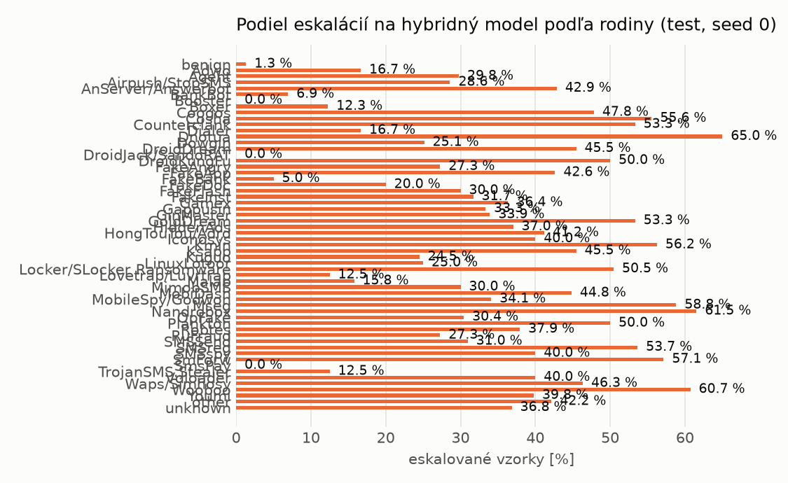

# Kaskáda `heavy` – beh `20261123-010137`

> Generované `src/cascade/evaluate.py` (2026-11-23T01:01:37+01:00). Seedy: [0, 1, 2]; hodnoty = priemer ± sm. odchýlka.
> Všetky prahy sú určené na validácii (FPR ≤ 1 %); test sa na nič nenastavuje.

| rola | beh |
|---|---|
| static | `runs_v4/real_p/full/students_static/mlp_kd/20261123-002115` |
| dynamic | `runs_v4/real_p/full/students_dynamic/mlp_kd/20261123-003616` |
| hybrid | `runs_v4/real_p/full/hybrid/mlp_large/20261123-000809` |

## Test
| prístup | accuracy | balanced_accuracy | precision | recall_tpr | fpr | f1 | mcc |
|---|---|---|---|---|---|---|---|
| kaskáda | 0.9605 ± 0.0008 | 0.9562 ± 0.0009 | 0.9969 ± 0.0007 | 0.9146 ± 0.0023 | 0.0023 ± 0.0005 | 0.9540 ± 0.0010 | 0.9221 ± 0.0015 |
| hybrid (každá vzorka) | 0.9728 ± 0.0015 | 0.9706 ± 0.0017 | 0.9900 ± 0.0010 | 0.9490 ± 0.0042 | 0.0078 ± 0.0008 | 0.9691 ± 0.0017 | 0.9456 ± 0.0028 |
| statický | 0.9236 ± 0.0011 | 0.9155 ± 0.0011 | 0.9909 ± 0.0015 | 0.8372 ± 0.0019 | 0.0063 ± 0.0011 | 0.9076 ± 0.0014 | 0.8520 ± 0.0022 |
| dynamický | 0.8717 ± 0.0041 | 0.8579 ± 0.0045 | 0.9857 ± 0.0014 | 0.7242 ± 0.0087 | 0.0085 ± 0.0008 | 0.8350 ± 0.0061 | 0.7573 ± 0.0075 |
| neskorá fúzia (priemer) | 0.9543 ± 0.0042 | 0.9498 ± 0.0048 | 0.9910 ± 0.0009 | 0.9063 ± 0.0101 | 0.0067 ± 0.0007 | 0.9467 ± 0.0052 | 0.9097 ± 0.0080 |
| neskorá fúzia (stacking) | 0.9688 ± 0.0006 | 0.9659 ± 0.0006 | 0.9919 ± 0.0007 | 0.9381 ± 0.0013 | 0.0062 ± 0.0006 | 0.9642 ± 0.0007 | 0.9378 ± 0.0012 |

## Validácia
| prístup | accuracy | balanced_accuracy | precision | recall_tpr | fpr | f1 | mcc |
|---|---|---|---|---|---|---|---|
| kaskáda | 0.9559 ± 0.0010 | 0.9514 ± 0.0011 | 0.9939 ± 0.0013 | 0.9072 ± 0.0029 | 0.0045 ± 0.0010 | 0.9486 ± 0.0012 | 0.9131 ± 0.0018 |
| hybrid (každá vzorka) | 0.9700 ± 0.0027 | 0.9676 ± 0.0030 | 0.9877 ± 0.0004 | 0.9447 ± 0.0064 | 0.0096 ± 0.0003 | 0.9657 ± 0.0032 | 0.9398 ± 0.0053 |
| statický | 0.9157 ± 0.0003 | 0.9071 ± 0.0003 | 0.9857 ± 0.0000 | 0.8240 ± 0.0006 | 0.0097 ± 0.0000 | 0.8976 ± 0.0004 | 0.8365 ± 0.0005 |
| dynamický | 0.8711 ± 0.0035 | 0.8574 ± 0.0039 | 0.9839 ± 0.0004 | 0.7244 ± 0.0076 | 0.0096 ± 0.0002 | 0.8344 ± 0.0052 | 0.7559 ± 0.0062 |
| neskorá fúzia (priemer) | 0.9498 ± 0.0048 | 0.9452 ± 0.0054 | 0.9868 ± 0.0002 | 0.9001 ± 0.0108 | 0.0097 ± 0.0000 | 0.9414 ± 0.0060 | 0.9006 ± 0.0093 |
| neskorá fúzia (stacking) | 0.9652 ± 0.0008 | 0.9623 ± 0.0009 | 0.9873 ± 0.0000 | 0.9344 ± 0.0019 | 0.0097 ± 0.0000 | 0.9601 ± 0.0010 | 0.9304 ± 0.0016 |

## Správanie kaskády (test, seed 0)
- podiel eskalácií na hybrid: **13.57%** (1717 vzoriek)
- chyby pri zhode študentov (kaskáda ich nemôže opraviť): **413**
  (3.775% zo zhôd; FP 0, FN 413)
- úspešnosť na eskalovaných vzorkách: hybrid 0.9440885264997088, statický 0.675596971461852,
  dynamický 0.32440302853814795  → prínos hybridu pri nezhode

## Výpočtové nároky (odhad z benchmarkov komponentov)
| meranie | statický | dynamický | hybrid na každej vzorke | neskorá fúzia | kaskáda (odhad) |
|---|---|---|---|---|---|
| CPU čas ms/vz. (dávka) | 0.0352 | 0.0323 | 0.2411 | 0.0674 | 0.1010 |
| CPU čas ms/vz. (1 vz.) | 0.1375 | 0.1310 | 0.5125 | 0.2685 | 0.3398 |
| latencia ms (1 vz., postupne) | 0.0764 | 0.0762 | 0.2809 | 0.1526 | 0.1917 |

