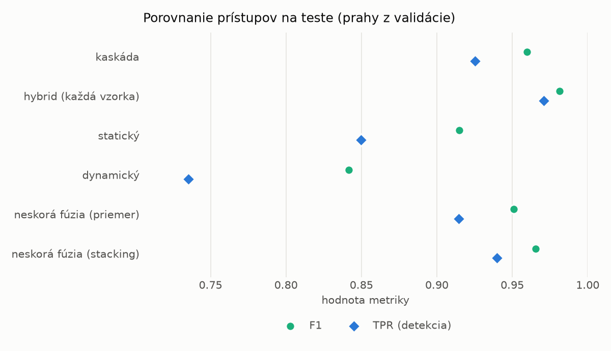
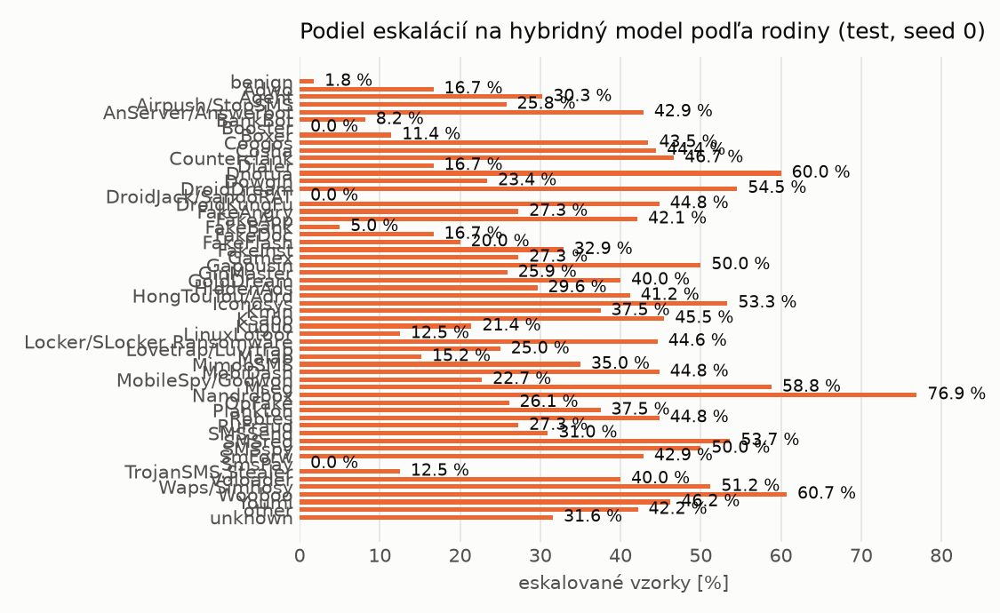

# Kaskáda `heavyteacher` – beh `20261123-010141`

> Generované `src/cascade/evaluate.py` (2026-11-23T01:01:41+01:00). Seedy: [0, 1, 2]; hodnoty = priemer ± sm. odchýlka.
> Všetky prahy sú určené na validácii (FPR ≤ 1 %); test sa na nič nenastavuje.

| rola | beh |
|---|---|
| static | `runs_v4/real_p/full/students_static/mlp_kd_heavy/20261123-003302` |
| dynamic | `runs_v4/real_p/full/students_dynamic/mlp_kd_heavy/20261123-005328` |
| hybrid | `runs_v4/real_p/full/hybrid/lightgbm/20261122-235912` |

## Test
| prístup | accuracy | balanced_accuracy | precision | recall_tpr | fpr | f1 | mcc |
|---|---|---|---|---|---|---|---|
| kaskáda | 0.9654 ± 0.0036 | 0.9616 ± 0.0040 | 0.9972 ± 0.0005 | 0.9253 ± 0.0078 | 0.0021 ± 0.0004 | 0.9599 ± 0.0044 | 0.9315 ± 0.0070 |
| hybrid (každá vzorka) | 0.9835 ± 0.0003 | 0.9824 ± 0.0004 | 0.9922 ± 0.0004 | 0.9709 ± 0.0006 | 0.0062 ± 0.0003 | 0.9814 ± 0.0004 | 0.9668 ± 0.0007 |
| statický | 0.9292 ± 0.0079 | 0.9217 ± 0.0089 | 0.9910 ± 0.0013 | 0.8498 ± 0.0186 | 0.0063 ± 0.0010 | 0.9149 ± 0.0104 | 0.8624 ± 0.0144 |
| dynamický | 0.8759 ± 0.0013 | 0.8627 ± 0.0015 | 0.9838 ± 0.0012 | 0.7353 ± 0.0034 | 0.0098 ± 0.0008 | 0.8416 ± 0.0020 | 0.7644 ± 0.0023 |
| neskorá fúzia (priemer) | 0.9578 ± 0.0029 | 0.9538 ± 0.0033 | 0.9908 ± 0.0005 | 0.9144 ± 0.0070 | 0.0069 ± 0.0004 | 0.9511 ± 0.0036 | 0.9164 ± 0.0055 |
| neskorá fúzia (stacking) | 0.9698 ± 0.0018 | 0.9670 ± 0.0019 | 0.9921 ± 0.0006 | 0.9400 ± 0.0035 | 0.0061 ± 0.0005 | 0.9654 ± 0.0021 | 0.9396 ± 0.0035 |

## Validácia
| prístup | accuracy | balanced_accuracy | precision | recall_tpr | fpr | f1 | mcc |
|---|---|---|---|---|---|---|---|
| kaskáda | 0.9650 ± 0.0047 | 0.9614 ± 0.0053 | 0.9946 ± 0.0002 | 0.9270 ± 0.0107 | 0.0041 ± 0.0002 | 0.9596 ± 0.0057 | 0.9306 ± 0.0091 |
| hybrid (každá vzorka) | 0.9816 ± 0.0004 | 0.9805 ± 0.0004 | 0.9879 ± 0.0002 | 0.9707 ± 0.0007 | 0.0096 ± 0.0002 | 0.9792 ± 0.0005 | 0.9628 ± 0.0008 |
| statický | 0.9242 ± 0.0124 | 0.9165 ± 0.0138 | 0.9860 ± 0.0005 | 0.8428 ± 0.0277 | 0.0097 ± 0.0000 | 0.9086 ± 0.0164 | 0.8523 ± 0.0230 |
| dynamický | 0.8775 ± 0.0032 | 0.8645 ± 0.0036 | 0.9840 ± 0.0002 | 0.7387 ± 0.0071 | 0.0097 ± 0.0000 | 0.8439 ± 0.0047 | 0.7672 ± 0.0057 |
| neskorá fúzia (priemer) | 0.9562 ± 0.0044 | 0.9523 ± 0.0049 | 0.9871 ± 0.0001 | 0.9143 ± 0.0098 | 0.0097 ± 0.0000 | 0.9493 ± 0.0054 | 0.9129 ± 0.0085 |
| neskorá fúzia (stacking) | 0.9671 ± 0.0012 | 0.9644 ± 0.0013 | 0.9874 ± 0.0000 | 0.9385 ± 0.0027 | 0.0097 ± 0.0000 | 0.9623 ± 0.0014 | 0.9340 ± 0.0024 |

## Správanie kaskády (test, seed 0)
- podiel eskalácií na hybrid: **13.22%** (1673 vzoriek)
- chyby pri zhode študentov (kaskáda ich nemôže opraviť): **347**
  (3.159% zo zhôd; FP 1, FN 346)
- úspešnosť na eskalovaných vzorkách: hybrid 0.9671249252839211, statický 0.722056186491333,
  dynamický 0.2779438135086671  → prínos hybridu pri nezhode

## Výpočtové nároky (odhad z benchmarkov komponentov)
| meranie | statický | dynamický | hybrid na každej vzorke | neskorá fúzia | kaskáda (odhad) |
|---|---|---|---|---|---|
| CPU čas ms/vz. (dávka) | 0.0352 | 0.0316 | 0.0575 | 0.0668 | 0.0745 |
| CPU čas ms/vz. (1 vz.) | 0.1401 | 0.1400 | 0.0496 | 0.2801 | 0.2868 |
| latencia ms (1 vz., postupne) | 0.0754 | 0.0754 | 0.0496 | 0.1508 | 0.1574 |

